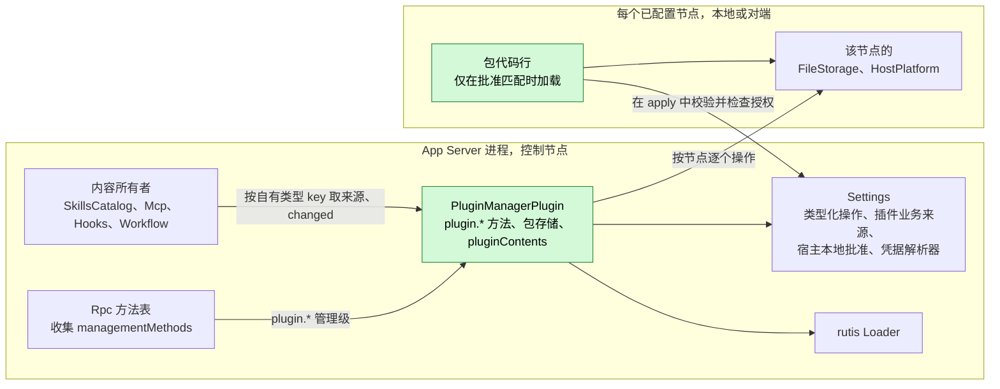
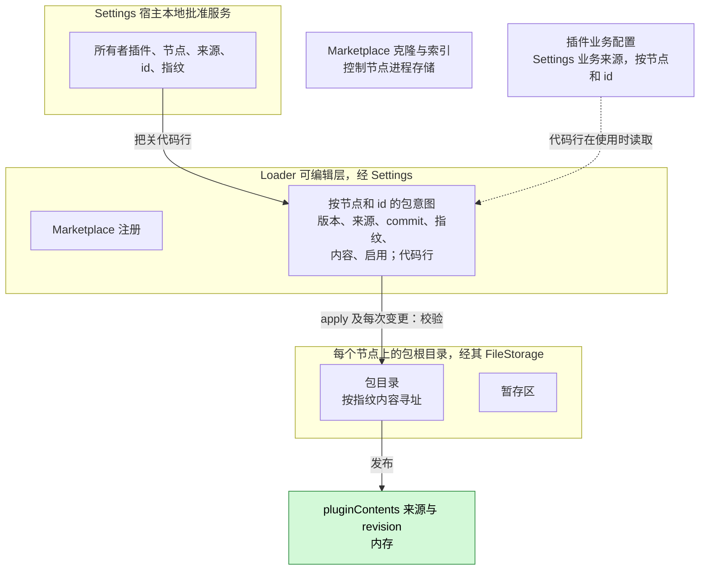
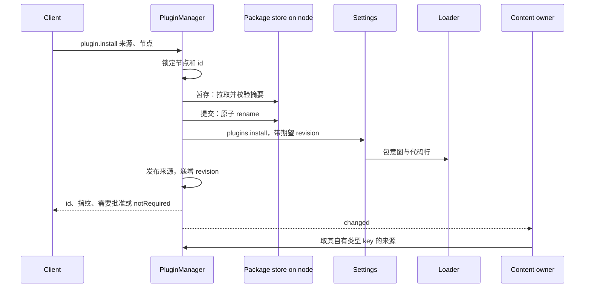
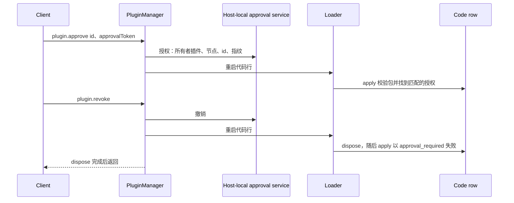
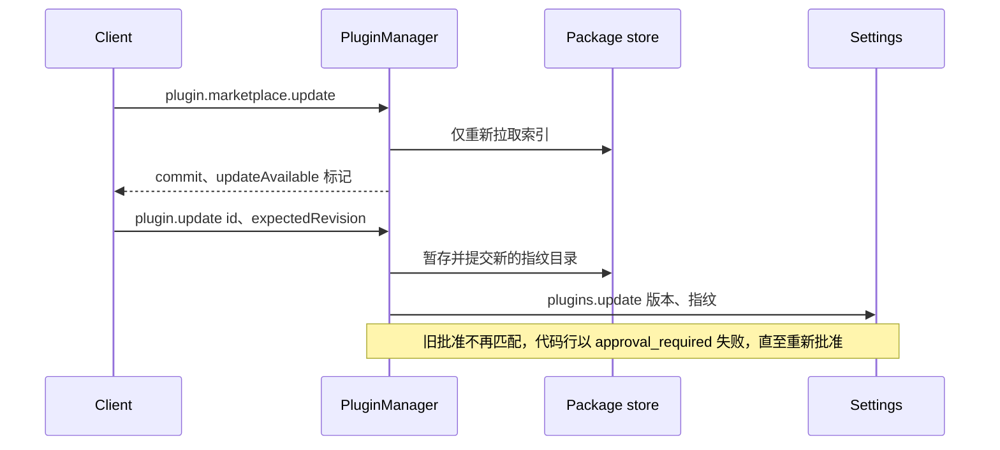
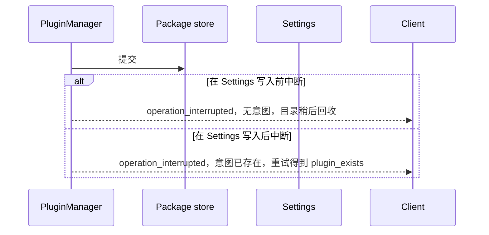

# PluginManager

状态：草案。总体设计：[overview B.12](../overview.md)，[Settings、Mcp、SkillsCatalog 变更](../overview.md)，[约定](../overview.md)，[多节点](../overview.md)，[ADR 002](../../adr/002-plugin-scope.md)。阶段：P3（依赖 [#3](https://github.com/arcships/dim/issues/3)；非 Rust Capability 插件依赖 [#4](https://github.com/arcships/dim/issues/4)；对端节点依赖 [#5](https://github.com/arcships/dim/issues/5)）。语言：Rust。

PluginManager 是一个进程插件（[ADR 002](../../adr/002-plugin-scope.md)：安装按宿主进行）。它从 Git marketplace、本地路径或 Git URL 将插件包安装到目标节点上；通过类型化的 Settings 操作将插件意图（安装、启用、节点绑定、包路径）记录到 loader 行中；将每个插件的业务配置路由到该插件的业务来源；并将已启用包的类型化内容发布为命名进程服务 `pluginContents`。内容所有者（SkillsCatalog、Mcp、Hooks、Workflow，任意语言）按名称依赖 `pluginContents`，定义各自的内容类型 key，并读取它们能理解的内容；PluginManager 对它们一无所知。包代码只有在经 Settings 宿主本地批准服务批准后才加载，批准绑定到节点和包指纹。包从不自动升级。

## 1. 结构



所有依赖都是同一作用域的进程服务（[ADR 002 D3](../../adr/002-plugin-scope.md)）。内容所有者依赖 `pluginContents`，按 D3 予以接受：安装、启用或移除包会以数据更新（`changed`）的方式改变已发布的来源，从不触发重载；而 PluginManager 重载（升级、崩溃）会重载内容所有者。Rpc 收集 PluginManager 的 `managementMethods` 服务（key `plugin`），因此 PluginManager 重载也会重载 Rpc。两者都是少见的结构性事件，其传播被记录在案，而非被阻止。包代码行是普通的 loader 行：它们提供其代码在 `provides` 中声明的命名服务（例如 `toolContribution`、`sessionMethods`、`modalityAdapter`），消费方按服务名和作用域收集它们；当某一行卸载时，其依赖方按同一规则重载。离线对端节点上的代码行不会卸载：其导入的服务保持注册并以 `node_unavailable` 使调用失败，其依赖方既不重载也不变为 Pending（对 [#5](https://github.com/arcships/dim/issues/5) 的要求）。

| 部分 | 作用域 | 依赖 | 提供 |
| --- | --- | --- | --- |
| `PluginManagerPlugin` | 进程，控制节点 | Settings（类型化操作、插件业务来源、宿主本地批准）、rutis Loader、每个已配置节点的 `FileStorage` 与 `HostPlatform` | `pluginContents` 进程服务；`managementMethods` key `plugin`（`plugin.*`），由 Rpc 收集 |
| 包代码行 | 进程，位于包所在节点 | 该节点的 `FileStorage`、宿主本地批准服务、代码所声明的依赖 | 在其 `provides` 中声明的命名服务；在使用时读取其业务配置 |
| 内容所有者 | 进程 | `pluginContents` | —（各自定义自己的类型 key） |

此处定义的契约：包清单 `dim-plugin.json` schema 2、marketplace 索引 `dim-marketplace.json`、`pluginContents` 服务及其 `ContentSource` 形态（[语言中立](../../adr/002-plugin-scope.md)，A.3；Rust 绑定见附录 G）、包目录布局、代码行批准检查、`plugin.*` 方法。依赖的契约：loader 可编辑层上的类型化 Settings 操作（#3），用于插件意图；用于每插件配置的 Settings 业务来源（[ADR 002 D4](../../adr/002-plugin-scope.md)）；Settings 宿主本地批准服务（R11）与凭据引用解析器（R10）；控制节点上的进程存储；rutis-loader `Loader`（`entries`、`reload`、`restart`、`LoaderChanged`）；包所在节点的 `FileStorage` 与 `HostPlatform`（对端节点：经 rutis 链路导入）；[方法](../contracts/session-boundary.md)契约。这些被依赖的服务是现有的类型化 Rust 服务，PluginManager 作为 Rust 插件直接使用它们；将它们按名称暴露给非 Rust 代码行是 [#4](https://github.com/arcships/dim/issues/4) 的工作。PluginManager 从不调用内容所有者，也从不在代码中写出任何内容类型 key。

## 2. 数据与状态



loader 行中的包意图是持久状态；`plugin.list` 由 loader 条目投影而来，从不来自单独的存储。已发布的来源在 `apply` 时从意图重建（校验每个已启用包），并在每次操作后原地更新，同时递增 revision。每插件业务配置不在行中：`plugin.configure` 将其写入业务来源，带 revision 与变更通知，插件在使用时读取，因此配置从不重载任何东西（D4、A16）。包字节存放在其所在节点的包根目录下，marketplace 缓存在控制节点进程存储中；批准只存在于宿主本地批准服务中。没有任何内容是 Session 事实。

## 3. 流程

### 3.1 安装与发布



纯内容包一经发布即生效；所有者在 `changed` 时自行对齐，从不接收推送。代码行在批准前保持 Pending。

### 3.2 批准、撤销与代码生命周期



代码行在自身的 `apply` 中检查完整性和匹配的授权；若无授权，则以 `approval_required` 失败并停止服务。撤销或禁用代码会卸载该行；其依赖方按 D3 重载，使用了它所提供内容的在途轮次可能失败。该代价被记录在案，而非被阻止。

### 3.3 显式更新，从不自动



marketplace 刷新只标记 `updateAvailable`；更改已安装的包始终需要显式的 `plugin.update`（决策 E22）。

## 4. 时序与冲突



安装的顺序为暂存、提交、Settings 写入；Settings revision 是提交点，因此中断从不会留下已批准或半注册的包。

| 场景 | 结果 | 负责方 |
| --- | --- | --- |
| 代码行在其提供的内容正被使用时被撤销或禁用 | 该行卸载；依赖方重载（D3）；受影响的在途轮次可能失败 | Loader、代码行 |
| 已授予批准，随后包被更新 | 新指纹不匹配；代码行以 `approval_required` 失败，直至重新批准 | 代码行 |
| 安装后节点离线 | 该节点上的操作 `node_unavailable`；其来源被撤回；其代码行的服务以 `node_unavailable` 使调用失败；不发生重载，也没有任何东西变为 Pending；其他节点不受影响 | PluginManager |
| 插件运行时 `plugin.configure` | 业务数据更新与通知；不重载；下次使用读取新值 | 插件 |
| 同一 id 的两次安装 | 第二次等待锁，然后 `plugin_exists` | PluginManager |
| 分支使用某包的 Skill 时该包被禁用 | 分支保留其已采纳的提示词，直至重新采纳 | Skills 所有者 |
| PluginManager 重载 | 内容所有者与 Rpc 随之重载（D3）；在途的 install/remove `operation_interrupted` | PluginManager |

完整表格：[附录 B](#附录-b-完整冲突表)。

## 5. 上下文映射

无直接的模型可见效果。PluginManager 不写输入，不提供工具，也不注册提示词来源。包内容只通过其所有者、以该所有者的形式到达模型：Skills 通过 Skill 提示词来源（按分支采纳，压缩后作为配置重放，子分支从已采纳前缀继承），MCP 与代码行工具通过工具声明和 `ToolResult.content`，Hooks 输出通过 Session 输入。非交互 Session 的差异仅由所有者定义。模型从不看到包 id、指纹、批准、marketplace 数据、配置或诊断。

## 6. 接口（摘要）

| 接口 | 类型 | 用途 |
| --- | --- | --- |
| `plugin.marketplace.list/add/remove/update/search/view` | 方法，管理级 | Marketplace；`update` 仅刷新索引 |
| `plugin.install/update/list/set_enabled/configure/reload/approve/revoke/remove` | 方法，管理级 | 包生命周期 |
| `pluginContents`（`sources`、`changed`） | 进程服务，无 key | 通用内容发布 |
| 代码行批准检查 | Loader 行规则 | 代码行仅在授权匹配时加载 |
| `dim-plugin.json` v2、`dim-marketplace.json` v1 | 文件格式 | 包与 marketplace 描述 |
| 类型化 Settings 操作 `plugins.*`、`marketplaces.*` | 依赖（#3、ADR 002 D4） | 持久化意图；路由业务配置 |
| CLI | `/plugins`、`/plugin`、`/reload-plugins`、`dimcode plugin …` | 用户入口 |

详见：[附录 A](#附录-a-接口细节)。

## 7. 安全

安装、批准和移除是管理级方法，只由为该级别配置的入口提供（[方法](../contracts/session-boundary.md)）；RemoteGateway 从不提供它们。包代码一旦加载即为受信任的原生进程代码（AGENTS 规则 11），因此加载需要对该节点上确切指纹的宿主本地批准；重放、fork、FullAccess、项目文件以及安装本身都从不授予批准。Git 拉取不运行任何仓库 hooks 或子模块；安装时从不执行包文件；每次加载都重新检查完整性。内容所有者对其解释执行的可执行内容（Hooks、MCP、workflows）施加各自的宿主本地批准。插件业务配置只保存凭据引用，由插件通过 Settings 凭据解析器解析；解析后的秘密从不进入行、业务来源、`plugin.list`、诊断或内容来源。代码贡献管理级方法的包只有在批准后才扩展宿主管理面。

## 附录 A. 接口细节

### A.1 包清单 `dim-plugin.json`（schema 2）

版本 1 是现有的托管提供方清单（[App Server 契约](../../../../crates/dim-app-server/README.md#optional-managed-provider)）；它保留给 `--plugin-dir` 使用，在此不可安装（A3）。

```json
{
  "schemaVersion": 2,
  "id": "acme-review",
  "version": "1.2.0",
  "name": "Acme review kit",
  "description": "Review Skills and hooks",
  "files": {"skills/review/SKILL.md": "<sha256>", "dist/index.js": "<sha256>"},
  "contents": [
    {"type": "skills", "path": "skills"},
    {"type": "hooks", "path": "hooks/hooks.json"}
  ],
  "code": [
    {"runtime": "node", "entry": "dist/index.js", "hostApiVersion": 2, "rutisVersion": "0.10.0"}
  ]
}
```

| 字段 | 规则（在安装边界校验一次） |
| --- | --- |
| `id` | `[a-z][a-z0-9-]{0,63}`；每节点唯一（A4） |
| `version` | SemVer；仅用于显示和比较 `updateAvailable` |
| `files` | 除 `dim-plugin.json` 和 `.git/` 外的所有文件；相对 POSIX 路径，不含 `..`，无符号链接；未列出的文件或摘要不匹配即拒绝 |
| `contents` | 不透明的 `type` `[a-z][a-z0-9-]*`（key 由其消费方定义：`skills`、`hooks`、`mcp`、`workflows`，R14），包内的 `path`，可选 `options` ≤ 64 KiB；只校验这一形状 |
| `code` | 可选；`runtime: "node"` 将 `entry` 作为 rutis 运行时行加载；检查 `hostApiVersion`/`rutisVersion`；其他运行时在 #4 之前被拒绝（A1） |
| 指纹 | 所存清单字节的 SHA-256；清单列出了每个文件的摘要，因此它绑定全部包字节。这是 PluginManager 向宿主本地批准服务（R11）声明的规范可执行内容 |

### A.2 Marketplace 索引 `dim-marketplace.json`（A5）

位于仓库根目录：`{schemaVersion: 1, name, plugins: [{id, version, description, keywords?, source: {path} | {git, ref?}, fingerprint?}]}`。`source.path` 位于 marketplace 仓库内；`fingerprint` 若存在，必须等于所拉取包的指纹。

### A.3 `pluginContents`

服务 `pluginContents`，作用域为进程，无 key，由 PluginManagerPlugin 提供；内容所有者按名称依赖它。错误是数据 `{ code, message }`。

| 方法 | 类型 | 请求 | 回复 |
| --- | --- | --- | --- |
| `sources` | 同步 | `{ type }` | `{ revision, sources: ContentSource[] }`：可用节点上已启用且通过完整性校验的包 |
| `changed` | 异步 | `{ after_revision }` | 一旦已发布的 revision 超过 `after_revision` 即返回 `{ revision }`；消费方通过丢弃该调用来取消 |

`ContentSource`：

| 字段 | 类型 | 含义 |
| --- | --- | --- |
| `package` | string | 包 id |
| `version` | string | 包版本 |
| `fingerprint` | string | 消费方将各自的批准绑定到它 |
| `node` | string 或 null | null = 控制节点 |
| `root` | string | `node` 上的包目录 |
| `path` | string | 声明的路径，相对于 `root` |
| `options` | object | 来自清单 |

消费方拥有自己的类型 key 与格式，通过对 `node` 有效的服务读取文件，并将其自身的宿主本地批准绑定到 `node + package + fingerprint`（[overview 约定](../overview.md)）。节点规则（A6）：节点 N 上的来源是节点 N 的内容。针对 Session 执行内容的消费方（例如 Hooks）只使用节点等于该 Session 资源节点（`SessionConfig.resource_node`）的来源；只在控制节点上读取内容的消费方忽略它无法触达的来源，并在自己的目录中报告它们。

### A.4 包存储

PluginManager 内部组件，不是服务：`stage`（拉取、校验）、`commit`（原子 rename）、`verify`（重新哈希）、`remove`、`fetch_marketplace`，每项都针对目标节点的 `FileStorage` 与 `HostPlatform` 运行；来源是本地路径，或带可选引用的 Git URL。未配置或其服务不可用的节点会使操作以 `node_unavailable` 失败。

包存放在其所在节点上 PluginManager 的包根目录下，通过该节点的 `FileStorage` 写入（A13）。Git 通过该节点的 `HostPlatform` 运行，禁用 hooks 和子模块，仅限 `https://` 和 `ssh://`（A7）。本地路径被复制，从不被引用（A8）。目录按指纹内容寻址，因此更新从不改写运行中行正在使用的文件。

### A.5 方法（`managementMethods`，key `plugin`，管理级）

| 方法 | 参数 | 结果 | 中断 |
| --- | --- | --- | --- |
| `plugin.marketplace.list` | `{}` | `[{name, url, ref, commit, fetchedAt, error?}]` | Drain |
| `plugin.marketplace.add` | `{name, url, ref?}` | `{commit}` | Report |
| `plugin.marketplace.remove` | `{name}` | `{}` | Report |
| `plugin.marketplace.update` | `{name?}` | `[{name, commit, error?}]`；仅刷新索引 | Report |
| `plugin.marketplace.search` | `{query, marketplace?}` | `[{marketplace, id, version, description, installed: [{node, version}]}]` | Drain |
| `plugin.marketplace.view` | `{marketplace, id}` | 条目加清单摘要（`contents` 类型、是否有 `code`） | Drain |
| `plugin.install` | `{source: {marketplace, id} \| {path} \| {git, ref?}, node?, enabled?}` | `{id, version, node, fingerprint, approval, approvalToken?}` | Report |
| `plugin.update` | `{id, node?, version?, expectedRevision}` | `{version, fingerprint, approval}` | Report |
| `plugin.list` | `{node?}` | `[{id, version, node, enabled, status, approval, approvalToken?, contents, source, updateAvailable, error?}]` | Drain |
| `plugin.set_enabled` | `{id, node?, enabled, expectedRevision}` | `{}` | Report |
| `plugin.configure` | `{id, node?, configuration, expectedRevision}`；`expectedRevision` 指插件业务配置的 revision | `{}` | Report |
| `plugin.reload` | `{id?, node?}` | `[{id, node, status, error?}]` | Report |
| `plugin.approve` | `{id, node?, approvalToken}` | `{}` | Report |
| `plugin.revoke` | `{id, node?}` | 代码行 dispose 后返回 `{}` | Report |
| `plugin.remove` | `{id, node?}` | `{cleanupError?}` | Report |

`status`：`active`、`pending`（等待批准或运行时）、`unavailable`（节点离线；其服务使调用失败）、`failed`（原因）、`disabled`。`approval`：`notRequired`、`required`、`approved`；`approvalToken` 即指纹（一个摘要，而非凭据）。`install`、`update` 和 `marketplace.update` 通过该调用的进度接收器报告阶段（`fetch`、`verify`、`commit`）（[方法](../contracts/session-boundary.md)，A14）。相对 overview B.12 新增：`configure`、`approve`、`revoke`、`update`、`marketplace.search/view`（A9）。

### A.6 使用的类型化 Settings 操作（#3，拟议的 Settings 补充）

| 操作 | 效果 |
| --- | --- |
| `plugins.install(entry, expected_revision)` | 记录包意图，并在可编辑层创建代码行 |
| `plugins.update(id, node, version, fingerprint, expected_revision)` | 更新包意图；代码行随之变化 |
| `plugins.set_enabled(id, node, enabled, expected_revision)` | 设置包的启用标记，并对其代码行设置 `set_disabled` |
| `plugins.configure(id, node, configuration, expected_revision)` | 将插件的业务配置写入以 `<node>/<id>` 为 key 的 Settings 业务来源并发出通知；从不编辑行（A16） |
| `plugins.remove(id, node, expected_revision)` | 移除包意图及其所有代码行 |
| `marketplaces.save/remove` | Marketplace 注册 |
| 宿主本地批准服务 `grant/revoke {owner: "plugin", node, source, id, fingerprint}` | 位于 loader 与 Timeline 之外（R11） |

`reload`、`restart` 与状态查询直接调用 `Loader`。

### A.7 Capability 机制

| 步骤 | 路径 |
| --- | --- |
| Timeline | 无写入，无 Dispatcher 订阅，无 `StateCell`；复查依据是 Settings revision 与批准匹配 |
| 安装 | 锁定 `(node, id)`（A10），`stage`，与意图比较，`commit`，`plugins.install`，发布来源，回复；Settings 写入失败会留下一个未被引用的目录，稍后回收（A11） |
| 发布 | `apply` 时校验每个已启用包并构建来源；每次操作后更新来源并递增 revision；校验失败的包被撤回并报告为 `failed` |
| 代码行 | `apply` 校验完整性，并要求存在匹配节点、id 和指纹的授权，否则以 `approval_required` 失败；`approve`/`revoke`/`update` 通过 `Loader` 重启它们；业务配置在使用时读取 |
| PluginManager 重载 | 内容所有者与 Rpc 随之重载（D3）；在途的 install/remove 返回 `operation_interrupted`；代码行不受影响 |
| 进程重启 | Loader 恢复各行；包重新校验；暂存区删除；孤立目录在 loader 稳定后回收 |

## 附录 B. 完整冲突表

| 场景 | 序列顺序 | 结果 | 决策负责方 |
| --- | --- | --- | --- |
| 轮次或分支中断、分支关闭、并发输入、`input/withdraw`/`input/deleted`、未结算批次、压缩、子分支切分 | — | 对 PluginManager 无影响；适用所有者的采纳规则 | 内容所有者 |
| Session 使用某包的 Skill 时该包被禁用 | revision 递增 < 下次采纳 | 分支保留其已采纳的提示词，直至重新采纳 | Skills / PromptSourcesBranch |
| 代码行在使用中被撤销或禁用 | — | 该行卸载；其依赖方重载（D3）；受影响的在途轮次可能失败 | Loader |
| 同一节点上同一 id 的两次安装 | 锁，然后 Settings revision | 第二次 `plugin_exists`（跨进程时为 `plugin_settings_conflict`） | PluginManager、Settings |
| 两次 `configure` 调用竞争 | 业务来源 revision | 过期的 `expectedRevision` 失败；`set_enabled` 使用意图 revision，不与 `configure` 冲突 | Settings |
| 已授予批准，随后包被更新 | 新指纹 | 代码行以 `approval_required` 失败，直至重新批准 | 代码行 |
| 代码运行时撤销 | 撤销已持久化 < 重启 | 代码行在结算其工作后 dispose；dispose 后回复 | Loader、代码行 |
| 安装在提交后、Settings 写入前中断 | — | `operation_interrupted`；无意图；目录被回收 | PluginManager |
| 安装在 Settings 写入后中断 | — | `operation_interrupted`；意图已存在；重试 `plugin_exists` | 客户端读取状态 |
| 重复或迟到的 `plugin.install` | — | `plugin_exists` | PluginManager |
| Marketplace 更新发现更新的版本 | — | 仅 `updateAvailable`；不做任何改变 | PluginManager |
| 安装前目标节点不可用 | — | `node_unavailable`；不写入任何内容 | PluginManager |
| 安装后节点离线 | — | 其来源被撤回；其代码行导入的服务保持注册并以 `node_unavailable` 使调用失败；没有依赖方重载或变为 Pending（对 #5 的要求）；其他节点不受影响 | PluginManager、rutis 链路 |
| 包所在节点与 Session 的资源节点不同 | — | 执行型消费方对该 Session 忽略此来源 | 内容所有者 |
| 磁盘上的文件被修改 | 下次校验 | `integrity_failed`；来源被撤回；代码行失败 | PluginManager、代码行 |
| 操作中途 PluginManager 重载或重启 | — | 按 A.7；从不重新执行拉取 | PluginManager |
| Session 卸载/恢复 | — | 无影响 | — |
| 客户端脱离 | — | 操作继续；回复与进度被丢弃 | Rpc |

## 附录 C. 错误与恢复

| 代码（`appError`） | 含义 |
| --- | --- |
| `manifest_invalid` | 清单或索引缺失或格式错误 |
| `integrity_failed` | 摘要不匹配、未列出的文件、路径逃逸或符号链接 |
| `incompatible_host` | `hostApiVersion`/`rutisVersion` 或不支持的 `runtime` |
| `source_unavailable` | Git 拉取或路径读取失败（stderr 仅出现在诊断中） |
| `node_unavailable` | 目标节点未配置或其服务不可用 |
| `plugin_exists`、`plugin_not_found`、`marketplace_not_found` | 身份错误 |
| `plugin_settings_conflict` | 过期的 `expectedRevision` |
| `approval_stale` | `approvalToken` 与当前指纹不同 |
| `approval_required` | 代码行没有匹配的授权（行状态） |
| `runtime_unavailable` | Node 运行时未配置；代码行 Pending |
| `operation_interrupted` | 方法契约的 `Report` 规则；重试前先读取 `plugin.list` |

移除先 dispose 代码行，再删除目录；删除失败时返回 `cleanupError`，并由垃圾回收重试。

## 附录 D. 验收

通过 `plugin.*` 方法进行流程测试，使用一个本地测试 marketplace 和一个自定义类型 key 的测试消费方：

1. 添加、更新、搜索、查看 marketplace；无效索引 `manifest_invalid`；更新标记 `updateAvailable` 而不改变已安装的包。
2. 从 marketplace、路径和 Git URL 安装；被篡改、含未列出文件和指纹不匹配的包被拒绝，且不写入任何内容。
3. 纯内容包通过 `changed()` 向测试消费方发布来源而不重载它；禁用会撤回来源；移除先删除意图再删除文件；PluginManager 重载会重载测试消费方，之后它读取到相同的来源。
4. 含 Node 代码的包在 `plugin.approve` 之前以 `approval_required` 失败；`plugin.update` 需要重新批准；撤销会 dispose 代码行。
5. 撤销一个提供测试工具的代码行会重载其依赖方；测试将失败的在途轮次记录为已记录在案的结果。
6. 并发安装；过期的 `expectedRevision`；在提交后和 Settings 写入后中断。
7. 对端测试节点：安装以其为目标；使其离线时只有它的操作及其代码行的服务以 `node_unavailable` 失败，其来源被撤回，且不发生任何重载；恢复后复原。
8. 重启：各行恢复，完整性已校验，暂存区移除，孤立目录被回收。

## 附录 E. 假设

| # | 假设 | 依据 | 若被否决的影响 |
| --- | --- | --- | --- |
| A1 | 包代码是提供和消费命名服务的 Node 运行时行（rutis-bridge）；无动态 Rust 代码；按名称访问运行时的类型化服务需等待 #4 | Overview §5.12、§11.1；ADR 002 D5 | 更多 `code.runtime` 取值 |
| A2 | 代码批准使用所有者为 `plugin` 的 Settings 宿主本地批准服务 | 决策 R11；overview 约定 | 插件自有的批准文件 |
| A3 | 清单 schema 2 扩展现有格式；v1 仅用于 `--plugin-dir` | App Server README；判断 | 兼容映射 |
| A4 | 每个 `(node, id)` 只安装一个版本 | 判断 | 并存多版本 |
| A5 | Marketplace 索引的格式与名称 | 判断；功能清单“Git plugin marketplaces” | 格式被替换 |
| A6 | 来源是节点内容；执行型消费方匹配 Session 的资源节点 | Overview 多节点；判断 | 消费方经导入的服务读取对端内容 |
| A7 | Git 使用节点的 `git`，禁用 hooks/子模块，仅限 `https`/`ssh` | 判断 | 库形式的拉取器或更多协议 |
| A8 | 本地路径被复制而非链接 | 判断（完整性） | 开发用链接模式 |
| A9 | 新增方法 `configure`、`approve`、`revoke`、`update`、`marketplace.search/view` | 功能清单；overview B.12 | 并入其他方法 |
| A10 | 操作按 `(node, id)` 串行化 | 判断 | 仅依赖 Settings revision |
| A11 | 未被引用的目录在 loader 稳定后被垃圾回收 | 判断 | 显式清理命令 |
| A12 | 内容所有者依赖 `pluginContents`；PluginManager 重载会重载它们 | ADR 002 D3 | 单独托管的发布服务 |
| A13 | 包目录通过节点的 `FileStorage` 写入 PluginManager 包根目录下（该处可用原子 rename） | 判断 | 需要每节点存储服务 |
| A14 | 安装与更新报告进度阶段 | 方法契约进度接收器；判断 | 仅返回结果 |
| A15 | 无自动升级，包括纯内容包 | 决策 E22 | 可选启用的自动升级设置 |
| A16 | 每插件业务配置位于以 `<node>/<id>` 为 key 的 Settings 业务来源中，由插件在使用时读取 | ADR 002 D4；判断 | 每个插件保有自己的存储并贡献自己的 configure 方法 |

## 附录 F. 待对齐问题

| 问题 | 描述 |
| --- | --- |
| #3 类型化操作 | A.6 中的 Settings 操作在此提出；其最终形态属于 Settings 补充与 #3（仅意图；`plugins.configure` 写入业务配置，ADR 002 D4） |
| Overview SkillsCatalog 变更 | “安装与移除由 PluginManager 发起”理解为：PluginManager 发布和撤回来源，SkillsCatalog 读取它们；PluginManager 不调用 SkillsCatalog |
| 对端节点内容 | 控制节点上的消费方是否应通过导入的资源服务读取对端节点上的内容（#5） |

对 [#5](https://github.com/arcships/dim/issues/5) 的要求：从对端节点导入的服务（其 `FileStorage`、`HostPlatform` 以及在那里运行的代码行的服务）在链路断开期间保持注册，并以 `node_unavailable` 使调用失败，因此离线节点从不重载 PluginManager，也不使任何依赖方变为 Pending。

## 附录 G. Rust 绑定

Rust 内容所有者可以使用生成的绑定；A.3 中的中立形式是规范性的。

```rust
/// Binding for service `pluginContents` (process, no key).
impl PluginContents {
    pub fn sources(&self, type_key: &str) -> Vec<Arc<ContentSource>>;
    pub fn changed(&self) -> tokio::sync::watch::Receiver<u64>; // revision; maps `changed`
}
pub struct ContentSource {
    pub package: String,
    pub version: String,
    pub fingerprint: String,
    pub node: Option<String>,
    pub root: PathBuf,
    pub path: PathBuf,
    pub options: serde_json::Value,
}
```

PluginManager 将其注册在 `TypeKey::named("pluginContents")` 下；其 `plugin.*` 方法使用[方法](../contracts/session-boundary.md)契约的 `managementMethods` 绑定。
