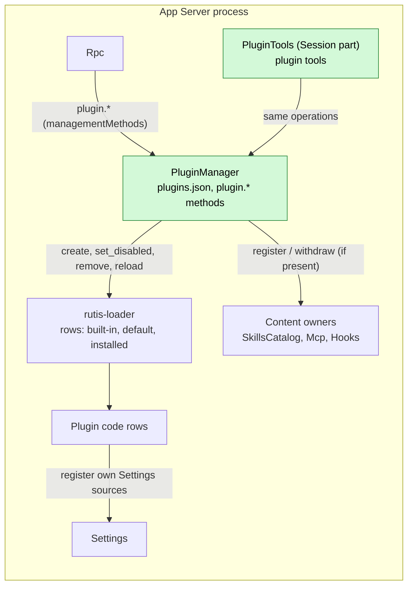

# PluginManager

状态：草案，2026-10-27 已与维护者对齐。需求：[插件管理](../../../design/plugin-management.md)（[#432](https://github.com/arcships/dim/issues/432)）。Issue：[#3](https://github.com/arcships/dim/issues/3)、[#384](https://github.com/arcships/dim/issues/384)。作用域：[ADR 002](../../adr/002-plugin-scope.md)（进程：安装按宿主进行）。语言：Rust。里程碑：§0 中标出的部分属于 M1。

PluginManager 保存一个宿主的插件配置：装了哪些插件，它们从哪里来，每个名字使用哪个插件，哪些名字被关闭。它把这份配置保存在自己的文件 `plugins.json` 中，格式是 Dim 自己的格式。它不保存运行时状态。插件是否已加载、正在运行或已失败，是 rutis 的状态，从 rutis-loader 读取。一个所有者持有什么内容（skill、MCP 服务器、hook），是该所有者的状态。PluginManager 通过向所有者下达命令来执行配置变更：插件代码交给 rutis-loader，内容交给 SkillsCatalog、Mcp 和 Hooks。每个所有者自己做决定，自己保存状态。

一个插件是一个带有清单的目录。它可以带代码（TypeScript 或 Python 写的 rutis 插件），可以带内容（skill、MCP 配置、hook），也可以两者都带。插件按**名字**识别。可以安装多个同名插件，但同一时间只使用其中一个。打开另一个，就会替换正在使用的那个。内置插件就是这样被替换的。

## 0. 实施边界

| 部分 | M1（2026-11-01） | 之后 |
| --- | --- | --- |
| `plugins.json`、默认配置文件、启动层（§2、§3.1） | 是 | |
| 从本地路径或 Git 安装、更新、移除、列出（§3.2–§3.6） | 是 | marketplace |
| 插件代码：创建、打开/关闭、替换、重新加载 loader 行（§3） | 是，TypeScript | 从目录安装的 Python 插件（附录 D） |
| `plugin.*` 管理方法和 `dimcode plugin` 命令（§6、A.1） | 是 | 变更的客户端通知 |
| 通过 Session 部件提供的 agent 工具（§6） | 是 | |
| 默认 CLI 加载默认插件（goal、web、session-title、workflow、scheduler） | 是 | |
| 每个插件在运行时自己登记 Settings 来源（§9 R1） | 是，内置插件和 TypeScript 插件一起 | |
| 内容种类：skill、MCP 配置、hook（§3、§9 R2） | skill 和 MCP，前提是它们的所有者按时落地 | hook（Hooks 属于 M2） |

M1 的验收是：用户或 agent 写一个 TypeScript 插件，从本地路径安装它，使用它的工具，修改它并重新加载它，变更不重启就生效；默认 CLI 启动时已加载默认插件。

## 1. 结构



- PluginManager 是一个进程行。它是锁定的（§2.3）：它不能被关闭，也不能被替换，因为没有东西能把它重新打开。
- 它注入 loader 句柄和 `managementMethods`。它只在内容所有者存在时读取它们（`Option<Keyed<_>>`，不是门槛）：缺少某个所有者，只跳过那一种内容。
- 它向 `partRegistry` 登记一个 Session 部件 `PluginTools`。该部件向 Session 的 `toolRegistry` 登记插件工具；每次工具调用都交给 PluginManager 的进程服务。
- 所有者从不查找插件，也从不读取 `plugins.json`。

## 2. 数据

### 2.1 插件目录及其清单

一个插件是一个根目录下有 `dim-plugin.json` 的目录。清单中出现的键说明插件带有哪些种类。

```json
{
  "name": "my-tool",
  "description": "Adds the echo tool",
  "code": {
    "entry": "index.ts",
    "inject": ["partRegistry", "settings"],
    "provides": {},
    "instanceNames": {},
    "config": {}
  },
  "skills": "skills",
  "mcp": "mcp.json",
  "hooks": "hooks.json"
}
```

| 键 | 种类 | 含义 |
| --- | --- | --- |
| `name` | — | 插件的名字，`[A-Za-z0-9_-]`，1–64 个字符。同名插件互相替换。 |
| `code` | 代码 | rutis 行的字段（[rutis 用法 §2](../rutis-usage.md#2-插件是一行实例挂载它的部件)），`id` 和 `name` 除外：`entry` 是目录内的路径；`inject`、`provides`、`instanceNames` 和 `config` 原样复制到行中。 |
| `skills` | skill | 插件内的一个目录，里面是 Skill 文档，登记到 SkillsCatalog。 |
| `mcp` | MCP | 插件内的一个文件，里面是 MCP 服务器条目，登记到 Mcp。 |
| `hooks` | hook | 插件内的一个文件，里面是一份 hooks 文档，登记到 Hooks。 |

每个路径都是相对路径，在跟随符号链接之后在目录内解析；离开目录的路径在安装时和重新加载时被拒绝（`invalid_manifest`）。清单在这个边界上解析；所有者收到的是已经读好的文档。

插件的业务配置（它的 Settings 来源）不在清单中：插件的代码在启动时向 Settings 登记自己的来源（§9 R1）。现在 TypeScript 行中的 `settings` 成员将被去掉。

仓库自己的 TypeScript 插件（`runtime/plugins/*`）用 `dim-plugin.json` 代替它们的行文件（`web.json`、`process.json`、`settings.json`、`session-title.json`）。

### 2.2 `plugins.json`

`<home>/plugins.json`，只由 PluginManager 读取和写入。它只保存配置。

```json
{
  "version": 1,
  "installed": [
    {
      "id": "my-tool",
      "name": "my-tool",
      "source": { "path": "/Users/me/src/my-tool" },
      "dir": "/Users/me/src/my-tool",
      "kinds": ["code", "skills"]
    },
    {
      "id": "hooks-plus",
      "name": "Hooks",
      "source": { "git": "https://example.com/hooks-plus.git", "ref": "main", "commit": "4f1c…" },
      "dir": "<home>/plugins/hooks-plus/4f1c…",
      "kinds": ["code", "hooks"]
    }
  ],
  "names": {
    "my-tool": { "use": "my-tool" },
    "Hooks": { "use": "hooks-plus" },
    "web": { "off": true }
  }
}
```

| 字段 | 含义 |
| --- | --- |
| `installed[].id` | 在已安装插件中唯一。默认是清单中的名字；两个已安装插件同名时，由调用方给出另一个。 |
| `installed[].name` | 安装时或上一次重新加载时清单中的名字。 |
| `installed[].source` | 本地目录用 `{path}`，原地使用，从不复制；Git 用 `{git, ref?, commit}`。 |
| `installed[].dir` | 被加载的目录：本地路径本身，或 `<home>/plugins/<id>/<commit>` 下的克隆。 |
| `installed[].kinds` | 安装时或上一次重新加载时清单带有的种类。 |
| `names.<name>.use` | 这个名字使用哪个插件：一个已安装的 id、`"builtin"` 或 `"default"`。不存在时：如果有该名字的内置插件，就用它，否则用该名字的默认插件。 |
| `names.<name>.off` | 用户关闭了这个名字时为 `true`。 |

没有条目的名字处于出厂状态：内置插件或默认插件处于打开状态。写入时先写到同一目录下的临时文件，在它自己的可写句柄上刷盘（`sync_all`，在 Windows 上也可用），然后改名覆盖 `plugins.json`。文件无法解析时，启动失败，并给出文件路径；PluginManager 从不覆盖一个它读不了的文件。格式带有版本号；未知版本使启动失败。

### 2.3 默认配置文件

随 Dim 发布，只读，用 `--defaults PATH` 交给 App Server（默认 CLI 传入其发布包中的文件；开发时使用 `runtime/default-plugins.json`）。

```json
{
  "plugins": {
    "goal": "plugins/goal",
    "web": "plugins/web",
    "session-title": "plugins/session-title",
    "workflow": "plugins/workflow",
    "scheduler": "plugins/scheduler"
  },
  "locked": ["PluginManager", "Rpc", "Transport"]
}
```

- `plugins` 把每个默认插件的名字映射到它的目录，路径相对于这个文件。默认插件和其他插件一样是一个插件目录（§2.1）。
- `locked` 列出不能关闭、也不能切换所用插件的名字。锁定名字的其他插件仍然可以安装。锁定是产品配置；PluginManager 执行它。

### 2.4 PluginManager 不保存的状态

| 状态 | 所有者 | 读取方式 |
| --- | --- | --- |
| 有哪些行，它们的状态（`Pending`、`Running`、带错误的 `Failed`、`Stopped`） | rutis-loader | `Loader::entries()`、`Loader::get(id)`、`Loader::waiting_for` |
| 有哪些内置 rutis 插件 | App Server 的装配 | `Loader::entries()` 中 `assembly` 层的行；行 id 就是插件的名字 |
| 从插件登记的 skill、MCP 服务器、hook | SkillsCatalog、Mcp、Hooks | 所有者自己的方法 |
| 插件的业务配置 | 插件的 Settings 来源 | Settings |

## 3. 流程

下面说明 PluginManager 的命令如何对应到 rutis-loader。loader 有两层。`assembly` 存放内置行。`plugins` 是可编辑层，rutis 不持久化它（`NoPersist`）；它存放默认插件和已安装插件的行，以及对内置行的 `disabled` 覆盖。默认插件或已安装插件的每一行都以插件的 id 作为行 id（默认插件的 id 就是它的名字）。

| 配置变更 | Loader 命令 |
| --- | --- |
| 打开名字 N，使用插件 P | 先关闭 N 当前使用的插件（见下），然后 `create` P 的行 |
| 关闭名字 N | 内置：`set_disabled(N, true)`。默认或已安装：`remove` 它的行 |
| 重新打开一个内置插件 | `set_disabled(N, false)` |
| 重新加载 | `Loader::reload(id)` |

rutis 允许可编辑层禁用一个内置行，但不允许修改或移除它，所以替换内置插件时，要关闭它的行，并为新插件加一行。先关闭旧插件，这样新插件不会遇到同一服务的第二个提供者。rutis 会重新加载发生变化的行的依赖方。

内容跟随同样的切换：当名字 N 不再使用 P 时，PluginManager 从每个存在的所有者那里撤回 P 的内容；当 N 开始使用 P 时，它向每个存在的所有者登记 P 的内容（§3.7）。

### 3.1 启动

1. App Server 用 home 和默认配置文件调用 PluginManager 的启动函数。该函数读取 `plugins.json` 和每个被使用插件的清单，并返回：
   - 初始的 `plugins` 层：处于打开状态的默认插件和已安装插件的行，以及每个被关闭或使用其他插件的内置名字的 `disabled: true`；
   - catalog 需要其 `instanceNames` 的名字（§4）；
   - 被关闭的内置行，App Server 把它们从变为 Active 所需的行中去掉。
2. App Server 以 `plugins` 作为可编辑层，对 `[assembly, plugins]` 进行 reconcile。被关闭的内置插件从不启动。
3. PluginManager 的行 apply，向 `managementMethods` 登记 `plugin`，向 `partRegistry` 登记 `PluginTools`，然后在激活之后，删除残留的暂存目录，以及没有任何已安装条目引用的 Git 克隆。

默认插件或已安装插件的行失败时，启动不失败；`plugin.list` 把它显示为失败，并带上 rutis 的错误。启动时不会再次登记内容：所有者保存自己的状态（§9 R2）。

### 3.2 安装

`plugin.install {source, id?, enable?}`。`enable` 默认为 `true`（[需求 2](../../../design/plugin-management.md)：已安装就意味着可用）。

1. 获取（§7）：本地路径在原地检查；Git 来源先克隆到暂存目录，检查后改名为 `<home>/plugins/<id>/<commit>`。任何失败都会删除暂存目录。
2. 读取清单。拒绝已经安装的 `id`（`plugin_exists`）。
3. 写入 `plugins.json`，加入新条目；当 `enable` 为 true 且名字未锁定时，同时写入 `names.<name>.use = id`。
4. 如果已打开：执行"打开"（§3）。回复带上行的状态，以及被所有者拒绝的内容。

安装名字已锁定的插件时，只记录它，不打开它，并在回复中说明这一点。

### 3.3 打开、关闭、切换

- `plugin.enable {name, use?}`：`use` 是一个已安装的 id、`"builtin"` 或 `"default"`；不给时，使用该名字当前的 `use`。对锁定的名字，当 `use` 改变时拒绝（`plugin_locked`）。写入 `names.<name>`（清除 `off`，设置 `use`），然后执行 §3 中的命令。
- `plugin.disable {name}`：对锁定的名字拒绝。写入 `off: true`，然后关闭该名字。

当一个内容所有者本身被打开时（例如 Hooks），PluginManager 登记每个正在使用、并带有该种类的插件的内容（§3.7）。

### 3.4 重新加载

`plugin.reload {name}` 重新加载该名字使用的插件。宿主不监视任何文件；这个调用就是表示有东西变了的信号。

1. 再次读取清单。如果名字变了，拒绝（`name_changed`）；用户用新名字重新安装它。
2. 代码：`Loader::reload(id)`。rutis 重新导入插件的入口模块（它导入的模块不会被重新导入；[需求 3](../../../design/plugin-management.md)），并开始一个新的世代；它在 Session 和分支中的部件被替换，它的依赖方被重新加载。如果清单的 `code` 字段变了，PluginManager 先移除这一行，再用新字段创建它。
3. 内容：把每种内容重新登记到存在的所有者；新文档替换旧文档。清单不再带有的种类被撤回。
4. 如果 `kinds` 变了，更新 `plugins.json` 中的 `kinds`。

使用内置 Rust 插件的名字不能重新加载（`not_reloadable`）：它需要重新构建；它可以被替换（§3.3）。

### 3.5 更新

Git 插件使用 `plugin.update {id, ref?}`：像 §3.2 那样获取新 commit，检查后放入一个新目录，写入新的 `commit` 和 `dir`，然后，如果插件正在使用，就在新目录上执行一次重新加载（它的行会被重新创建，因为入口路径变了）。旧目录在之后删除。本地路径插件没有可更新的东西（`not_updatable`）；重新加载它即可。是否要求用户确认更新，是客户端的事。

### 3.6 移除和列出

- `plugin.remove {id}`：如果有名字使用它，先关闭该名字（如果存在内置插件或默认插件，就回到它，否则什么都不用）。从 `plugins.json` 中移除条目，然后删除它的 Git 目录。本地目录从不删除。内置插件和默认插件不能移除（`not_removable`）；它们可以被关闭。
- `plugin.list {}`：每个名字一项，由 `plugins.json`、默认配置文件和 `assembly` 行构建，列出每个候选者以及正在使用的那一个；状态在调用时从 `Loader::get` 读取。

### 3.7 内容登记

对于 P 带有的每种内容和每个存在的所有者，PluginManager 调用该所有者的 `register({plugin, dir, document})`；撤回时调用 `withdraw({plugin})`，其中 `plugin` 是插件的名字。所有者把登记的内容作为自己的状态保存，持久化它，并在自己重新加载后恢复它。PluginManager 不监视所有者，也不代替它们再次登记任何东西。PluginManager 要调用某个所有者而它不存在时，跳过它；回复中列出被跳过的种类。当 PluginManager 打开该所有者的名字时，它登记该种类的全部内容。

## 4. 时序与冲突

- PluginManager 在内存表上一步完成对 `plugins.json` 的修改，然后写文件，然后向 loader 和所有者下达命令。针对同一个 id 或名字的第二个操作能看到第一个操作的变更（`plugin_exists`，或者它在新状态上执行）。rutis-loader 一次执行一个自己的操作。
- rutis 或某个所有者拒绝的命令，不改变已写入的配置；该项在 `plugin.list` 中显示这次拒绝（例如，新插件失败，因为另一个不同名的插件提供了同一服务）。
- `instanceNames`：rutis 需要在运行时启动之前，在 catalog 中拿到插件的部件在 Session 和分支中提供的名字（[rutis 用法 §2](../rutis-usage.md#2-插件是一行实例挂载它的部件)）。安装、切换或重新加载到一个 `instanceNames` 不在运行中 catalog 内的插件时，记录变更并回复 `restart_required`；该行在下次启动时创建。只登记工具、方法或提示来源的插件没有这个限制。
- 正在使用时的重新加载或替换：旧世代卸载，rutis 取消它正在运行的调用，使用它的进行中轮次可能失败（[ADR 002](../../adr/002-plugin-scope.md) 的后果）。这一点写入文档，不加以阻止。

## 5. 上下文映射

PluginManager 不向模型上下文加入任何东西。插件的工具和提示来源通过它们自己的登记到达模型（[ADR 006 D4](../../adr/006-plugin-contract.md)）。插件工具的工具结果说明变更了什么、状态是什么，以及适用时的 `restart_required`。

## 6. 接口（摘要）

- 管理方法，命名空间 `plugin`（A.1）：`list`、`install`、`enable`、`disable`、`reload`、`update`、`remove`。
- CLI：`dimcode plugin list | install <path|git-url> [--ref R] [--id ID] [--no-enable] | enable <name> [--use ID|builtin|default] | disable <name> | reload <name> | update <id> | remove <id>`。
- 来自 `PluginTools` 的 agent 工具：`plugin_list`、`plugin_install`、`plugin_enable`、`plugin_disable`、`plugin_reload`、`plugin_update`、`plugin_remove`，参数相同。它们是工具调用：Permission 像平常一样对每一个做决定（[需求 5](../../../design/plugin-management.md)、[ADR 003](../../adr/003-approval-scope.md)）。
- PluginManager 调用的所有者操作：SkillsCatalog、Mcp 和 Hooks 上的 `register` / `withdraw`（§9 R2）。

## 7. 安全

安装和打开是通过管理方法或工具调用完成的宿主配置；已启用的插件代码运行时不需要宿主本地审批（[ADR 003](../../adr/003-approval-scope.md)）。PluginManager 不增加作用域、审批或信任步骤（[需求](../../../design/plugin-management.md)）。它守护的是获取过程本身：

- Git 来源只接受 `https://` 或 `ssh://` URL；其他协议（`file://`、`ext::`、scp 风格的路径）以及以 `-` 开头的参数，在 Git 运行之前就被拒绝。克隆时关闭子模块（`--no-recurse-submodules`），关闭 hook（`core.hooksPath` 设为一个空目录），设置 `protocol.file.allow=never`，并且不弹出终端提示。
- 克隆先放到 `<home>/plugins/.staging/<random>`，只有在清单和路径检查通过后才改名放到正式位置。失败时删除暂存目录；启动时删除残留目录以及没有条目引用的克隆。
- 清单中的任何路径在跟随符号链接之后都不能离开插件目录；Git 克隆内指向克隆外部的符号链接被拒绝。
- `plugins.json` 以原子方式写入（§2.2）。

## 8. 规则检查

PluginManager 不是 Capability：它没有 Timeline 状态，不写 Timeline 事件，也没有分支部件。

| 规则 | 本文档如何遵守 |
| --- | --- |
| Principles §4 规则 1（对他人状态使用命令） | Loader 行是 rutis 的状态，内容是其所有者的状态；PluginManager 只向它们下达命令，并在被请求时读取它们的状态。 |
| Principles §4 规则 2（交接） | 不适用：没有输入交接或 Timeline 交接。 |
| Principles §4 规则 3（只有 before 回调） | 没有写入之前的干预。 |
| Principles §4 规则 4（核心中没有业务含义） | 所有者的 `register`/`withdraw` 操作和 Settings 登记（§9）不带插件管理的含义；任何调用方都可以使用它们。 |
| Principles §4 规则 5（批次） | 不适用。 |
| Principles §4 规则 6（上下文来自已交接的事件） | 除工具结果外，没有东西进入模型上下文（§5）。 |
| Principles §4 规则 7（只用公开事件和服务） | rutis-loader 的公开 `Loader` API、`managementMethods`、`partRegistry`、`toolRegistry` 以及所有者的公开服务。 |
| Principles §4 规则 8（向机制所有者提出需求） | §9：Settings、SkillsCatalog、Mcp 和 Hooks；没有向 rutis 提出的需求。 |
| Principles §4 规则 9（只保存之后的决定会用到的事实） | 配置保存在 `plugins.json` 中，这是唯一的记录；运行时状态从其所有者读取。 |
| Principles §1（Capability 与 App Server 的边界） | App Server 的一个进程插件；不是 Capability。 |
| ADR 002 D1（作用域跟随状态） | 进程：安装按宿主进行。`PluginTools` 是 Session 部件，只是因为工具按 Session 登记。 |
| ADR 002 D2（没有接线模块） | 没有接线：通过所有者的登记操作调用它们。 |
| ADR 002 D3（依赖跟随作用域） | 只有进程依赖；所有者是可选读取，所以它们重新加载时不会重新加载 PluginManager。 |
| ADR 002 D4（结构配置与业务配置） | 结构配置（已安装、使用中、已关闭）在 `plugins.json` 中；业务配置留在每个插件的 Settings 来源中，由插件自己登记。 |
| ADR 002 D5（语言中立的契约） | 方法和所有者操作都是 JSON 契约。 |
| ADR 006 D3（一个 rutis 插件是一行） | 每个带代码的插件是一个进程行，由 PluginManager 的命令创建、关闭和重新加载；内容不是行。 |

## 9. 向机制所有者提出的需求

没有向 rutis 提出的需求：用到的每个 loader 操作在 rutis-loader 0.17.1 中都已存在。

**R1. Settings：在运行时登记来源（M1）。**

| 项 | 内容 |
| --- | --- |
| 阻塞点 | Settings 来源在 App Server 构建 Settings 时就固定了：内置 Rust 所有者在代码中列出（`.reserve::<T>()`），TypeScript 行的 `settings` 成员在启动时读取（`.declare()`）。在运行时安装、替换或移除的插件无法添加或撤回它的来源。 |
| 已考虑的现有机制 | 由 PluginManager 从清单登记来源（业务配置不属于插件管理，ADR 002 D4）；每次安装都重启（违反需求 3）。 |
| 通用能力 | 在具名 `settings` 服务上提供 `settings.register(declaration)`，声明内容与现在的 `settings` 成员相同（`source`、`userFile`、`projectFile?`、`schema`、`userOnly`）。登记属于调用方，在调用方卸载时撤回；同一来源名的第二次登记失败。每个所有者，不论是内置 Rust 还是 TypeScript，都在自己的 `apply` 中登记来源。不论来源是否已登记，存储的文档都留在 home 中。硬编码的 `.reserve::<T>()` 和 `.declare()` 路径被移除。 |
| 对 sequence、批次、中断、重新加载的影响 | 对 Timeline 没有影响。重新加载时由新世代再次登记。 |
| 所有者与 issue | Settings（App Server）；将随 #384 提交。 |

**R2. SkillsCatalog、Mcp、Hooks：登记插件内容并保存它（SkillsCatalog 和 Mcp 若按时落地则为 M1；Hooks 为 M2）。**

| 项 | 内容 |
| --- | --- |
| 阻塞点 | 所有者只读取用户来源和项目来源；没有办法把插件的内容交给它们。 |
| 已考虑的现有机制 | 由所有者读取一个 `pluginContents` 服务（所有者会去查找插件；已否决）；把内容作为 loader 行（Dim 的产品状态放进 rutis；已否决）。 |
| 通用能力 | 一个进程操作 `register({plugin, dir, document})`，用于添加或替换 `plugin` 的内容，以及 `withdraw({plugin})`。所有者把登记的内容作为自己的状态保存，在自己的存储中持久化，并在自己重新加载后恢复它。Mcp 用 `plugin` 作为服务器 id 的前缀；Hooks 把来源命名为 `plugin:<plugin>`，并给命令设置 `DIM_PLUGIN_ROOT = dir`；SkillsCatalog 读取 `dir` 下的 Skill。 |
| 对 sequence、批次、中断、重新加载的影响 | 与每个所有者现有的来源相同：一次变更是一次数据更新，由所有者用自己的方式通告。 |
| 所有者与 issue | SkillsCatalog、Mcp、Hooks（[Hooks](Hooks.md)）。 |

## 附录 A. 接口细节

### A.1 方法（`managementMethods`，命名空间 `plugin`）

| 方法 | 参数 | 结果 |
| --- | --- | --- |
| `plugin.list` | `{}` | `[{name, use, off, locked, candidates: [{id \| "builtin" \| "default", source?, kinds}], status?, error?, waitingFor?}]` |
| `plugin.install` | `{source: {path} \| {git, ref?}, id?, enable?}` | `{id, name, enabled, status?, skipped?: [kind], restartRequired?}` |
| `plugin.enable` | `{name, use?}` | `{status?, skipped?, restartRequired?}` |
| `plugin.disable` | `{name}` | `{}` |
| `plugin.reload` | `{name}` | `{status?, skipped?, restartRequired?}` |
| `plugin.update` | `{id, ref?}` | `{commit, status?, restartRequired?}` |
| `plugin.remove` | `{id}` | `{}` |

对带代码的插件，`status` 是该行的 loader 状态（`pending`、`running`、`failed`、`stopped`）。`install` 和 `update` 通过调用的进度接收端报告阶段 `fetch`、`check` 和 `load`。

### A.2 错误

`plugin_exists`、`plugin_not_found`、`plugin_locked`、`not_removable`、`not_reloadable`、`not_updatable`、`name_changed`、`invalid_manifest`（带字段和原因）、`invalid_source`（协议或参数被拒绝）、`acquire_failed`（Git 的消息）、`record_unreadable`（启动时）。配置写入之后 loader 或所有者的拒绝不是这次调用的错误：它在结果和 `plugin.list` 中报告。

## 附录 B. 冲突表

| 场景 | 结果 | 由谁决定 |
| --- | --- | --- |
| 同一个 id 安装两次 | 第二次看到第一次的条目：`plugin_exists` | PluginManager |
| 不同名的插件提供一个已有提供者的服务 | rutis 使新行失败；`plugin.list` 显示错误 | rutis |
| 替换一个被其他插件依赖的内置插件 | 内置行关闭，新行启动；rutis 重新加载依赖方 | rutis |
| Session 正在使用插件的工具时重新加载 | 旧世代卸载，调用被取消，新部件被挂载 | rutis、实例的挂载方 |
| 安装时内容所有者不存在 | 跳过该种类并报告；PluginManager 打开该所有者时登记 | PluginManager、所有者 |
| 内容所有者重新加载 | 它恢复自己已登记的内容 | 所有者 |
| `instanceNames` 不在运行中的 catalog 内 | 记录配置，`restart_required`；该行在下次启动时创建 | PluginManager |
| Git 安装过程中进程停止 | 下次启动时删除暂存目录；`plugins.json` 未被写入 | PluginManager |
| `plugins.json` 写入之后、loader 命令之前进程停止 | 下次启动时根据 `plugins.json` 构建行 | PluginManager 启动 |

## 附录 C. 验收（M1）

1. 使用隔离的 home，`dimcode` 启动时已加载 goal、web、session-title、workflow 和 scheduler；`dimcode plugin list` 显示它们和内置插件。
2. `dimcode plugin install ./my-tool`（一个登记一个工具的 TypeScript 插件）使该工具在新的轮次中对模型可见，不需要重启。
3. 编辑 `index.ts` 并运行 `dimcode plugin reload my-tool`，会改变该工具在已打开 Session 中的行为。
4. agent 通过自己的工具完成步骤 2–3，每次调用都由 Permission 决定。
5. `dimcode plugin disable web` 移除 web 的工具；`enable web` 把它们恢复；该状态在重启后保留。
6. 安装一个与内置插件同名的插件并启用它，会替换该内置插件；`enable <name> --use builtin` 切换回去。
7. `disable PluginManager` 被拒绝，错误为 `plugin_locked`。
8. 使用 `file://` URL 的 Git 安装被拒绝；失败的克隆不会在 `<home>/plugins` 下留下任何东西。
9. 默认插件的 Settings 来源在它启动时出现，在它被关闭时消失。

## 附录 D. 待对齐问题

- 从目录安装的 Python 插件：现在一个 Python 行指定一个模块（`py:<module>`），从一个配置好的项目目录导入。从插件目录加载模块，需要在 Python 运行时设置中做出决定；放在 M1 之后。
- 发布包如何附带默认插件和 TypeScript 运行时，以及如何找到 `node`，是 M1 的发布打包事项，随 #384 跟踪。
