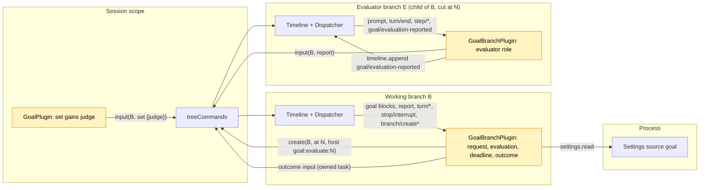

# Pursuit

状态：草案，Ready 候选（[#146](https://github.com/arcships/dim/issues/146)，里程碑 M2；进入 Ready 还差什么见 [§17](#17-进入-ready-还差什么)）。作用域：对 [Goal](Goal.md) 的 Session 部分与分支部分的修订，不新增 Capability（[ADR 002](../../adr/002-plugin-scope.md)）。语言：TypeScript，放在 Goal 的包 `runtime/plugins/goal` 里（[Goal §10](Goal.md#10-实现)）。依赖：Goal（P5，已由 [#199](https://github.com/arcships/dim/pull/199) 实现，[#69](https://github.com/arcships/dim/issues/69) 已关闭）、C5 及其分支 `timeline` 导出（[分支 TypeScript 绑定](../../../design/branch-typescript.md)，#260）、S8b（[settings 服务](../appserver/settings-service.md)）。都已交付；不阻塞的限制见 [§12](#12-依赖)。里程碑 M2，不在当前计划内（[路线图](../../../design/roadmap.md) D3）。

需求（[功能列表](../../../feature-list.md)，Agent 行为）：朝明确的目标持续工作，记录完成或受阻，**并且由评审者而不是干活的模型判断是否完成**。

决策 A3（[#44](https://github.com/arcships/dim/issues/44)，路线图 D3）先做 Goal，Pursuit 暂缓；本文档取代实验性设计（#17）。**Pursuit 是 Goal 的一种裁判模式。** 以 `judge: "evaluator"` 设置的目标和其他 Goal 目标运行方式完全相同：回合之间的续跑一样，续跑文本、预算、中断、暂停和上限都是 Goal 的。Pursuit 只改变一个点：**Goal 本来会因为干活的模型报告完成而停下的地方，改为运行一轮评审。** 评审裁判下，干活模型的 `goal_update completed` 是一次核实请求，不是状态；目标保持 active。Goal 创建一个**评审分支**，即在请求所在回合的 `turn/end` 处切出的工作分支子分支；它核对事实，以三种结果之一结束回合：`DONE`（目标由评审者判定完成）、带至少仍缺少的事项及证据的 `CONTINUE`（Goal 续跑干活的模型，计为一次续跑），或带只有用户能提供的东西的 `BLOCKED`。这种目标只有评审者能判定完成。干活模型的 `goal_update blocked` 仍然直接生效，因为它需要用户处理；达到上限、中断和用户暂停都不会启动评审。

Goal 的分支部分在每个分支上运行，评审分支也不例外。在评审分支上，它读取本分支的最终回复，按 id 向工作分支写一条**报告**输入，这是唯一的跨分支途径（[分支 TypeScript 绑定](../../../design/branch-typescript.md#subscription-rebuild-and-recovery) 第 6 条）。工作分支上的 Goal 是目标的所有者，它确认报告回应的是仍然打开的评审，然后写入结果。

## 1. 关键决策

| # | 决策 | 原因 |
| --- | --- | --- |
| P1 | Pursuit 是 Goal 的裁判模式，不是独立插件 | 续跑只有一个所有者；独立插件会和 Goal 在同一个 `turn/end` 上竞争，或者要读 Goal 的状态（§4 规则 7） |
| P2 | 裁判由 `set` 按目标选择，记在 `set` 块上 | 裁判是用户对这个目标的意图，属于 Timeline 事实；用 Settings 开关会悄悄改变正在运行的目标 |
| P3 | 只在 Goal 会因完成报告而停下的地方评审 | 回合之间的续跑归 Goal，保持不变；评审只替换那次停止 |
| P4 | 评审裁判下 `goal_update completed` 是请求，状态保持 `active` | 只有评审者能判定完成。不需要中间状态（声明、待定、重新打开）：请求、评审及其结果都是工作分支上的事实 |
| P5 | 评审者是在请求所在回合的 `turn/end` 处切出的子分支 | 它能看到做了什么、为什么做（并复用共享前缀的提示缓存），在同一策略下运行，是用 `treeCommands.create` 创建的普通 TimelineTree 分支 |
| P6 | 评审分支通过输入报告，工作分支做决定 | 没有分支读取另一个分支；跨分支通信就是按 id 写输入。调用方写，所有者决定：评审者陈述结果，工作分支上的 Goal 写入结局 |
| P7 | `CONTINUE` 是一次 Goal 续跑，把评审者的清单作为可能不完整的清单交给干活的模型 | 评审者指出至少还缺什么；其余由干活的模型自己判断。预算是 Goal 的 `maxContinuations` |
| P8 | 评审从不重跑；没有产生报告的评审由截止时间了结 | [总体设计约束 4](../overview.md#62-约束)。截止时间由 `branch/create` 推出，经得起重载和重启，不需要观察评审分支 |

## 2. 用户流程

```
 user: session.goal.set {objective: "make the CLI tests pass", judge: "evaluator"}
   └─ goal active ─▶ turn ─▶ continuation ─▶ turn ...        (Goal, unchanged)
 model: goal_update completed "all tests pass"              (request; status stays active)
 turn/end N ─▶ Goal(B): request in this turn ─▶ treeCommands.create(B, at N, goal:evaluate:N)
                                                   evaluator E checks, replies
                                                   "... \n CONTINUE: 2 tests still fail: ..."
               Goal(E): report input to B
 Goal(B): report answers the open evaluation N
   ├─ DONE     → status completed (by evaluator)
   ├─ CONTINUE → continuation (count + 1): "the list may be incomplete; assess, continue,
   │             report completed again when done"           ─▶ next turn
   ├─ BLOCKED  → status blocked (by evaluator)
   └─ failed / no report by the deadline → paused (evaluation_failed)
 user: Esc on B during the evaluation ─▶ Goal's interrupt pause; E's late report is ignored
```

客户端从工作分支的事件中读取全部信息（[Goal A.3](Goal.md#a3-读取目标)）：`set` 块上的裁判、请求（干活模型的 `completed` 块）、评审（操作为 `goal:evaluate:<N>` 的 `branch/create`）、报告和结局：

```
 goal ▸ active · 3/20                        (worker running)
 goal ▸ active · evaluating · branch 7f3c…   (open evaluation)
 goal ▸ completed ✓ by evaluator · "all tests pass"
```

CLI 目前没有 `/goal` 命令；`/pursue <objective>` 随它们加入，即带 `judge: "evaluator"` 的 `/goal`（§16）。

## 3. 结构



| 部分 | 变化 |
| --- | --- |
| `GoalPlugin`（Session，`session.ts`） | `session.goal.set` 接受 `judge?: "model" \| "evaluator"`（默认 `model`），在 `set` 目标块上标记 `judge="evaluator"`。`goal_update completed` 块的文本改为与裁判无关（§9）。仍然不读折叠 |
| `GoalBranchPlugin`（分支，`branch.ts`） | 新增注入 `timeline`（#260），Dispatcher key 新增 `branch/create`、`branch/create-failed` 和 `goal/evaluation-reported`。折叠裁判、请求和评审（§4）；在工作分支上做 §5 的决定，在评审分支上承担评审角色 |
| 共享折叠与文本（`goal.ts`） | §4 的字段、干活模型 `completed` 块随裁判而定的含义、新标记（§9） |
| Settings 源 `goal`（`settings.json`） | 新字段 `evaluationTimeoutSeconds`（§6） |

评审分支不是 Goal 的部件。TimelineTree 以 `source: host` 创建它；它的第一条输入是作为普通 Queue 文本的提示词（[TimelineTree `first_input`](../../../../crates/dim-agent-capabilities/src/timeline_tree.rs)）。那里的 Goal 没有属于自己的目标（折叠只用本地事件），并像在任何子分支上一样写入起始 `clear`（[Goal §3.4](Goal.md#34-新分支清除继承的目标)），所以它不会续跑。

## 4. 数据与状态

Pursuit 新增一个扩展事件 `goal/evaluation-reported`，只由评审分支上的 Goal 写入（§5.3）。其余都是 Goal 的 `input/message` 块和 TimelineTree 的事实。

### 4.1 工作分支

在 Goal 的折叠（[Goal §2](Goal.md#2-数据与状态)）上新增，作用于分支的本地事件：

| 字段 | 推导 |
| --- | --- |
| `judge` | 如果当前生效的 `goal:objective` 块来自标记 `judge="evaluator"` 的 `set`，或来自这样一个 `set` 之后的 `edit`，则为 `evaluator`；否则为 `model`。要换裁判就重新 `set` |
| 干活模型的 `completed` 块 | 模型裁判下：状态 `completed`，同 Goal。评审裁判下：**状态不变**，它是一次请求 |
| `request(N)` | 评审裁判下，以 `N` 结束的回合（上一个 `turn/end` 与 `N` 之间）包含干活模型的 `completed` 块 |
| `evaluation(N)` | 第一个来源为 `host`、`operation_id` 为 `goal:evaluate:N` 的本地 `branch/create`；其 `branch` 是评审分支 id `E`，`create_at` 是开始时间。它标记 `N` 已决定 |
| `open(N)` | `evaluation(N)` 存在，不存在标记 `evaluation="N"` 的 Goal 结局，并且 `N` 之后没有带 key 的目标块（`goal:objective` 或 `goal:status`，任何写入者）。暂停、中断暂停、`set`、`edit`、`resume`、`clear` 或干活模型的新报告都会关闭它 |
| `report(N)` | 第一条首个标记为 `kind="report" evaluation="N"`、且 `evaluator` 等于 `evaluation(N)` 的 `E` 的本地输入。来自其他分支或第一份之后的报告都不算 |
| `deadline(N)` | `evaluation(N).create_at + evaluationTimeoutSeconds` |

状态仍由 Goal 现有规则决定：`active`，直到出现结局（§5.4）、用户变更或 Goal 的某种暂停。Goal 的计数、`A`、中断和上限规则不变。

### 4.2 评审分支

| 字段 | 推导 |
| --- | --- |
| `role` | 分支的第一条本地 `input/message` 是用户文本，首行是 `<dim-goal kind="evaluate" branch="B" evaluation="N">`，并且 `B` 是本分支 `branch/start` 的 `parent` |
| `evaluation turn` | 该输入的 `input/consumed` 之后的第一个 `turn/end`，序号 `M` |
| `reported` | 存在本地事件 `goal/evaluation-reported {evaluation: N}` |

这些都是已提交事实的折叠。只在运行时存在的：创建、截止、报告和结局任务，各自以决定它的序号为 key，与 Goal 的写入任务相同。

## 5. 决策

Goal 的分支部分在 Dispatcher 处理函数消费事件时做每个决定，只依据已消费的状态，登记自有任务后返回，同 [Goal A.4](Goal.md#a4-续跑决策)。每个任务都等待 `branchLifecycle.activated()`，写入前按已消费的折叠复查条件（[时间总线 §4](../../../architecture/rust-agent/time-bus.md)）。

### 5.1 工作分支上的回合结束

Goal 的 A.4 表新增一个条件和一个分支：

| # | 条件 | 不满足时 |
| --- | --- | --- |
| C0（新） | 没有 `open` 的评审 | 停止：由评审决定接下来怎么做 |
| C1–C4 | Goal 的条件（目标存在且 `active`、未中断、回合 `completed`、是最新的且未决定） | Goal 的处理（暂停 `interrupted`、暂停 `turn_failed` 或停止） |
| E（新） | `request(N)` | 继续走 Goal 的 C5–C6 和续跑 |
| — | E 满足 | 为 `N` 登记创建任务（§5.2），取代 C5–C6 |

所以评审正好发生在模型裁判本会停下的地方（C1 会因 `completed` 不满足），其他决定都是 Goal 的。待处理的用户输入不会阻止评审（它只阻止续跑，C5）：评审不在工作分支上驱动回合。

### 5.2 创建与截止任务

`N` 的创建任务：复查（C0–C4 与 `request(N)`、没有 `evaluation(N)`、`N` 之后没有带 key 的目标块），然后以 §9 的提示词调用 `treeCommands.create(B, N, {prompt, source: {host: {operation_id: "goal:evaluate:N"}}}, cancelled)`。卸载或消费到 `N` 之后的带 key 目标块时 `cancelled` 完成。如果 `create` 抛出的不是这种取消，复查评审是否仍打开或尚未创建，然后写暂停（`evaluation_failed`）。

| 消费的事件 | 条件 | 动作 |
| --- | --- | --- |
| `goal:evaluate:N` 的 `branch/create` | `open(N)` | 截止任务：`settings.read` 读取 `evaluationTimeoutSeconds`（读取失败则不写入就结束，同 Goal 的回合结束任务，[Goal 附录 C](Goal.md#附录-c-错误与恢复)）；等到 `deadline(N)`（已过则不等）；复查 `open(N)` 且无 `report(N)`；写暂停（`evaluation_failed`） |
| `evaluation(N)` 的 `branch/create-failed` | `open(N)` | 写暂停（`evaluation_failed`） |
| 报告输入 R | `report(N)` 就是 R，`open(N)` | 结局任务（§5.4） |

截止时间是所有没有报告的评审的唯一恢复手段：评审运行太久、重启截断了它的回合或报告、评审分支没有恢复，或者丢失了 `branch/create-failed`。

### 5.3 评审角色

在未 `reported` 时消费到 `evaluation turn` `M`（实时或加载时），评审分支上的 Goal 登记一个任务：

1. 从 `dispatcher.local(open, M)` 重组最终回复：该回合最后一个 `step/model-start` 给出最后一次请求的 `request_id`；按序号顺序拼接 `turn_id` 和 `request_id` 都匹配的每个 `step/text` 的 `delta`。回合中更早的请求和 `step/thinking` 不算；结果行可能跨多条 `step/text`。这与历史投影的拼接相同。
2. 在这个边界解析。结果从最后一个以 `DONE:`、`CONTINUE:` 或 `BLOCKED:` 开头的行开始，一直到回复末尾，所以 `CONTINUE` 清单可以有多行。没有这样的行：`continue`，以整个回复为清单。状态为 `failed` 或 `cancelled` 的 `turn/end`：`failed`。文本截断到 4000 字符。
3. `treeCommands.input(B, report)`（Append，§9），标记 `evaluation="N" evaluator="E"`，`E` 取自 `timelineIdentity`。
4. `timeline.append({type: "goal", name: "evaluation-reported", data: {evaluation: N}})`。

这条记录是评审分支自己 Timeline 上的扩展事件（#260），因为恢复时不能再次报告，而评审分支读不到工作分支，无法推断自己是否已经报告过。事件是满足这一点的最小持久事实：与输入不同，它不进入评审分支的模型上下文，也不经过 InputQueue 和 Loop。先第 3 步后第 4 步使报告至少写一次：两步之间重载会写出一份重复报告，`report(N)` 会忽略它。评审角色不对目标做任何决定。

### 5.4 结局任务

1. 对 `continue`，`settings.read` 读取 `maxContinuations`（读取失败则不写入就结束）。
2. 复查 `open(N)`，写一条标记 `evaluation="N" after="R"` 的输入：

| 结果 | 写入 | 模式 |
| --- | --- | --- |
| `done` | `goal:status` `completed`，`by="evaluator"`，带评审者的结果 | Append |
| `blocked` | `goal:status` `blocked`，`by="evaluator"`，带用户需要提供的东西 | Append |
| `continue`，`count < maxContinuations` | Goal 续跑（`count = k+1`），使用 Pursuit 文本（§9） | Queue |
| `continue`，`count >= maxContinuations` | 暂停（`limit`） | Append |
| `failed` | 暂停（`evaluation_failed`） | Append |

报告在结局之前，所以 `continue` 驱动的回合先看到评审者的清单。该回合结束时 Goal 的规则再次适用：干活的模型再次报告完成（再一次评审），或被续跑。

## 6. 预算与上限

| 上限 | 界 |
| --- | --- |
| 评审次数 | 每次干活模型的请求最多一次，且只在 Goal 会停下的回合结束处 |
| `CONTINUE` 结果 | 每次是一次 Goal 续跑，与 Goal 自己的续跑一起受 `maxContinuations` 约束；到上限时 Goal 暂停（`limit`），报告留在上下文中 |
| 单次评审 | `evaluationTimeoutSeconds`（源 `goal`，整数，60..=3600，默认 900），从它的 `branch/create` 算起；到截止时间目标暂停（`evaluation_failed`） |
| 评审递归 | 不存在：评审分支没有目标，不发请求；它的子分支没有评审标记 |

Settings 在使用时读取，修改从下一个截止或结局起生效，无需重载。在 R1 之前，已关闭的评审（截止、中断、暂停、更新的变更）只让 Goal 不再等待，并不停止评审分支：它跑完回合，迟到的报告被忽略。

## 7. 中断、重载、恢复与 fork

| 情况 | 结果 |
| --- | --- |
| 请求所在回合被中断 | Goal 的 C2：暂停（`interrupted`）；不评审 |
| 评审期间中断工作分支 | Goal 的中断暂停（目标是 `active`）；暂停关闭评审；迟到的报告被忽略 |
| 中断评审分支 | 它的回合以 `cancelled` 结束：报告 `failed`，暂停（`evaluation_failed`） |
| 评审期间 `pause`、`resume`、`set`、`edit`、`clear` 或干活模型的 `goal_update` | 带 key 的块关闭评审，并按 Goal 的规则决定；迟到的报告被忽略。`resume` 之后 Goal 正常续跑；新的请求在其回合结束时评审 |
| 评审期间的用户输入 | 它的回合在工作分支上运行；回合结束时 C0 让 Goal 停止（评审打开期间不续跑）；报告到达时结局生效 |
| 工作分支重载或重启 | 新一代重新折叠，在加载时把欠下的决定各做一次，同 Goal（[Goal §4.2](Goal.md#42-重载)）：有 `request(N)` 而未决定的 `N` 登记创建任务；`open` 的评审登记截止任务（截止时间是事实）；已消费而未回应的 `report(N)` 登记结局任务。交接时如有创建在进行，可能创建出第二个评审分支；只有第一个 `branch/create` 算数。这是 Goal 在 [#242](https://github.com/arcships/dim/pull/242) 中接受的通用交接竞争，不是 Pursuit 的场景 |
| 评审分支重载或重启 | 如果评审回合已消费且未 `reported`，加载时报告一次 |
| 恢复截断了评审回合 | `cancelled` 的回合报告 `failed`；没有 `turn/end` 则交给截止时间 |
| 评审分支没有恢复，或工作分支已关闭 | 没有报告；工作分支下次加载时由截止时间了结 |
| 工作分支的子分支 | 没有目标（Goal A3），也没有评审标记 |
| Session fork | Goal A11：fork 的 `main` 从 `session/forked` 开始折叠，所以没有目标，也没有打开的评审；评审分支不会被复制 |

### 7.1 持久化的内容

| 事实 | 位置 | 写入者 |
| --- | --- | --- |
| 裁判 | `set` 目标块 | Goal Session 部分 |
| 请求 | 干活模型的 `completed` 块 | Goal Session 部分（`goal_update`） |
| 评审已开始 / 创建失败 | 工作分支上的 `branch/create`、`branch/create-failed` | TimelineTree |
| 评审提示词、工作、回复 | 评审分支 | TimelineTree、Loop 及其能力 |
| 报告 | 工作分支上的报告输入 | 评审分支上的 Goal |
| 已报告 | 评审分支上的 `goal/evaluation-reported` | 评审分支上的 Goal |
| 结局 | 工作分支上的结局输入 | 工作分支上的 Goal |

## 8. 结局汇总

| 结束打开的评审 | Goal 在工作分支上写入 | 之后的状态 |
| --- | --- | --- |
| `DONE` | `completed`（`by="evaluator"`） | completed |
| `BLOCKED` | `blocked`（`by="evaluator"`） | blocked |
| `CONTINUE`，未到上限 | 续跑 | active |
| `CONTINUE`，已到上限 | 暂停（`limit`） | paused |
| `failed`、创建失败、截止 | 暂停（`evaluation_failed`） | paused |
| `N` 之后的带 key 目标块 | 不再写入（由该块决定） | 取决于该块 |

## 9. 上下文映射

干活的模型只看到 Goal 的输入（[Goal §5](Goal.md#5-上下文映射)）；评审者看到截至切点的继承历史，然后是它的提示词。标记格式、转义和 key 沿用 Goal（[A.5](Goal.md#a5-模型可见文本)）。`N` 是请求所在回合的 `turn/end`，`R` 是报告，`B` 是工作分支，`E` 是评审分支。模型可见文本保持英文。

| 写入 | 分支、块（key） | 模式 | 文本 |
| --- | --- | --- | --- |
| `set` | B；Goal 的两个块，块 1 标记 `judge="evaluator"` | Queue | Goal 的文本不变：两种裁判下干活的模型都以同样方式报告完成 |
| 干活模型的 `completed`（两种裁判都变） | B；`goal:status` 生效 | Append | `op="completed"`；`Result:` / `<summary>` / 空行 / `goal_update reported the goal for branch B as completed. Do not continue working toward it on your own unless a later goal input asks you to.` |
| 评审提示词 | E；纯文本第一条输入 | Queue | `<dim-goal kind="evaluate" branch="B" evaluation="N">` / `You are an evaluator. Branch B reported that its goal is completed. Only you decide whether it is. Do not continue the work, do not change files or settings, and do not call goal_update.` / 空行 / `Objective:` / `<objective>` / 空行 / `Reported result:` / `<summary>` / 空行 / `Verify the facts yourself by reading files and running checks; do not rely on the report or on earlier messages. End your reply with exactly one of:` / `DONE: <the verified result>` / `CONTINUE: followed by the items that are at least still missing, one per line, each with its evidence` / `BLOCKED: <what only the user can provide>` |
| 报告 | B；一个块，无 key | Append | `<dim-goal kind="report" result="done\|continue\|blocked\|failed" evaluation="N" evaluator="E" branch="B">` / `Evaluator report:` / `<结果文本，或 "the evaluator's turn did not complete">` |
| `DONE` | B；`goal:status` 生效 | Append | `<dim-goal kind="goal" op="completed" by="evaluator" evaluation="N" after="R" branch="B">` / `Result:` / `<result>` / 空行 / `An evaluator verified that the goal for branch B is completed. Do not continue working toward it on your own.` |
| `BLOCKED` | B；`goal:status` 生效 | Append | `op="blocked" by="evaluator"`；`Blocker:` / `<what is needed>` / 空行 / `An evaluator found that the goal for branch B cannot proceed without the user. Do not continue working toward it on your own.` |
| `CONTINUE` | B；Goal 续跑，无 key | Queue | `<dim-goal kind="continuation" count="k" limit="L" evaluation="N" after="R" branch="B">` / `An evaluator checked your report that the goal for branch B is completed and found it is not achieved yet. Its report above lists items that are at least still missing; the list may be incomplete. Assess yourself how far the goal still is, then continue working toward it. When you think it is achieved, call goal_update with status "completed" again.` |
| 暂停 `evaluation_failed` | B；`goal:status` 生效 | Append | Goal 的暂停文本，原因短语 "the evaluator could not check the result"，标记 `evaluation="N"` |

干活模型的 `completed` 文本在模型裁判下也会变，因为 Session 部分写入时不知道裁判；“unless a later goal input asks you to”在两种裁判下都成立。`goal:status` 的重放仍等于折叠（Goal A16），只多一条随裁判而定的规则：评审裁判下，干活模型的 `completed` 块表示 `active`。压缩时它一直是最新的状态块，直到结局或变更取代它；`CONTINUE` 不增加状态块，因为状态从未离开 `active`。

## 10. 接口

| 接口 | 变化 |
| --- | --- |
| `session.goal.set` | 参数 `{sessionId, branchId?, objective, judge?}`；`judge` 为 `"model"`（默认）或 `"evaluator"`；其他值返回 `invalid_params` |
| `goal_update` | 参数和结果不变（`goal_update recorded: completed.`）；块文本与裁判无关（§9） |
| 读取目标 | 没有查询方法（Goal A8）；客户端从工作分支的事件中读取裁判、请求、带 `goal:evaluate:<N>` 的 `branch/create`、报告和结局 |
| Settings 源 `goal` | 新增 `evaluationTimeoutSeconds`（整数，`minimum: 60`、`maximum: 3600`、`default: 900`） |
| 扩展事件 | `goal/evaluation-reported {evaluation: number}`，只由评审分支上的 Goal 写入，也只由它读取 |
| 分支操作 id | `goal:evaluate:<N>`；客户端可以用这个前缀标注或隐藏评审分支 |

## 11. 安全

评审分支是普通子分支：它继承工作分支的权限策略，工具调用经过 Approval（[ADR 003](../../adr/003-approval-scope.md)），所以它得不到干活模型没有的权限。“不要改动任何东西”只是指引，不是隔离（§16）。结果无法伪造成结局：`session.submit` 不接受原始块，标记转义所有文本，工作分支上的 Goal 只接受来自自己的 `branch/create` 所记录分支、针对打开评审的第一份报告。操作者用伪造的评审提示词创建 host 分支（`session.branch_create`）时，那里的 Goal 会写一份不了结任何东西的报告；而这样的操作者本来就能直接向工作分支写入。诊断记录 Session、分支和评审序号以及结果类型，从不记录目标或报告文本。

## 12. 依赖

| 机制 | 状态 | 用途 |
| --- | --- | --- |
| Goal（P5） | 已实现（#199），#69 已关闭 | 在 `runtime/plugins/goal` 中修订（§3） |
| C5 绑定、分支 `timeline` 导出 | 已交付（#100、#196、#205、#260） | `treeCommands.create` / `input`、`dispatcher`、`timelineIdentity`、`branchLifecycle`、`timeline.append` |
| 扩展事件（#2） | 已交付（#260） | `goal/evaluation-reported` |
| S8b Settings | 已交付 | 读取源 `goal` 的 `settings.read` |
| 可选工具行（#241） | 已交付（#255） | Goal 的行激活后即提供 `goal_update`；没有 Pursuit 专属问题 |
| 在 TypeScript 中按 id 停止分支 | 未导出 | 不阻塞（R1） |
| 持久的分支退役 | 不存在 | 不阻塞（R2） |

## 13. 规则检查

规则：[原则 §1 与 §4](../../../architecture/rust-agent/principles.md)、[ADR 002](../../adr/002-plugin-scope.md) D1–D5。

| 规则 | 本文档如何遵守 |
| --- | --- |
| §4.1 用指令事件改别人的状态 | Goal 只通过自己的输入改变目标状态。创建评审分支是发给 TimelineTree 的指令（`create`），事实由它写入。干活模型的请求和评审者的报告都是输入；由工作分支上的 Goal（所有者）决定其含义 |
| §4.2 交接后不撤回 | 不撤回任何东西：结局一旦写入就成立；已关闭评审的评审分支不召回，它的报告只是不再匹配 |
| §4.3 只有 before 回调，不阻塞 | 不适用：没有 before 回调；`set` 只校验自己的参数 |
| §4.4 核心不带业务含义 | 不改 Timeline、Dispatcher、TimelineTree、InputQueue 或 Loop；带 `operation_id` 的 host 分支、输入和扩展事件都是现有契约 |
| §4.5 批次 | 决定按已消费事件顺序做出；每个任务都按已消费状态复查；每个结局是一条输入 |
| §4.6 上下文只含交接后的事件 | 干活的模型只通过已采用的报告和结局看到结果；评审者的回复留在它的分支上；`goal/evaluation-reported` 不进上下文 |
| §4.7 只用公开事件和服务 | Goal 只读取本分支的公开事件及自己的块和事件，调用已导出的服务；没有分支读取另一个分支 |
| §4.8 向机制所有者提需求 | R1 和 R2（§14），都不阻塞 |
| §4.9 只有后续决定要用的事实才进 Timeline | 报告是所有者据以决定的事实；`goal/evaluation-reported` 阻止恢复后的评审分支再次报告；结局既是模型上下文，也关闭评审；截止时间由 `branch/create` 推出。任务和计时器不进 Timeline |
| §1 Capability 与 App Server 边界 | 不新增 Capability；App Server 不变 |
| ADR 002 D1 作用域 | 请求、评审和结局是工作分支的状态，归那里的 Goal 分支部分；评审角色是评审分支的状态，归那里的 Goal 分支部分；分支本身归 TimelineTree |
| ADR 002 D2 无接线模块 | 没有地方点名 Goal；评审分支是普通子分支 |
| ADR 002 D3 作用域依赖 | 分支服务、外层 Session 的 `treeCommands` 和进程级 `settings`，同 Goal；没有核心部件依赖 Goal |
| ADR 002 D4 配置 | 裁判是每个目标的 Timeline 事实；超时是 Goal Settings 源中的业务配置，使用时读取 |
| ADR 002 D5 语言中立契约 | `judge` 参数、标记、Settings 字段、操作 id 和扩展事件都是数据 |

## 14. 向机制所有者提出的需求

### R1. 从 TypeScript 部件按 id 停止分支（不阻塞）

| 项 | 内容 |
| --- | --- |
| 受阻于 | 不阻塞，只有代价。截止、中断或更新的变更之后，Goal 无法停止评审分支：它跑完回合（模型和工具开销），然后空闲驻留 |
| 已考虑的现有机制 | `treeCommands` 导出 `list`、`info`、`input`、`create`；`TreeCommands::get` 返回的 `Branch` 句柄不能跨语言；`timeline` 只属于部件自己的分支；`session.stop` 是客户端入口 |
| 通用能力 | 和 `input` 一样按 id 的 `TreeCommands` 数据方法：`interrupt(id, reason)` 和 `close(id)`，委托给门面 |
| 对序号、批次、中断、重载的影响 | 无：沿用门面语义；调用方不持有句柄 |
| 所有者与 issue | 运行时与装配（TimelineTree、C5 导出列表）；本设计接受后开 issue |

### R2. 持久的分支退役（不阻塞）

| 项 | 内容 |
| --- | --- |
| 受阻于 | `restore` 会构建每个已存储的分支，所以每次恢复都会以完整能力作用域重建每个评审分支；成本随评审次数增长（`branch` 工具已完成的分支也一样） |
| 已考虑的现有机制 | `Branch::close` 下次恢复就失效；`session.delete` 删除整个 Session；让它们空闲是正确的（`goal/evaluation-reported` 阻止第二次报告），但恢复成本不断增长 |
| 通用能力 | 已存储分支的持久“退役”状态，归 TimelineTree：历史可读，恢复时不构建，不接受输入 |
| 对序号、批次、中断、重载的影响 | 退役意味着关闭；它是分支目录事实，不产生业务事件；恢复时跳过退役子树 |
| 所有者与 issue | 运行时（TimelineTree）；本设计接受后开 issue |

## 15. 验收

计划的流程中，干活的模型和评审者都用假模型，放在 `goal.test.mjs`（按精确事件顺序测折叠与决策）和 `transport_flow/goal.rs`（在 Node 中运行真实插件）：

1. 评审裁判：回合之间的续跑是 Goal 的（相同文本、计数、上限）。干活的模型报告 `completed`；状态保持 `active`；该回合结束时正好一个切点为 `N`、带 `goal:evaluate:N` 的 `branch/create`，没有续跑。`DONE` 写出一份报告和评审者的 `completed`；不再有回合。
2. 带两行清单的 `CONTINUE`：一份报告和一次续跑（`count` + 1），使用 Pursuit 文本；下一回合看到两者；第二次请求启动第二次评审；`BLOCKED` 写出评审者的 `blocked`。
3. 评审裁判下干活模型的 `goal_update blocked` 立即生效，不评审。上限暂停、中断和用户暂停都不启动评审。
4. 上限：`maxContinuations = 1` 时，一次续跑之后的 `CONTINUE` 写暂停（`limit`）。
5. 没有结果行的回复算 `continue`；评审回合失败、创建失败、截止时没有报告，各写暂停（`evaluation_failed`）。
6. 评审期间中断工作分支：Goal 的暂停；之后的报告不写任何东西。评审期间 `pause`、`edit`、`set`、`clear` 和干活模型的新报告都关闭评审；它的报告不写任何东西。
7. 评审期间的用户输入：用户回合运行，结束时不续跑，报告到达时结局生效。
8. 评审打开时重启：不出现第二个 `branch/create`；已有的报告只回应一次；截止时间已过时加载后立即暂停；带 `goal/evaluation-reported` 的恢复后评审分支不写第二份报告；被取消的评审回合报告 `failed`。
9. 模型裁判：Goal 的验收不变，只是 `completed` 文本与裁判无关。
10. 评审分支没有目标，不发请求；它的策略等于工作分支在切点处的策略；伪造的评审分支写出的报告不了结任何东西。
11. `DONE` 之后和 `CONTINUE` 之后压缩：最新的 `goal:status` 块加上裁判给出折叠的状态。
12. 修改 `evaluationTimeoutSeconds` 从下一个截止起生效，无需重载。
13. 刷新边界：评审回合有一次工具调用循环，之前的回复以 `DONE: early` 结尾，最后一次请求把 `... \nDONE:` 和 ` all checks pass` 分开流出，得到 `done`，结果为 `all checks pass`；拆开的 `BLOCKED:` 和多行 `CONTINUE:` 清单同理。

与 Goal（#242）相同，有任务进行中的代际交接属于通用交接，不是 Pursuit 的场景。

## 16. 待对齐问题

| 问题 | 说明 |
| --- | --- |
| 评审者的独立性 | P5 在请求所在回合的 `turn/end` 处切分，评审者能看到干活模型的推理。改在目标的 `set` 处切分则只评判工作区，代价是失去提示缓存和对尝试过程的了解 |
| 只读或更便宜的评审者 | 需要在第一条输入之前应用分支初始配置，以及按分支收窄 Permission；两者都不存在 |
| 结构化结果 | 结果工具可以替代行协议，但会出现在每个分支上 |
| CLI | 还没有 `/goal` 命令；`/pursue` 和 `evaluating` 状态随它们加入 |
| 列表中的评审分支 | 客户端可以隐藏带 `goal:evaluate:` 操作的分支；R2 之前它们仍会列出 |
| ~~声明、待定和重新打开状态~~ | 由 P4 移除：请求让状态保持 `active`；打开的评审由 `branch/create` 推出，被任何带 key 的目标块关闭 |
| ~~观察评审分支~~ | 由 P6 移除：评审分支通过输入报告 |

## 17. 进入 Ready 还差什么

1. 确认两种裁判下干活模型 `completed` 文本都改为与裁判无关（§9）：Session 部分无法知道裁判，这是模型裁判唯一能看到的变化。
2. 确认待处理的用户输入不阻止评审（§5.1），以及评审打开期间用户回合结束后 Goal 不续跑（C0）。
3. 同意 R1、R2 不阻塞：R1 之前，已关闭评审的评审分支仍会跑完回合；R2 之前，每次恢复都会重建每个评审分支。
4. `evaluationTimeoutSeconds` 的默认值和范围（900，60..=3600）。

## 18. 消融复核

| 删除 | 不需要的原因 |
| --- | --- |
| 声明、`pending`、`trigger`、`settled` 和 `reopen` 状态，以及把 Goal 的 `A` 与计数起点拆开 | P4：状态保持 `active`；`open(N)` 由 `branch/create` 推出，被任何带 key 的目标块关闭，所以 Goal 自己的规则（中断、暂停、`resume`、上限）就能了结它，不需要 Pursuit 专属的行 |
| Pursuit 自己的中断、`turn_failed` 和暂停行 | 目标是 `active`，Goal 的 C2、C3 和中断规则已经适用 |
| `edit` 时重新评审 | `edit` 和任何带 key 的块一样关闭评审；新的请求在其回合结束时评审 |
| 观察评审分支、`S:SessionLifecycle`、关闭评审分支 | 由 P6 和截止时间取代；关闭留给 R1 和 R2 |
| 评审分支上本地的 `reported` 输入 | 换成扩展事件：不进模型上下文，不经过 InputQueue |
| 重载竞争的验收 | 通用交接（#242） |

| 保留 | 作用 |
| --- | --- |
| 评审分支的报告输入 | 唯一的跨分支途径；评审分支读不到自己的评审是否仍打开，所以只能由所有者写结局 |
| `goal/evaluation-reported` | 没有它，评审分支每次恢复都会再写一份报告 |
| `branch/create-failed` 行 | 已知的创建失败立即了结，不必等到截止 |
| 截止时间 | 所有没有报告的评审的唯一恢复手段，由事实推出 |
| C0 | 没有它，Goal 会在评审期间续跑干活的模型，`CONTINUE` 又会再加一次续跑 |
