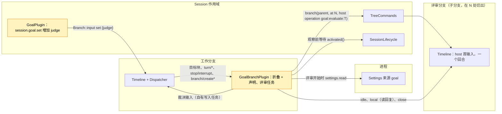

# Pursuit

状态：草案（[#146](https://github.com/arcships/dim/issues/146)，里程碑 M2）。作用域：[Goal](Goal.md) 的 Session 部分与分支部分的扩展，不新增 Capability（[ADR 002](../../adr/002-plugin-scope.md)）。语言：同 Goal（优先 TypeScript，[#4](https://github.com/arcships/dim/issues/4) 覆盖分支部分之前用 Rust）。依赖：Goal（P5，[#69](https://github.com/arcships/dim/issues/69)，未实现）、C5（[#100](https://github.com/arcships/dim/pull/100)，未实现）、S8b（[#118](https://github.com/arcships/dim/issues/118)，未实现）。不在当前计划内（[路线图](../../../design/roadmap.md) D3）。

需求（[功能列表](../../../feature-list.md)，Agent 行为）：朝明确的目标持续工作，记录完成或受阻，**并且由评审者而不是干活的模型判断是否完成**。

决策 A3（[#44](https://github.com/arcships/dim/issues/44)，路线图 D3）先做 Goal，Pursuit 暂缓。实验性的 Pursuit 设计（#17）是第二个续跑所有者，有自己的 `pursuit/*` 事件、目标、上限和中断规则，所以一个 Session 只能在 Goal 与 Pursuit 中启用一个，而且它自己的事件类型要等动态事件（[#2](https://github.com/arcships/dim/issues/2)）。本文档取代它。**Pursuit 是 Goal 的一种裁判模式**：以 `judge: "evaluator"` 设置的目标保留 Goal 的全部规则（目标与状态两个 key、折叠、续跑、上限、中断、压缩、子分支），只改变完成报告的含义。模型裁判（Goal 原设计）下，`goal_update completed` 结束目标。评审裁判下它是一个**完成声明**：做出声明的回合结束时，Goal 启动一个**评审分支**，即在该 `turn/end` 处切出的工作分支的子分支；评审分支核对事实，最后给出裁决。Goal 读取裁决，把结果写成自己的目标输入：已核实的完成、受阻、带评审反馈重新打开的目标（一次续跑），或自动暂停。未经核实的声明不会留下来：每个声明都由裁决、暂停或之后的目标变更了结。

Pursuit 需要的都已属于 Goal：状态所有者（Goal 的分支部分）、事实（Goal 的 `input/message` 块，不需要新的事件类型）、续跑预算（`maxContinuations`）。新增的只有 `set` 上的 `judge` 属性、Goal 分支部分里的评审任务、裁决写入和一个 Settings 字段。

## 1. 关键决策

| # | 决策 | 理由 |
| --- | --- | --- |
| P1 | Pursuit 是 Goal 的裁判模式，不是独立插件 | Goal 与 Pursuit 都会续跑分支；续跑只有一个所有者，就不会有两台状态机抢同一个 `turn/end`。独立的 Pursuit 插件要么读 Goal 的状态，要么等 Goal（违反第 4 节规则 7）。其余部分 Goal 已经处理 |
| P2 | 裁判按目标由 `set` 选择，记录在 `set` 块上 | 一个目标用哪种裁判是用户对这个目标的意图，属于 Timeline 事实；用 Settings 开关会悄悄改变已在运行的目标的含义 |
| P3 | 只在完成声明时评审，不是每个回合都评审 | 要裁决的是"完成没有"；每回合评审会让干活的模型自己都知道没做完的回合成本翻倍。声明之间的续跑归 Goal |
| P4 | 评审分支是在声明之后的 `turn/end` 处切出的子分支 | 它能看到做了什么、为什么做（并复用共享前缀的提供方提示缓存），在同一策略下运行，是普通的 TimelineTree 分支；不需要新 Session 或进程机制 |
| P5 | 裁决是评审最后回复的最后一行，由 Goal 在边界处解析；结果由 Goal 写在工作分支上 | 评审是一次模型运行，它的回复本来就是自己分支上的持久事实。后续决策要用的结果是 Goal 自己的写入（第 4 节规则 1：目标状态归 Goal） |
| P6 | 被驳回的声明重新打开目标，算一次续跑 | 驳回循环由已有的 `maxContinuations` 限制，不设第二个预算 |
| P7 | 已经开始的评审不再重跑；后一代只观察已有的评审分支 | [总体设计约束 4](../overview.md#62-约束) |

## 2. 用户流程

```
 user: /pursue "make the CLI tests pass"
   └─ session.goal.set {objective, judge: evaluator} ─▶ 目标 active ─▶ 回合运行
 model: ... 工作 ... goal_update completed "all tests pass"        （声明 C）
 turn/end N ─▶ Goal：声明 C 待裁决 ─▶ 在 N 处切出评审分支
                                      读文件、跑检查、回复
                                      "... \n CONTINUE: 2 tests still fail"
            ◀─ Goal 读取裁决
               ├─ DONE     → 状态 completed（by evaluator）   用户看到摘要
               ├─ BLOCKED  → 状态 blocked（by evaluator）     用户看到需要什么
               ├─ CONTINUE → 状态重新 active + 反馈（Queue，count + 1）─▶ 下一回合
               └─ 失败     → 状态 paused（evaluation_failed） 用户 resume
 user: 评审期间按 Esc ─▶ stop/interrupt ─▶ 关闭评审分支，状态 paused（interrupted）
```

CLI：`/pursue <objective>` 就是采用评审裁判的 `/goal <objective>`。其余 `/goal` 命令（`edit`、`pause`、`resume`、`clear`，以及单独的 `/goal` 查看状态）对两种裁判都适用。正在核对声明时状态行显示 `evaluating`：

```
 goal ▸ active · 3/20                         （模型工作中）
 goal ▸ evaluating claim · branch b-7f3c      （评审运行中）
 goal ▸ completed ✓ verified · "all tests pass"
```

## 3. 结构与依赖



不新增部件。Goal 各部分的变化：

| 部分 | 变化 |
| --- | --- |
| `GoalPlugin`（Session） | `session.goal.set` 接受 `judge?: "model" \| "evaluator"`（默认 `model`），写在 `set` 块上；`goal_update` 和其他方法不变，仍然从不读取折叠 |
| `GoalBranchPlugin`（分支） | 折叠 `judge`、声明和评审事实（第 4 节）；据此决策（第 5 节）；运行评审任务。新依赖：`S:TreeCommands`（创建、获取、关闭评审分支），`S:SessionLifecycle`（观察评审分支前等待恢复后的分支树发布，第 7 节） |
| Goal 的 Settings 来源 `goal` | 新字段 `evaluationTimeoutSeconds`（第 6 节） |

两个新依赖都是外层作用域的 Session 级服务（D3），都不是可选的。`S:TreeCommands` 在 Rust 中已存在；TypeScript 分支部分只能通过 C5 使用它以及它返回的 `Branch` 门面（需求 R1，第 14 节）。

评审分支不是 Goal 的部件。它是 TimelineTree 以 `source: host` 创建的普通子分支，带有装配为分支安装的全部能力。评审分支上的 Goal 没有自己的目标（折叠只用本地事件），并像在任何子分支上一样写入开始时的 `clear`（[Goal §3.4](Goal.md#34-新分支清除继承的目标)），所以评审不会把父分支的目标当成自己的，也从不续跑。

## 4. 数据与状态

Pursuit 不新增事件类型。除 Goal 自己的块外，它读三类公开事实：工作分支上的 `branch/create` 和 `branch/create-failed`（来源为 `host`，`operation_id` 为 `goal:evaluate:<T>`），以及评审分支上的 `turn/end`、该回合最后一次模型请求的 `step/model-start` 和该请求的 `step/text` 增量。Goal 的写入在标记里带 `claim="C"` 与 `evaluation="T"` 属性，让折叠知道它们了结的是什么。

对 Goal 折叠（[Goal §2](Goal.md#2-数据与状态)）的补充，基于工作分支的本地事件：

| 字段 | 推导 |
| --- | --- |
| `judge` | 最近一条有效 `set` 的 `judge` 属性；没有 `set` 或其后有 `clear` 时为 `model`。`edit` 不改变它；要换裁判就重新 `set` |
| `claim` | 当前 `goal:status` 块是由 `goal_update`（不是 Goal）写的 `completed` 且 `judge = evaluator` 时，该块的序号 `C` |
| `settled(C)` | 存在标记 `claim="C"` 的 Goal 写入（第 8 节列出） |
| `pending` | `claim` 存在且未 `settled` |
| `trigger` | 对待裁决的 `C`：以下两者中较晚者：(a) `C` 之后第一个结果为 `completed` 的 `turn/end`，(b) 该 `turn/end` 之后任何有效的 `edit`。其序号 `T` 标识这次评审 |
| `started(T)` | 存在操作为 `goal:evaluate:T` 的本地 `branch/create`；其 `branch` 字段是评审分支 id |
| `create_failed(T)` | 该 `branch/create` 对应的 `branch/create-failed` |
| `evaluating` | `pending` 且 `started(trigger)` |

全部是已提交事实的折叠，重载或恢复都能重建。仅在运行时：评审任务（每个分支至多一个）和它的计时器。

声明被了结之前，干活的模型看不到结果：此时它上下文里最新的状态块是它自己的 `completed`，折叠也一致（`status = completed`，`pending`）。Goal 的 A16（重放等于折叠）不变：Pursuit 每个改变状态的写入都是一个 `goal:status` 块。

## 5. 决策

Goal 的分支部分在 Dispatcher 处理函数消费事件时做决策，只用已消费的状态；需要写入或评审时登记一个自有任务，然后不等待直接返回，与 [Goal A.4](Goal.md#a4-续跑决策) 完全相同。Goal 的 C1–C6 不变：它们要求 `status = active`，而待裁决的声明不是 active。

| 消费的事件 | 条件 | 动作 |
| --- | --- | --- |
| `turn/end` N | 待裁决声明 `C < N`，结果 `failed` | 写暂停（`turn_failed`，`claim="C"`） |
| `turn/end` N | 待裁决声明 `C < N`，结果 `completed`，`trigger = N`，且未 `started(N)` | 启动评审 `T = N`（5.1） |
| `edit` E | `pending`，`C` 之后有已完成的 `turn/end` | 取消进行中的评审并关闭其分支；启动评审 `T = E`，切点为该 `turn/end` |
| `stop/interrupt` M（`scope: turn`） | `pending`，`C < M` | 取消进行中的评审并关闭其分支；写暂停（`interrupted`，`claim="C"`，`after="M"`） |
| `C` 之后的任何其他目标块（`set`、`pause`、`resume`、`clear`、又一次 `goal_update`） | — | 声明已不是当前状态，没有待裁决项；取消进行中的评审并关闭其分支。不写任何东西：较新的块已经决定了状态 |
| `goal:evaluate:T` 的 `branch/create-failed` | `pending`，`T = trigger` | 写暂停（`evaluation_failed`） |

被中断取消的 `turn/end` 由它之前的 `stop/interrupt` 一行处理。评审进行期间在 `C` 之后结束的回合（例如用户回合）不会重启评审：声明针对的是切点处的状态；该回合中的新声明是一个新的目标块，会取代旧声明。

### 5.1 评审任务

1. 调用 `settings.read {source: "goal", scope: "user"}`（S8b）取得 `evaluationTimeoutSeconds` 和 `maxContinuations`；任务全程使用这份文档。
2. 创建评审分支：`S:TreeCommands.branch(parent = 本分支, at = 切点 turn/end, {source: host {operation_id: "goal:evaluate:T"}, prompt}, admission)`，提示词见第 9 节。TimelineTree 在工作分支上写 `branch/create` 并打开子分支，其首输入是提示词（Queue）。创建失败由 TimelineTree 记为 `branch/create-failed`，由上表对应行了结。
3. 观察：在超时内等待评审分支 `idle()`，然后读取其本地事件：最近的 `turn/end` 及其 `turn_id`。超时则中断评审分支，按失败处理。
4. 重组最后的回复：取该回合最后一条 `step/model-start`，其 `request_id` 即最后一次模型请求。按序号顺序拼接所有 `turn_id` 和 `request_id` 都匹配的 `step/text` 的 `delta`。`step/text` 是 Output 按大小和时间边界刷出的增量，单条记录不是完整回复，裁决行可能跨越多条记录。该回合更早的请求（工具调用之前的回复）和 `step/thinking` 不属于这条回复。这与 history 投影已有的拼接相同，不需要新事件或核心 API。
5. 在这个边界解析：重组后回复的最后一个非空行 `DONE: <summary>`、`CONTINUE: <feedback>` 或 `BLOCKED: <reason>`。其他文本按 `continue` 处理，整段文本作为反馈（截断到 2000 字符，Goal A10）。`turn/end` 为 `failed` 或 `cancelled`，或没有已完成的回合，是评审失败。
6. 基于已消费状态复查（[时间总线 §4](../../../architecture/rust-agent/time-bus.md)）：`C` 仍待裁决，且 `T` 仍是它的 `trigger`。否则不写。
7. 写入裁决（5.2），然后 `close()` 评审分支。

取消任务（上表各行或卸载）会取消准入或观察，若评审分支已创建则中断并关闭它，不写任何东西；由触发取消的那一行写声明需要的结果。每个分支至多运行一个任务：只有前一个任务的声明或触发被取代后才会开始新评审，而取代会取消前一个任务。

### 5.2 裁决写入

每种写入都是工作分支上一条来源为 `goal` 的 `input/message`，标记 `claim="C" evaluation="T"`，被消费后 `settled(C)` 成立。

| 裁决 | 写入 | 模式 |
| --- | --- | --- |
| `done` | `goal:status` `completed`，`by="evaluator"`，带评审摘要 | Append |
| `blocked` | `goal:status` `blocked`，`by="evaluator"`，带评审给出的原因 | Append |
| `continue`，`count < maxContinuations` | 重新打开：第 1 块是续跑（无 key，`count = k+1`），携带反馈；第 2 块是 `goal:status` `active`（`op="reopen"`） | Queue |
| `continue`，`count >= maxContinuations` | `goal:status` 暂停（`limit`） | Append |
| 失败（创建、回合、超时） | `goal:status` 暂停（`evaluation_failed`） | Append |

重新打开的输入以续跑标记开头，所以计入 Goal 的 `count`（Goal A5：只有 `set`、`resume` 和操作者输入会重置计数；重新打开不会）。它的状态块让 `status` 重新为 `active`，于是下一个 `turn/end` 照常适用 Goal 的 C1–C6：干活的模型要么再次声明，要么被续跑。

## 6. 预算与循环上限

| 上限 | 约束 |
| --- | --- |
| 每个声明的评审次数 | 一次；声明待裁决期间每 `edit` 一次目标再加一次 |
| 被驳回的声明 | 每次消耗一次续跑：两次 `set`、`resume` 或操作者输入之间至多 `maxContinuations` 次重新打开；下一个 `continue` 裁决会暂停（`limit`） |
| 一个 active 周期内的评审次数 | 没有用户输入时至多 `maxContinuations + 1` 次 |
| 单次评审 | `evaluationTimeoutSeconds`（来源 `goal`，整数，最小 60，最大 3600，默认 900）；到期时中断评审分支，声明暂停（`evaluation_failed`） |
| 评审递归 | 无：评审分支没有目标，所以不会做出声明，也不会启动评审；它创建的分支随它一起关闭 |

Settings 在使用时读取（5.1 第 1 步），所以修改从下一次评审起生效，不重载 Goal。Goal 处理函数侧的决策仍按 Goal §1 读取 `maxContinuations`；只有评审任务因为本来就要等待，自己读一份。

## 7. 中断、重载、恢复与 fork

| 情形 | 结果 |
| --- | --- |
| 用户在声明所在回合中断工作分支 | 回合以 `cancelled` 结束；`stop/interrupt` 一行暂停该声明（`interrupted`）。未核实的声明不会在中断后留下 |
| 用户在评审期间中断工作分支 | 中断并关闭评审分支；暂停（`interrupted`） |
| 用户中断评审分支本身 | 其回合以 `cancelled` 结束：评审失败，暂停（`evaluation_failed`） |
| 评审期间 `pause`、`resume`、`clear`、`set` 或又一次 `goal_update` | 较新的块决定状态；取消评审，不再写其他内容 |
| 评审期间 `edit` | 针对新目标重启评审（第 5 节） |
| 评审期间有用户输入 | 用户回合在工作分支上与评审并行运行；声明保持待裁决；裁决到达时生效。`continue` 的重新打开排在用户回合之后 |
| 评审进行中 Goal 分支部分重载 | 旧任务随旧一代结束。新一代折叠出 `evaluating`：不创建第二个评审分支，而是按 id（`TreeCommands.get`）从第 3 步开始观察已有的评审分支。总体设计约束 4 允许按保存的句柄恢复观察 |
| 评审进行中进程重启或 Session 恢复 | 同上，但要等 `SessionLifecycle` 进入 Active（恢复后的分支树已发布）。TimelineTree 像恢复任何子分支一样恢复评审分支：被重启打断的回合以 `cancelled` 结束（评审失败），已完成的回合照常读取，从未消费的首输入可能仍会运行，观察会等它。被重启打断的创建由 TimelineTree 记为 `branch/create-failed`：暂停（`evaluation_failed`）。Goal 不重新执行任何东西 |
| 观察时评审分支不存在（恢复后未激活） | 评审失败，暂停（`evaluation_failed`） |
| 装载时有未决的触发（任务还没创建分支） | 装载折叠做一次该决策并启动评审；`started(T)` 去重 |
| 工作分支关闭 | 评审分支是子分支，随子树关闭；不写任何东西。下次装载该分支时（若会装载），按上文观察或判为失败 |
| 工作分支的子分支 | 没有目标，所以没有声明，也没有评审（Goal A3） |
| Session fork | fork 把 `main` 复制到切点，并以 `branch/resume` 打开（[Session 删除与 fork](../appserver/session-deletion-and-fork.md)）；子分支（包括评审分支）不复制。如果 fork 的目标折叠中有 `started(T)` 的待裁决声明，观察找不到评审分支：暂停（`evaluation_failed`）。分叉在复制来的事实之后写 `session/forked`，Goal 据此清除复制来的生效目标（Goal A11），因此复制来的声明不再是该 fork 的目标 |

### 7.1 持久化的内容

| 事实 | 位置 | 写入者 |
| --- | --- | --- |
| 裁判 | `set` 块（`judge` 属性） | Goal Session 部分（`session.goal.set`） |
| 声明 | `goal_update completed` 块 | Goal Session 部分（`goal_update`） |
| 评审开始 / 创建失败 | 工作分支上的 `branch/create`、`branch/create-failed` | TimelineTree |
| 评审的工作与回复 | 评审分支自己的 Timeline | Loop 及该分支的能力 |
| 了结 | 工作分支上 Goal 的裁决或暂停输入 | Goal 分支部分 |

不持久化：任务、计时器和评审分支在内存中的实例；都由上述事实重建或观察得到。

## 8. 了结汇总

| 了结待裁决声明 `C` 的情形 | Goal 写入 | 之后的状态 |
| --- | --- | --- |
| 裁决 `done` | `completed`（`by="evaluator"`） | completed |
| 裁决 `blocked` | `blocked`（`by="evaluator"`） | blocked |
| 裁决 `continue`，未到上限 | 带反馈重新打开（Queue） | active |
| 裁决 `continue`，已到上限 | 暂停（`limit`） | paused |
| 评审或创建失败 | 暂停（`evaluation_failed`） | paused |
| 声明所在回合失败 | 暂停（`turn_failed`） | paused |
| `C` 之后的中断 | 暂停（`interrupted`） | paused |
| 之后的目标块 | 不写（由该块决定） | 由该块决定 |

## 9. 上下文映射

干活的模型只看到 Goal 的输入，同 [Goal §5](Goal.md#5-上下文映射)；评审看到切点之前继承的历史和它的提示词。标记格式、转义和 key 沿用 Goal（A.5）。模型可见文本保持英文原文；新增标记：

| 写入 | 块（key） | 文本 |
| --- | --- | --- |
| 已核实的完成 | `goal:status` 生效 | `<dim-goal kind="status" op="completed" by="evaluator" claim="C" evaluation="T" branch="B">` / `Result:` / `<summary>` / 空行 / `An evaluator checked the result and set the goal status for branch B to completed. Do not continue working toward a goal for branch B on your own.` |
| 评审给出的受阻 | `goal:status` 生效 | `op="blocked" by="evaluator"`；`Blocker:` / `<reason>` / 空行 / `An evaluator found that the goal for branch B cannot proceed without the user and set its status to blocked. Do not continue working toward it on your own.` |
| 重新打开 | 1：无；2：`goal:status` 生效 | 1：`<dim-goal kind="continuation" count="k" limit="L" claim="C" evaluation="T" branch="B">` / `An evaluator checked your report that the goal for branch B is completed and found it is not achieved yet:` / `<feedback>` / 空行 / `Continue working toward it. When it is achieved, call goal_update with status "completed" again.`；2：`<dim-goal kind="status" op="reopen" status="active" branch="B">` / `The goal for branch B is active again.` |
| 暂停（`evaluation_failed`） | `goal:status` 生效 | Goal 的暂停文本，原因短语为 "the evaluator could not check the result" |
| 评审提示词（评审分支的首输入，纯文本） | — | `You are an evaluator. Branch B reported that its goal is completed. Do not continue the work, do not change files or settings, and do not call goal_update.` / 空行 / `Objective:` / `<objective>` / 空行 / `Reported result:` / `<claim summary>` / 空行 / `Check whether the objective is actually achieved. Verify the facts yourself by reading files and running checks; do not rely on the report or on earlier messages. End your reply with exactly one line: DONE: <the verified result>, CONTINUE: <what is missing or wrong>, or BLOCKED: <what only the user can provide>.` |

`set` 块沿用 Goal 不变：两种裁判下干活的模型行为相同（认为目标达成时报告完成），所以裁判不是模型上下文，也不需要 key。压缩像对待任何 Goal 状态一样重放最新的 `goal:status` 块，所以重新打开后模型看到 `active`，核实完成后看到评审的 `completed`。

## 10. 接口

| 接口 | 变化 |
| --- | --- |
| `session.goal.set` | 参数 `{sessionId, branchId?, objective, judge?}`；`judge` 为 `"model"`（默认）或 `"evaluator"`；写成 `set` 输入第一个块的 `judge` 属性。其他值为 `invalid_params` |
| 读取目标 | Goal 没有查询方法（Goal A.3、A8）：判定方式以及评估的声明、触发与分支，和目标的其余部分一样从 Goal 的块中读取 |
| `goal_update` | 不变。结果文本仍为 `goal_update recorded: completed.`；评审裁判下这条记录就是声明 |
| Settings 来源 `goal` | 在 Goal 清单声明的 schema 中增加 `evaluationTimeoutSeconds`（整数，60..=3600，默认 900） |
| CLI | `/pursue <objective>` 发送带 `judge: "evaluator"` 的 `set`；状态行从 Goal 的块显示 `evaluating` 和 `verified` |

## 11. 安全

评审是普通子分支：它具有工作分支的权限策略（Permission 重放祖先前缀），工具调用像其他分支一样经过 Approval，所以不会获得工作分支没有的权限。提示词里的"不要修改任何东西"是指引，不是隔离；只读评审需要按分支收窄权限，目前没有这种能力（第 16 节）。交互式 Session 中，它的审批请求像干活的模型一样到达用户。用户无法伪造裁决：`session.submit` 不接受 raw 块，标记会转义所有文本，裁决只来自 Goal 通过 `branch/create` 记录了 id 的评审分支。诊断记录 Session、分支、声明与评审的序号以及裁决种类，从不记录目标或反馈文本。

## 12. 对未实现机制的依赖

| 机制 | 状态 | Pursuit 需要它提供什么 |
| --- | --- | --- |
| Goal（P5，#69） | 设计已合入，未实现 | 全部；Pursuit 作为 Goal 的一部分实现，或紧随其后 |
| C5（#100），#4 的一部分 | 未实现 | TypeScript 分支部分使用 `TreeCommands` 及其返回的 `Branch` 门面操作（需求 R1）。先用 Rust 实现则不需要 |
| S8b（#118） | 设计已合入，未实现 | 读取来源 `goal` 的 `settings.read`（已是 Goal 的依赖） |
| 持久的分支退役 | 不存在 | 不阻塞（需求 R2） |
| 动态事件（#2） | Proposed | 不需要：Pursuit 不写自己的事件类型 |

## 13. 规则检查

规则：[设计规则第 1、4 节](../../../architecture/rust-agent/principles.md)，[ADR 002](../../adr/002-plugin-scope.md) D1–D5。

| 规则 | 本文档如何遵守 |
| --- | --- |
| §4.1 改别人的状态写指令事件 | Goal 只通过自己的输入改变目标状态。评审分支经 TimelineTree 公开的 `TreeCommands` 创建，由 TimelineTree 写自己的事实。声明是模型通过 `goal_update` 写的目标块，由所有者 Goal 决定它的含义 |
| §4.2 交接后不撤回 | Goal 不撤回任何东西：重新打开或暂停一旦写入就成立。评审分支用分支门面公开的 `close` 关闭，这是 Goal 所启动分支自己的停止指令 |
| §4.3 before 回调只变换草稿、不阻塞 | 不适用：没有 before 回调；`set` 只校验参数 |
| §4.4 核心机制不带业务含义 | Timeline、Dispatcher、TimelineTree、Loop 都不改：带 `operation_id` 的 host 来源分支是已有合同，裁决是普通输入 |
| §4.5 批次 | 决策按序号跟随已消费事件；任务写入前基于已消费状态复查；每个裁决是一条输入，其中状态块排在续跑块之后 |
| §4.6 上下文只来自交接后的事件 | 干活的模型只通过 Goal 被采用的输入看到裁决；评审的回复留在它自己的分支上 |
| §4.7 只通过公开事件和服务交互 | Goal 读取公开的 `branch/create`、`branch/create-failed`、`turn/*`、`stop/interrupt`、`step/model-start`、`step/text` 和自己的块，调用 `TreeCommands`、`Branch` 和 `settings` |
| §4.8 向机制所有者提需求 | 第 14 节的 R1 和 R2 |
| §4.9 只有后续决策要用的事实进 Timeline | 没有新事件类型；裁决写入既是模型上下文，也是后续决策读取的了结事实；进行中的评审由 TimelineTree 的事实推导；计时器和任务不进 Timeline |
| §1 Capability 与 App Server 边界 | 不新增 Capability；Goal 已有部分增加两个 Session 级依赖；App Server 中没有任何改动 |
| ADR 002 D1 作用域 | 声明、评审和裁决是工作分支的状态，归 Goal 的分支部分；评审分支归 TimelineTree |
| ADR 002 D2 不设接线模块 | 没有东西点名 Goal；评审分支是普通子分支 |
| ADR 002 D3 作用域依赖 | 分支部分依赖 Session 级的 `TreeCommands`、`SessionLifecycle` 和进程服务 `settings`，都是外层；Goal 是可选插件，没有核心部分依赖它 |
| ADR 002 D4 配置 | 裁判是按目标的 Timeline 事实，不是配置。超时是 Goal Settings 来源中的业务配置，使用时读取，从不触发重载 |
| ADR 002 D5 语言中立合同 | `judge` 参数、块属性、Settings 字段、操作 id 和块格式都是数据；Rust 与 TypeScript 绑定沿用 Goal 的 |

## 14. 向机制所有者提出的需求

### R1. TypeScript 分支部分使用的分支门面操作（C5）

| 项 | 内容 |
| --- | --- |
| 被什么挡住 | ADR 002 D5 和 Goal 优先 TypeScript：Goal 的分支部分要创建子分支、等它空闲、读它的本地事件并关闭它。C5 的范围按名暴露 `Dispatcher`、`Branch::input` 和 `TreeCommands`，但不包括 `TreeCommands.branch` 和 `get` 返回的 `Branch` 门面 |
| 考虑过的现有机制 | 只按名暴露 `TreeCommands`：返回的句柄 TypeScript 部分用不了。Session 方法（`session.*`）：是客户端入口，不是分支部分的依赖。先用 Rust：C5 覆盖之前的退路 |
| 需要的通用能力 | 其他语言的分支部分可以按名使用经 `TreeCommands` 取得的分支的公开 `Branch` 门面：`id`、`idle`、`state`、`local`、`interrupt` 和 `close`；以及带 `source: host` 和可取消准入的 `TreeCommands.branch` |
| 对序号、批次、中断、重载的影响 | 无：调用保持门面的语义；句柄不跨所有者重载存活，调用方按 id 重新查找 |
| 实现者与 issue | 运行时与装配，zerob13；[#100](https://github.com/arcships/dim/pull/100)（C5） |

### R2. 持久的分支退役（不阻塞）

| 项 | 内容 |
| --- | --- |
| 被什么挡住 | TimelineTree："关闭不等于删除持久化历史"，且 `restore` 会构建每个已存储的分支。每个评审分支关闭后，在 Session 每次恢复时都会带着完整能力作用域重新构建，恢复成本随声明次数增长。`branch` 工具完成的委托分支同样如此 |
| 考虑过的现有机制 | `Branch::close`：仅限运行时，下次恢复即失效。`session.delete`：针对整个 Session。让它们保持装载并空闲：正确，在此能力落地前 Pursuit 就这样运行，代价是恢复成本增长 |
| 需要的通用能力 | 已存储分支的持久"已退役"状态，归 TimelineTree：退役分支的历史仍可读，但恢复时不构建，也不接受输入 |
| 对序号、批次、中断、重载的影响 | 退役包含关闭（中断、了结、卸载）。它是 TimelineTree 分支目录中的事实，不向任何业务 Timeline 增加事件；恢复时跳过构建退役分支及其子树 |
| 实现者与 issue | 运行时（TimelineTree）；本设计被接受后开 issue |

## 15. 验收

通过 `session.goal.*`、`goal_update` 和 Timeline 事件做流程测试，干活的模型和评审都用假模型：

1. `set {judge: evaluator}`；干活的模型调用 `goal_update completed`；回合结束时在该 `turn/end` 处创建一个评审分支，操作为 `goal:evaluate:N`；`DONE` 写入已核实的 `completed`，不再运行回合；`get` 显示 `judge: evaluator` 且没有 `evaluation`。
2. `CONTINUE` 写入一条带反馈的重新打开输入（Queue，`count` + 1）；下一回合运行；第二次声明启动第二次评审；`BLOCKED` 写入评审给出的 `blocked`。
3. 上限：`maxContinuations = 1` 时，第二个 `CONTINUE` 写入暂停（`limit`）；`resume` 重置计数。
4. 无法解析的回复按 `continue` 处理；评审回合失败、创建失败和超时都写入暂停（`evaluation_failed`）。
5. 在声明所在回合和评审期间中断：暂停（`interrupted`），评审分支关闭，迟到的裁决不写任何东西。
6. 评审期间 `pause`、`clear`、`set` 和第二次 `goal_update`：取消评审，不写其他内容；`edit` 以操作 `goal:evaluate:E` 重启评审。
7. 评审期间的用户输入：用户回合运行，声明保持待裁决，裁决生效；重新打开排在用户回合之后运行。
8. 评审进行中分支部分重载和进程重启：没有第二条 `branch/create`；观察已有的评审分支，其裁决只生效一次；重启打断了评审回合时写入暂停（`evaluation_failed`）。
9. 模型裁判：`goal_update completed` 结束目标，没有评审（Goal 的验收不变）。
10. 评审分支没有目标，不做声明，也不启动评审；其策略等于工作分支在切点处的策略。
11. 核实完成后和重新打开后压缩：上下文中最新的 `goal:status` 块与 `get` 一致。
12. 修改 `evaluationTimeoutSeconds` 从下一次评审起生效，不重载 Goal。
13. 裁决不受刷出边界影响：评审回合中有一次工具调用，其之前的回复文本以 `DONE: early` 结尾，最后一次请求把 `... \nDONE:` 和 ` all checks pass` 作为两条 `step/text` 记录流出；裁决为 `done`，摘要为 `all checks pass`。`BLOCKED:` 跨记录拆分时同样得到 `blocked`。

## 16. 待对齐问题

| 问题 | 说明 |
| --- | --- |
| 每回合评审 | P3 只评审声明。从不声明的工作者会被续跑到上限，与模型裁判相同。之后可以加"每 k 回合评审"的设置 |
| 评审的独立性 | P4 在声明的 `turn/end` 处切分，评审能看到工作者的推理。改为在目标的 `set` 处切分，就只评判工作区，代价是失去提示缓存和"尝试过什么"的上下文 |
| 只读或更便宜的评审 | 需要创建分支时在首输入之前应用初始配置（创建后再 `ConfigureUpdate` 可能输给第一个请求）；只读还需要按分支收窄 Session 级的 Permission 策略。两者都不存在；用户需要时再作为需求提出 |
| 结构化裁决 | 用裁决工具可以取代"最后一行"协议，但工具会出现在每个分支上；行协议保持工具集不变 |
| 列表中的评审分支 | 客户端可以隐藏 host 操作为 `goal:evaluate:` 的分支；R2 之前它们仍会列出 |
| ~~fork 与 Goal A11~~ | 已解决：分叉在复制来的事实之后写 `session/forked`，Goal 从它之后折叠并清除复制来的生效目标（Goal A11）。在该清除之前的窗口内，Pursuit 的规则（评审分支不被复制，所以声明暂停）依然成立 |
