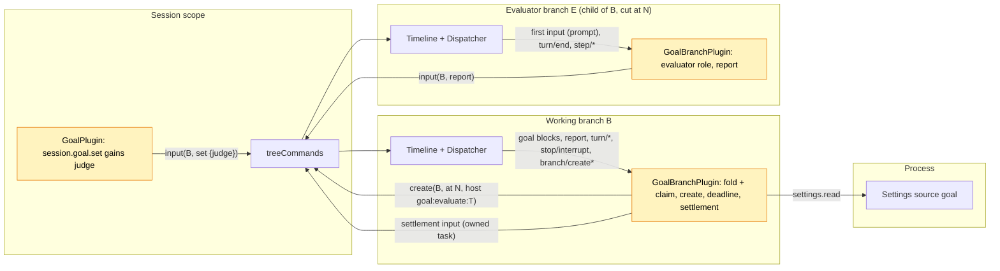

# Pursuit

状态：草案，Ready 候选（[#146](https://github.com/arcships/dim/issues/146)，里程碑 M2；进入 Ready 还差什么见 [§17](#17-进入-ready-还差什么)）。作用域：对 [Goal](Goal.md) 的 Session 部分与分支部分的修订，不新增 Capability（[ADR 002](../../adr/002-plugin-scope.md)）。语言：TypeScript，放在 Goal 的包 `runtime/plugins/goal` 里（[Goal §10](Goal.md#10-实现)）。依赖：Goal（P5，已由 [#199](https://github.com/arcships/dim/pull/199) 用 TypeScript 实现，验收完成，[#69](https://github.com/arcships/dim/issues/69) 已关闭）、C5（已交付，[分支 TypeScript 绑定](../../../design/branch-typescript.md)）、S8b（已交付，[settings 服务](../appserver/settings-service.md)）。所需机制都已存在；[§12](#12-依赖) 列出用到的机制和不阻塞的限制。里程碑 M2，不在当前计划内（[路线图](../../../design/roadmap.md) D3）。

需求（[功能列表](../../../feature-list.md)，Agent 行为）：朝明确的目标持续工作，记录完成或受阻，**并且由评审者而不是干活的模型判断是否完成**。

决策 A3（[#44](https://github.com/arcships/dim/issues/44)，路线图 D3）先做 Goal，Pursuit 暂缓。实验性的 Pursuit 设计（#17）是第二个续跑所有者，有自己的 `pursuit/*` 事件、目标、上限和中断规则。本文档取代它。**Pursuit 是 Goal 的一种裁判模式**：以 `judge: "evaluator"` 设置的目标保留 Goal 的全部规则（目标与状态两个 key、折叠、续跑、上限、中断、压缩、子分支），只改变完成报告的含义。模型裁判（已实现的 Goal）下，`goal_update completed` 结束目标。评审裁判下它是一个**完成声明**：做出声明的回合结束时，Goal 创建一个**评审分支**，即在该 `turn/end` 处切出的工作分支的子分支；评审分支核对事实，用一行裁决结束回合。Goal 的分支部分在每个分支上运行，评审分支也不例外；在评审分支上，它读取本分支的最终回复，按 id 向工作分支写一条**报告**输入。工作分支上的 Goal 是目标的所有者，由它判断报告的含义并写入结果：已核实的完成、受阻、重新打开的目标（一次续跑）或自动暂停。未经核实的声明不会留下来：每个声明都由报告、暂停、截止时间或之后的目标变更了结。

Pursuit 需要的都已属于 Goal，或已导出给 TypeScript：状态所有者（Goal 的分支部分）、事实（Goal 的 `input/message` 块和 TimelineTree 的 `branch/create`）、续跑预算（`maxContinuations`）、分支创建（`treeCommands.create`）和跨分支输入（`treeCommands.input`）。新增的只有 `set` 的 `judge` 参数、Goal 折叠中的声明规则、Goal 分支部分的评审角色、报告与了结写入，以及一个 Settings 字段。

## 1. 关键决策

| # | 决策 | 原因 |
| --- | --- | --- |
| P1 | Pursuit 是 Goal 的裁判模式，不是独立插件 | 续跑只有一个所有者；独立插件会和 Goal 在同一个 `turn/end` 上竞争，或者要读 Goal 的状态（§4 规则 7） |
| P2 | 裁判由 `set` 按目标选择，记在 `set` 块上 | 目标用哪种裁判是用户对这个目标的意图，属于 Timeline 事实；用 Settings 开关会悄悄改变正在运行的目标的含义 |
| P3 | 只在完成声明时评审，不是每轮都评审 | 关键的裁决是“完成没有”；声明之间的续跑归 Goal |
| P4 | 评审者是在声明之后的 `turn/end` 处切出的子分支 | 它能看到做了什么、为什么做（并复用共享前缀的 provider 提示缓存），在同一策略下运行，是用已导出的 `treeCommands.create` 创建的普通 TimelineTree 分支 |
| P5 | 评审分支通过输入报告，工作分支做决定 | 分支部分只读自己的分支，跨分支通信是通过 `treeCommands` 按 id 写输入（[分支 TypeScript 绑定](../../../design/branch-typescript.md#subscription-rebuild-and-recovery) 第 6 条）。评审分支上的 Goal 读取本分支的最终回复并写报告；工作分支上的 Goal 用自己的事实校验报告并写了结（调用方写，所有者决定）。没有分支观察另一个分支 |
| P6 | 被驳回的声明重新打开目标，计为一次续跑 | 驳回循环受现有 `maxContinuations` 约束，不需要第二个预算 |
| P7 | 已开始的评审从不重跑；没有产生报告的评审由截止时间了结 | [总体设计约束 4](../overview.md#62-约束)。截止时间由 `branch/create` 事实推出，经得起重载和重启，并覆盖丢失、被截断或未建成的评审分支，无需观察它 |

## 2. 用户流程

```
 user: session.goal.set {objective: "make the CLI tests pass", judge: "evaluator"}
   └─ goal active ─▶ turn runs
 model: ... work ... goal_update completed "all tests pass"      (claim C)
 turn/end N ─▶ Goal(B): claim C pending ─▶ treeCommands.create(B, at N, goal:evaluate:N)
                                            evaluator branch E: reads files, runs checks,
                                            replies "... \n CONTINUE: 2 tests still fail"
               Goal(E): turn/end ─▶ report input to B (verdict continue)
 Goal(B): report from E for evaluation N, claim C pending
   ├─ done     → status completed (by evaluator)        user sees the summary
   ├─ blocked  → status blocked (by evaluator)          user sees what is needed
   ├─ continue → active again (Queue, count + 1)  ─▶ next turn sees the report
   └─ failed / no report by the deadline → paused (evaluation_failed), user resumes
 user: Esc on B during the evaluation ─▶ stop/interrupt ─▶ paused (interrupted); E's late report is ignored
```

客户端和读取任何目标一样，从工作分支的事件中读取全部信息（[Goal A.3](Goal.md#a3-读取目标)）：`set` 块上的裁判、声明（没有 `by` 的 `completed` 块）、评审（操作为 `goal:evaluate:<T>` 的 `branch/create`）和了结。状态行可以显示：

```
 goal ▸ active · 3/20                         (model working)
 goal ▸ evaluating claim · branch 7f3c…       (claim pending, evaluator created)
 goal ▸ completed ✓ verified · "all tests pass"
```

CLI 目前没有 `/goal` 命令；加入后，`/pursue <objective>` 就是带 `judge: "evaluator"` 的 `/goal <objective>`，其他 `/goal` 命令对两种裁判都适用（§16）。

## 3. 结构与依赖



不新增部件、服务或依赖。Goal 各部分的变化：

| 部分 | 变化 |
| --- | --- |
| `GoalPlugin`（Session，`session.ts`） | `session.goal.set` 接受 `judge?: "model" \| "evaluator"`（默认 `model`），在 `set` 的目标块上写 `judge="evaluator"`。`goal_update` 和其他方法不变，仍然从不读取折叠 |
| `GoalBranchPlugin`（分支，`branch.ts`） | 现有注入（`dispatcher`、`timelineIdentity`、`treeCommands`、`settings`、`branchLifecycle`）已够用。它在 Dispatcher 订阅 key 中加入 `branch/create` 和 `branch/create-failed`；折叠裁判、声明和评审事实（§4）；在工作分支上做 §5 的决定；在评审分支上承担评审角色（§5.3） |
| 共享折叠与文本（`goal.ts`） | 声明与评审字段、评审角色、`reopen` 状态（§4.1）、新标记（§9） |
| Goal 的 Settings 源 `goal`（`settings.json`） | 新字段 `evaluationTimeoutSeconds`（§6） |

评审分支不是 Goal 的部件，而是 TimelineTree 以 `source: host` 创建的普通子分支；它的第一条输入是作为普通 Queue 文本的提示词（[TimelineTree `first_input`](../../../../crates/dim-agent-capabilities/src/timeline_tree.rs)）。评审分支上的 Goal 看不到属于自己的目标（折叠只用本地事件），并像在任何子分支上一样写入起始 `clear`（[Goal §3.4](Goal.md#34-新分支清除继承的目标)），所以评审者不会把工作分支的目标当成自己的，也不会续跑。

## 4. 数据与状态

Pursuit 不新增事件类型。除了 Goal 自己的块，它读取工作分支上来源为 `host`、`operation_id` 为 `goal:evaluate:<T>` 的 `branch/create` 和 `branch/create-failed`，以及评审分支上本分支的 `branch/start`、第一条 `input/message`、`turn/end`、`step/model-start` 和 `step/text`。Pursuit 的每次写入都是来源为 `goal` 的 `input/message`，第一个原始块是 `<dim-goal>` 标记；标记属性（`claim`、`evaluation`、`evaluator`、`after`）说明它了结什么。

### 4.1 工作分支的折叠

在 Goal 的折叠（[Goal §2](Goal.md#2-数据与状态)）上新增，作用于分支的本地事件：

| 字段 | 推导 |
| --- | --- |
| `judge` | 如果当前生效的 `goal:objective` 块来自标记 `judge="evaluator"` 的 `set`，或来自这样一个 `set` 之后、中间没有其他 `set` 的 `edit`，则为 `evaluator`；否则为 `model`。`edit` 保留裁判；要换裁判就重新 `set` |
| `claim` | 当前 `goal:status` 块是没有 `by` 的 `op="completed"`（由 `goal_update` 写入）、目标存在且 `judge = evaluator` 时，该块的序号 `C`。`blocked` 报告从不是声明：两种裁判下，受阻都需要用户处理 |
| `settled(C)` | 存在标记 `claim="C"` 的 Goal 写入 |
| `pending` | 有 `claim` 且未 `settled` |
| `trigger` | 对待定的 `C`：取以下最晚者的序号 `T`：(a) `C` 之后第一个状态为 `completed` 的 `turn/end`，(b) 该 `turn/end` 之后任何生效的 `edit`。`T` 的切点始终是那个 `turn/end` |
| `started(T)` | 第一个来源为 `host`、`operation_id` 为 `goal:evaluate:T` 的本地 `branch/create`；其 `branch` 是评审分支 id `E`，其 `create_at` 是开始时间 |
| `create_failed(T)` | `createEvent` 等于 `started(T)` 序号的本地 `branch/create-failed` |
| `report(T)` | 第一个首个标记为 `kind="report" evaluation="T"`、且 `evaluator` 等于 `started(T)` 的 `E` 的本地 `input/message`。来自其他分支或针对其他 `T` 的报告不了结任何东西 |
| `deadline(T)` | `started(T).create_at + evaluationTimeoutSeconds` |

Goal 的状态与计数规则新增一种状态操作：

| 变更 | 写入者 | Key | 对折叠的影响 |
| --- | --- | --- | --- |
| `reopen` | Goal，收到 `continue` 报告时 | 续跑块（无 key）+ `goal:status` | `status = active`；成为 `interrupted` 规则的 `A`；**不**重置计数，所以它携带的续跑会被计数（P6） |
| `by="evaluator"` 的 `completed` / `blocked` | Goal，收到 `done` / `blocked` 报告时 | `goal:status` | 同 Goal 的 `completed` / `blocked`，带评审者的摘要；从不是声明 |
| 暂停 `evaluation_failed` | Goal | `goal:status` | 同 Goal 的自动暂停 |

已实现的折叠只有一个序号 `active`，既是 `A` 又是计数起点；现拆成两个：`A` 在 `set`、`resume` 和 `reopen` 时移动；计数起点仍是 `max(最近的 set 或 resume, last_operator)`。

### 4.2 评审分支的折叠

同一个折叠，作用于评审分支自己的本地事件：

| 字段 | 推导 |
| --- | --- |
| `evaluation` | 分支的第一条本地 `input/message` 是用户文本，首行是标记 `<dim-goal kind="evaluate" branch="B" claim="C" evaluation="T">`，并且 `B` 是本分支 `branch/start` 的 `parent`。由此得到 `B`、`C`、`T` |
| `evaluation turn` | 该输入的 `input/consumed` 之后的第一个 `turn/end`，序号 `N` |
| `reported` | 存在标记 `kind="reported" after="N"` 的本地 Goal 输入 |

一切都是已提交事实的折叠，重载或恢复都能重建。只在运行时存在的：创建任务、截止计时器、报告任务和了结任务，各自以决定它的序号为 key，和 Goal 的写入任务完全一样。

了结写入之前，干活的模型看不到了结：此前它上下文中最新的状态块是它自己的 `completed`，折叠也一致（`status = completed`、`pending`）。Goal A16（重放等于折叠）不变：Pursuit 每个改变状态的写入都是 `goal:status` 块。

## 5. 决策

Goal 的分支部分在 Dispatcher 处理函数消费事件时做每个决定，只依据已消费的状态；需要写入或创建时登记一个自有任务，不等待就返回，和 [Goal A.4](Goal.md#a4-续跑决策) 完全一样。每个任务都等待 `branchLifecycle.activated()`，写入前按已消费的折叠复查条件（[时间总线 §4](../../../architecture/rust-agent/time-bus.md)）。Goal 的 C1–C6 和中断规则不变：它们要求 `status = active`，待定的声明不满足。

### 5.1 工作分支上

| 消费的事件 | 条件 | 动作 |
| --- | --- | --- |
| `turn/end` N | `pending` 且 `C < N`，状态 `failed` | 写暂停（`turn_failed`，`claim="C" after="N"`） |
| `turn/end` N | `pending` 且 `C < N`，状态 `completed`，`trigger = N`，未 `started(N)` | 创建任务 `T = N`（§5.2） |
| `edit` E | `pending`，`C` 之后有已完成的 `turn/end` | 取消进行中的创建任务；创建任务 `T = E`，切点为该 `turn/end`。之前的评审分支不会被停止（R1）；它的报告不再匹配 trigger |
| `stop/interrupt` M（`scope: turn`） | `pending` 且 `C < M` | 写暂停（`interrupted`，`claim="C" after="M"`）。声明所在回合若仍在运行，会以 `cancelled` 结束，不再引发决定 |
| `C` 之后的任何其他目标块（`set`、`pause`、`resume`、`clear`、另一次 `goal_update`） | — | 不再有待定声明；取消进行中的创建任务。不写任何东西：较新的块已经做了决定 |
| `goal:evaluate:T` 的 `branch/create` | `pending`，`T = trigger` | 截止任务（§5.2） |
| `started(T)` 的 `branch/create-failed` | `pending`，`T = trigger` | 写暂停（`evaluation_failed`，`claim="C" evaluation="T"`） |
| 针对 `T` 的报告输入 R | `report(T)` 就是 R，`pending`，`T = trigger` | 了结任务（§5.4） |

评审期间在 `C` 之后结束的回合（例如用户回合）不会重启评审：声明针对的是切点处的状态。该回合中的新声明是新的目标块，取代旧声明。

### 5.2 创建任务与截止任务（工作分支）

`T` 的创建任务：

1. 调用 `treeCommands.create(B, cut, {prompt, source: {host: {operation_id: "goal:evaluate:T"}}}, cancelled)`，提示词见 §9。任务被取消（被取代的行或卸载）时 `cancelled` 完成。TimelineTree 在 `B` 上写 `branch/create`，建好子分支并提交它的第一条输入（提示词，Queue），或者在锚点已提交后记录 `branch/create-failed`。
2. 如果 `create` 抛出的不是任务自身的取消，复查（`pending`、`T = trigger`）后写暂停（`evaluation_failed`）。TimelineTree 也记录了的失败只写一次：第二次写入时声明已了结。

`T` 的截止任务，在消费 `started(T)` 时登记（实时或加载时）：

1. `settings.read {source: "goal", scope: "user"}` 读取 `evaluationTimeoutSeconds`；读取失败则不写入就结束任务，和 Goal 的回合结束任务一样（[Goal 附录 C](Goal.md#附录-c-错误与恢复)），下次加载再试。
2. 等到 `deadline(T)`；如果已经过了（重启之后），不等待。
3. 复查（`pending`、`T = trigger`、无 `report(T)`）后写暂停（`evaluation_failed`）。

截止时间是所有不产生报告的评审的唯一恢复手段：评审运行太久、重启截断了它的回合或报告、评审分支没有恢复，或者丢失了 `branch/create-failed` 的创建。Goal 从不观察评审分支。

### 5.3 评审角色（评审分支）

消费 `evaluation turn` `N` 时（或者加载时 `N` 已消费且未 `reported`），评审分支上的 Goal 登记一个报告任务：

1. 从 `dispatcher.local(open, N)` 重组最终回复：取该回合最后一个 `step/model-start`，其 `request_id` 是最后一次模型请求。按序号顺序拼接 `turn_id` 和 `request_id` 都匹配的每个 `step/text` 的 `delta`。`step/text` 是 Output 按大小和时间边界刷出的增量，一行裁决可能跨多条记录。回合中更早的请求（工具调用循环之前的回复）和 `step/thinking` 不属于回复。这与历史投影做的拼接相同。
2. 在这个边界解析：最后一个非空行 `DONE: <summary>`、`CONTINUE: <feedback>` 或 `BLOCKED: <reason>` 给出裁决及其文本（截断到 2000 字符，Goal A10）。其他任何最后一行都算 `continue`，以整个回复为反馈（同样截断）。状态为 `failed` 或 `cancelled` 的 `turn/end` 算 `failed`。
3. 向 `B` 写报告：`treeCommands.input(B, report)`（Append，§9），标记 `claim="C" evaluation="T" evaluator="E"`，`E` 取自 `timelineIdentity`。
4. 在本分支写 `reported`（Append，`after="N"`）。

这个顺序保证报告至少写一次：在第 3、4 步之间重载会写出第二份报告，`report(T)` 忽略它（只算第一份），这是唯一的代价。`reported` 记录让评审分支之后的每次恢复都不会再次报告。评审角色不对目标做任何决定，只陈述本分支产出了什么。

### 5.4 了结任务（工作分支）

1. 对 `continue` 裁决，`settings.read` 读取 `maxContinuations`（读取失败则不写入就结束，同上）。
2. 复查（`report(T)` 已消费、`pending`、`T = trigger`）后写了结（§5.5），标记 `claim="C" evaluation="T" after="R"`。

### 5.5 了结写入

| 裁决 | 写入 | 模式 |
| --- | --- | --- |
| `done` | `goal:status` `completed`，`by="evaluator"`，带报告中的摘要 | Append |
| `blocked` | `goal:status` `blocked`，`by="evaluator"`，带报告中的原因 | Append |
| `continue`，`count < maxContinuations` | 重新打开：块 1 是续跑（无 key，`count = k+1`）；块 2 是 `goal:status` `reopen` | Queue |
| `continue`，`count >= maxContinuations` | 暂停（`limit`） | Append |
| `failed` | 暂停（`evaluation_failed`） | Append |

重新打开是一条 Queue 输入；它的第一个块是续跑标记，所以 Goal 的 `count` 会计数，而 `reopen` 不重置计数（§4.1）。它所回应的报告是在它之前提交的 Append 输入，所以它驱动的回合先看到报告。该回合结束时 Goal 的 C1–C6 照常适用：干活的模型要么再次声明，要么被续跑。

## 6. 预算与循环上限

| 上限 | 界 |
| --- | --- |
| 每个声明的评审次数 | 一次，声明待定期间每 `edit` 一次目标再加一次 |
| 被驳回的声明 | 每次消耗一次续跑：两次 `set`、`resume` 或操作者输入之间最多 `maxContinuations` 次重新打开；再一次 `continue` 裁决就暂停（`limit`） |
| 单次评审 | `evaluationTimeoutSeconds`（源 `goal`，整数，最小 60，最大 3600，默认 900），从开始它的 `branch/create` 算起；到截止时间声明暂停（`evaluation_failed`） |
| 评审递归 | 不存在：评审分支没有目标，不做声明，也不创建评审分支；它自己的子分支没有评审标记，也没有目标 |

Settings 在使用时读取（§5.2、§5.4），所以修改从下一个截止或了结起生效，无需重载 Goal。在 R1 之前，截止、对工作分支的中断或取代性的变更只让 Goal 不再等待评审分支，并不能停止它：它把回合跑完，迟到的报告被忽略。

## 7. 中断、重载、恢复与 fork

| 情况 | 结果 |
| --- | --- |
| 用户在声明所在回合中断工作分支 | `C` 之后的 `stop/interrupt` 暂停声明（`interrupted`）；回合以 `cancelled` 结束，不创建评审分支。未核实的声明经不起中断 |
| 用户在评审期间中断工作分支 | 暂停（`interrupted`）；评审分支之后的报告被忽略（声明已了结） |
| 用户中断评审分支 | 它的回合以 `cancelled` 结束：报告 `failed`，暂停（`evaluation_failed`） |
| 评审期间 `pause`、`resume`、`clear`、`set` 或另一次 `goal_update` | 较新的块决定；不写其他东西；报告被忽略 |
| 评审期间 `edit` | 针对新目标的新评审（§5.1） |
| 评审期间的用户输入 | 它的回合在工作分支上运行，同时评审分支也在运行；声明保持待定；`continue` 的重新打开排在用户回合之后 |
| 工作分支的分支部分重载或重启 | 新一代重新折叠，在加载时把欠下的决定各做一次，与 Goal 相同（[Goal §4.2](Goal.md#42-重载)）：未决定且没有 `started` 的 trigger 登记创建任务；已 `started` 而未了结的评审登记截止任务（截止时间是事实，不会多算或少算时间）；已消费而未回应的 `report(T)` 登记了结任务。代际交接时如果已有创建在进行，可能创建出第二个评审分支；只有第一个 `branch/create` 算数，所以声明仍只了结一次。这是 Goal 在 [#242](https://github.com/arcships/dim/pull/242) 中接受的通用交接竞争，不是 Pursuit 的验收场景 |
| 评审分支的分支部分重载或重启 | 如果评审回合已消费且未 `reported`，加载时报告一次（§5.3） |
| 恢复截断了评审回合 | 如果恢复以 `cancelled` 结束该回合，报告 `failed`；如果没有留下 `turn/end`，由截止时间了结声明 |
| 评审分支没有恢复 | 没有报告；由截止时间了结声明 |
| 工作分支关闭 | 评审分支是它的子分支，随子树一起关闭；不写任何东西。工作分支下次加载时，仍待定的声明由截止时间了结 |
| 工作分支的子分支 | 没有目标，所以没有声明（Goal A3）；没有评审标记，所以没有评审角色 |
| Session fork | fork 复制 `main`，在复制的事实之后写 `session/forked`；Goal 从它之后折叠，所以 fork 的 `main` 没有目标也没有声明，并清除复制来的生效目标（Goal A11）。子分支（包括评审分支）不会被复制 |

### 7.1 持久化的内容

| 事实 | 位置 | 写入者 |
| --- | --- | --- |
| 裁判 | `set` 目标块（`judge` 属性） | Goal Session 部分（`session.goal.set`） |
| 声明 | `goal_update completed` 块 | Goal Session 部分（`goal_update`） |
| 评审已开始 / 创建失败，以及开始时间 | 工作分支上的 `branch/create`、`branch/create-failed` | TimelineTree |
| 评审者的提示词、工作和回复 | 评审分支自己的 Timeline | TimelineTree（第一条输入）、Loop 和该分支的能力 |
| 报告 | 工作分支上的报告输入；评审分支上的 `reported` | 评审分支上的 Goal 分支部分 |
| 了结 | 工作分支上的了结输入 | 工作分支上的 Goal 分支部分 |

不持久化：任务和计时器；都可以从上面的事实重建。

## 8. 了结汇总

| 了结待定声明 `C` 的情况 | Goal 在工作分支上写入 | 之后的状态 |
| --- | --- | --- |
| 报告 `done` | `completed`（`by="evaluator"`） | completed |
| 报告 `blocked` | `blocked`（`by="evaluator"`） | blocked |
| 报告 `continue`，未到上限 | 重新打开（Queue） | active |
| 报告 `continue`，已到上限 | 暂停（`limit`） | paused |
| 报告 `failed`、创建失败、截止 | 暂停（`evaluation_failed`） | paused |
| 声明所在回合失败 | 暂停（`turn_failed`） | paused |
| `C` 之后的中断 | 暂停（`interrupted`） | paused |
| 之后的目标块 | 不写（由该块决定） | 取决于该块 |

## 9. 上下文映射

干活的模型只看到 Goal 的输入，同 [Goal §5](Goal.md#5-上下文映射)；评审者看到截至切点的继承历史，然后是它的提示词。标记格式、转义和 key 沿用 Goal（[A.5](Goal.md#a5-模型可见文本)）；`C`、`T`、`R`、`N` 是序号，`B` 是工作分支，`E` 是评审分支。新增和变化的文本（模型可见文本保持英文）：

| 写入 | 分支、块（key） | 模式 | 文本 |
| --- | --- | --- | --- |
| 评审裁判的 `set` | B；Goal 的 `set`，块 1 标记 `judge="evaluator"` | Queue | Goal 的 `set` 文本不变：两种裁判下干活的模型行为相同 |
| 评审提示词 | E；纯文本第一条输入（TimelineTree 由 `prompt` 写入） | Queue | `<dim-goal kind="evaluate" branch="B" claim="C" evaluation="T">` / `You are an evaluator. Branch B reported that its goal is completed. Do not continue the work, do not change files or settings, and do not call goal_update.` / 空行 / `Objective:` / `<objective>` / 空行 / `Reported result:` / `<claim summary>` / 空行 / `Check whether the objective is actually achieved. Verify the facts yourself by reading files and running checks; do not rely on the report or on earlier messages. End your reply with exactly one line: DONE: <the verified result>, CONTINUE: <what is missing or wrong>, or BLOCKED: <what only the user can provide>.` |
| 报告 | B；一个块，无 key | Append | `<dim-goal kind="report" verdict="done\|continue\|blocked\|failed" claim="C" evaluation="T" evaluator="E" branch="B">` / `Evaluator report:` / `<裁决文本，或 "the evaluator's turn did not complete">` / 空行 / `This is the evaluator's report on the completion reported for branch B. Goal records the result.` |
| reported | E；一个块，无 key | Append | `<dim-goal kind="reported" after="N" branch="E">` / `This branch reported its verdict to branch B. Its evaluation is finished.` |
| 已核实的完成 | B；`goal:status` 生效 | Append | `<dim-goal kind="goal" op="completed" by="evaluator" claim="C" evaluation="T" after="R" branch="B">` / `Result:` / `<summary>` / 空行 / `An evaluator checked the result and set the goal status for branch B to completed. Do not continue working toward a goal for branch B on your own.` |
| 评审者判定受阻 | B；`goal:status` 生效 | Append | `op="blocked" by="evaluator"`；`Blocker:` / `<reason>` / 空行 / `An evaluator found that the goal for branch B cannot proceed without the user and set its status to blocked. Do not continue working toward it on your own.` |
| 重新打开 | B；1：无，2：`goal:status` 生效 | Queue | 1：`<dim-goal kind="continuation" count="k" limit="L" claim="C" evaluation="T" after="R" branch="B">` / `An evaluator found that the goal for branch B is not achieved yet; its report is above. Continue working toward it. When it is achieved, call goal_update with status "completed" again.`；2：`<dim-goal kind="goal" op="reopen" claim="C" branch="B">` / `The goal for branch B is active again.` |
| 暂停（`evaluation_failed`） | B；`goal:status` 生效 | Append | Goal 的自动暂停文本，原因短语 "the evaluator could not check the result"，标记 `claim="C" evaluation="T"`（由某个序号决定时加 `after`） |
| 针对声明的 `interrupted`、`turn_failed`、`limit` 暂停 | B | Append | Goal 的文本，标记 `claim="C"` |

重新打开的续跑块不重复反馈：报告带着反馈，并在同一次请求中排在它前面。两者都没有 key，压缩对它们一视同仁。压缩像对待任何 Goal 状态一样重放最新的 `goal:status` 块，所以重新打开之后模型看到 `active`，核实完成之后看到评审者带摘要的 `completed`。

## 10. 接口

| 接口 | 变化 |
| --- | --- |
| `session.goal.set` | 参数 `{sessionId, branchId?, objective, judge?}`；`judge` 为 `"model"`（默认）或 `"evaluator"`；其他值返回 `invalid_params` |
| 读取目标 | 不变：没有查询方法（Goal A.3、A8）。裁判、声明、评审（带 `goal:evaluate:<T>` 的 `branch/create`）、报告和了结都从工作分支的事件中读取 |
| `goal_update` | 不变。结果文本仍为 `goal_update recorded: completed.`；评审裁判下这条记录就是声明 |
| Settings 源 `goal` | 在 `settings.json` 中加入 `evaluationTimeoutSeconds`（整数，`minimum: 60`、`maximum: 3600`、`default: 900`） |
| 分支操作 id | `goal:evaluate:<T>`，`T` 为十进制；客户端可以用这个前缀标注或隐藏评审分支 |

## 11. 安全

评审分支是普通子分支：它有工作分支的权限策略（Permission 重放祖先前缀），它的工具调用和其他调用一样经过 Approval，所以它得不到工作分支没有的权限（[ADR 003](../../adr/003-approval-scope.md)）。提示词里的“不要改动任何东西”只是指引，不是隔离；只读评审需要按分支收窄权限，而这种机制不存在（§16）。在交互式 Session 中，它的审批请求和干活模型的一样送到用户面前。

裁决无法伪造成了结。`session.submit` 不接受原始块，标记会转义所有文本。报告只由 Goal 的分支部分写入；工作分支只接受第一份 `evaluator` 等于 TimelineTree 在当前 trigger 的 `branch/create` 中记录的分支 id 的报告。操作者用伪造的评审提示词创建 host 分支（`session.branch_create`）时，可以让那里的 Goal 向父分支写一份报告，但它不了结任何东西；而这样的操作者本来就能直接向工作分支写输入。诊断记录 Session、分支、声明和评审序号以及裁决类型，从不记录目标、报告或反馈文本。

## 12. 依赖

| 机制 | 状态 | Pursuit 使用的内容 |
| --- | --- | --- |
| Goal（P5，#69） | 已实现（#199），验收完成，#69 已关闭 | 全部；Pursuit 修订 `runtime/plugins/goal`（§3） |
| C5 分支 TypeScript 绑定 | 已交付（#100、#195、#196、#205） | 带显式 `cancelled` 的 `treeCommands.create`、`treeCommands.input`、`dispatcher.listen/local`、`timelineIdentity`、`branchLifecycle` |
| S8b Settings | 已交付 | 读取源 `goal` 的 `settings.read`（Goal 已有） |
| 可选工具的启动时序（[#241](https://github.com/arcships/dim/issues/241)） | 未关闭 | 如果 `goal_update` 错过第一次工具采样，干活的模型无法声明，目标会一直续跑到 `maxContinuations` 暂停，和模型裁判下一样（[Goal 附录 B](Goal.md#附录-b-完整冲突表)）。本文不解决 |
| 在 TypeScript 中按 id 停止分支 | 未导出 | 不阻塞（R1） |
| 持久的分支退役 | 不存在 | 不阻塞（R2） |
| 动态事件（#2） | 已于 2026-10-20 收敛 | 不需要：Pursuit 不写自己的事件类型 |

## 13. 规则检查

规则：[原则 §1 与 §4](../../../architecture/rust-agent/principles.md)、[ADR 002](../../adr/002-plugin-scope.md) D1–D5。

| 规则 | 本文档如何遵守 |
| --- | --- |
| §4.1 用指令事件改别人的状态 | Goal 只通过自己的输入改变目标状态。创建评审分支是通过 TimelineTree 已导出的 `create` 发给它的指令，事实由 TimelineTree 写入。声明是模型通过 `goal_update` 写的目标块；报告是评审侧写的输入；两种情况下都由工作分支上的 Goal（所有者）决定它们的含义 |
| §4.2 交接后不撤回 | Goal 不撤回任何东西：了结一旦写入就成立，被取代的评审分支也不召回（只是它的报告不再匹配） |
| §4.3 只有 before 回调，不阻塞 | 不适用：没有 before 回调；`set` 只校验自己的参数 |
| §4.4 核心不带业务含义 | 不改 Timeline、Dispatcher、TimelineTree、InputQueue 或 Loop：带 `operation_id` 的 host 来源分支是现有契约，报告和了结是普通输入 |
| §4.5 批次 | 决定按已消费事件的序号顺序做出；每个任务写入前都按已消费状态复查；重新打开是一条输入，其状态块在续跑块之后 |
| §4.6 上下文只含交接后的事件 | 干活的模型只通过已采用的报告和了结输入看到裁决；评审者的回复留在它自己的分支上 |
| §4.7 只用公开事件和服务 | Goal 读取自己分支上公开的 `branch/*`、`input/*`、`turn/*`、`stop/interrupt`、`step/model-start`、`step/text` 和自己的块；调用已导出的 `treeCommands`、`dispatcher`、`timelineIdentity`、`branchLifecycle` 和 `settings`。没有分支读取另一个分支 |
| §4.8 向机制所有者提需求 | §14 的 R1 和 R2，都不阻塞 |
| §4.9 只有后续决定要用的事实才进 Timeline | 不新增事件类型。报告是工作分支据以决定的事实；`reported` 是阻止恢复后的评审分支再次报告的事实；了结既是模型上下文，也是 `settled` 读取的事实；截止时间由 `branch/create` 推出。任务和计时器不进 Timeline |
| §1 Capability 与 App Server 边界 | 不新增 Capability 或依赖；App Server 不变 |
| ADR 002 D1 作用域 | 声明、评审和了结是工作分支的状态，归那里的 Goal 分支部分所有；评审角色是评审分支的状态，归那里的 Goal 分支部分所有；评审分支本身归 TimelineTree |
| ADR 002 D2 无接线模块 | 没有地方点名 Goal；评审分支是普通子分支 |
| ADR 002 D3 作用域依赖 | 与 Goal 相同：分支服务、外层 Session 的 `treeCommands` 和进程级 `settings`；没有核心部件依赖 Goal |
| ADR 002 D4 配置 | 裁判是每个目标的 Timeline 事实，不是配置。超时是 Goal Settings 源中的业务配置，使用时读取，从不触发重载 |
| ADR 002 D5 语言中立契约 | `judge` 参数、块属性、Settings 字段、操作 id 和块格式都是数据；实现是基于已导出服务的 TypeScript |

## 14. 向机制所有者提出的需求

### R1. 从 TypeScript 部件按 id 停止分支（不阻塞）

| 项 | 内容 |
| --- | --- |
| 受阻于 | 不阻塞，只有代价：截止、中断工作分支或取代性变更之后，Goal 不再等待评审分支，但无法停止它，于是评审分支把回合跑完（模型和工具开销），之后空闲驻留 |
| 已考虑的现有机制 | `treeCommands` 只导出 `list`、`info`、`input` 和 `create`；`TreeCommands::get` 返回的 `Branch` 句柄不能跨语言，C5 绑定把跨分支通信限定为按 id 写输入。不存在停止输入（`stop/interrupt` 是门面指令，不是输入）。Session 方法（`session.stop`）是客户端入口，不是部件的依赖 |
| 通用能力 | 和 `input` 一样按 id 的 `TreeCommands` 数据方法：`interrupt(id, reason)`（门面的 `Branch::interrupt`）和 `close(id)`（`Branch::close`），导出给其他语言 |
| 对序号、批次、中断、重载的影响 | 无：委托给门面现有语义；调用方不持有句柄 |
| 所有者与 issue | 运行时与装配（TimelineTree、C5 导出列表）；本设计接受后开 issue |

### R2. 持久的分支退役（不阻塞）

| 项 | 内容 |
| --- | --- |
| 受阻于 | TimelineTree：“关闭不是删除持久化历史”，`restore` 会构建每个已存储的分支。每次恢复 Session 都会以完整能力作用域重建每个评审分支，恢复成本随声明次数增长。`branch` 工具已完成的委派分支也是如此 |
| 已考虑的现有机制 | `Branch::close`：只作用于运行时，下次恢复就失效。`session.delete`：删除整个 Session。让它们加载并空闲：正确（`reported` 记录阻止恢复后的评审分支再次报告），但恢复成本不断增长 |
| 通用能力 | 已存储分支的持久“退役”状态，归 TimelineTree：退役分支的历史仍可读，但恢复时不构建，也不接受输入 |
| 对序号、批次、中断、重载的影响 | 退役意味着关闭（中断、了结、卸载）。它是 TimelineTree 的分支目录事实，不往任何业务 Timeline 加事件；恢复时跳过退役分支及其子树 |
| 所有者与 issue | 运行时（TimelineTree）；本设计接受后开 issue |

## 15. 验收

计划的流程测试通过 `session.goal.*`、`goal_update` 和 Timeline 事件进行，干活的模型和评审者都用假模型，放在 `goal.test.mjs`（按精确事件顺序测折叠与决策）和 `transport_flow/goal.rs`（在 Node 中运行真实插件）：

1. `set {judge: evaluator}`；干活的模型调用 `goal_update completed`；回合结束时写出一个操作为 `goal:evaluate:N`、切点为 `N` 的 `branch/create`；评审者回复 `DONE: …`；写出一份报告和一个已核实的 `completed`，工作分支不再运行回合。
2. `CONTINUE` 写出一次重新打开（Queue，`count` + 1）；下一回合看到报告和重新打开；第二次声明开始第二次评审；`BLOCKED` 写出评审者的 `blocked`。评审裁判下模型的 `goal_update blocked` 不创建评审分支。
3. 上限：`maxContinuations = 1` 时，第二次 `CONTINUE` 写暂停（`limit`）；`resume` 重置计数；重新打开不重置。
4. 无法解析的回复算 `continue`；评审回合失败、创建失败、评审分支在截止前没有报告，各写一次暂停（`evaluation_failed`）。
5. 在声明所在回合和评审期间中断：暂停（`interrupted`）；之后的报告不写任何东西。
6. 评审期间 `pause`、`clear`、`set` 和第二次 `goal_update`：不写其他东西，报告被忽略；`edit` 创建一个操作为 `goal:evaluate:E` 的新评审分支，只有它的报告能了结声明。
7. 评审期间的用户输入：用户回合运行，声明保持待定，报告了结它；重新打开在用户回合之后运行。
8. 评审进行中重启：不出现第二个 `branch/create`；已写出的报告只了结一次；恢复以 `cancelled` 结束评审回合时得到 `failed`；截止时间已过时，加载后立即写暂停。已 `reported` 的恢复后评审分支不写第二份报告。
9. 模型裁判：`goal_update completed` 结束目标，没有评审分支（Goal 的验收不变）。
10. 评审分支没有目标，不做声明；它的策略等于工作分支在切点处的策略；客户端用伪造的评审提示词创建的 host 分支写出的报告不了结任何东西。
11. 核实完成之后和重新打开之后压缩：上下文中最新的 `goal:status` 块与折叠一致。
12. 修改 `evaluationTimeoutSeconds` 从下一个截止起生效，无需重载 Goal。
13. 裁决与刷新边界无关：评审回合有一次工具调用循环，之前的回复以 `DONE: early` 结尾，最后一次请求把 `... \nDONE:` 和 ` all checks pass` 作为两条 `step/text` 流出；裁决是 `done`，摘要为 `all checks pass`。把 `BLOCKED:` 拆到多条记录中，同样得到 `blocked`。

与 Goal（#242）相同，有任务进行中的代际交接属于通用交接，不是 Pursuit 的场景。

## 16. 待对齐问题

| 问题 | 说明 |
| --- | --- |
| 每轮都评审 | P3 只评审声明。从不声明的模型会被续跑到上限，和模型裁判下一样。每 k 轮评审一次可以作为以后的设置 |
| 评审者的独立性 | P4 在声明的 `turn/end` 处切分，评审者能看到干活模型的推理。改在目标的 `set` 处切分则只评判工作区，代价是失去提示缓存和对尝试过程的了解 |
| 只读或更便宜的评审者 | 需要创建分支时在第一条输入之前应用初始配置；只读还需要按分支收窄 Session 级的 Permission 策略。两者都不存在；用户需要时再作为需求提出 |
| 结构化裁决 | 裁决工具可以替代末行协议，但会出现在每个分支上；末行协议保持工具集不变 |
| CLI | CLI 没有 `/goal` 命令；`/pursue` 和 `evaluating` / `verified` 状态在它们设计时一并加入 |
| 列表中的评审分支 | 客户端可以隐藏 `branch/create` 带 `goal:evaluate:` 操作的分支；R2 之前它们仍会列出 |
| ~~fork 与 Goal A11~~ | 已解决：fork 写 `session/forked`，Goal 从它之后折叠，所以 fork 的 `main` 没有声明（§7） |
| ~~从工作分支观察评审分支~~ | 由 P5 解决：C5 交付的是按 id 的跨分支输入，没有跨分支读取，所以由评审分支报告，而不是被观察；原 R1（给 TypeScript 的 `Branch` 门面）撤回 |

## 17. 进入 Ready 还差什么

1. 维护者确认 P5：评审侧通过输入报告、工作分支做决定，取代对评审分支的观察。
2. 确认对 Goal 的修订：`judge` 参数和属性、`A` 与计数起点拆分后的 `reopen` 状态（§4.1），以及加入 Goal 决策的声明行（§5.1）。本设计接受时，[Goal 附录 F](Goal.md#附录-f-待对齐问题) 随之更新。
3. 同意 R1 和 R2 不阻塞：R1 之前，被取代或超时的评审分支会跑完它的回合；R2 之前，每次恢复都会重建每个评审分支。
4. `evaluationTimeoutSeconds` 的默认值和范围（900，60..=3600）。

## 18. 消融复核

| 从已合入草案中删除 | 不需要的原因 |
| --- | --- |
| 观察评审分支（对另一个分支的 `idle`、`local` 和 `get`，`S:SessionLifecycle`）以及原 R1 | P5：评审分支通过输入报告；C5 绑定没有跨分支读取，也不需要 |
| 裁决之后关闭评审分支 | TypeScript 无法使用，正确性也不需要；留给 R1 和 R2 |
| 暂停复制来的声明的 fork 行 | Goal A11 已经让 fork 的 `main` 没有目标也没有声明 |
| 重新打开的续跑块中重复的反馈 | 报告在同一次请求中排在它前面 |
| 重载竞争的验收 | 通用交接，与 #242 对 Goal 的决定相同 |

| 保留 | 作用 |
| --- | --- |
| 评审分支上的 `reported` | 没有它，评审分支每次恢复都会向工作分支再写一份报告 |
| `branch/create-failed` 行 | 已知的创建失败立即了结，而不是等到截止 |
| 截止时间 | 所有没有报告的评审的唯一恢复手段；由事实推出，不需要观察，经得起重启 |
| 报告与了结分成两条输入 | 报告由评审侧写入，它读不到工作分支的折叠；只有所有者能判断声明是否仍待定（A16 要求状态块与折叠一致） |
