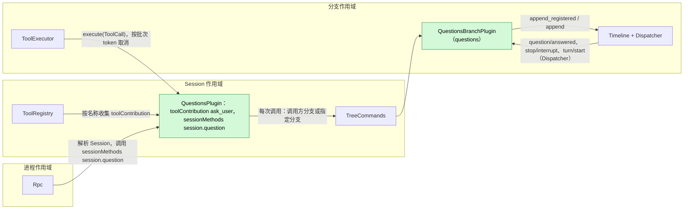
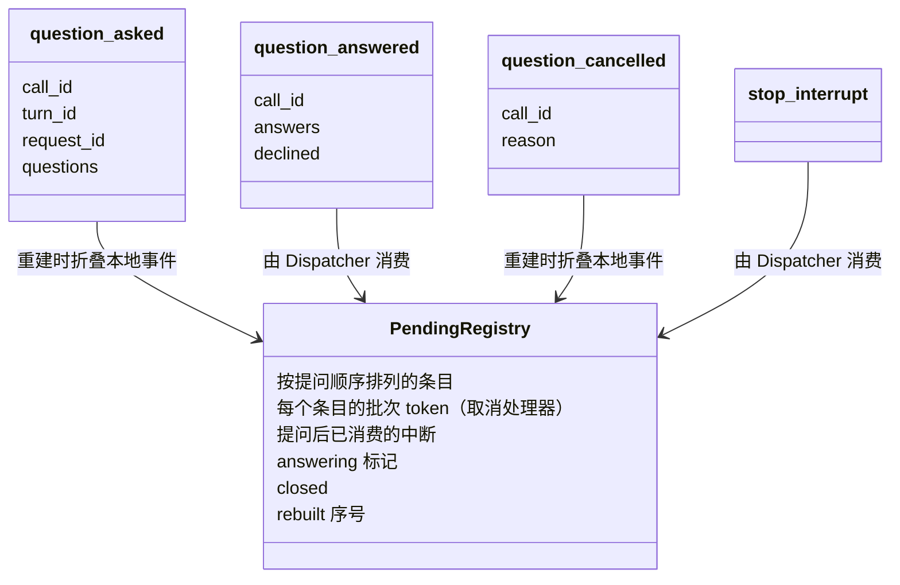
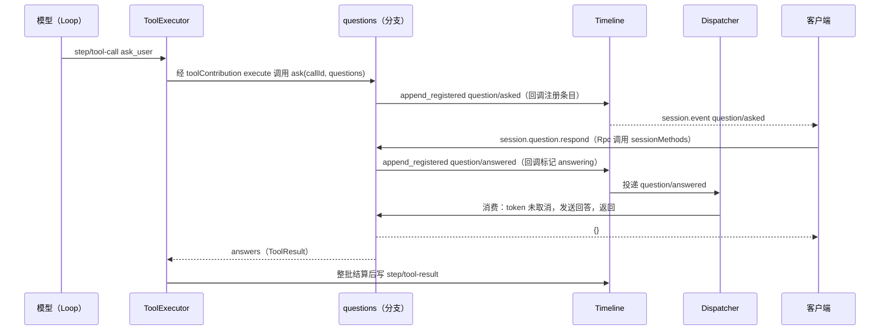
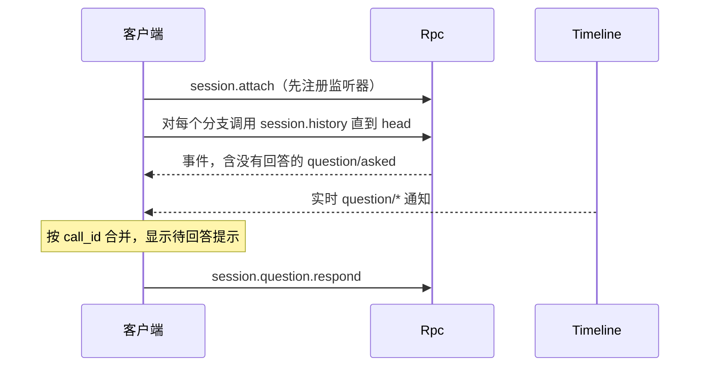
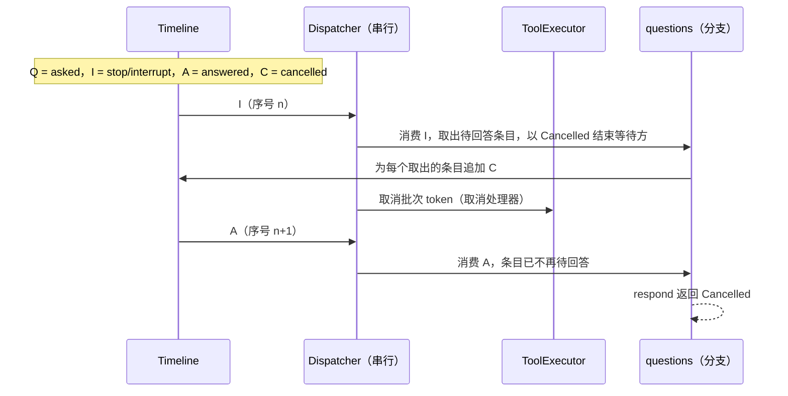
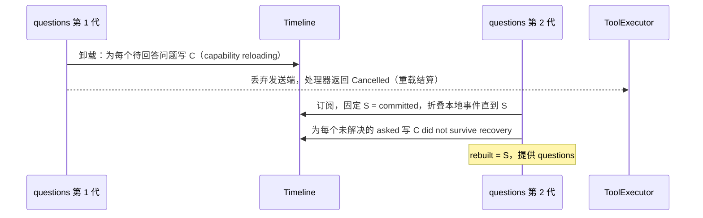

# Questions

状态：需要重新设计。总体设计：[overview §4](../overview.md)。阶段：P1。语言：Rust。作用域：Session + 分支（[ADR 002](../../adr/002-plugin-scope.md)）。

> **需要重新设计。** 本文不具权威性，不得按现文实现。模型已经通过 `ask_user` 的工具结果拿到回答，调用在所属 turn 内同步等待。三个 `question/*` 事件以及由此带来的对 #2（客户端可见事件）的依赖缺少依据：待答问题可以从已提交、尚无结果的 `step/tool-call` 推导出来，中断、重载和恢复已由 ToolExecutor 用该调用的 `step/tool-result` 结算。重新设计要决定在工具调用和结果之外是否还需要事实（例如在批次完成前让其他客户端关闭提示，或在批次完成前崩溃时保留回答），并按设计规则 §4 rule 9 逐一说明理由。

模型通过 `ask_user` 工具向用户提出一个或多个问题并等待回答：单选、多选、一次调用多个问题、自定义回答。**Session 部分**以 `toolContribution` 服务（Session 作用域，key `ask_user`）提供 `ask_user` 工具，并通过 `sessionMethods` 服务（Session 作用域，key `session.question`）提供 Session 方法 `session.question.respond`（[session-boundary](../contracts/session-boundary.md)）。插件启用时，它安装在每个 Session 中；在非交互 Session 中，`ask_user` 回答当前没有可以回答的对象（§3.3）。**分支部分**把待回答的问题和回答记录为 Timeline 事实，并依据自己消费到的 `stop/interrupt` 按序号判定回答与中断，沿用 [Approval](../../../architecture/rust-agent/plugins/Approval.md) 的模式。

## 1. 结构



两个 Session 服务都不持有状态；它们在每次调用时通过 `S:TreeCommands` 解析调用方分支（工具）或指定分支（方法）的 `questions` 服务，与 [Wait](../../../architecture/rust-agent/plugins/Wait.md) 相同。所有等待和排序都在分支部分。契约以语言中立形式给出（服务名、作用域、key、带数据形状的方法）；Rust 形式见[附录 G](#附录-g-rust-绑定)。

| 部分 | 作用域 | 依赖 | 提供 |
| --- | --- | --- | --- |
| `QuestionsPlugin` | Session | `S:TreeCommands` | `toolContribution` key `ask_user`；`sessionMethods` key `session.question`（`session.question.respond`） |
| `QuestionsBranchPlugin` | 分支 | `B:Timeline`、`B:Dispatcher` | `questions`（分支作用域；`ask`、`respond`），仅供 Session 部分使用 |

安装：两个部分都在插件的 `provides` 中声明各自的服务，插件启用时 Agents 就安装它们。安装从不依赖 `SessionConfig.interactive`（[session access §9.4](../contracts/session-access.md#94-按启用状态安装可选部分)），因此每个 Session 都声明 `ask_user`，fork 前后工具集合不变。处理器从所属 Session 的配置读取 `SessionConfig.interactive`（由 `session.create` 设置；ACP、`exec`、Scheduler 和 Workflow 的 Session 都是非交互的）。ToolRegistry 和 Rpc 按名称和作用域收集这些服务。

依赖的契约：`toolContribution`（ToolRegistry 接受按名称提供的工具服务，[工具贡献](../../../architecture/rust-agent/tool-contributions.md)补充）；ToolExecutor 的批次 token（只用于取消处理器）与结算；`stop/interrupt` 数据契约；[single-tree](../../../architecture/rust-agent/single-tree.md) 的 `Timeline` 追加契约和 Dispatcher 协议（类型化运行时服务；Questions 用 Rust 实现）；`SessionConfig.interactive`（[session-access](../contracts/session-access.md)）；`sessionMethods`（[session-boundary](../contracts/session-boundary.md)）；客户端可见的动态事件（#2，A10；需求见 [§9](#9-向机制所有者提出的需求)）；Permission 风险类别 `session`。

本文定义的契约：`ask_user` 工具、`question/*` 的数据与消费契约、`questions` 分支服务、`session.question.respond` 及其错误。`question/answered` 唯一的写入路径是 `questions.respond`。

## 2. 数据与状态



三个事件都是只由 `questions` 服务写入的分支 Timeline 事实；待回答注册表是 `Mutex` 下的内存（不用 `StateCell`，与 Approval 相同），从不跨代保留。

结果规则，供重建和读取历史的客户端使用：问题在存在 `asked` 且既无 `answered` 也无 `cancelled` 时为**待回答**；存在 `answered` 且无 `cancelled` 时为**已回答**；否则为**已取消**。`cancelled` 优先，因为它恰好在回答未送达处理器时写入。

加载时的重建只折叠本分支的本地事件（子分支从不拥有父分支的问题），并为每个未解决的 `asked` 写入 `question/cancelled`（"did not survive recovery"）。

为什么需要这些事件：在处理器开始到 `step/tool-result` 之间，调用没有任何事实，而结果要等整批完成后才发布，因此"等待中"和"已回答"都无法推导；回答是用户内容，必须成为事实才能与 `stop/interrupt` 排序。`turn_id`、`request_id` 和 `declined` 扩展了总体设计中的载荷（A3，F1）。

## 3. 流程

### 3.1 提问与回答



`respond` 只在 Dispatcher 消费了回答之后才返回，因此 `{}` 表示回答已送达正在等待的调用。Dispatcher 处理器只负责解析通道；结果由 ask future 构建。

### 3.2 断开与重新附着



监听器注册之前分发的内容都在历史中，之后的内容实时到达，重复项按 `call_id` 合并。Rpc 不增加 Questions 专用的重放。

### 3.3 非交互 Session

`ask_user` 与其他 Session 中一样被声明。处理器读取 `SessionConfig.interactive`；为 `false` 时，调用立即返回一个说明当前没有可以回答的对象的结果（A.1），Questions 不写任何 `question/*` 事件。从不会有待回答的问题，因此 `session.question.respond` 找不到问题。

## 4. 时序与冲突

### 4.1 回答与中断



Questions 订阅 `stop/interrupt`（turn 级与分支级），依据自己的消费做决定，不看 ToolExecutor 的批次 token：读完 `I` 所在的整个批次后，取出每个待回答条目，写 `question/cancelled {reason: "interrupted"}`，以 Cancelled 结束等待方，并记下该分支当前轮次已被中断（消费到下一个 `turn/start` 时清除）；记录存在时到来的 `ask` 返回 Cancelled，不写任何内容；`Q` 在 `I` 之后提交、但在 Questions 消费 `I` 之前已登记的条目，也一并取出，因为它属于被中断的轮次（[time-bus](../../../architecture/rust-agent/time-bus.md) §2）；消费 `A` 时只有条目仍待回答才接受回答，这表示在其 `Q` 之后没有消费到序号更小的中断。`A` 单独写入，因此决定前已读完它所在的整个批次。若 `A` 在 `I` 之前，回答作为已完成结果保留；轮次仍在 `step/tool-result` 之后以取消结束。ToolExecutor 的批次 token 只用于停止处理器，不决定回答的去留。

### 4.2 重载与重启



不会重新提问。Session 部分的重载像任何贡献重载一样传播到 ToolRegistry 及其依赖方；在途调用以重载结算结束，轮次失败。这发生在罕见的结构性操作之后，是可接受的代价（[ADR 002](../../adr/002-plugin-scope.md) D3）。

| 场景 | 结果 |
| --- | --- |
| 两个客户端都回答 | 第二次注册失败，`AlreadyAnswered` |
| 客户端无法回答（`-p` 附着到交互 Session） | CLI 停止轮次，退出码 3（A8） |
| 已配对的远程设备回答 | 允许：已配对设备可以调用 Session 方法 |
| 待回答期间出现 `input/withdraw` / `input/deleted` | 对问题没有影响 |
| 提问中途进程重启 | 加载时写 `C`；批次按未执行结算；轮次 Failed |

完整表格：附录 B。

## 5. 上下文映射

| 模型看到的内容 | 形式 | 位置 |
| --- | --- | --- |
| `ask_user` 名称、描述、schema | 固定的工具声明 | 已采用的 `context/configured`，每个 Session |
| 回答、拒绝回答 | `ToolResult.content`（附录 A.1） | 工具结果位置，在批次中所有调用结算之后 |
| 取消 | ToolExecutor 给出的错误文本 | 同一位置 |

始终不可见：`question/*` 事件、`structuredContent`、CLI 渲染。压缩保留声明，回答只通过摘要保留。子分支继承其 `step/tool-result` 位于切点之前的回答；在 `asked` 与其结果之间被切断的调用投影为未执行。

## 6. 接口（摘要）

| 接口 | 类型 | 用途 |
| --- | --- | --- |
| `ask_user` | `toolContribution`（Session，key `ask_user`），风险 `session` | 提出 1–4 个问题，等待回答 |
| `session.question.respond` | `sessionMethods`（Session，key `session.question`） | 回答或拒绝一个待回答的调用 |
| `questions.ask` / `respond` | 分支服务 `questions`，Questions 内部使用 | 注册并等待；回答的边界写入 |
| `question/asked`、`question/answered`、`question/cancelled` | 事件 | 待回答状态与回答排序 |
| CLI 提示契约 | 客户端 | 渲染、延后、`Ctrl+C`、附着 |

## 7. 安全

`ask_user` 不使用任何宿主资源，属于 `session` 风险（在所有预设下都允许；`disallowed_tools` 仍然适用）。回答是作为事实写入并重放给模型的用户内容；客户端不得在其中放入机密。任何具有 Session 访问权的客户端都可以调用 `session.question.respond`，包括已配对的远程设备（[RemoteGateway](RemoteGateway.md)）；它除回答之外不授予任何权限。Questions 从不放宽权限；重放从不重新提问。

## 8. 规则检查

规则：[principles §1 与 §4](../../../architecture/rust-agent/principles.md)，[ADR 002](../../adr/002-plugin-scope.md) D1–D5。

| 规则 | 本文如何符合 |
| --- | --- |
| §4.1 改别的模块拥有的状态时写指令事件 | Questions 只写自己的 `question/*` 事实；调用的终态事实仍是 ToolExecutor 的 `step/tool-result`。 |
| §4.2 交接后不能撤回 | 回答在消费 `question/answered` 时交给等待的调用，只交一次，之后不撤回。 |
| §4.3 只用 before 回调在写入前干预 | 不适用：Questions 不注册 before 回调，也不加入口检查；`respond` 只校验自己的参数。 |
| §4.4 核心机制不带业务含义 | Questions 不要求 Timeline、Dispatcher、ToolExecutor 或 Rpc 改动；它的事件是自己声明的事件。 |
| §4.5 决定前读完整个批次 | `question/answered` 单独写入，读完其批次后才决定；`stop/interrupt` 在读完其整个批次后按序号顺序处理。 |
| §4.6 模型上下文只含交接后被读取的事件 | 回答只经 ToolExecutor 的 `step/tool-result` 进入模型；`question/*` 事件从不投影。 |
| §4.7 插件之间只通过公开事件和服务交互 | 回答与中断依据 Questions 自己消费的 `stop/interrupt` 判定，不依据 ToolExecutor 的批次 token 或内存。 |
| §4.8 向机制所有者提通用需求 | 客户端可见的动态事件（#2）见 §9；按启用状态安装链接到 [session access](../contracts/session-access.md) §9.4；Connection 转发是列在 [overview 附录 B.2](../overview.md) 的改动。 |
| §4.9 只有后续决定要用的事实进入 Timeline | `question/asked` 与 `question/cancelled` 在重建时决定待回答状态，`question/answered` 是回答判定读取的边界事实；客户端显示用的也是这些事件，没有新增只供显示的事件。 |
| §1 Capability 与 App Server 边界 | 两个部分都是各自包中的 Capability；Rpc 只分派 `sessionMethods`，不含 Questions 逻辑。 |
| ADR 002 D1 作用域跟随状态所有者 | 工具与方法是 Session 服务；待回答的问题是分支状态。 |
| ADR 002 D2 不设接线模块 | ToolRegistry 与 Rpc 按名字和作用域收集服务；没有模块指名 Questions。 |
| ADR 002 D3 依赖跟随作用域 | Session 部分只依赖 Session 服务；重载会取消待回答的问题，可接受。 |
| ADR 002 D4 结构性配置与业务配置分离 | 不适用：Questions 没有配置；安装不依赖 `SessionConfig.interactive`，处理器把它当作 Session 数据读取。 |
| ADR 002 D5 合同语言中立 | 工具、方法、分支服务与事件以中立形式给出；附录 G 只是一种绑定。 |

## 9. 向机制所有者提出的需求

### R1. 客户端可见的动态事件（#2，运行时）

| 项 | 内容 |
| --- | --- |
| 被哪条规则挡住 | principles §4 第 4 条与 overview 约束 3：Rpc 不能为 Questions 增加专门通知，但客户端必须实时看到 `question/*` 才能显示和关闭提示。 |
| 考虑过的现有机制 | 像 `approval.request` 那样的专用 Rpc 通知（Rpc 中出现 Questions 专用代码）；客户端轮询 `session.history`（没有实时提示）；返回待回答问题的 Session 方法（仍需实时信号）。 |
| 需要的通用能力 | #2 动态事件登记时可声明“客户端可见”，登记的任何使用方都能读取该标记。Connection 把所有如此声明的事件作为 `session.event` 转发、不理解其含义，这是列在 [overview 附录 B.2](../overview.md) 的 Transport/Connection 改动，不属于本需求。 |
| 对序号、批次、中断、重载的影响 | 对序号与批次无影响：该标记是静态登记数据，通知与其他事件一样在提交后发布。中断与重载不变；历史重放与实时通知按事件身份合并。 |
| 由谁实现，对应 issue | 运行时；[#2](https://github.com/arcships/dim/issues/2)。 |

### R2. 按启用状态安装可选部件（运行时，Agent 装配）

五项内容见 [session access](../contracts/session-access.md) §9.4：Agent 装配在插件启用时安装其部分，在 Session 加载时决定，且从不依赖 `SessionConfig.interactive`。Questions 需要它，使装配代码不指名 Questions。

## 附录 A. 接口细节

### A.1 工具 `ask_user`

服务 `toolContribution`，Session 作用域，key `ask_user`，Questions 启用时在每个 Session 中列出。`declaration(): sync -> ToolDeclaration` 返回名称、固定描述、下列参数 schema 和风险 `session`；`execute(ToolCall): async -> ToolResult` 运行处理器。消费方通过对调用发出取消请求来取消（ToolExecutor 的批次 token）。

| 参数 | 类型 | 规则 |
| --- | --- | --- |
| `questions` | 数组，1..=4（A4） | 必填 |
| `questions[].id` | 字符串 | 可选；默认按位置为 `"1"`、`"2"`……；在调用内唯一 |
| `questions[].header` | 字符串，最多 40 个字符 | 可选的短标签 |
| `questions[].question` | 非空字符串 | 必填 |
| `questions[].options` | `{label, description?}` 数组，2..=6，标签唯一 | 必填（A4） |
| `questions[].multiSelect` | 布尔，默认 false | 多选 |
| `questions[].allowCustom` | 布尔，默认 true | "Other" 自由文本（A5） |

校验在处理器中进行；无效输入返回错误 `ToolResult`，不写任何内容。结果 `content`：

```
User answered:
1. <question>
   -> <label>, <label>
2. <question>
   -> (custom) <text>
```

被拒绝回答的调用得到 `User declined to answer the question(s).`（A6）。在非交互 Session 中，调用立即得到 `No one is available to answer the question(s).`，不登记条目，也不写任何 `question/*` 事件。`structuredContent` 携带 `{answers, declined}`，仅供客户端使用。被取消的调用以错误 `{code: "cancelled", reason}` 结束，由 ToolExecutor 报告。

### A.2 事件载荷

| 类型 | 载荷 | 写入路径 | 消费方 |
| --- | --- | --- | --- |
| `question/asked` | `call_id, turn_id, request_id: string`，`questions: Question[]` | `questions.ask`，`append_registered`；回调在锁内注册条目（已关闭或 `call_id` 已在待回答中时失败） | 重建；客户端显示提示 |
| `question/answered` | `call_id: string`，`answers: Answer[]`，`declined: boolean` | `questions.respond`，`append_registered`；回调以 `Closed`/`Cancelled`/`AlreadyAnswered` 失败，否则设置 `answering` 并按事件 id 保存等待方 | Dispatcher 订阅 `"Questions"`（同时订阅 `stop/interrupt` 与 `turn/start`），在重建闸门下，跳过 `sequence <= rebuilt`；仅当条目仍待回答、即其 `asked` 之后没有消费到 `stop/interrupt` 时接受。客户端关闭提示 |
| `question/cancelled` | `call_id, reason: string` | 仅 `questions`，`append`：消费 `stop/interrupt`、取消时的 ask future、消费方、`close()`、重建 | 重建；客户端关闭提示 |

三者都通过 #2 注册声明为客户端可见，从不渲染进模型历史。

| 形状 | 字段 |
| --- | --- |
| `Question` | `{id: string, header?: string, question: string, options: QuestionOption[], multi_select: boolean, allow_custom: boolean}` |
| `QuestionOption` | `{label: string, description?: string}` |
| `Answer` | `{question_id: string, selected: string[], custom?: string}` |

### A.3 分支服务 `questions`

分支作用域，无 key，由 `QuestionsBranchPlugin` 提供，只由其 Session 部分调用。

| 方法 | 模式 | 请求 | 回复 | 错误 |
| --- | --- | --- | --- | --- |
| `ask` | async | `{callId, turnId, requestId, questions: Question[]}` | `{answers: Answer[], declined: boolean}` | `cancelled {reason}`（来自消费方的取消请求、关闭、重载），`invalid {reason}` |
| `respond` | async | `{callId, answers: Answer[], declined: boolean}` | `{}`：回答已分发并送达正在等待的调用 | `unknown`、`already_answered`、`cancelled`、`invalid {reason}`、`closed` |

取消 `ask` 就是对调用发出取消请求；ToolExecutor 取消批次 token 时由 Session 部分发出。

### A.4 机制

| 步骤 | 机制 |
| --- | --- |
| 工具解析 | 处理器通过 `S:TreeCommands` 解析调用方分支的 `questions`；查找失败（分支已关闭或分支部分正在重载）→ 错误结果或带 `capability reloading` 的 Cancelled，与 Wait 相同 |
| 提问 | 当前轮次已记录为被中断（上次消费 `turn/start` 之后消费过 `stop/interrupt`），或 token 已取消：返回 Cancelled，不写任何内容。否则 `append_registered(question/asked)`；提交失败时移除条目并返回 Cancelled 或错误 |
| 等待 | `select! biased { response, cancel.cancelled() }`。取消时：在锁内取出条目；若取到，释放锁后写 `question/cancelled {reason: "Tool execution cancelled"}`；返回 Cancelled。发送端被丢弃：带 `capability reloading` 的 Cancelled |
| 回答 | 预先检查待回答状态，并按条目的 `asked` 数据校验；`append_registered(question/answered)`；等待分发结果 |
| 消费 `stop/interrupt` | 读完其整个批次后：取出该分支每个待回答条目；对每个条目写 `question/cancelled {reason: "interrupted"}`，以 Cancelled 结束其等待方，并向回答等待方回复 `Cancelled`；把当前轮次记为被中断，直到消费下一个 `turn/start` |
| 消费 `question/answered` | 条目仍待回答：取出，发送回答，回复 `Ok`。条目已被先消费的中断或取消取出：回复 `Cancelled`。条目不存在：`Unknown` |
| 复核 | 只看 Questions 自己已消费的 `stop/interrupt` 与 `turn/start`（[time-bus](../../../architecture/rust-agent/time-bus.md) §4）；批次 token 只用于停止处理器，以及在 `ask` 之前提前退出；它不决定任何事 |
| 终态事实 | `asked`/`cancelled` 由 Questions 写入，`answered` 是边界事实；调用的终态事实是 ToolExecutor 的 `step/tool-result` |
| 卸载 | 卸载清理函数：设置 `closed`，丢弃回答等待方（`Closed`），取出所有条目，写 `question/cancelled {reason: "capability reloading"}`，丢弃发送端。正在关闭的 Timeline 可能拒绝写入；该分支不会恢复 |
| 加载 / 重启 | 订阅，在闸门下固定 `S = committed()`，折叠 `local(..=S)`，取消未解决的问题，设置 `rebuilt`，提供 `questions` |

### A.5 Session 方法 `session.question.respond`

服务 `sessionMethods`，Session 作用域，key `session.question`。`describe()` 返回一个 `MethodDecl`：`{name: "session.question.respond", mutating: true, interruption: report, progress: false, notifications: [], reply: direct}`。Rpc 解析 Session 并发送 `call(MethodCall)`；处理器通过 `S:TreeCommands` 解析指定分支的 `questions`。

`params`：`{sessionId, branchId?: "main", callId, answers: [{questionId, selected: [label], custom?}], declined?: false}` → `MethodReply` 值 `{}`。错误为 `MethodError` 数据：

| 错误 | 条件 |
| --- | --- |
| `invalid_params` `Question is absent or already resolved` | `Unknown` |
| `invalid_params` `Question already answered` | `AlreadyAnswered` |
| `invalid_params` `Question was cancelled` | `Cancelled` |
| `invalid_params` `<reason>` | `Invalid`：未知的问题 id、未提供的标签、没有 `multiSelect` 时选了多个标签、没有 `allowCustom` 时给了 `custom`、未 `declined` 时既无选择也无 `custom` |
| `service_reloading` | 存活分支上的 `Closed`，或服务正在重载 |
| `unknown_method` | Questions 未启用（服务未安装） |
| `session_closed` | Session 已关闭 |

已接受的指令属于 Session，断开连接后继续执行。

### A.6 CLI 契约

CLI 处理所附着 Session 中每个分支的 `question/*` 通知（A9），与审批相同：

| 情形 | CLI 行为 |
| --- | --- |
| `question/asked`，没有打开的提示 | 排队；按到达顺序一次处理一个调用。打印 `[question] <header>`，每个问题及其编号选项，`allowCustom` 时加上 `0. Other (type your answer)`。提示 `Choose 1-N` 或 `Choose numbers, comma separated`。在第一个问题处输入空行即拒绝回答该调用（A6） |
| 提示已打开 | 其他通知延后到提示关闭 |
| 所有问题已收集 | `session.question.respond`；打印错误回复；`Cancelled`/`Unknown` 静默关闭提示 |
| 当前显示的调用出现 `answered`/`cancelled` | 关闭提示；打印 `[question answered elsewhere]` 或 `[question cancelled]` |
| 提示中按 `Ctrl+C` | `session.stop`（轮次）；中断会取消问题 |
| EOF | `session.stop`；退出码 130 |
| 无交互输入（`-p`）且收到问题 | `Interactive answer required; stopping`，`session.stop`，退出码 3（A8） |
| 附着或恢复 | 先注册监听器，再对每个分支调用 `session.history`；推导待回答问题；按 `call_id` 合并 |

## 附录 B. 完整冲突表

`A` = `question/answered`，`I` = 轮次 `stop/interrupt`，`Q` = `question/asked`，`C` = `question/cancelled`，`R` = `step/tool-result`。

| 场景 | 序号顺序 | 结果 | 决策归属 |
| --- | --- | --- | --- |
| 批次分发前中断 | I < `step/tool-call` 被消费 | 没有 `Q`；调用未执行 | ToolExecutor |
| 问题注册前中断 | I 已消费，然后 `ask` | 轮次已记录为被中断：`ask` 返回 Cancelled，不写任何内容 | Questions（按序号） |
| 中断在 `Q` 之前提交、在 `Q` 登记之后被消费 | I < Q，Q 在消费 I 之前登记 | 消费 I 时取出该条目（同一轮次）并写 C | Questions（按序号） |
| 先回答，后中断 | Q < A < I | 接受回答；结果作为已完成保留；轮次在 R 之后以取消结束 | Questions；ToolExecutor |
| 中断后，回答在 Questions 消费 I 之前提交 | Q < I < A < C | 消费 I 时写 C；消费 A 时没有待回答条目；`respond` → `Cancelled` | Questions |
| 中断，已写取消，然后回答 | Q < I < C | 注册失败 `Cancelled`；不写任何内容 | Questions |
| 两个客户端并发回答 | Q < A1（A2 被拒绝） | `AlreadyAnswered`；第一个决定结果 | Questions（注册锁） |
| 重复或迟到的 RPC | 在解决之后 | `Unknown` 或 `Cancelled`；不写任何内容 | Questions |
| 分支级中断、分支关闭 | Q < 分支 I | Questions 消费 I → C；关闭以 C 结算其余问题 | Questions；ToolExecutor |
| 已回答，批次中其他调用仍在运行 | Q < A < R | 回答保存在处理器结果中，直到 R | ToolExecutor |
| 已回答，然后在 R 前重载 | Q < A < 重载 | 批次重载结算，轮次 Failed；问题结果为已回答 | ToolExecutor |
| 回答已提交，分支部分在消费前卸载 | Q < A，卸载 | `close()` 写 C：已取消；`respond` → `service_reloading` | Questions |
| 待回答期间 Session 部分重载 | — | 传播到 ToolRegistry；批次重载结算，轮次 Failed；若分支部分也重载则写 C（D3） | ToolExecutor；Questions |
| 待回答期间的 Steer/Queue/Append | Q < 输入 | 只在 R 之后（Steer/Append）或 `turn/end` 之后（Queue）被消费；问题继续（A11） | Loop、InputQueue |
| 待回答期间的 `input/withdraw` / `input/deleted` | Q < withdraw | 没有影响；撤回只涉及 InputQueue 仍持有的输入 | InputQueue |
| 一个批次中多个 `ask_user` | Q1 < Q2 | 各自独立回答；结果一起发布 | Questions；ToolExecutor |
| 同一 `call_id` 提问两次 | — | 第二次注册失败；错误结果 | Questions |
| Q 与 R 之间压缩 | — | 不会发生：压缩在请求准备阶段运行，不在批次中运行 | ContextPreparation |
| 子分支在 Q 与 A 之间切出 | Q < 切点 < A | 子分支没有待回答问题；继承的调用投影为未执行 | Questions（子分支） |
| Session 卸载 | Q 待回答 | 轮次运行中，Session 不空闲，不卸载 | AgentIndex |
| 提问中途进程重启 | Q，无 A/C | 加载时写 C；批次结算；轮次 Failed | Questions；ToolExecutor；Loop |
| 客户端断开，从未有客户端附着 | Q 待回答 | 保持待回答，无超时（A7） | 用户 |
| 交互 Session 上的 `-p` CLI | Q < I | CLI 停止轮次；中断导致 C | CLI；Questions |
| 已配对的远程设备回答 | Q < A | 与任何客户端一样被接受 | Questions |
| 非交互 Session | — | `ask_user` 回答当前没有可以回答的对象；没有 `Q`；`respond` 找不到问题 | Questions |

## 附录 C. 错误与恢复

| 情形 | 结果 |
| --- | --- |
| 工具输入无效 | 错误 `ToolResult`；不写任何内容 |
| 分支服务查找失败（正在重载） | 带 `capability reloading` 的 Cancelled；ToolExecutor 重载结算 |
| `asked` 提交失败 | 移除条目；Cancelled 或错误结果 |
| 中断、分支关闭 | `question/cancelled`；`execute` 以 `cancelled` 结束 |
| 重载、重启 | 为每个未解决的问题写 `question/cancelled`；从不重新提问 |
| 重载期间的 `respond` | `service_reloading`；重试返回 `Unknown`，因为问题已取消 |

## 附录 D. 验收

通过 RPC、工具调用和事件进行的流程测试：

1. 单选、多选、多问题和自定义回答产生规定的 `content`；无效回答在 `respond` 时被拒绝，不产生事实。
2. 以 `interactive: false` 创建的 Session（包括 `exec` 和 ACP）：`ask_user` 被声明，并回答当前没有可以回答的对象，不产生 `question/*` 事件；省略 `interactive` 时照常提问。两种情况下工具集合相同。
3. 先回答后停止：结果包含回答。先停止后回答：`Cancelled`、`question/cancelled`、已取消结果。两种顺序都通过在 Dispatcher 被挂起时先提交 `I` 再提交 `A` 来强制产生。`I` 在 `Q` 之前提交、在其之后被消费：问题被取消；`I` 被消费之后的 `ask` 不写任何内容。
4. 两个并发 `respond`：恰好接受一个。
5. 一个批次中两个 `ask_user` 加一个慢工具：回答保留到唯一的 `step/tool-result`。
6. 分支关闭和分支部分重载会结算待回答问题；重启写入 "did not survive recovery" 且轮次失败；不重新提问。
7. 断开并重新附着：历史显示待回答问题；重新附着后回答有效；从已配对的远程设备回答有效。
8. 问题待回答期间，已删除的排队输入（`input/deleted`）不影响该问题。
9. CLI：渲染、延后、`Ctrl+C`、EOF、`-p` 退出码 3。

## 附录 E. 假设

| # | 假设 | 依据 | 若被否决的影响 |
| --- | --- | --- | --- |
| A1 | 每个 Session 都声明 `ask_user`，`interactive` 为 `false` 时回答当前没有可以回答的对象 | [Session 访问 A.3](../contracts/session-access.md#a3-sessionconfig-字段)（装配从不读取 `interactive`，#30）；决定 §3（ACP/自动化为非交互） | 各 Session 工具集合不同；fork 丢失提示词前缀 |
| A2 | `session.create` 省略 `interactive`，或已存储记录缺少该字段，表示交互 | [Session 访问 A.3](../contracts/session-access.md#a3-sessionconfig-字段) 的格式决定 | 现有 Session 不再提问 |
| A3 | 载荷增加 `turn_id`、`request_id`、`declined` | 判断 | 通过 `step/tool-call` 关联；拒绝回答建模为一种回答 |
| A4 | 1..=4 个问题，2..=6 个选项 | 边界情况参考；判断 | schema 限制改变 |
| A5 | 默认允许自定义回答 | 功能列表"自定义回答"；默认值是判断 | 模型必须显式开启 |
| A6 | 用户可以拒绝回答整个调用 | 维护者决定 | 用户必须回答或停止 |
| A7 | 无超时 | 维护者决定 | 超时会写 `question/cancelled {timeout}` |
| A8 | 没有输入的 CLI 以退出码 3 停止 | CLI 审批先例 | 不同的退出策略 |
| A9 | 展示每个分支的问题 | 审批先例 | 子分支的问题需要另一个客户端 |
| A10 | #2 注册把事件标记为客户端可见，Connection 将其作为 `session.event` 转发 | 总体设计 §1（#2）；判断 | Rpc 需要类似 `approval.request` 的专用通知 |
| A11 | Steer 不结束待回答的问题 | 判断 | Steer 以原因 `user steer` 取消 |

## 附录 F. 待对齐问题

| # | 问题 | 说明 |
| --- | --- | --- |
| F1 | 总体设计 §7 的载荷 | `turn_id`、`request_id`、`declined` 不在总体设计的 `question/*` 字段中（A3） |

## 附录 G. Rust 绑定

Questions 用 Rust 实现；本绑定是上述中立契约的一种实现。

| 中立契约 | Rust 绑定 |
| --- | --- |
| `toolContribution` key `ask_user` | `S:ToolContribution`，由 ToolRegistry 作为 `Contributions<ToolContribution>` 的条目 `ask_user` 收集；`execute` 映射到处理器 `HostFuture<Result<ToolResult, HostError>>`，取消请求映射到批次 `CancellationToken`，`cancelled` 映射到 `HostError::Cancelled` |
| `sessionMethods` key `session.question` | `SessionMethodContribution(Arc<dyn MethodProvider>)`，key `SessionScope::named_key::<SessionMethodContribution>("session.question")`；`describe` = `methods()`，`call` = `call(MethodCall, CallChannel, CancellationToken)` |
| `questions` | `B:Questions`，key `BranchScope::key::<Questions>()`；Dispatcher 订阅 `"Questions"`，订阅 `question/answered`、`stop/interrupt` 与 `turn/start` |

```rust
pub struct Question { pub id: String, pub header: Option<String>, pub question: String,
    pub options: Vec<QuestionOption>, pub multi_select: bool, pub allow_custom: bool }
pub struct QuestionOption { pub label: String, pub description: Option<String> }
pub struct Answer { pub question_id: String, pub selected: Vec<String>, pub custom: Option<String> }

impl Questions {
    /// Registers and waits. `cancel` is the batch token from ToolExecutor.
    pub async fn ask(&self, call_id: &str, ctx: &ToolExecutionContext, questions: Vec<Question>,
        cancel: CancellationToken) -> Result<Answered, HostError>;
    /// `Ok` means the answer was dispatched and delivered to the waiting call.
    pub async fn respond(&self, call_id: &str, answers: Vec<Answer>, declined: bool)
        -> Result<(), QuestionRespondError>;
}
pub enum QuestionRespondError { Unknown, AlreadyAnswered, Cancelled, Invalid(String), Closed }
```

卸载清理函数通过 `ctx.effect` 注册。
