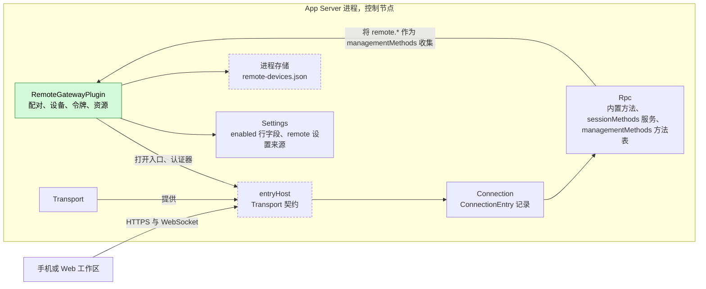
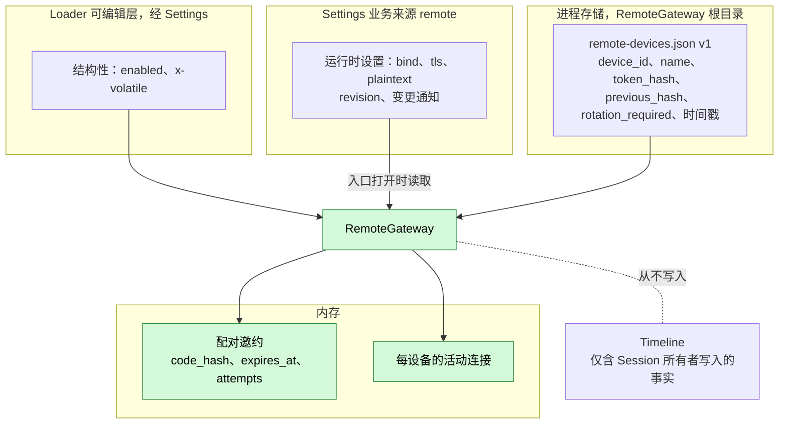
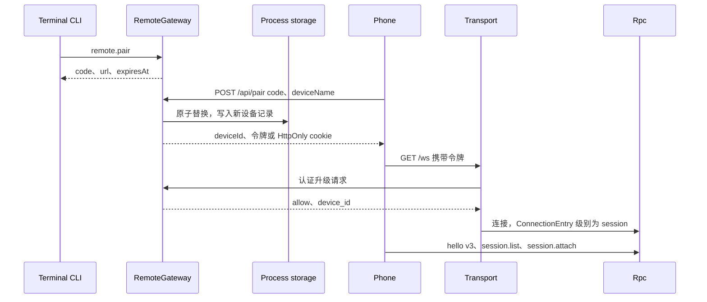
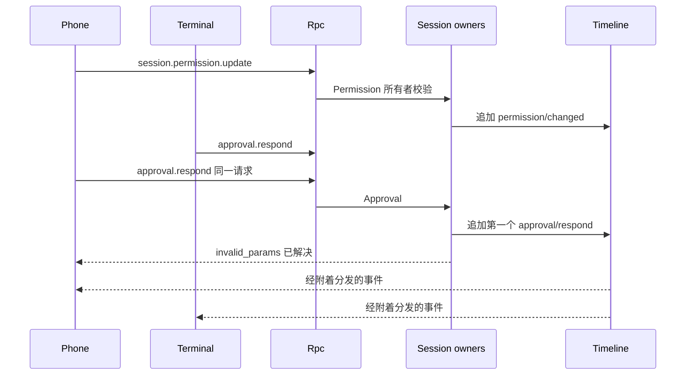
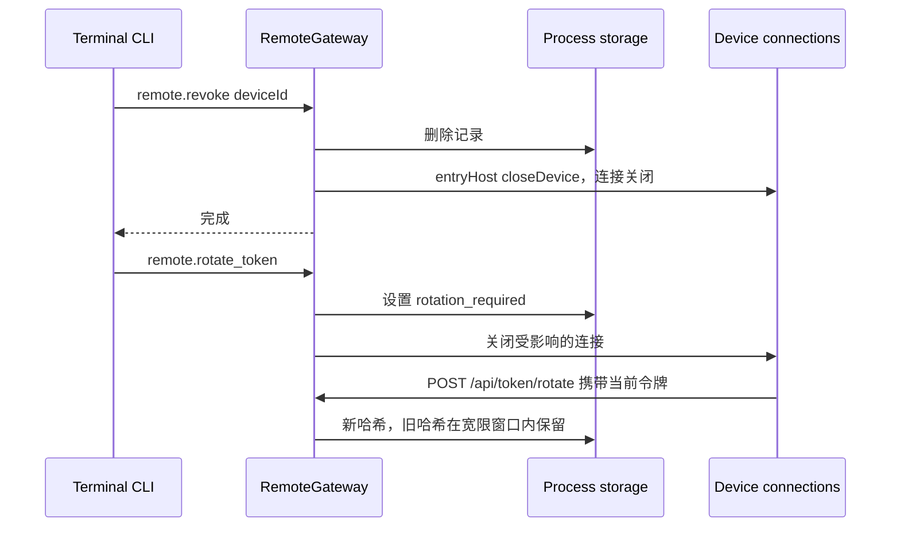
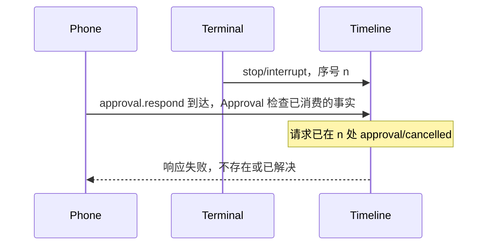

# RemoteGateway

状态：草案。总体设计：[overview B.13](../overview.md)，[Transport、Connection 变更](../overview.md)，[多节点](../overview.md)，[通用约束](../overview.md)，[ADR 002](../../adr/002-plugin-scope.md)。阶段：P3（认证、断连与 TLS 的取舍与 [#5](https://github.com/arcships/dim/issues/5) 一起决定）。语言：Rust。

RemoteGateway 在 Transport 的 WebSocket 上为手机和 Web 工作区开设一个经认证的入口：通过二维码或配对码配对，每设备令牌及其轮换与吊销，以及 Web 工作区的静态资源。已配对设备使用现有的 App Server 协议；该入口只提供[方法](../contracts/session-boundary.md)契约中的 Session 级（Rpc 的 Session 内置方法和每个 `sessionMethods` 服务），因此设备可以调用每个 Session 方法，包括 `session.permission.update`（决策 E3），但不能调用任何管理级方法。该入口是产品 UI 面，从不承载节点之间的 rutis 链路面。

## 1. 结构



RemoteGateway 只认证升级请求，并在连接上记录设备；此后的每次调用都是由其所有者提供的普通 Session 级方法。它自己的 `remote.*` 方法是一个 `managementMethods` 进程服务（key `remote`），由 Rpc 按名称以管理级收集进其方法表，因此可从为该级别配置的入口（本地入口）访问，从不能从已配对设备访问。Rpc 依赖该服务，因此 RemoteGateway 重载会重载 Rpc；重载是少见的结构性事件，该代价被接受（[ADR 002 D3](../../adr/002-plugin-scope.md)）。

| 部分 | 作用域 | 依赖 | 提供 |
| --- | --- | --- | --- |
| `RemoteGatewayPlugin` | 进程，控制节点 | `entryHost`（Transport）、进程存储、Settings | `managementMethods` key `remote`（`remote.*`），由 Rpc 收集；以入口名 `remote` 为 key 的 `upgradeAuthenticator` 与 `httpRoutes` |
| `TransportPlugin`（变更） | 进程 | 现有；每入口的 `upgradeAuthenticator`、`httpRoutes` | 现有 `ListenAddresses`；新增 `entryHost` |
| `ConnectionPlugin` / `RpcPlugin`（变更） | 进程 | 现有 | `ConnectionEntry {name, levels, device_id}`；Rpc 只分派入口被配置提供的级别 |

此处定义的契约：设备记录与令牌、配对与轮换 HTTP 端点、`remote.*` 方法、`remote-devices.json` 格式。依赖的契约：Transport 的 `entryHost`、`upgradeAuthenticator` 与 `httpRoutes` 服务（拟议的 Transport 变更，[语言中立](../../adr/002-plugin-scope.md)形式见 A.1，Rust 绑定见附录 G；Transport 作为其消费方拥有它们）、Connection 的入口记录、[方法](../contracts/session-boundary.md)契约（Rpc 方法表中的管理级条目，每入口提供的级别）、[进程存储](../overview.md)、用于结构性 `enabled` 字段的类型化 Settings 操作（`x-volatile`、`VolatileUpdate`，rutis-loader 0.10），以及用于运行时设置的 Settings 业务来源（ADR 002 D4）。RemoteGateway 不了解任何 Session 方法的含义，也不了解任何其他插件。

## 2. 数据与状态



`enabled` 是结构性插件配置；`bind`、`tls` 和 `plaintext` 是在入口打开时读取的业务配置，变更是带通知的数据更新，从不触发插件重载（A16）。设备记录是位于进程存储中的宿主本地安全材料（原子替换、锁、格式版本、仅所有者可访问的文件）；文件损坏或不可读时失败即拒绝。邀约和活动连接位于内存中，重载或重启时丢失。Timeline 只保存 Session 所有者为远程调用写入的事实，不含设备归属（A2）。

## 3. 流程

### 3.1 配对与连接



邀约为一次性使用，在写入记录之前即被消耗；令牌只以哈希形式存储。

### 3.2 远程控制 Session



远程和本地客户端是对等的 Session 客户端；所有者在各自边界校验，由 Timeline 序号在它们之间裁决。两个附着方以每分支顺序看到相同的事件。

### 3.3 吊销与轮换



吊销在连接关闭之前持久化，因此与之竞争的、使用旧令牌的升级请求会被拒绝。被吊销设备已准入的命令继续执行；其回复丢失。

## 4. 时序与冲突



远程与本地客户端之间的每场竞争都由所属插件内部的 Timeline 序号裁决；RemoteGateway 只决定其自身的配对、吊销与轮换顺序。

| 场景 | 结果 | 负责方 |
| --- | --- | --- |
| 手机与终端回答同一审批或问题 | 第一个被消费的事实决定；第二个失败 | Approval、Questions |
| 手机 `session.permission.update` 与终端竞争 | 两个 `permission/changed` 事实；序号较后者生效 | Permission |
| 手机在输入被应用时撤回该输入（`session.input.withdraw`） | `input/applied` 先于 `input/withdraw`：`notHeld`，不写入任何内容，正常消费；`input/withdraw` 在先：`input/deleted`，从不被应用 | InputQueue |
| 带待处理审批断开连接 | 保持待处理；重新附着时重放；无超时（A14） | Approval |
| 该设备的请求运行时被吊销 | 连接关闭；命令继续；回复丢失 | Rpc |

完整表格：[附录 B](#附录-b-完整冲突表)。

## 5. 上下文映射

自身无模型可见效果。远程客户端的内容与本地客户端内容完全一样地进入模型：`session.submit` 用户内容（文本、图像）在输入被消费的位置成为一条用户消息，不带来源标记，因为用户就是其作者；审批、停止、撤回和权限变更不是模型内容。压缩、子分支继承和非交互 Session 遵循 Session 输入规则（[session access](../contracts/session-access.md)）。模型从不看到设备 id、设备名、令牌、入口名或诊断。

## 6. 接口（摘要）

| 接口 | 类型 | 用途 |
| --- | --- | --- |
| `GET /`、`/assets/*` | HTTP | Web 工作区静态资源 |
| `POST /api/pair`、`POST /api/token/rotate` | HTTP | 配对、设备令牌轮换 |
| `GET /ws` | WebSocket | 面向已配对设备的 App Server 协议 v3：全部 Session 方法 |
| `remote.start/stop/status/pair/devices/revoke/rotate_token` | 方法，管理级 | 入口与设备的本地管理 |
| `entryHost`、`upgradeAuthenticator`、`httpRoutes`、`ConnectionEntry` | Transport/Connection 变更（进程服务、数据记录） | 带装配定义级别的经认证入口 |
| CLI | `/remote`、`/web`、`dimcode remote`、`dimcode web` | 用户入口 |

详见：[附录 A](#附录-a-接口细节)。

## 7. 安全

每个已配对设备对宿主上的每个 Session 拥有完整的 Session 级控制：提交输入、回答审批和问题、停止轮次、`session.permission.update`、`session.exec.stop`、`session.model.update`、`session.mcp*`，以及在任何已授权目录中创建 Session（决策 E3、A12）。这放宽了如今仅限本地的执行类 Session 方法，并记录在[兼容性表](#a3-远程入口上的协议与兼容性)中。远程更改的权限预设是 Session 配置（决策 E4）：一个由子分支继承、在 fork 时重置为默认值的 Timeline 事实。该入口从不授予管理权限：配对、吊销、配置、宿主本地批准和 `daemon.shutdown` 都是 `level: management`，需要提供该级别的入口；在此提供该级别是一个装配选项，等同于给每个已配对设备宿主管理员权限。认证保持最小化（[overview 多节点](../overview.md)）：每设备一个 bearer 令牌，静态存储为哈希，由设备轮换，在本地吊销；配对码短时有效、一次性使用且有速率限制。Cookie 为 `HttpOnly`、`Secure`、`SameSite=Strict`，并进行同源 `Origin` 检查。令牌从不出现在 URL、日志、诊断或 Timeline 中。该入口从不接受 rutis 链路帧，也不导出服务。

## 附录 A. 接口细节

### A.1 Transport 变更（拟议，由 Transport 拥有）

三个进程服务。`entryHost`（无 key）由 Transport 提供。`upgradeAuthenticator` 与 `httpRoutes` 由入口的所有者提供，以入口名（`remote`）为 key，在其 `provides` 中声明；Transport 在入口打开时按名称收集它们。错误是数据 `{ code, message }`。

| 服务 | 方法 | 类型 | 请求 | 回复 |
| --- | --- | --- | --- | --- |
| `entryHost` | `open` | 异步 | `{ name, bind: "<ip>:<port>", tls?: { cert_path, key_path }, levels: ["session"] }` | `{ entry_id, address }`；在 Transport 的 HTTP/WebSocket 栈上绑定一个监听器 |
| `entryHost` | `close` | 异步 | `{ entry_id }` | 监听器及其接受的每个连接关闭（脱离）后返回 `{}` |
| `entryHost` | `closeDevice` | 异步 | `{ entry_id, device_id }` | 该设备的连接关闭后返回 `{}` |
| `upgradeAuthenticator` | `authenticate` | 异步 | `{ headers, origin?, remote_addr }`（令牌只在 headers 或 cookie 中） | `{ verdict: "allow", device_id } \| { verdict: "deny" }` |
| `httpRoutes` | `handle` | 异步 | `{ method, path, headers, body_base64? }` | `{ status, headers, body_base64? }` |

`levels` 是装配数据；RemoteGateway 传入 `["session"]`（A1）。每个被接受的连接都携带数据记录 `ConnectionEntry { name, levels, device_id? }`。吊销调用 `closeDevice`；丢弃入口调用 `close`。Transport 与 RemoteGateway 是 Rust 实现，使用附录 G 中的绑定。

没有 RemoteGateway 时，裸 WebSocket 保持现有规则（受保护 profile：只允许 `hello` 和 `daemon.ping`）。

### A.2 HTTP 接口面

| 路径 | 认证 | 行为 |
| --- | --- | --- |
| `GET /`、`GET /assets/*` | 无 | 限定在发行包 assets 目录内的静态文件；不可变缓存头；严格的 Content-Security-Policy（A5） |
| `POST /api/pair` | 配对码 | `{code, deviceName, web?}` → `{deviceId, token}`；`web: true` 时改为设置 `HttpOnly; Secure; SameSite=Strict` cookie（A6）；邀约一次性使用 |
| `POST /api/token/rotate` | 当前或上一个令牌 | 新令牌；上一个令牌对该端点和升级请求保持有效，直至新令牌被使用或经过 10 分钟（A7） |
| `GET /ws` | Bearer 令牌，或带同源 `Origin` 的 cookie | 升级；未知、已吊销或 `rotation_required` 时返回 401 |

令牌：32 个随机字节，base64url；SHA-256 哈希以常量时间比较。配对码：8 个 Crockford base32 字符（A8）。尝试次数：每个邀约 5 次，每个入口每分钟 20 次；超出则使邀约失效（A9）。默认 loopback；非 loopback 需要 `tls` 或显式 `plaintext: true`（A10）。

### A.3 远程入口上的协议与兼容性

| 项目 | 规则 |
| --- | --- |
| 版本 | 仅 `hello` v3；v1/v2 以 `protocol_version` 拒绝（A11） |
| 方法 | Rpc Session 内置方法和每个 `sessionMethods` 服务，作用于宿主上的每个 Session（E3、A12）；Rpc 方法表中的管理级名称，包括 `daemon.shutdown` → `-32601 unknown_method` |
| `hello.features` | 仅 Session 功能 |
| 身份 | `ConnectionEntry.device_id` 用于诊断与吊销；不授予超出入口方法集的任何权限 |
| 反向请求 | 无：客户端发请求，服务端发通知（[#5](https://github.com/arcships/dim/issues/5)） |

兼容性（来源：[protocol.rs](../../../../crates/dim-app-server/src/protocol.rs) 中的 `LOCAL_EXECUTION_METHODS`、`Call::is_management`；[connection.rs](../../../../crates/dim-app-server/src/connection.rs) 中的 `validate_call`）：

| 客户端 | 之前 | 之后 |
| --- | --- | --- |
| v3 远程入口（新） | 不存在；执行类 Session 方法（`session.permission.get/update`、`session.exec.stop`、`session.skills`、`session.model.update`、`session.prompt.refresh`、`session.mcp`、`session.mcp.refresh`）仅限本地 | **兼容性变更（E3）：**与其他全部 Session 方法一起对已配对设备可用；管理级名称和 `daemon.shutdown` 为 `unknown_method` |
| v3 裸 WebSocket，受保护 profile，无 RemoteGateway | 除 `hello`/`daemon.ping` 外均为 `local_transport_required` | 不变 |
| 远程入口上的 v1、v2 | 不存在 | `protocol_version`（A11） |

### A.4 方法（`managementMethods`，key `remote`，管理级）

| 方法 | 参数 | 结果 | 中断 |
| --- | --- | --- | --- |
| `remote.start` | `{bind?, tls?, plaintext?}` | 绑定后返回 `{address}` | Report |
| `remote.stop` | `{}` | 监听器与连接关闭后返回 `{}` | Report |
| `remote.status` | `{}` | `{enabled, running, address?, tls, error?, devices, connections}` | Drain |
| `remote.pair` | `{ttlSeconds?}`（默认 300，最大 900） | `{code, url, expiresAt}`；`url` 为 `<origin>/pair#code=<code>` | Drain |
| `remote.devices` | `{}` | `[{deviceId, name, pairedAt, lastSeenAt, connections, rotationRequired}]` | Drain |
| `remote.revoke` | `{deviceId}` | 记录删除且连接关闭后返回 `{}` | Report |
| `remote.rotate_token` | `{deviceId?}`（缺省：全部） | 标记持久化且连接关闭后返回 `{}` | Report |

`remote.start`/`stop` 通过类型化 Settings 操作写入结构性 `enabled` 字段；loader 投递 `VolatileUpdate` 而不重载插件，RemoteGateway 随之调用 `entryHost.open` 或 `close`。`remote.start` 的参数 `bind`、`tls`、`plaintext` 先保存到业务来源。入口运行期间业务来源变更时，以新设置关闭并重新打开入口（连接脱离），而不重载插件（A16）。

### A.5 Capability 机制

| 步骤 | 路径 |
| --- | --- |
| 写入 | RemoteGateway 不写入。远程调用与本地调用一样经 Rpc 到达所有者：`session.submit` → Session 输入边界（`Timeline::append`），`approval.respond` → 分支 Approval（`approval/respond`），`session.stop` → `stop/interrupt`，`session.permission.update` → Permission（`permission/changed`），`session.input.withdraw` → InputQueue 的撤回服务（撤回指令 `input/withdraw`；若 InputQueue 仍持有该输入，则写入 `input/deleted`） |
| Dispatcher | 不订阅；设备通过其每连接的 Session 附着接收事件 |
| 并发附着方 | 无独占所有者（A13）；全部以每分支顺序收到相同事件 |
| 重载 | 关闭入口：监听器与远程连接关闭（脱离）；记录保留；邀约丢失；Rpc 因收集 `managementMethods` 而随之重载（ADR 002 D3，已接受）；在途调用遵循 Rpc 的重载规则。Transport 重载会重载 RemoteGateway（它依赖 `entryHost`）；运行时设置变更从不重载它 |
| 进程重启 | 若 `enabled` 则重新打开入口；设备重连并重新附着；已提交的输入与待处理审批在附着时重放 |

## 附录 B. 完整冲突表

| 场景 | 序列顺序 | 结果 | 决策负责方 |
| --- | --- | --- | --- |
| 手机与终端回答同一审批 | 第一个 `approval/respond` | 第一个决定；第二个 `invalid_params` | Approval |
| 轮次 `stop/interrupt` 之后的远程回答 | 中断 < 响应 | 请求已 `approval/cancelled`；响应失败 | Approval |
| 中断之前的远程回答 | 响应 < 中断 | 被接受；工具仍可能在启动前被停止 | Approval、ToolExecutor |
| 附着期间的分支级中断或分支关闭 | — | 事件被投递；之后在该分支上的调用失败 | Session 所有者 |
| 终端 Queue 输入待处理时手机 Steer | Timeline 顺序 | 按序号顺序依模式应用 | InputQueue、Loop |
| 远程撤回与输入的应用 | InputQueue 序号顺序中的 `input/applied` 对 `input/withdraw` | 应用在先：`notHeld`，不写入任何内容；撤回在先：`input/deleted`，从不被应用 | InputQueue |
| 未结算工具批次期间的远程提交 | 输入 < `step/tool-result` | Steer/Append 在批次结果之后；Queue 在 `turn/end` 之后 | Loop |
| 远程 `session.permission.update` 对终端更新 | 序号 | 较后的 `permission/changed` 为当前值；工具准入使用准入时消费的策略 | Permission、Approval |
| 远程 `session.exec.stop` 对 exec 完成 | 序号 | 较早的终态事实胜出 | WorkspaceTools exec 所有者 |
| 远程输入附近的压缩或子分支切分 | — | 同任何输入（[session access](../contracts/session-access.md)） | ContextPreparation、InputQueue |
| 远程权限变更后的 fork | — | fork 将预设重置为默认值（E4） | SessionStore |
| 两台设备回答同一问题 | 第一个 `question/answered` | 第一个被接受 | Questions |
| 审批待处理时断开连接 | — | 保持待处理；重新附着时重放（A14） | Approval |
| `session.submit` 已准入后断开，回复丢失 | 输入已提交 | 重连后按 `submissionId` 调用 `session.input_lookup` | 客户端 |
| 设备请求运行时被吊销 | 已准入 < 吊销 | 连接关闭；命令继续；回复丢失 | Rpc |
| 升级请求与吊销竞争 | 记录删除 < 连接关闭 | 使用旧令牌的升级被拒绝 | RemoteGateway |
| 两部手机使用同一配对码 | 第一个 `POST /api/pair` | 第二个失败，计为一次尝试 | RemoteGateway |
| 轮换响应丢失 | — | 上一个令牌在宽限窗口内有效；设备重试 | RemoteGateway |
| 设备轮换期间 `remote.rotate_token` | 持久化标记的顺序 | 标记之前完成的轮换也会被标记 | RemoteGateway |
| 有附着设备时 `remote.stop` | — | 连接关闭（脱离）；Session 继续 | RemoteGateway、Transport |
| Rpc 重载 | — | 受影响的调用 `service_reloading`；除非协议实例改变，否则连接保留 | Rpc |
| 贡献 Session 方法的 Session 插件重载 | — | 其名称在重载期间 `service_reloading`，之后恢复提供；在途调用遵循[方法](../contracts/session-boundary.md)契约；连接保留 | Rpc、贡献方 |
| 设备已连接时运行时设置变更 | 业务来源 revision | 入口以新设置重新打开；连接脱离并重连 | RemoteGateway |
| Session 被另一个客户端关闭 | `session.closed` | 远程附着方收到它 | Connection |
| 只有远程附着方的 Session 空闲卸载 | — | 附着会钉住 Session；脱离时释放 | AgentIndex |
| Session 的资源节点离线 | — | 到达该节点的调用以 `node_unavailable` 失败，与本地客户端相同；不发生重载，也没有任何东西变为 Pending（[overview 多节点](../overview.md)） | Session 所有者 |
| 存在未完成邀约时进程重启 | — | 邀约丢失；设备保留 | RemoteGateway |

## 附录 C. 错误与恢复

| 情况 | 结果 |
| --- | --- |
| `remote.start` 时绑定失败 | `-32000 remote_bind_failed`；`enabled` 保持 false |
| TLS 文件不可读 | `-32000 remote_tls_invalid`；不启动 |
| 无 TLS 或 `plaintext` 的非 loopback 绑定 | `-32602 invalid_params` |
| 设备文件损坏或不可读 | `remote.status.error`；拒绝所有升级请求；`remote.devices` 以 `remote_storage_failed` 失败；保留文件以供修复 |
| 配对/吊销/轮换时进程存储加锁或写入失败 | `-32000 remote_storage_failed`；内存状态不变；吊销不报告为完成 |
| 未知设备 id | `-32602 invalid_params` |
| 令牌错误的升级请求 | HTTP 401，无细节；计入诊断，不含令牌 |
| 运行中监听器失败 | 入口关闭，设置 `remote.status.error`，`enabled` 不变；守护进程继续运行（A15） |

## 附录 D. 验收

在 App Server 测试套件中基于真实 WebSocket 入口进行流程测试：

1. `remote.start`/`status`/`stop`；无 TLS 的非 loopback 被拒绝；`enabled` 时重启会重新打开；在业务来源中修改 `bind` 会重新打开入口而不重载插件。
2. 使用有效、过期、重复使用的配对码以及尝试次数过多时的配对；`remote.devices` 列出该设备。
3. 已配对设备调用 Session 方法，包括 `session.permission.update`、`session.exec.stop`、`session.model.update` 和 `session.input.withdraw`；每个管理级名称（包括 `remote.*` 和 `daemon.shutdown`）返回 `unknown_method`；v1 被拒绝。
4. 两个附着的客户端：都收到事件；竞争的 `approval.respond`；远程响应之前和之后的中断；远程撤回与应用竞争（`input/deleted` 或 `notHeld`）。
5. 带待处理审批和已提交输入时断开连接；重新附着时重放；`session.input_lookup` 找到该输入。
6. 吊销关闭连接并拒绝令牌；轮换宽限窗口；`remote.rotate_token` 强制轮换。
7. 损坏的设备文件导致拒绝所有升级请求，且不重置该文件。

## 附录 E. 假设

| # | 假设 | 依据 | 若被否决的影响 |
| --- | --- | --- | --- |
| A1 | 入口级别是入口装配数据；此处为 `{session}` | Overview 通用约束；方法契约的入口规则 | — |
| A2 | 设备身份不写入 Timeline | Overview §9；判断 | 输入携带设备归属 |
| A3 | 设备存储在 RemoteGateway 进程存储中的 `remote-devices.json` | 决策 R8 | 换用另一存储并变更格式 |
| A4 | 配对邀约只在内存中 | 判断 | 持久化邀约 |
| A5 | Web 工作区资源随发行包提供，无需认证 | 功能清单 `/web`；判断 | 资源需要认证 |
| A6 | 浏览器配对使用 HttpOnly cookie；原生客户端获得令牌 | 判断 | 令牌存于浏览器存储 |
| A7 | 由设备发起轮换，宽限窗口 10 分钟；通过标记强制轮换 | 功能清单“rotate access tokens”；判断 | 不同的轮换模型 |
| A8 | 配对码格式与 32 字节令牌 | 判断 | — |
| A9 | 尝试上限：每个邀约 5 次，每分钟 20 次 | 判断 | 不同的上限 |
| A10 | 默认 loopback；非 loopback 需要 TLS 或显式 plaintext | Overview §5.13；判断 | 策略在 #5 中决定 |
| A11 | 远程入口只接受协议 v3 | 判断 | 入口上支持 v1/v2 |
| A12 | 已配对设备可访问每个 Session 和每个 Session 方法 | 决策 E3；功能清单“access projects and Sessions” | 每入口方法过滤或每设备作用域划分 |
| A13 | 无独占的 Session 所有权；“接管”指附着并操作 | 功能清单“collaborate with or take over” | 控制锁协议 |
| A14 | 无客户端附着时待处理审批无超时 | 现有 Approval 行为 | 在 Approval 中加入超时 |
| A15 | 监听器失败只停止远程入口 | 判断 | 远程失败时守护进程关闭 |
| A16 | `bind`、`tls`、`plaintext` 是 Settings 业务来源中的业务配置；只有 `enabled` 是结构性的 | ADR 002 D4 | 运行时设置成为 `x-volatile` loader 字段 |

## 附录 F. 待对齐问题

| 问题 | 描述 |
| --- | --- |
| [#5](https://github.com/arcships/dim/issues/5) 与 overview 待对齐问题“Remote access” | 产品设备身份与对端令牌的关系、链路断连、TLS 部署 |
| 每设备作用域 | 之后是否可将设备限制到特定工作区或 Session（E3 不要求） |
| Transport/Connection 变更 | `entryHost`、`upgradeAuthenticator` 与 `httpRoutes` 在此提出，需要 Transport 变更文档 |

## 附录 G. Rust 绑定

Transport 与 RemoteGateway 是 Rust 实现；它们使用 A.1 的这一绑定，A.1 的中立形式是规范性的。

```rust
/// Binding for service `entryHost` (process, no key).
impl EntryHost {
    /// Maps `open`; dropping the handle maps `close`.
    pub async fn open(&self, spec: EntrySpec) -> Result<EntryHandle, EntryError>;
}
pub struct EntrySpec {
    pub name: String,                                // "remote"
    pub bind: SocketAddr,
    pub tls: Option<TlsFiles>,
    pub authenticate: Arc<dyn UpgradeAuthenticator>, // service `upgradeAuthenticator`
    pub routes: Arc<dyn HttpRoutes>,                 // service `httpRoutes`
    pub levels: MethodLevels,
}
pub trait UpgradeAuthenticator: Send + Sync {
    fn authenticate(&self, request: &UpgradeRequest) -> HostFuture<'_, Result<Authenticated, Rejected>>;
}
/// `revoked` maps `closeDevice`: the connection closes when it fires.
pub struct Authenticated { pub device_id: String, pub revoked: CancellationToken }
pub struct ConnectionEntry { pub name: String, pub levels: MethodLevels, pub device_id: Option<String> }
```

`remote.*` 使用[方法](../contracts/session-boundary.md)契约的 `managementMethods` 绑定。
