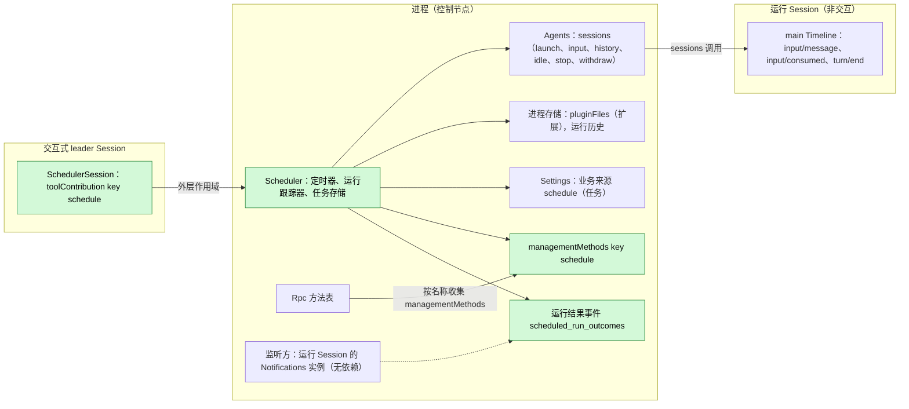
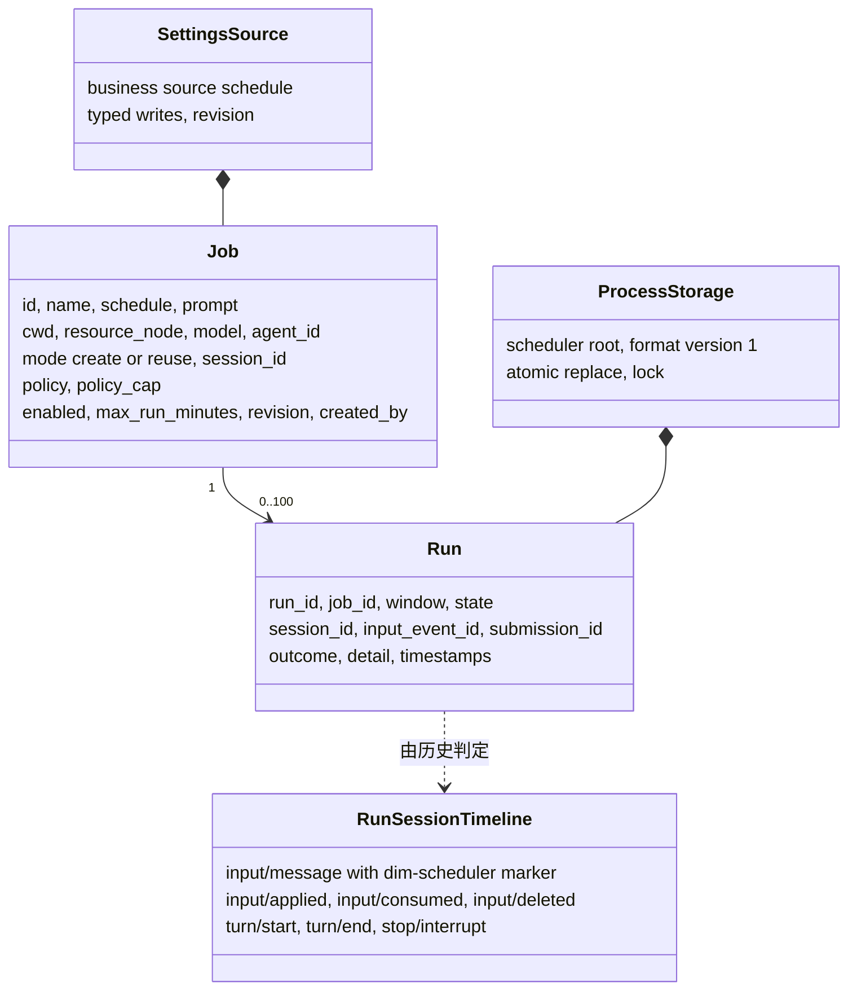
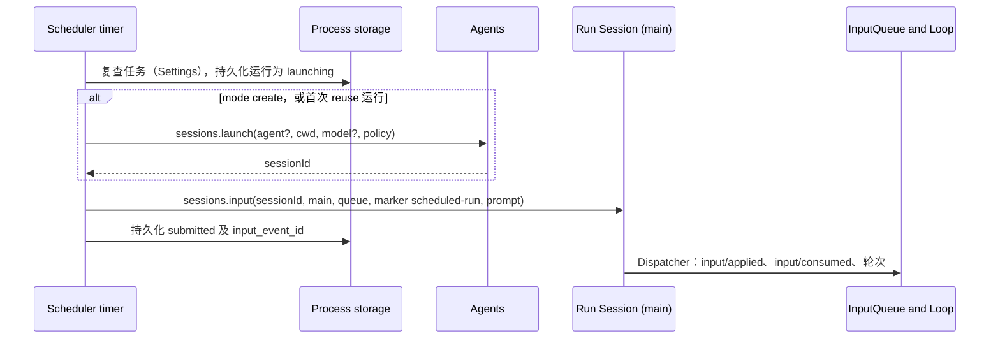
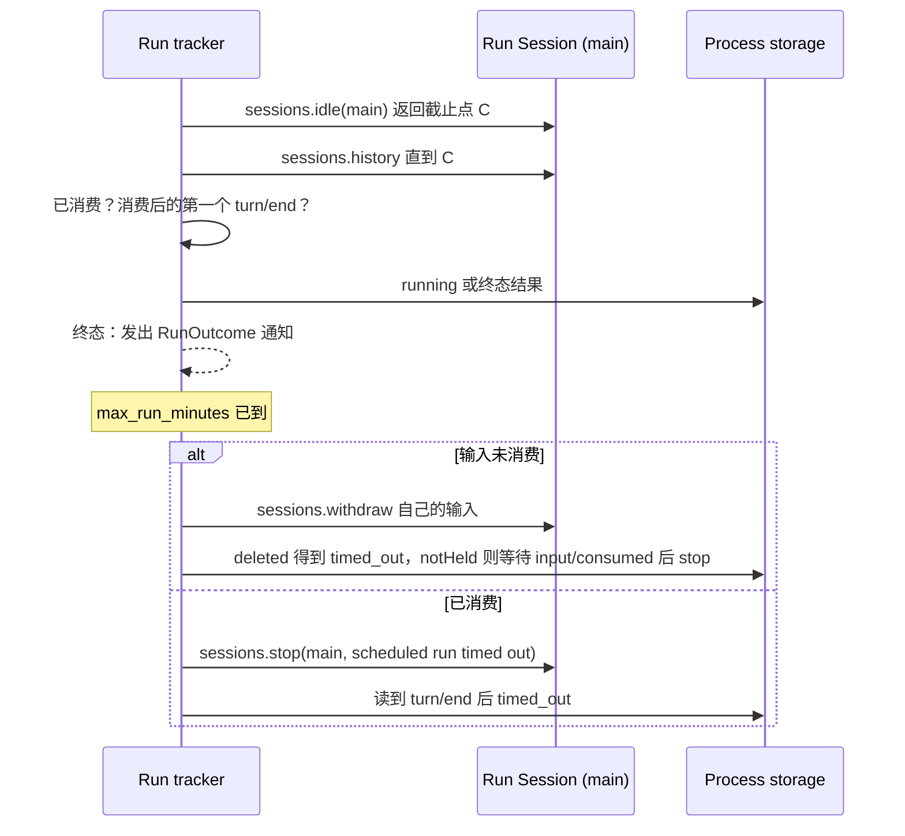
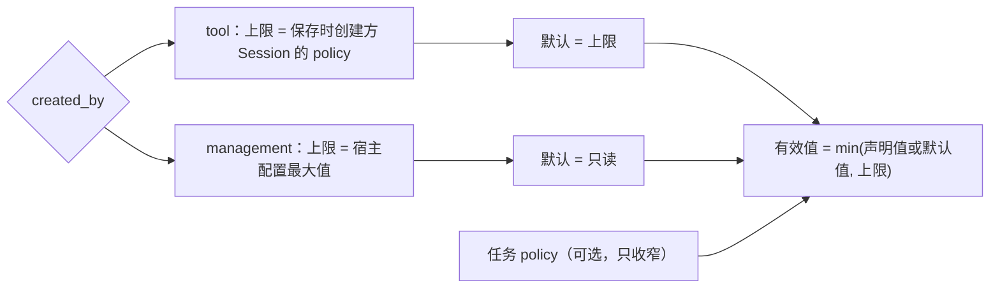
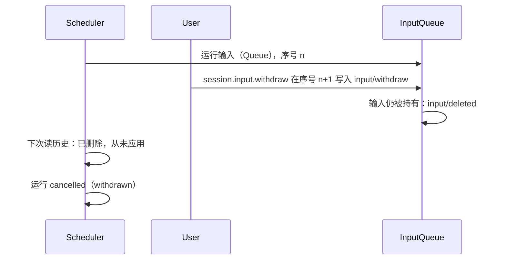

# Scheduler

状态：草案。总体设计：[overview §4](../overview.md#4-插件目录)；作用域：[ADR 002](../../adr/002-plugin-scope.md)（进程 + Session）。阶段：P2。语言：优先 TypeScript（[overview 附录 C](../overview.md#附录-c-实现语言)）。

> **设计复核时要改的依赖（[#35](https://github.com/arcships/dim/issues/35)）。** `schedule` 工具在每次调用时查找 `scheduleJobs`，进程部件在每次使用时获取 `sessions`，都不作为依赖持有。这样 Agents 或 Scheduler 重载只会让一次调用失败，不会让每个 Session 重载。

> **离线资源节点。** 关于资源节点离线的各行描述的是 P3 多节点行为。#5 已撤回（rutis 是外部依赖，链接断开时会撤掉导入的服务），这些行在 P3 按总览 §6.3 重新设计：节点服务在每次调用时按 `resourceNode` 查找。P1/P2 中每个 Session 都使用控制节点。

> **待设计复核时细化。** 运行结果的通知是 Scheduler 自己的功能。为 Notifications 发布的运行结果事件通知，以及它所需的跨语言具名进程事件（§9.1），随 Notifications 一并撤回。

Scheduler 把定时任务（用户写的配置）保存在自己的 Settings 业务来源 `schedule` 中，把运行历史保存在自己的进程存储 [`pluginFiles`（扩展）](../../../../crates/dim-app-server/README.md#trusted-plugin-storage) 中。守护进程存活且某个窗口到期时，进程部分通过 `sessions.launch` 创建一个非交互 Session（或复用一个），并通过 `sessions.input`（[session-access](../contracts/session-access.md)）把任务提示词写成带自身来源标记的 Queue 输入，方式与 Collaboration 访问其成员相同。Session 部分以 `toolContribution` 向交互式 leader Session 提供 `schedule` 工具（风险 `persistent_configuration`）。运维方使用 `schedule.*` 管理方法，即一个 `managementMethods` 条目。所有契约都是语言中立的命名服务（[ADR 002 D5](../../adr/002-plugin-scope.md)）；Rust 形式见[附录 G](#附录-g-rust-绑定)。Scheduler 不写自己的 Timeline 事件：一次运行的结果从运行 Session 的历史中读取，并作为运行结果事件通知发布。

## 1. 结构



任务和窗口跨越多个 Session，因此属于进程（[ADR 002](../../adr/002-plugin-scope.md) D1）；向 Session 提供工具是 Session 部分的职责（D2）。Session 部分依赖进程部分（外层作用域）。进程部分依赖 Agents（服务 `sessions`）、Settings（业务来源 `schedule`）和 `pluginFiles`（扩展）；它只通过 `sessions` 访问运行 Session。依赖遵循作用域（D3）：Agents 重载会重载 Scheduler，Scheduler 重载会重载其 Session 部分，并使其在途轮次失败；两者都是罕见的结构性事件，属于已接受并有文档记录的代价。任务编辑属于业务配置（D4）：通过 Settings 的类型化写操作写入，收到变更通知后在使用时读取，绝不重载。

| 部分 | 作用域 | 依赖 | 提供 |
| --- | --- | --- | --- |
| `Scheduler` | 进程（控制节点） | `sessions`（Agents；`launch` 带 `policy`）、Settings 业务来源 `schedule`、`pluginFiles`（扩展） | 任务访问、定时器、运行跟踪器；`scheduleJobs`（工具访问任务存储的服务，A.2）；`managementMethods` key `schedule`；进程事件 `scheduled_run_outcomes` |
| `SchedulerSession` | Session，Scheduler 启用时安装 | `scheduleJobs`（`Scheduler`）、Session 配置 | `toolContribution` key `schedule`，仅在 `interactive` 且非 Collaboration 成员时声明 |

**依赖的契约**：`sessions`（[session-access](../contracts/session-access.md)：带启动方上限 `policy` 的 `launch`、Session 配置字段 `interactive`、带来源 raw 块的 `input`、固定前缀 `history`、`idle`、`stop`、`withdraw`；`agent` 可省略）、`toolContribution`（ToolRegistry 接受命名工具服务，属于补充；[工具贡献](../../../architecture/rust-agent/tool-contributions.md)）、由 Rpc 收集的 `managementMethods`（[session-boundary](../contracts/session-boundary.md)）、Permission 类别 `persistent_configuration`（FullAccess 允许，E1）、[`pluginFiles`（扩展）](../../../../crates/dim-app-server/README.md#trusted-plugin-storage)（存运行历史；在现有的受信插件存储上增加二进制读写和格式版本；TypeScript 部分直接使用，Rust 部分通过同名服务使用）、Settings 业务来源 `schedule`，按 Scheduler 声明的 schema 类型化写入（Settings 补充，[overview 附录 B](../overview.md#附录-b-现有插件的补充)）、[单树事件契约](../../../architecture/rust-agent/single-tree.md)。**此处定义的契约**：任务和运行格式、`schedule` 工具、`scheduleJobs` 服务、`schedule.*` 方法、运行结果事件（A.6）、来源名 `scheduler`（标记 `dim-scheduler`，提交 id `scheduler:<run_id>`）。

## 2. 数据与状态



任务存于 Settings 业务来源，运行只存于进程存储；不从 Timeline 重建，Scheduler 不拥有 `StateCell`。运行进度由运行 Session `main` 分支上的已有事实推导。Session 部分不持有状态。

## 3. 流程

### 3.1 窗口到期



运行在任何外部副作用之前先持久化为 `launching`，因此重启后通过查询来结算，而不是重新提交。

### 3.2 完成与超时



每个活动运行都有一个任务，等待 `sessions.idle` 并读取直到返回截止点的历史，与 Collaboration 和 Workflow 的做法相同；Scheduler 不观察 Session 广播。如果撤回答复 `notHeld`（InputQueue 已应用该输入，因此它归 Loop 所有），跟踪器等待 `input/consumed`，然后使用 `stop`。通知在终态记录持久化后只发出一次。

### 3.3 运行的权限



自动化绝不扩大权限（E2）：有效 policy 传入 `sessions.launch` 的 `policy`，Agents 按启动方（任务的 `policy_cap`）对其设上限。复用的 Session 保留自身的 policy；若超过任务的有效 policy，运行为 `skipped: policy`。

## 4. 时序与冲突



所有待处理输入的判定都排除已删除的输入，因此已删除的运行输入绝不会让运行永远停在 `submitted`。

| 场景 | 序号顺序 | 结果 | 负责方 |
| --- | --- | --- | --- |
| 窗口触发时上一次运行仍在活动 | —（存储） | `skipped: overlap`（A4） | Scheduler |
| 用户中断运行的轮次 | consumed < `stop/interrupt` < `turn/end` | 运行 `cancelled` | Loop；Scheduler 记录 |
| 应用之后的超时撤回 | `input/applied` < `input/withdraw` | `notHeld`，不写入任何内容；`input/consumed` 之后 `stop` | InputQueue、Scheduler |
| Agents 或 Scheduler 重载、重启 | — | `launching` → 查询：已接受 → `submitted`，未知 → `lost`；绝不重新提交；恢复跟踪 | Scheduler |
| 窗口期间守护进程停机 | — | `missed`；不补跑（E5） | Scheduler |

完整表格：附录 B。

## 5. 上下文映射

| 位置 | 模型看到的内容 | 形式 | 位置与存续 |
| --- | --- | --- | --- |
| 调用方 Session | `schedule` 声明 | 已采用配置中的工具声明（仅交互式 leader） | 配置；压缩后保留 |
| 调用方 Session | `schedule` 结果 | `ToolResult.content` | 批次结果位置；压缩后仅存于摘要 |
| 运行 Session | `<dim-scheduler kind="scheduled-run" job="..." run="...">job name</dim-scheduler>`，随后是作为用户内容的提示词 | 一个 Queue 输入的 raw 标记块 + 用户文本 | 位于其 `input/consumed` 位置；无 key，因此压缩后只经由摘要；若在切点前已消费，子分支会继承 |

运行 Session 是非交互的：没有 `ask_user`，没有 `schedule` 工具。`reuse` Session 中的先前运行与任何输入一样保留为历史。模型永远看不到任务记录、运行历史、定时器或诊断信息。

## 6. 接口（摘要）

| 接口 | 类型 | 用途 |
| --- | --- | --- |
| `schedule` | `toolContribution`（Session，key `schedule`），风险 `persistent_configuration` | 模型管理任务 |
| `schedule.list/save/delete/set_enabled/run_now/history` | `managementMethods`（进程，key `schedule`） | 运维方管理任务 |
| `scheduled_run_outcomes` | 此处定义的进程事件（A.6） | 每次运行结束的实时通知（Notifications 监听） |
| `/scheduled`、`/schedule`、`dimcode schedule` | CLI | 调用管理方法 |
| `sessions` | 依赖（进程） | 带节点、模型和启动方上限 `policy` 的非交互运行 Session；input、history、idle、stop、withdraw |

## 7. 安全

`schedule` 由 Approval 和 Permission 按 `persistent_configuration` 准入；FullAccess 允许（E1），其他预设询问或拒绝。运行只写入输入；其工具在运行 Session 的 policy 下准入，上限如 3.3 所述，审批不预先授予。工具创建的任务记录 `created_by`，可供审查。工具只改任务条目，经 Scheduler 代其工具发起的类型化写入；`max_concurrent_runs` 是仅限用户的字段，这类写入若改动它会被拒绝，由用户经客户端方法 `settings.update` 设置（S8b，尚未实现）。任务不存储凭据。运行 Session 只使用自身资源节点的服务；Scheduler 不触及任何节点服务。任何具有管理访问权限的人都能读取任务提示词。

## 8. 规则检查

规则：[principles §1 与 §4](../../../architecture/rust-agent/principles.md)，[ADR 002](../../adr/002-plugin-scope.md) D1–D5。

| 规则 | 本文如何符合 |
| --- | --- |
| §4.1 改别的模块拥有的状态时写指令事件 | Scheduler 只通过 `sessions` 改动运行 Session（输入、写 `input/withdraw` 的 `withdraw`、写 `stop/interrupt` 的 `stop`）；结果由 InputQueue 和 Loop 决定并写入。 |
| §4.2 交接后不能撤回 | `input/applied` 之前撤回运行输入；之后（`notHeld`）Scheduler 只在读到 `input/consumed` 后使用 `stop`（§3.2）。 |
| §4.3 只用 before 回调在写入前干预 | 不适用：Scheduler 不加入口检查，也不注册 before 回调；任务校验是它对自己方法和工具的边界校验。 |
| §4.4 核心机制不带业务含义 | Scheduler 不需要带有自身含义的运行时改动；运行结果事件是它自己的进程事件。 |
| §4.5 决定前读完整个批次 | 运行决定读取到 `sessions.idle` 返回的截止点 `C` 为止的历史，只用 `C` 之前的事件；批次整体提交，`C` 不会切开一个批次（A.5）。 |
| §4.6 模型上下文只含交接后被读取的事件 | 运行提示词只作为已消费的 Queue 输入到达模型；被撤回的输入被删除，模型看不到。 |
| §4.7 插件之间只通过公开事件和服务交互 | Scheduler 使用 `sessions`、Settings 的类型化操作、`pluginFiles`（扩展）和自己的 `scheduleJobs`；Notifications 监听其公开事件，不形成依赖。 |
| §4.8 向机制所有者提通用需求 | 跨语言命名进程事件在 §9 中提出；离线节点行为依赖 #5（[ExternalAgent §9](ExternalAgent.md#9-向机制所有者提出的需求)）；Agents 和 Settings 的补充见 [overview 附录 B](../overview.md#附录-b-现有插件的补充)。 |
| §4.9 只有后续决定要用的事实才进 Timeline | Scheduler 不写 Timeline 事件；任务留在 Settings，运行留在进程存储，运行结果是进程事件通知。 |
| §1 Capability 与 App Server 边界 | 任务和运行是进程级的，不是 Capability；存储是 `pluginFiles` 插件，不是 App Server 服务。 |
| ADR 002 D1 作用域跟随状态所有者 | 任务跨越 Session（进程部分）；工具属于 Session（Session 部分）。 |
| ADR 002 D2 不设接线模块 | Rpc 收集 `managementMethods`，ToolRegistry 收集 `toolContribution`，监听方按名称订阅事件；没有接线模块。 |
| ADR 002 D3 依赖跟随作用域 | Agents 和 Scheduler 的重载按作用域传播，是已接受并有记录的代价（§1）。 |
| ADR 002 D4 结构性配置与业务配置分离 | 任务和运行上限是 Settings 业务来源 `schedule` 中使用时读取的业务数据；没有结构性变化。 |
| ADR 002 D5 合同语言中立 | `scheduleJobs`、工具、方法和事件都是带数据形状的命名服务；Rust 形式见附录 G。 |

## 9. 向机制所有者提出的需求

### 9.1 跨语言的命名进程事件

| 项 | 内容 |
| --- | --- |
| 被哪条规则挡住 | ADR 002 D5 与 principles §4.7：运行结果事件必须公开且语言中立，但进程事件目前是类型化的 Rust `EventKey<T>`；TypeScript 实现的 Scheduler 无法发出它，TypeScript 实现的 Notifications 也无法按名称监听。 |
| 考虑过的现有机制 | Timeline 事件：不行，结果是进程级的，没有所属分支（§4.1，time-bus）。由 Scheduler 调用的命名服务：不行，会使 Scheduler 依赖其监听方（D2）。节点间的 rutis 事件转发：只转发类型化事件，不定义名称加数据的形式。 |
| 需要的通用能力 | 用名称加可序列化数据标识进程事件，任何语言都能发出和监听，投递方式与类型化进程事件相同（实时、不可恢复）；不带业务含义。 |
| 对序号、批次、中断、重载的影响 | 不涉及 Timeline 序号或批次；投递是实时的；未加载或正在重载的监听方会错过事件，发出方不受影响；监听不引起重载。 |
| 由谁实现，对应 issue | rutis（事件总线与 rutis-bridge 运行时）；尚无 issue，待提出，相关的暴露工作见 [#4](https://github.com/arcships/dim/issues/4)。 |

## 附录 A. 接口细节

### A.1 记录

| 记录 | 字段 |
| --- | --- |
| Job | `id`、`name`、`schedule`（A.4）、`prompt`（文本 ≤ 32 KiB）、`cwd`、`resource_node`（`None` = 控制节点）、`model`（`None` = profile 的模型）、`agent_id`（可选；`None` = Agents 的默认 profile）、`mode`（`create` \| `reuse`）、`session_id`（`reuse` 在首次运行时绑定）、`policy`（可选预设，只收窄）、`policy_cap`（保存时捕获）、`enabled`、`max_run_minutes`（默认 60，A7）、`revision`、`created_by`（`user` \| `tool:<session_id>`） |
| Run | `run_id`、`job_id`、`window`（时刻或 `manual`）、`state`、`session_id`、`input_event_id`、`submission_id`、时间戳、`outcome`（`completed` \| `failed` \| `cancelled`，附原因）、`detail` |

运行状态：`skipped`（overlap、capacity、disabled、节点不可用、policy）、`missed`、`launching`、`submitted`、`running`，终态 `completed`/`failed`/`cancelled`/`timed_out`/`lost`。历史为每个任务保留最近 100 次运行（A8）。Settings 来源 `schedule` 保存一个文档 `{ jobs: [Job], max_concurrent_runs }`（A13），由 Settings 在写入和读取持久化文件时按 Scheduler 的 schema 校验并填充默认值；Scheduler 按交付的样子使用。任务写入是 Scheduler 对该文档的类型化写入，按文档 revision 做 CAS，因此工具保存和管理保存绝不会静默互相覆盖；运行记录在存储锁下以原子替换写入。

### A.2 工具 `schedule`

`toolContribution` key `schedule`，仅由 `SchedulerSession` 在配置为 `interactive: true` 且无成员角色的 Session 中注册（A9），因此运行 Session 和成员永远看不到它，运行也无法调度更多运行。`declaration(): sync -> ToolDeclaration` 返回下列参数，所有动作的风险均为 `persistent_configuration`（A10）；`execute(ToolCall): async -> ToolResult` 调用进程部分的 `scheduleJobs` 服务。取消即消费方丢弃该调用。

`scheduleJobs`，进程作用域，无 key，在此定义：`call(JobRequest): async -> JobReply`，其中 `JobRequest = {action, job_id?, job?, enabled?, limit?, caller: {sessionId, cwd}}` 使用下列参数，`JobReply = {content: string, records: JSON}`，或附录 C 中的错误 `{code}`。取消即消费方丢弃该调用；已持久化的保存保留。

| 参数 | 类型 | 规则 |
| --- | --- | --- |
| `action` | `list` \| `get` \| `create` \| `update` \| `delete` \| `set_enabled` \| `run_now` \| `history` | 必填 |
| `job_id` | string | 除 `list`、`create` 外均需 |
| `job` | object：`name`、`schedule`、`prompt`、`cwd?`、`model?`、`mode?`、`policy?`、`max_run_minutes?` | `create`、`update`（部分） |
| `enabled` | bool | `set_enabled` |
| `limit` | integer ≤ 50 | `history` |

`cwd` 和 `resource_node` 默认取调用方 Session 的配置；工具不能指向其他资源节点（A11）。在 `create`/`update` 时，`policy_cap` 为调用方 Session 当前的 policy，由 Agents 解析（A15）。结果 `content`：包含 `job_id`、下一个窗口或列表的简短文本；`structured_content` 保存记录。校验错误为错误结果。

### A.3 管理方法

`managementMethods` key `schedule`：`describe(): async -> MethodDecl[]` 列出下列方法（除 `list` 和 `history` 外均为 `mutating`）；`call(MethodCall): async -> MethodReply` 分派它们。参数和结果是 JSON 对象；错误为附录 C 中的代码。

| 方法 | 参数 | 结果 |
| --- | --- | --- |
| `schedule.list` | `{}` | 任务及 `next_window`、最近一次运行 |
| `schedule.save` | `{job, revision?}` | 已保存的任务（`policy_cap` = 宿主配置最大值）；过期 `revision` → `schedule_conflict` |
| `schedule.delete` | `{job_id}` | 删除任务（Settings）及其历史（`pluginFiles`）；活动运行不会停止（A14） |
| `schedule.set_enabled` | `{job_id, enabled}` | 暂停/恢复 |
| `schedule.run_now` | `{job_id}` | `run_id` 或跳过原因 |
| `schedule.history` | `{job_id, limit?}` | 运行列表，最新在前 |

Scheduler 重载期间，Rpc 回复 `service_reloading`；未启用时回复 `unknown_method`。

### A.4 调度格式

| 类型 | 形式 | 规则 |
| --- | --- | --- |
| `cron` | `{cron: "m h dom mon dow", tz?: IANA}` | 五个字段，支持列表、范围、步长；`tz` 默认为控制节点时区；DST 空缺时刻跳过，重复时刻只触发一次 |
| `every` | `{every_minutes: n}` | `n` ≥ 1；窗口位于 `anchor + k·n`，anchor = 最近一次启用时间 |
| `at` | `{at: RFC 3339 instant}` | 一个窗口；触发或错过后任务被禁用 |

粒度为一分钟（A1）。窗口只有在其时刻后 60 s 内被观察到才会触发（A2）；否则用一条 `missed` 记录合并这段时间。定时器在每次 tick 和唤醒时评估墙钟时间，因此挂起期间的时间绝不补跑。

### A.5 Timeline 与 Capability 机制

| 步骤 | 路径 |
| --- | --- |
| 触发 | 定时器任务为每个已启用任务计算下一个窗口；到窗口时应用 overlap、capacity（A13）、启用与 policy 规则；以新的 `run_id` 持久化 `launching` |
| Session | `create`：`sessions.launch {agent?, cwd, model?, policy?, starter?}` → `{sessionId}`；只有任务设置了 `agent` 和 `model` 才传入：省略 `agent` 即 Agents 的默认 profile，请求中的 `model` 优先于 profile 的模型；Scheduler 不自行解析；对工具创建的任务，`starter` 为创建方 Session（A15），否则省略。`reuse`：已绑定的 `session_id`（未加载的 Session 由该调用恢复）；首次运行时 launch 并绑定 `session_id` |
| 写入 | `sessions.input {sessionId, branchId: "main", mode: "queue", submissionId: "scheduler:<run_id>", rawBlocks: [marker {kind: "scheduled-run", attrs: [job, run], body: job name}], content: [prompt text]}` → `{inputId}`，存为 `input_event_id`；持久化 `submitted` |
| 消费 | InputQueue 追加 `input/applied`；Loop 追加 `input/consumed { input_id }` 并驱动轮次 |
| 完成 | 跟踪器任务：`sessions.idle {sessionId, branchId: "main"}` → 截止点 `C`；按页读取 `sessions.history {through: C}`；一旦存在 `input/consumed { input_id = input_event_id }` 即为 `running`；在其后的第一个 `turn/end` 结束；`input/deleted` → `cancelled: withdrawn`（除非是跟踪器自身的超时撤回写入的：`timed_out`） |
| 超时 | 未消费：对自己的输入执行 `sessions.withdraw`；`deleted` → `timed_out`，`notHeld` → 等待 `input/consumed`，然后按已消费处理；已消费：`sessions.stop {sessionId, branchId: "main"}`（轮次作用域），读到 `turn/end` 时 `timed_out` |
| 复查 | 写入前从 Settings 重新读取任务，从存储重新读取运行（已启用、revision 未变、运行仍为 `launching`） |
| 重载或重启 | Session 部分随 Scheduler 重载；在途的 `schedule` 调用随其轮次失败。新一代进行结算：`launching` → 按 `submissionId` 执行 `sessions.lookup`：已接受 → `submitted`，未知 → `lost`（绝不重新提交）；`submitted`/`running` 恢复跟踪；已过的窗口为 `missed` |
| 运行结果 | 持久化终态后，以 A.6 的数据发布 `scheduled_run_outcomes`；重载或重启后不重放 |

### A.6 运行结果事件（公共契约）

名为 `scheduled_run_outcomes` 的进程事件；监听方按名称订阅，不形成对 Scheduler 的依赖。在 TypeScript 或 Rust 部分中按名称发出和监听，是 §9 中提出的需求。报告一次运行的监听方是运行 Session（`session_id`）的 Notifications 实例，由它发送 `schedule.ended`（[Notifications](Notifications.md)）。数据：

| 字段 | 类型 |
| --- | --- |
| `job_id`、`job_name`、`run_id` | string |
| `session_id` | string，可选 |
| `state` | `completed` \| `failed` \| `cancelled` \| `timed_out` \| `lost` |
| `reason` | string，可选；固定的原因文本，绝不包含 Session 内容 |
| `ended_at` | RFC 3339 时刻 |

每次运行在其终态记录持久化后发出一次（A16、A17）。投递是实时且不可恢复的；未加载的监听方会错过该通知。特别是，发出通知时运行 Session 未加载，就不会发送 `schedule.ended`，该通知丢失；这一点已接受，`schedule.history` 是持久记录（A18）。通知不携带提示词或 Session 内容。

## 附录 B. 完整冲突表

| 场景 | 序号顺序 | 结果 | 负责方 |
| --- | --- | --- | --- |
| 窗口触发时上一次运行仍在活动 | — | `skipped: overlap`；无输入（A4） | Scheduler |
| 运行活动时 `run_now` | — | 拒绝，`skipped: overlap` | Scheduler |
| 复用的 Session 忙碌 | 先前事实 < 运行输入 | 以 Queue 写入；在运行中的轮次之后消费（A5） | InputQueue、Loop |
| 复用的 Session：用户并发 Steer/Queue/Append | Timeline 顺序 | 按序号顺序依模式应用；运行按自身 `input_id` 跟踪 | InputQueue |
| 用户中断运行的轮次 | consumed < interrupt < `turn/end` | `cancelled` | Loop |
| 中断发生在运行输入之前 | interrupt < input | 输入启动一个轮次 | Loop |
| 输入已应用，消费前中断 | applied < interrupt | 保持待处理；由下一轮次消费；运行 `submitted` | Loop |
| 用户在输入仍被持有时撤回运行输入 | input < `input/withdraw`，无 `input/applied` | `input/deleted`；运行 `cancelled: withdrawn` | InputQueue、Scheduler |
| 用户在应用之后撤回 | `input/applied` < `input/withdraw` | `notHeld`；运行继续 | InputQueue |
| 超时撤回与应用竞争 | `input/applied` < `input/withdraw` | `notHeld`；`input/consumed` 之后 `stop`，然后 `timed_out` | InputQueue、Scheduler |
| 写入前分支关闭或 Session 关闭 | — | `failed: session_missing`；保留 reuse 绑定（A6） | Scheduler |
| 运行活动时 Session 关闭 | — | 历史读取失败；`failed` | Scheduler |
| 运行期间压缩 | — | 无影响：`input/consumed` 和 `turn/end` 保留在本地历史中 | — |
| 在运行 Session 中创建子分支 | — | 忽略；运行只使用 `main` | Scheduler |
| 运行 Session 在输入待处理时因空闲卸载 | — | 跟踪器未返回的 `sessions.idle` 调用使其保持加载；重启后下一次 `sessions` 调用将其恢复 | Agents |
| 运行中 Agents 重载 | — | Scheduler 随之重载；运行保留；从历史恢复跟踪 | Scheduler |
| 运行中 Scheduler 重载或重启 | — | A.5 结算；绝不重新提交 | Scheduler |
| `schedule` 调用期间 Scheduler 重载 | — | 调用方 Session 部分重载；该轮次失败（D3，已接受） | Loop |
| 窗口期间守护进程停机 | — | `missed`；不补跑 | Scheduler |
| 触发时资源节点离线，`create` | — | 因节点不可用而被拒的 launch → `skipped: node_unavailable`，不重试（A6）；已启动的 Session 照常运行，其节点服务调用失败为 `node_unavailable`（见下一行） | Agents、Scheduler |
| 资源节点离线，`reuse` 或运行中 | — | 输入提交；运行 Session 保持加载（不重载，不进入 Pending）；其对节点服务的调用失败为 `node_unavailable`，轮次按自身结果结束；超时照常适用（对 [#5](https://github.com/arcships/dim/issues/5) 的要求） | Session 的节点服务、Scheduler |
| 复用 Session 的 policy 高于任务的有效 policy | — | `skipped: policy` | Scheduler |
| 运行 Session 中有待处理审批 | `approval/request` | 等待任一客户端的 `approval.respond` 或超时 | Approval；Scheduler |
| 重复/迟到的 `schedule.save` | revision | 过期 revision 被拒 | Scheduler |
| `schedule` 调用在保存后被中断 | save < interrupt | 已保存的任务保留；工具结果取消 | ToolExecutor；Scheduler |
| 客户端断开 | — | 无影响 | — |

## 附录 C. 错误与恢复

| 情况 | 结果 |
| --- | --- |
| 无效任务（调度、提示词大小、未知节点、policy 超过上限） | `schedule_invalid` 或错误工具结果 |
| launch 失败 | 运行 `failed`；窗口不重试 |
| 写入结果不确定（重载、发布未知） | 运行保持 `launching`；通过查询结算 |
| 存储不可读或格式版本未知 | Scheduler 应用失败（不静默重置） |
| 进程退出 | 定时器停止；下次启动时结算 |

错误代码：`schedule_invalid`、`schedule_conflict`、`schedule_not_found`、`service_reloading`。

## 附录 D. 验收

使用可控时钟，通过管理方法、`schedule` 工具和通知：

1. 每种调度类型产生预期窗口，包括 DST 空缺/重叠以及 `at` 自行禁用。
2. 到期的 `create` 任务产生一个非交互 Session，其第一个输入携带标记和提示词；运行 `completed`；一条通知。
3. 重叠：活动运行期间的窗口为 `skipped: overlap`。
4. `reuse` 遇到忙碌 Session：输入排在运行中的轮次之后。
5. 用户中断 → `cancelled`；输入被持有时超时 → `input/deleted` 且 `timed_out`；应用后超时 → `notHeld`，然后 `stop`；消费后 → `stop/interrupt` 且 `timed_out`。
6. 用户在输入被持有时撤回运行输入 → `input/deleted` 且 `cancelled: withdrawn`。
7. 时钟跳变 → 一条 `missed` 记录，无运行。
8. 带 `launching` 运行重启：已接受的恢复，未知的 → `lost`；无重复输入。
9. 运行中 Agents 重载：Scheduler 重载，运行完成并被跟踪到结束。
10. Policy：WorkspaceWrite 下工具创建的任务最多以 WorkspaceWrite 运行；管理创建的任务默认 ReadOnly。
11. 非交互和成员 Session 中没有 `schedule`；WorkspaceWrite 下询问，FullAccess 下允许。
12. 触发时节点不可用：`skipped: node_unavailable`。

## 附录 E. 假设

| # | 假设 | 依据 | 若被否决的影响 |
| --- | --- | --- | --- |
| A1 | 格式 `cron`、`every`、`at`；一分钟粒度 | 功能清单（“recurrence”）；判断 | 格式变化 |
| A2 | 窗口宽限 60 s | 判断 | 其他错过检测方式 |
| A4 | 重叠：跳过新窗口 | 判断 | 排队或并行运行 |
| A5 | 复用的忙碌 Session：入队 | 判断 | 忙碌时窗口被跳过 |
| A6 | 失败绝不重试，也不回退到 `create` | 判断 | 回退策略 |
| A7 | `max_run_minutes` 默认 60 | 判断 | 运行无上限 |
| A8 | 每个任务保留最近 100 次运行 | 判断 | 保留设置 |
| A9 | 工具仅用于交互式 leader Session | [Overview §6.2](../overview.md#62-约束) 约束 15；判断 | 运行可创建任务 |
| A10 | 所有动作使用一个风险类别 | [Overview §6.2](../overview.md#62-约束) 约束 7 | 拆分出只读工具 |
| A11 | 工具创建的任务使用调用方的资源节点 | 判断（overview §6.3） | 允许其他节点 |
| A13 | 最大并发运行数 = 4，即 `schedule` 文档中仅限用户的字段 `max_concurrent_runs`，在每个窗口读取 | 判断；ADR 002 D4 | 其他上限 |
| A14 | 删除任务不停止其活动运行 | 判断 | 删除即停止运行 |
| A15 | 工具创建任务的上限在保存时捕获 | 在 E2 范围内的判断 | 每次运行重新解析 |
| A16 | 运行结果是实时、不可恢复的通知 | [Overview §5.5](../overview.md#55-经-agents-的定时运行)；判断 | 每个监听方的持久发件箱 |
| A17 | 只有到达 `launching` 的运行才产生通知 | 判断 | 监听方看到每个窗口 |
| A18 | `schedule.ended` 只由运行 Session 的 Notifications 实例投递；该 Session 未加载时丢失 | 用户决定（不增加进程级投递） | 由进程级监听方投递每个通知 |

已决定：运行 policy（E2）、FullAccess 允许 `persistent_configuration`（E1）、守护进程存活（E5）、任务存于 Settings 业务来源、运行历史存于 `pluginFiles`（扩展）（用户决定）、`LaunchRequest.agent` 可省略（用户决定）、撤回自己的输入、作用域（[ADR 002](../../adr/002-plugin-scope.md)）。

## 附录 F. 待对齐问题

| 问题 | 描述 |
| --- | --- |
| 存活表述 | 功能清单要求交互式终端存活；本设计保持“守护进程存活”（E5）；已记录，非开放问题 |

## 附录 G. Rust 绑定

上述中立契约的一种绑定，用于 Rust 实现；TypeScript 实现通过其 rutis-bridge 运行时使用相同的名称和数据。

| 中立 | Rust |
| --- | --- |
| `toolContribution` key `schedule` | 在 `SchedulerSession` 的 `provides` 中注册的 Session 级 `ToolContribution`；`declaration()` / `execute(ToolCall, cancel)` |
| `managementMethods` key `schedule` | 由 Rpc 按调用查找，不是 Rpc 的依赖（[方法附录 F](../contracts/session-boundary.md#附录-f-rust-绑定)） |
| `sessions.launch` | `AgentIndex::launch(LaunchRequest) -> SessionUse` |
| `sessions.input` / `history` / `idle` / `stop` / `withdraw` | `AgentIndex::acquire(id)` 租约，然后 `Session::input`、`local_page`、`idle`、`stop`、`service::<InputQueue>(branch).withdraw` |
| `scheduled_run_outcomes` | Scheduler 公共类型 crate 中的 `pub fn scheduled_run_outcomes() -> EventKey<RunOutcome>`；`emit(host_ctx, &key, Arc::new(outcome))`，监听方 `on(host_ctx, &key, listener)` |
| `scheduleJobs` | 由 `Scheduler` 提供、由 `SchedulerSession` 使用的进程级命名服务 |
| 进程存储 | 在 `apply` 中打开的 `pluginFiles`（扩展）作用域 |
| 定时器任务 | 在 `ctx.effect` 中 spawn |

```rust
pub struct RunOutcome {
    pub job_id: String, pub job_name: String, pub run_id: String,
    pub session_id: Option<String>,
    pub state: RunEnd,               // Completed | Failed | Cancelled | TimedOut | Lost
    pub reason: Option<String>,
    pub ended_at: Timestamp,
}
```
