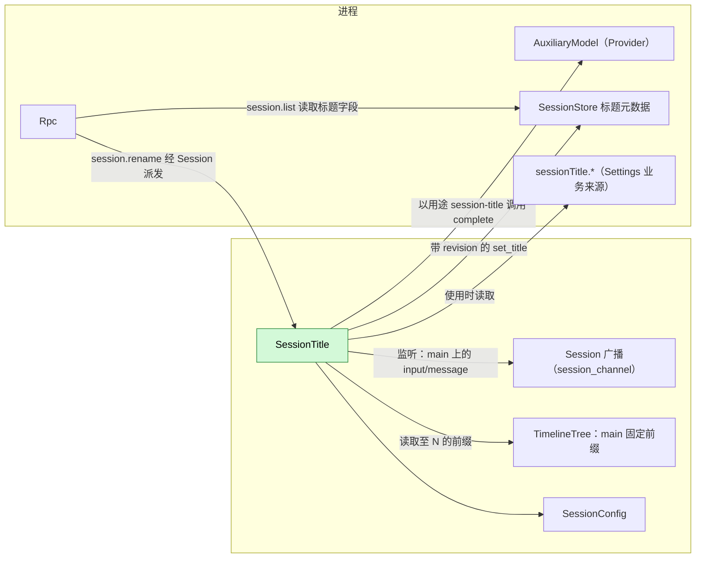
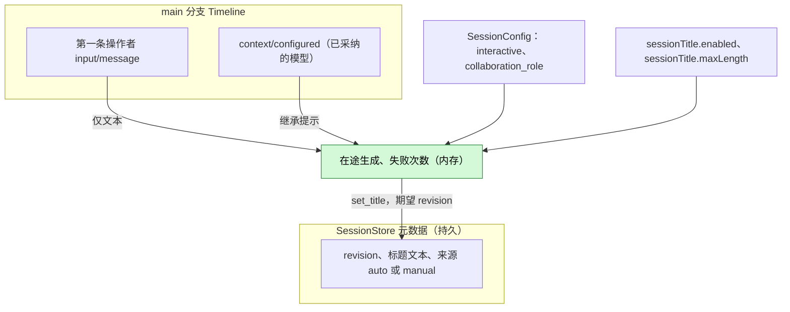
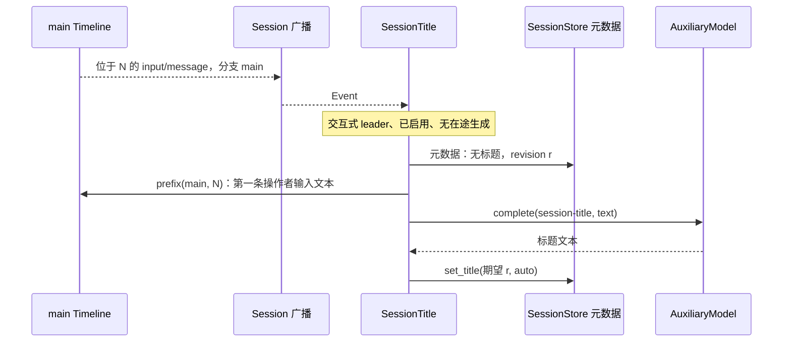
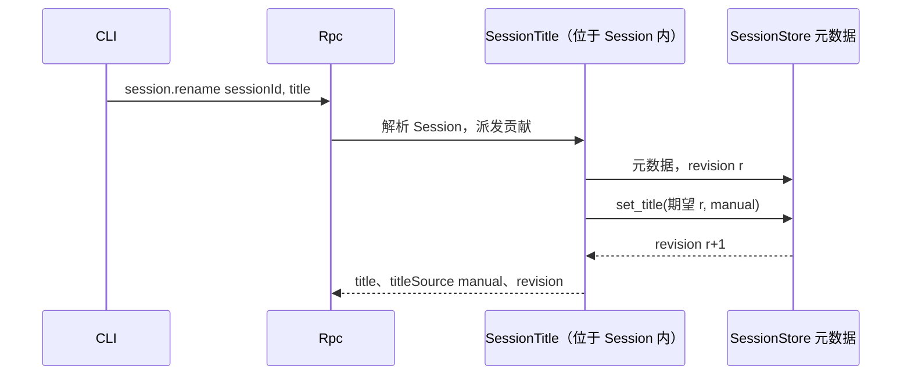
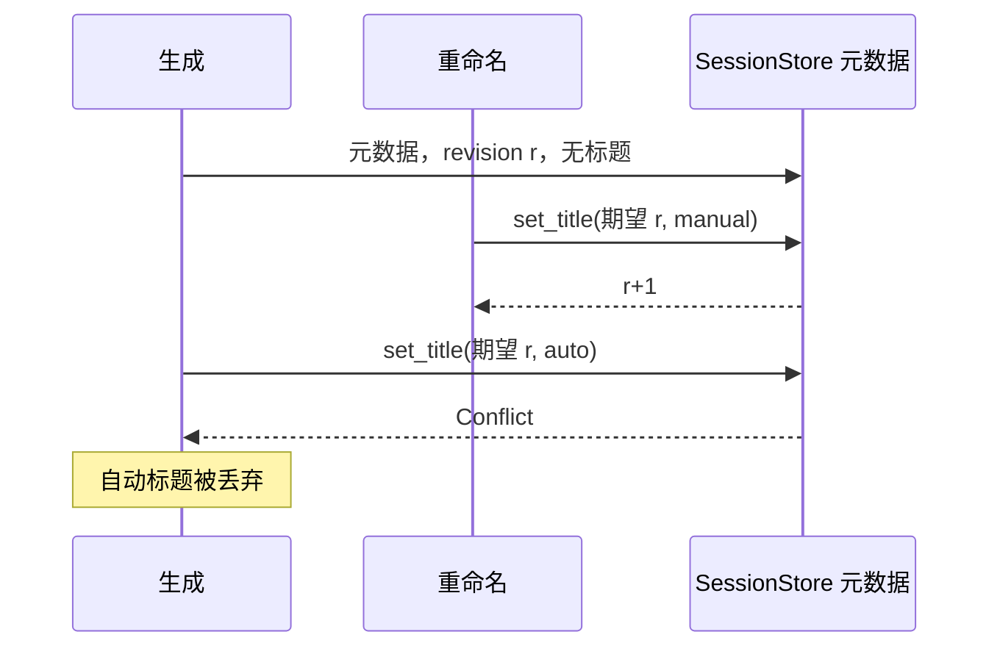

# SessionTitle

状态：草案。总体设计：[overview](../overview.md)（SessionTitle）。阶段：P1。语言：TypeScript 优先。作用域：[ADR 002](../../adr/002-plugin-scope.md)（Session）。

SessionTitle 是一个 Session 插件，为交互式 leader Session 提供经 SessionStore 元数据存储的标题。它通过既有的 Session 广播观察自身所在的 Session；当 `main` 上的第一条用户输入写入时，它仅依据该输入的文本，经 Provider `AuxiliaryModel` 以用途键 `session-title` 生成标题。它以 `SessionMethodContribution` 提供 `session.rename`（[session-boundary](../contracts/session-boundary.md)）。它不写任何 Timeline 事件，也没有模型可见的效果。

## 1. 结构



| 部件 | 作用域 | 依赖 | 提供 |
| --- | --- | --- | --- |
| `SessionTitle` | Session | 所在 Session 的 Session 广播、TimelineTree（`main` 的固定前缀）、`SessionConfig`；进程服务 SessionStore 标题元数据、Provider `AuxiliaryModel`、Settings 业务来源 | 以 `AgentBuilder::session_methods("session.rename")` 注册的 `S:SessionMethodContribution[session.rename]`，级别 `session`；用途键 `session-title`；业务键 `sessionTitle.enabled`、`sessionTitle.maxLength` |

所有依赖都位于 Session 作用域或外层进程作用域。SessionStore、Provider 或 Settings 的重载会重载 SessionTitle，从而取消在途的生成；这是可接受的（[ADR 002 D3](../../adr/002-plugin-scope.md)）。业务配置变更从不重载（[D4](../../adr/002-plugin-scope.md)）。

## 2. 数据与状态



只有 SessionTitle 写入标题元数据；SessionStore 维护 revision 计数器。每次决定先读元数据，再读固定前缀。内存状态在重载或 Session 卸载时丢失，这只会导致再尝试一次。

## 3. 流程

### 3.1 依据第一条用户输入自动生成标题



生成在输入写入时开始，而非轮次结束后。只发送 `main` 上第一条操作者输入的文本。

### 3.2 手动重命名



Rpc 按任何 Session 方法的方式解析 Session，必要时加载它。遇到 `Conflict` 时 SessionTitle 重新读取并重试，至多 3 次。

## 4. 时序与冲突



revision 检查即复核：手动标题总是胜出。

| 场景 | 顺序 | 结果 | 负责方 |
| --- | --- | --- | --- |
| member、workflow 阶段或其他非交互 Session | `SessionConfig` | 从不生成；允许重命名 | SessionTitle |
| 生成完成前到来第二条输入 | — | 跳过（在途中） | SessionTitle |
| 第一条输入被撤回 | input < `input/withdrawn` | 仍生成标题（A9） | SessionTitle |
| 生成失败 | — | 尚无标题时，下一条 `main` 输入从第一条输入重试（A5） | SessionTitle |
| 生成中途重载或 Session 卸载 | — | 取消，不写入；下一条 `main` 输入触发 | Lifecycle |

完整表格：[附录 B](#附录-b-完整冲突表)。

## 5. 上下文映射

无模型可见效果：SessionTitle 不写任何输入、工具、提示词来源或事件。辅助请求是一次独立的单次调用：

| 部分 | 内容 |
| --- | --- |
| System | `Write a short title for this conversation: at most 8 words, in the language of the user's message, no quotes, no trailing punctuation. Reply with the title only.`（A2） |
| User 消息 | `main` 上第一条操作者 `input/message` 的文本块，以换行连接，截断至 2000 个字符（A2） |

从不发送：图片、raw 输入块、后续输入、助手输出、系统提示词、工具调用与结果、子分支事件。诊断只记录结果与耗时。

## 6. 接口（摘要）

| 接口 | 类型 | 用途 |
| --- | --- | --- |
| `session.rename {sessionId, title \| null}` | `SessionMethodContribution`，级别 `session` | 设置或清除手动标题 |
| `session-title` | Provider 用途键 | 标题生成的模型策略；未配置时继承 |
| `sessionTitle.enabled`、`sessionTitle.maxLength` | 业务配置（Settings 来源） | 关闭生成；标题长度 |
| `session.list`/`session.summaries` 中的 `title`、`titleSource` | 从 SessionStore 读取的 Rpc 协议字段 | 显示 |

## 7. 安全

第一条输入的文本会发送给为 `session-title` 选定的模型；在默认继承策略下即该 Session 的 provider。标题可能包含用户内容，并返回给每个能列出 Session 的客户端。请求中不包含凭据、宿主设置或工具输出。重命名输入在 RPC 边界校验。

## 附录 A. 接口细节

### A.1 `session.rename`

| 参数 | 结果 | 错误 |
| --- | --- | --- |
| `{sessionId, title: string \| null}` | `{title: string \| null, titleSource: "auto" \| "manual" \| null, revision}` | `invalid_params`、`session_not_found`、`service_reloading`、`storage_failed`；派发错误见 [session-boundary](../contracts/session-boundary.md) |

`title` 去除首尾空白；1..=`sessionTitle.maxLength` 个字符，不含换行或控制字符（A3）。`null` 清除标题（A6）。

### A.2 依赖的形态（由所有者定义）

```rust
// SessionStore metadata supplement
async fn metadata(&self, session_id: &str) -> Result<SessionMetadata, MetadataError>;
async fn set_title(&self, session_id: &str, expected_revision: u64, title: Option<Title>)
    -> Result<u64, MetadataError>;                       // Conflict | NotFound | Storage
pub struct SessionMetadata { pub revision: u64, pub title: Option<Title> }
pub struct Title { pub text: String, pub source: TitleSource }   // Auto | Manual
// Provider AuxiliaryModel; the inherit hint is SessionTitle's assumption (A1)
async fn complete(&self, purpose: &str, inherit: Option<ModelSelection>,
    request: AuxiliaryRequest, cancel: CancellationToken) -> Result<String, AuxiliaryError>;
```

### A.3 配置

`sessionTitle.enabled: bool` 默认 `true`；`sessionTitle.maxLength: u32` 默认 80，范围 10..=200（A3）。业务配置在每次决定时读取；变更是带通知的数据更新，从不重载。启用插件属于结构性配置。`session-title` 的 Provider 策略位于 Provider 的按用途策略中；未配置时继承该 Session 的模型（A1）。

### A.4 机制

| 步骤 | 路径 |
| --- | --- |
| 监听 | 在 `apply` 中：在 `session_channel(session_id)` 上监听 `main` 上 `input/message` 的 `Event` 记录，由 `ctx.effect` 移除 |
| 资格 | `SessionConfig.interactive && collaboration_role = leader` |
| 触发 | 位于 `N` 的 `input/message` 带 `user` 内容时：若不具资格、已禁用、在途中或失败次数 ≥ 3（A5）则跳过；否则在 `ctx.effect` 下启动生成任务 |
| 检查 | `metadata(session)`：已有任何标题则跳过；记下 revision `r` |
| 读取 | `main` 至 `N` 的固定前缀；第一条操作者输入（`user` 内容，无来源标记；A10）及其文本。无文本：不生成标题（A8） |
| 生成 | `complete("session-title", inherit = 前缀中最新 context/configured 的模型, request, cancel)`，预算 30 s（A4）。规范化：取第一行，去除引号与末尾标点，折叠空白，截断至 `maxLength` |
| 写入 | `set_title(session, r, Some({text, auto}))`；`Conflict` 或 `NotFound` 则丢弃 |
| Timeline | 不写入，不注册 Dispatcher，无 `StateCell` |
| 重载 / 卸载 | 生成由 `ctx.effect` 取消；不写入；间隙中的事件不重放 |

## 附录 B. 完整冲突表

| 场景 | 序号顺序 | 结果 | 负责方 |
| --- | --- | --- | --- |
| 第一条输入的轮次被中断或失败 | input < `stop/interrupt` | 生成继续 | SessionTitle |
| 不含 `user` 内容的输入（Goal 块、来源标记） | — | 从不触发，从不使用 | SessionTitle |
| 第一条用户输入只含图片 | — | 无自动标题（A8） | SessionTitle |
| 检查之前重命名 | rename < check | 已有标题：跳过 | SessionTitle |
| 生成期间重命名 | check (r) < rename (r+1) < write | `Conflict`：自动标题被丢弃 | SessionStore revision |
| 并发重命名 | revision 顺序 | 最后提交的重命名胜出 | SessionStore |
| 重复的 `session.rename` | — | 重写相同文本 | SessionTitle |
| 第一条之后的 Steer/Queue/Append 输入 | — | 从不进入摘录 | SessionTitle |
| 工具批次、压缩 | — | 无关：只读取输入事实 | — |
| 子分支输入 | 分支过滤 | 从不触发 | SessionTitle |
| member、阶段、定时或 ACP Session | `SessionConfig` | 从不生成 | SessionTitle |
| 生成期间 Session 关闭 | — | 生成随 Session 插件一起取消；不写入 | Lifecycle |
| Session 分叉 | 元数据不复制（A7） | 分叉无标题；第一条新的 `main` 输入依据其前缀中第一条操作者输入触发生成 | SessionTitle |
| SessionTitle、Provider、SessionStore 或 Settings 重载 | — | 生成取消，不写入（D3） | Lifecycle |
| 模型或策略不可用 | — | 计入失败；满 3 次后在重载前不再尝试（A5） | SessionTitle |
| 资源节点离线 | — | 无影响 | — |
| 客户端分离 | — | 无影响 | — |

## 附录 C. 错误与恢复

| 情形 | 结果 |
| --- | --- |
| 模型错误、超时、空输出、策略不可用 | 不写入；诊断；计入失败 |
| 自动写入时 `set_title` 返回 `Conflict` | 丢弃（诊断） |
| `set_title` 返回 `Storage` | 自动：计入失败；重命名：`storage_failed` |
| 重命名时 Session 未知 | `session_not_found` |
| SessionTitle 正在重载 | `service_reloading`；重命名未发生 |
| 取消 | 辅助调用在任何写入前中止 |

## 附录 D. 验收

通过 `session.create`/`session.submit`、`session.rename`、`session.list` 与伪造的辅助模型进行流程测试：

1. 交互式 leader Session 上的第一次 `session.submit` 在轮次结束前产生 `auto` 标题；请求只包含系统文本与该输入的文本。
2. 中断第一轮次或使其失败不妨碍标题生成。
3. member Session 与 `interactive: false` 的 Session 不获得标题；对它们重命名可用。
4. 生成期间重命名（伪模型挂起）：保留手动标题，丢弃自动标题。
5. 已有标题的 Session 从不重新生成；清除后在下一条输入时允许重新生成，仍依据第一条输入的文本。
6. 对未加载 Session 的重命名经 Rpc 加载后成功。
7. 子分支输入与不含 `user` 内容的输入从不触发；只含图片的第一条输入不产生标题。
8. 生成期间重载不写入任何内容；下一条输入触发生成。三次失败后停止尝试。
9. 非法的重命名输入返回 `invalid_params`。

## 附录 E. 假设

| # | 假设 | 依据 | 若被否决的影响 |
| --- | --- | --- | --- |
| A1 | `AuxiliaryModel::complete` 接受继承提示（最新 `context/configured` 的模型） | 判断 | 由 Provider 自行解析继承 |
| A2 | 指令文本、8 词目标、2000 字符摘录 | 判断 | 不同的提示词或摘录 |
| A3 | 标题长度默认 80（10..=200），单行 | 判断 | 其他限制 |
| A4 | 30 s 生成预算 | 判断 | 其他超时 |
| A5 | 每个 Session、每代插件实例至多 3 次失败尝试 | 判断 | 更多重试，或不重试 |
| A6 | `session.rename` 传 `null` 清除标题 | 判断 | 手动标题永久保留 |
| A7 | Session 分叉不复制标题 | 判断 | 分叉显示源标题 |
| A8 | 不含文本的第一条用户输入不产生自动标题 | 决定：标题来自第一条用户输入 | 使用后续输入或占位标题 |
| A9 | 撤回第一条输入不阻止也不移除其标题 | 判断（触发点是写入） | 生成需等待消费 |
| A10 | “用户输入”指操作者输入：不带来源标记的 `user` 内容 | 判断 | 来源写入的输入可能为 Session 命名 |

## 附录 F. 待对齐问题

| 问题 | 说明 |
| --- | --- |
| Session 列表字段 | `SessionSummary` 中的 `title`/`titleSource` 是一项 Rpc 协议变更，需记录到 overview |
