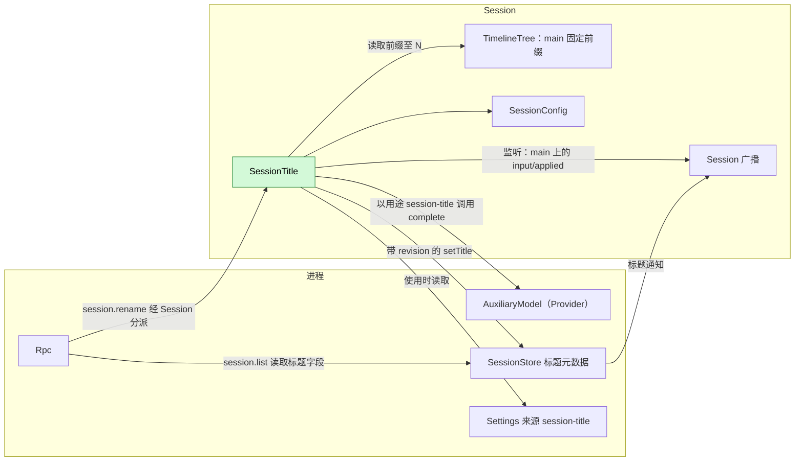
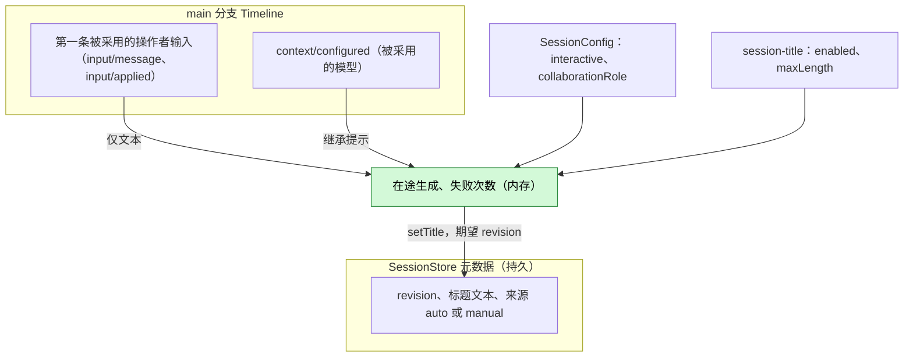
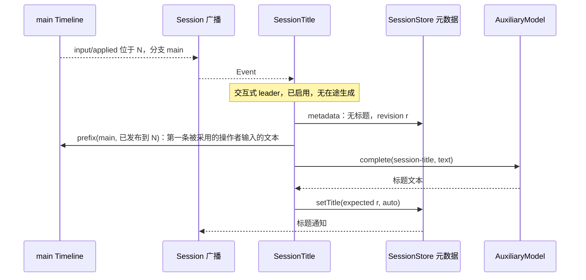
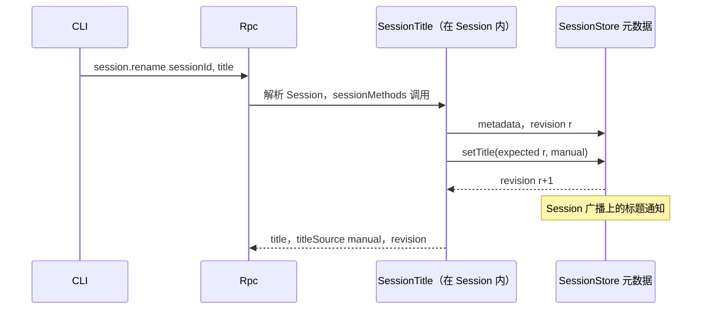
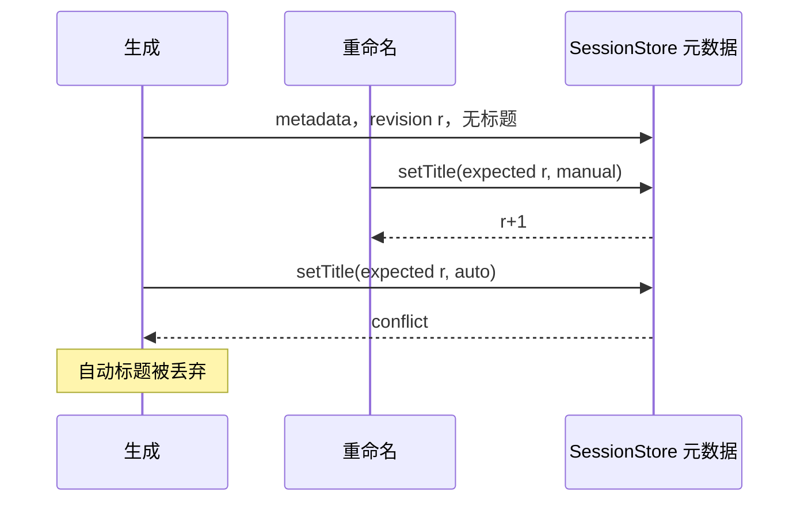

# SessionTitle

状态：草案。总体设计：[overview](../overview.md)（SessionTitle）。阶段：P1。语言：TypeScript 优先。作用域：[ADR 002](../../adr/002-plugin-scope.md)（Session）。

SessionTitle 是一个 Session 插件，为交互式 leader Session 提供经 SessionStore 元数据保存的标题。它通过既有的 Session 广播观察自己的 Session；当 `main` 上的第一条操作者输入被采用时（`input/applied`），它仅凭该输入的文本，经 Provider `AuxiliaryModel` 在用途 key `session-title` 下生成标题。标题是 SessionStore 的状态：SessionTitle 只通过 SessionStore 的类型化操作 `setTitle` 写入，SessionStore 在每次变更后发出一条 Session 广播通知，由客户端消费（通用通知记录是对运行时的需求，见 [§9](#9-向机制所有者提出的需求)；SessionStore 标题元数据和 Rpc 转发是补充，见[总体设计附录 B.2](../overview.md#b2-app-server-进程插件)）。它经 key 为 `session.rename` 的 Session 级 `sessionMethods` 服务提供 `session.rename`（[方法与工具贡献](../contracts/session-boundary.md)）。它不写任何 Timeline 事件，也没有模型可见的效果。契约以语言中立形式给出（[ADR 002 D5](../../adr/002-plugin-scope.md)）；Rust 绑定见附录 G。

## 1. 结构



| 部件 | 作用域 | 依赖 | 提供 |
| --- | --- | --- | --- |
| `SessionTitle` | Session | 其所在 Session 的 Session 广播、TimelineTree（`main` 的固定前缀）、`SessionConfig`；进程服务 SessionStore 标题元数据、Provider `AuxiliaryModel`、Settings 来源 `session-title` | `sessionMethods` key `session.rename`（在其 `provides` 中声明）；用途 key `session-title`；Settings 来源 `session-title`，字段 `enabled`、`maxLength` |

每个依赖都位于 Session 作用域或外层进程作用域。多数是既有的类型化服务；SessionStore 标题元数据和标题通知是拟议的补充；Settings 来源已为 Rust 所有者提供，具名的 `settings` 服务尚未实现（S8b）（[总体设计附录 B.2](../overview.md#b2-app-server-进程插件)；形状见 A.2）。将它们按名称暴露给 TypeScript 实现属于 issue [#4](https://github.com/arcships/dim/issues/4) 的工作，见 [session-access §9](../contracts/session-access.md#9-向机制所有者提出的需求)。SessionStore、Provider 或 Settings 重载会重载 SessionTitle，从而取消在途的生成；这是可接受的（[ADR 002 D3](../../adr/002-plugin-scope.md)）。业务配置变更从不触发重载（[D4](../../adr/002-plugin-scope.md)）。

## 2. 数据与状态



标题归 SessionStore 所有：它保存文本、来源和 revision 计数器，只接受通过类型化操作 `setTitle` 的修改，只有 SessionTitle 调用该操作。每次变更提交后，SessionStore 在 Session 广播上发出一条标题通知（A11）；标题从不进入 Timeline。每次决定都先读元数据，再读固定前缀。内存状态在重载或 Session 卸载时丢失，其后果只是允许再尝试一次。

## 3. 流程

### 3.1 由第一条用户输入自动生成标题



生成在输入被采用时开始，而非 turn 结束后。只发送 `main` 上第一条被采用的操作者输入的文本；被删除的输入从未被采用，因此不会产生标题，其文本也不会发给辅助模型。

### 3.2 手动重命名



Rpc 与处理任何 Session 方法一样解析 Session，必要时加载它。遇到 `conflict` 时 SessionTitle 重新读取并重试，至多 3 次。

## 4. 时序与冲突



revision 检查就是复检：手动标题总是胜出。

| 场景 | 顺序 | 结果 | 负责方 |
| --- | --- | --- | --- |
| 成员 Session（`collaborationRole`），或非交互 Session | `SessionConfig` | 从不生成；允许重命名 | SessionTitle |
| 生成完成前出现第二条输入 | — | 跳过（在途） | SessionTitle |
| 第一条输入已删除 | input < `input/deleted` | 从未被采用：不用它生成标题；下一条被采用的操作者输入触发（A9） | SessionTitle |
| 生成失败 | — | 无标题期间下一条被采用的 `main` 输入从第一条被采用的输入重试（A5） | SessionTitle |
| 生成中途重载或 Session 卸载 | — | 取消，不写入；下一条被采用的 `main` 输入触发 | Lifecycle |

完整表格：[附录 B](#附录-b-完整冲突表)。

## 5. 上下文映射

没有模型可见的效果：SessionTitle 不写输入、工具、提示词来源或事件。辅助请求是一次独立的单次调用：

| 部分 | 内容 |
| --- | --- |
| System | `Write a short title for this conversation: at most 8 words, in the language of the user's message, no quotes, no trailing punctuation. Reply with the title only.`（A2） |
| User 消息 | `main` 上第一条被采用（有 `input/applied`）的操作者 `input/message` 的文本块，以换行连接，截断到 2000 个字符（A2） |

从不发送：图片、raw 输入块、被删除的输入、后续输入、助手输出、系统提示词、工具调用与结果、子分支事件。诊断只记录结果与耗时。

## 6. 接口（摘要）

| 接口 | 类型 | 用途 |
| --- | --- | --- |
| `session.rename {sessionId, title \| null}` | `sessionMethods` key `session.rename` | 设置或清除手动标题 |
| `session-title` | Provider 用途 key | 标题生成的模型策略；未配置时继承 |
| `session-title` 来源：`enabled`、`maxLength` | 业务配置（Settings 来源） | 关闭生成；标题长度 |
| `session.list`/`session.summaries` 中的 `title`、`titleSource` | 从 SessionStore 读取的 Rpc 协议字段 | 展示 |
| 标题通知 `{sessionId, title, titleSource, revision}` | SessionStore 发出的 Session 广播通知（通用记录，§9；SessionStore 补充） | 已订阅的客户端实时更新标题 |

## 7. 安全

第一条输入的文本会发送给为 `session-title` 选择的模型；在默认的继承策略下即该 Session 的 provider。标题可能包含用户内容，并返回给每个能列出 Session 的客户端。请求中不包含凭据、宿主设置或工具输出。重命名输入由 SessionTitle 的方法校验（A.1）。

## 8. 规则检查

| 规则 | 本文如何遵守 |
| --- | --- |
| 原则 §4 第 1 条（改别人的状态写指令） | 标题是 SessionStore 没有 Timeline 的进程级状态；SessionTitle 只通过 SessionStore 的类型化 `setTitle` 修改，由 SessionStore 按 revision 检查决定（原则 §4 第 9 条）。 |
| 原则 §4 第 2 条（交接） | SessionTitle 只在输入交接（`input/applied`）之后读取它，从不处理输入本身。 |
| 原则 §4 第 3 条（只用 before 回调） | 不在写入前干预；重命名规则由 SessionTitle 自己的方法检查，不在入口检查。 |
| 原则 §4 第 4 条（核心不带业务含义） | §9 提出的 Session 广播通知是通用记录，任何拥有 Session 进程级状态的所有者都可使用。 |
| 原则 §4 第 5 条（批次） | 触发在消费 `input/applied` 时按序处理它。 |
| 原则 §4 第 6 条（上下文只含交接后的事件） | SessionTitle 不向模型上下文添加内容；辅助请求只含被采用的输入文本。 |
| 原则 §4 第 7 条（只用公开事件和服务） | 使用 Session 广播、固定前缀读取、SessionStore `setTitle`、`AuxiliaryModel` 和 Settings，均为公开接口。 |
| 原则 §4 第 8 条（向机制所有者提需求） | 对运行时的需求（通用广播通知记录）写在 §9；#4 写在 [session-access §9](../contracts/session-access.md#9-向机制所有者提出的需求)。对其他插件的需求（SessionStore 标题元数据和发出通知、Rpc 转发通知）列在[总体设计附录 B.2](../overview.md#b2-app-server-进程插件)。 |
| 原则 §4 第 9 条（只有后续决定要用的事实才进 Timeline） | 标题是 SessionStore 的进程级状态：不进 Timeline，通过 `setTitle` 修改，以 Session 广播通知送达 UI。 |
| 原则 §1（Capability 与 App Server 边界） | SessionTitle 是放在自己插件包中的 Session Capability；Rpc 只分派 `session.rename`，并从 SessionStore 读取标题字段。 |
| ADR 002 D1（作用域跟随状态） | Session 作用域：标题属于 Session；存储的标题归 SessionStore。 |
| ADR 002 D2（不设接线模块） | 没有接线模块；所有依赖都是声明的服务。 |
| ADR 002 D3（依赖跟随作用域） | 依赖位于 Session 或外层进程作用域；它们重载会取消生成，这是可接受的。 |
| ADR 002 D4（结构配置与业务配置分离） | 启用是结构配置；`session-title` 文档是其自己 Settings 来源中的业务配置，使用时读取。 |
| ADR 002 D5（合同语言中立） | 契约语言中立；Rust 形式见附录 G。 |

## 9. 向机制所有者提出的需求

**R1. 进程级状态的 Session 广播通知。**

| 项目 | 内容 |
| --- | --- |
| 被哪条规则挡住 | 原则 §4 第 9 条和第 4 条：SessionStore 标题这样的进程级状态不能进 Timeline，但客户端需要实时看到标题变更；Session 广播目前只承载 `Event`、`Fence`、`Closed` 记录（[session_broadcast.rs](../../../../crates/dim-agent-capabilities/src/session_broadcast.rs)）。 |
| 考虑过的现有机制 | `session/titled` Timeline 事件（把进程状态放进 Timeline；总体设计 §7 已否决）；客户端轮询 `session.list`（不能实时更新）；标题专用频道（业务专用端口，违反第 8 条）。 |
| 需要的通用能力 | Session 广播频道上的通知记录 `{source, kind, data}`，由该 Session 进程级状态的所有者在变更提交后发出；不带业务含义。标题通知就是这条记录，`source: "SessionStore"`、`kind: "title"`、`data: {sessionId, title, titleSource, revision}`；线上形式以这条记录为准。 |
| 对序号、批次、中断、重载的影响 | 没有序号，不属于批次；不重放：重新订阅的客户端通过所有者的查询（`session.list`）读取当前状态；不受中断影响；发出方重载只会让通知停止。 |
| 由谁实现，对应 issue | 运行时（Session 广播）；暂无 issue。Rpc 把记录原样转发给已订阅的客户端，这是 App Server 入口的改动，和 SessionStore 补充一起列在[总体设计附录 B.2](../overview.md#b2-app-server-进程插件)。 |

#4（运行时类型化服务按名字暴露给非 Rust 部分）写在 [session-access §9](../contracts/session-access.md#9-向机制所有者提出的需求)。

## 附录 A. 接口细节

### A.1 `session.rename`

经 `sessionMethods`（Session，key `session.rename`）提供：`describe(): async -> MethodDecl[]` 返回一个声明 `{name: "session.rename", mutating: true}`；`call(MethodCall): async -> MethodReply` 处理它。被丢弃的调用在 `setTitle` 之前被取消，或在其之后原子地完成。

| 参数 | 结果 | 错误 |
| --- | --- | --- |
| `{sessionId, title: string \| null}` | `{title: string \| null, titleSource: "auto" \| "manual" \| null, revision}` | `invalid_params`、`session_not_found`、`service_reloading`、`storage_failed`；分派错误见 [session-boundary](../contracts/session-boundary.md) |

`title` 去除首尾空白；1..=`maxLength`（来源 `session-title`）个字符，不含换行或控制字符（A3）。`null` 清除标题（A6）。

### A.2 依赖的形状（由所有者定义）

| 服务 | 方法 | 类型 | 请求 | 回复与错误 |
| --- | --- | --- | --- | --- |
| SessionStore 元数据（补充） | `metadata` | 异步 | `{sessionId}` | `{revision, title?: {text, source: "auto" \| "manual"}}`；错误 `not_found`、`storage` |
| SessionStore 元数据（补充） | `setTitle` | 异步 | `{sessionId, expectedRevision, title: {text, source} \| null}` | 新的 `revision`；错误 `conflict`、`not_found`、`storage`。提交后 SessionStore 发出标题通知 |
| SessionStore（补充） | 标题通知 | Session 广播通知（通用记录，§9） | — | 在该 Session 的广播频道上发出 `{source: "SessionStore", kind: "title", data: {sessionId, title, titleSource, revision}}`；没有序号，不重放 |
| Provider `AuxiliaryModel` | `complete` | 异步 | `{purpose: "session-title", inherit?: model selection, request: {system, user}}` | 文本；错误作为数据。继承提示是 SessionTitle 的假设（A1）。由取消请求或丢弃调用取消 |

### A.3 配置

Settings 来源 `session-title`，一个文档：`enabled: bool` 默认 `true`；`maxLength: u32` 默认 80，范围 10..=200（A3）。SessionTitle 声明的 schema 带有默认值和范围（`minimum`/`maximum`），因此 Settings 在写入和读取持久化文件时拒绝超出范围的值，SessionTitle 直接使用交付的文档，不再检查。每次决定时读取。SessionTitle 没有写配置的工具，因此文档只经客户端方法 `settings.read`/`settings.update` 写入（S8b，尚未实现）。变更是带通知的数据更新，从不触发重载。启用插件属于结构性配置。`session-title` 的 Provider 策略位于 Provider 的按用途策略中；未配置时继承 Session 的模型（A1）。

### A.4 机制

| 步骤 | 路径 |
| --- | --- |
| 监听 | 应用时：为 `main` 上的 `input/applied` 事件注册 Session 广播监听器，卸载时移除 |
| 资格 | `SessionConfig.interactive && collaborationRole = leader` |
| 触发 | 收到位于 `N` 的 `input/applied` 时：若不具资格、已禁用、有在途生成或失败次数 ≥ 3（A5）则跳过；否则启动一个归属插件生命周期的生成任务 |
| 检查 | `metadata(session)`：已有任何标题则跳过；记下 revision `r` |
| 读取 | `main` 已发布到 `N` 的固定前缀（session-access A.5，`atLeast = N`）；第一条有 `input/applied` 的操作者输入（`user` 内容；A10）及其文本。没有这样的输入或无文本：不生成标题（A8） |
| 生成 | `complete({purpose: "session-title", inherit: 前缀中最新 context/configured 的模型, request})`，30 s 预算（A4）。规范化：取第一行，去除引号与末尾标点，折叠空白，在 `maxLength` 处截断 |
| 写入 | `setTitle({sessionId, expectedRevision: r, title: {text, source: "auto"}})`；`conflict` 或 `not_found` 时丢弃 |
| Timeline | 不写入，不登记 Dispatcher，无 `StateCell` |
| 重载 / 卸载 | 生成随插件一起取消；不写入；间隙中的事件不重放 |

## 附录 B. 完整冲突表

| 场景 | 序号顺序 | 结果 | 负责方 |
| --- | --- | --- | --- |
| 第一条输入的 turn 被中断或失败 | input < `stop/interrupt` | 生成继续 | SessionTitle |
| 不含 `user` 内容的输入（Goal 块、来源标记） | — | 从不触发，从不使用 | SessionTitle |
| 第一条输入在被应用前被撤回（`session.input.withdraw`） | input < withdraw < `input/deleted` | 从未被应用：不生成，文本从不发送；第一条被应用的操作者输入触发 | SessionTitle |
| 第一条用户输入只含图片 | — | 无自动标题（A8） | SessionTitle |
| 检查之前重命名 | rename < check | 已有标题：跳过 | SessionTitle |
| 生成期间重命名 | check (r) < rename (r+1) < write | `conflict`：自动标题被丢弃 | SessionStore revision |
| 并发重命名 | revision 顺序 | 最后提交的重命名胜出 | SessionStore |
| 重复的 `session.rename` | — | 重写相同文本 | SessionTitle |
| 第一条之后的 Steer/Queue/Append 输入 | — | 从不进入摘录 | SessionTitle |
| 工具批次、压缩 | — | 无关：只读取输入事实 | — |
| 子分支输入 | 分支过滤 | 从不触发 | SessionTitle |
| 成员、阶段、定时或 ACP Session | `SessionConfig` | 从不生成 | SessionTitle |
| 生成期间关闭 Session | — | 生成随 Session 插件取消；不写入 | Lifecycle |
| Session fork | 不复制元数据（A7） | fork 无标题；`main` 上下一条被采用的操作者输入触发生成，取其前缀中第一条被采用的操作者输入 | SessionTitle |
| SessionTitle、Provider、SessionStore 或 Settings 重载 | — | 生成被取消，不写入（D3） | Lifecycle |
| 模型或策略不可用 | — | 计入失败；3 次后在重载前不再尝试（A5） | SessionTitle |
| 资源节点离线 | — | 无影响 | — |
| 客户端断开 | — | 无影响 | — |

## 附录 C. 错误与恢复

| 情况 | 结果 |
| --- | --- |
| 模型错误、超时、空输出、策略不可用 | 不写入；诊断；计入失败 |
| 自动写入时 `setTitle` 返回 `conflict` | 丢弃（诊断） |
| `setTitle` 返回 `storage` | 自动：计入失败；重命名：`storage_failed` |
| 重命名时 Session 未知 | `session_not_found` |
| SessionTitle 正在重载 | `service_reloading`；重命名未发生 |
| 取消 | 辅助调用在任何写入之前中止 |

## 附录 D. 验收

经 `session.create`/`session.submit`、`session.rename`、`session.list` 与伪造辅助模型的流程测试：

1. 在交互式 leader Session 上的第一次 `session.submit` 在输入被应用之后、turn 结束之前产生 `auto` 标题；请求只包含系统文本与该输入的文本；已订阅的客户端收到一条标题通知。
2. 中断第一个 turn 或使其失败不妨碍标题生成。
3. 成员 Session 与 `interactive: false` 的 Session 不获得标题；对它们的重命名可用。
4. 生成期间重命名（伪造模型被挂起）：保留手动标题，丢弃自动标题。
5. 已有标题的 Session 从不重新生成；清除后在下一条被采用的输入时允许重新生成，仍取第一条被采用的输入的文本。
6. 对未加载 Session 的重命名经 Rpc 加载它并成功。
7. 子分支输入与不含 `user` 内容的输入从不触发；只含图片的第一条输入不产生标题。
8. 生成期间重载不写入任何内容；下一条输入触发生成。三次失败后停止尝试。
9. 无效的重命名输入返回 `invalid_params`。
10. 在被应用前撤回（`session.input.withdraw`）的第一条输入不产生标题，也不发给辅助模型；下一条被采用的输入用它自己的文本产生标题。

## 附录 E. 假设

| # | 假设 | 依据 | 若被否决的影响 |
| --- | --- | --- | --- |
| A1 | `AuxiliaryModel::complete` 接受继承提示（最新 `context/configured` 的模型） | 判断 | Provider 自行解析继承 |
| A2 | 指令文本、8 个词的目标、2000 个字符的摘录 | 判断 | 不同的提示词或摘录 |
| A3 | 标题长度默认 80（10..=200），单行 | 判断 | 其他限制 |
| A4 | 30 s 生成预算 | 判断 | 其他超时 |
| A5 | 每个 Session 每代插件至多 3 次失败尝试 | 判断 | 更多重试或不重试 |
| A6 | 以 `null` 调用 `session.rename` 清除标题 | 判断 | 手动标题永久保留 |
| A7 | Session fork 不复制标题 | 判断 | fork 显示源标题 |
| A8 | 不含文本的第一条用户输入不产生自动标题 | 决定：标题取自第一条用户输入 | 使用后续输入或占位符 |
| A9 | 生成等待输入被采用（`input/applied`）；被删除的输入从不产生标题 | 维护者决定 | 被删除的文本可能发给辅助模型 |
| A10 | “用户输入”指操作者输入：在交互式 leader Session 中，即带 `user` 内容的输入，因为 Collaboration、Goal 和 ShellInput 只写 raw 块（Scheduler 与 Workflow 的输入带 `user` 内容，但运行在非交互 Session 中，SessionTitle 不为其命名） | 判断 | 来源写入的输入可能为 Session 命名 |
| A11 | SessionStore 用 Session 广播通知宣布标题变更；未订阅的客户端在下一次 `session.list` 时看到变更 | 原则 §4 第 9 条 | 客户端轮询 `session.list` |

## 附录 F. 待对齐问题

| 问题 | 描述 |
| --- | --- |
| Session 列表字段 | `SessionSummary` 中的 `title`/`titleSource` 是一项 Rpc 协议变更，需记录到 overview |
| 按名称获取服务 | TypeScript 实现需要 Session 广播、固定前缀读取、SessionStore 元数据、`AuxiliaryModel` 与 Settings 按名称暴露（[#4](https://github.com/arcships/dim/issues/4)，见 [session-access §9](../contracts/session-access.md#9-向机制所有者提出的需求)） |

## 附录 G. Rust 绑定

| 语言中立 | Rust |
| --- | --- |
| `sessionMethods` key `session.rename` | `SessionMethodContribution(Arc<dyn MethodProvider>)`，位于 `SessionScope::named_key::<SessionMethodContribution>("session.rename")`，以 `AgentBuilder::session_methods("session.rename")` 注册 |
| Session 广播监听器 | `session_channel(session_id)` 上针对 `Event` 记录的监听器，由 `ctx.effect` 移除 |
| 生成任务 | 在 `ctx.effect` 下派生 |

```rust
// SessionStore metadata supplement
async fn metadata(&self, session_id: &str) -> Result<SessionMetadata, MetadataError>;
async fn set_title(&self, session_id: &str, expected_revision: u64, title: Option<Title>)
    -> Result<u64, MetadataError>;                       // Conflict | NotFound | Storage; emits the title notice after commit
pub struct SessionMetadata { pub revision: u64, pub title: Option<Title> }
pub struct Title { pub text: String, pub source: TitleSource }   // Auto | Manual
// Provider AuxiliaryModel
async fn complete(&self, purpose: &str, inherit: Option<ModelSelection>,
    request: AuxiliaryRequest, cancel: CancellationToken) -> Result<String, AuxiliaryError>;
```
