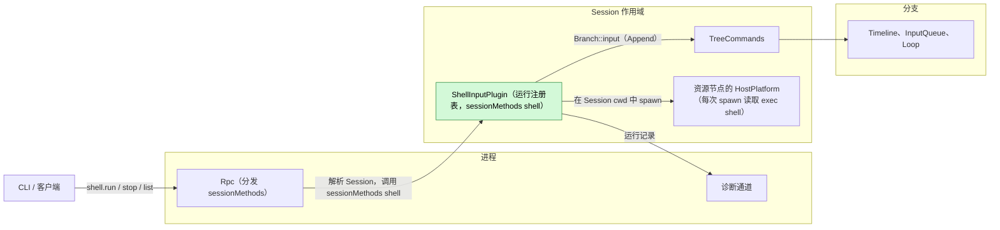
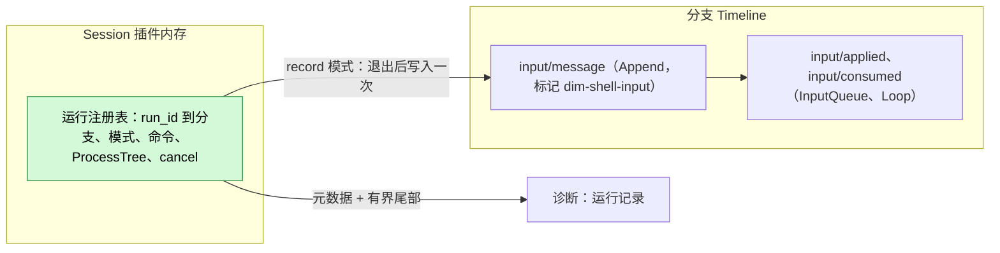
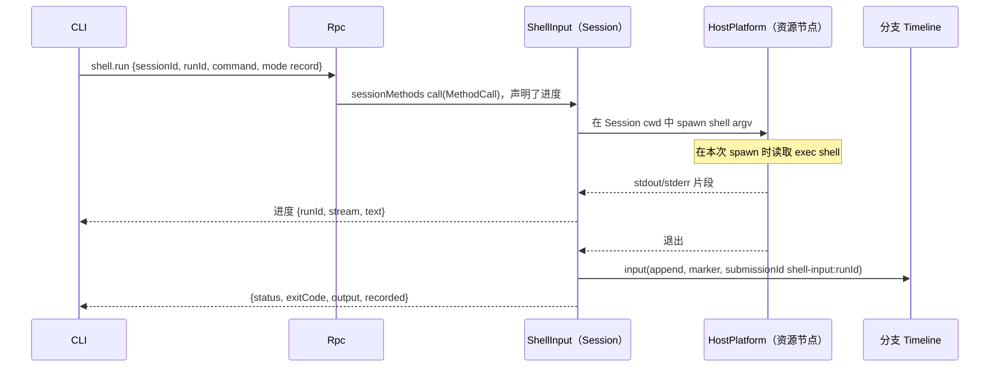
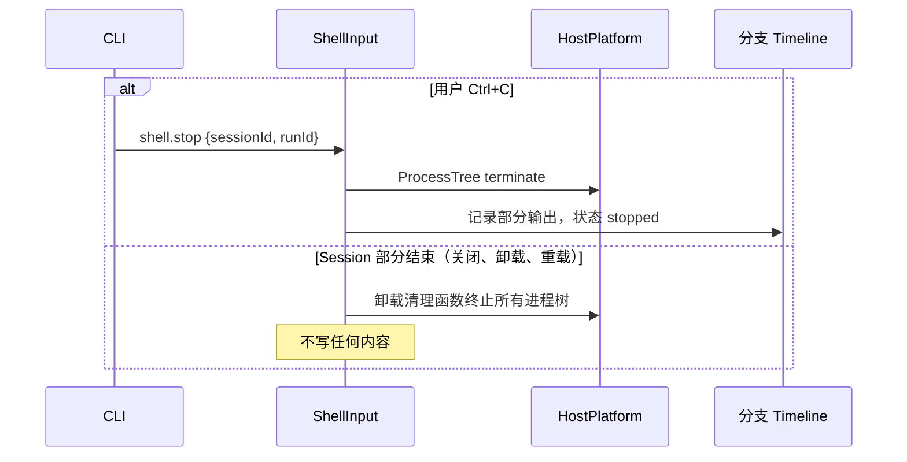
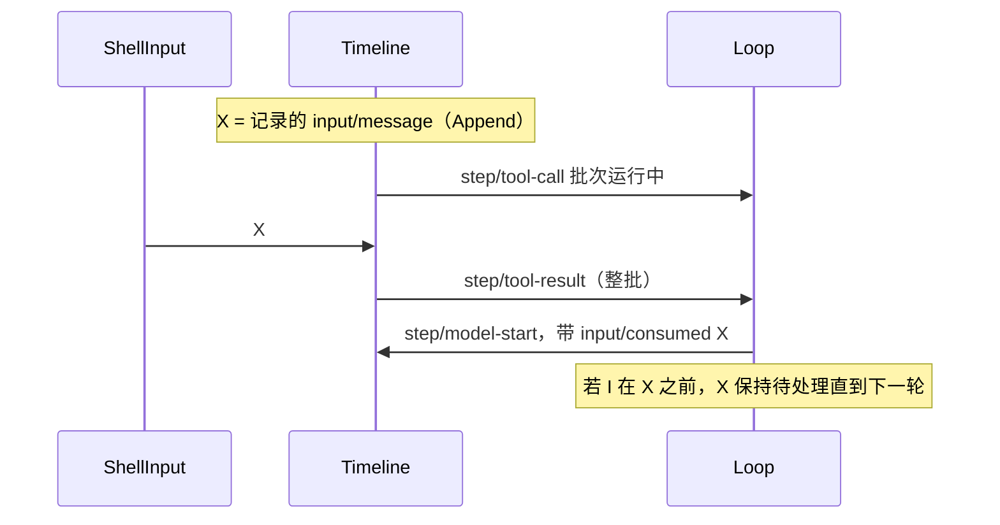

# ShellInput

状态：草案。总体设计：[overview B.3](../overview.md)。阶段：P1。语言：Rust。作用域：Session（[ADR 002](../../adr/002-plugin-scope.md)）。

在 Session 资源节点上的工作区中执行用户输入的 `!command` 和 `!!command`。`!command` 的结果（命令及有界输出）作为 Append 输入写入，因此随下一次模型请求进入上下文；`!!command` 的输出只发给调用方客户端和诊断。ShellInput 是一个没有事件的 Session 插件。它通过 `sessionMethods` 服务（Session 作用域，key `shell`）以普通 Session 方法提供 `shell.run`、`shell.stop` 和 `shell.list`（[session-boundary](../contracts/session-boundary.md)）；契约以语言中立形式给出，Rust 形式见[附录 G](#附录-g-rust-绑定)。每个 Session 最多同时运行一个命令；命令在 `shell.stop` 时或 Session 部分结束时（Session 关闭或卸载、重载、守护进程退出）结束。

## 1. 结构



| 部分 | 作用域 | 依赖 | 提供 |
| --- | --- | --- | --- |
| `ShellInputPlugin` | Session | `S:SessionConfig`（`cwd`）、`S:TreeCommands`、Session 资源节点的 HostPlatform（与 WorkspaceTools 的用法相同）、诊断通道 | `sessionMethods` key `shell`，在插件的 `provides` 中声明 |

依赖的契约：`sessionMethods` 与每次调用的进度（[session-boundary](../contracts/session-boundary.md)）；带边界校验的 `Branch::input`（[interrupt](../../../architecture/rust-agent/interrupt.md)）；HostPlatform 进程服务（启动进程树、读取输出、等待退出、终止进程树；Rust 名称见附录 G）；节点的 exec shell，作为每次 spawn 时读取的业务配置（[ADR 002](../../adr/002-plugin-scope.md)"现有插件"）；隔离（总体设计附录 C 补充）；节点离线规则（[overview §6.3](../overview.md)）：对离线资源节点的调用以 `node_unavailable` 失败，而 ShellInput 保持加载，这要求经 rutis 链路导入的服务在链路断开期间保持注册并让调用失败（对 [#5](https://github.com/arcships/dim/issues/5) 的要求，见 [ExternalAgent](ExternalAgent.md) §9）；`exec` 工具的 shell argv 构造（[exec.rs](../../../../crates/dim-agent-capabilities/src/workspace_tools/exec.rs)，作为 HostPlatform 辅助函数暴露，A2）。

本文定义的契约：`shell.*` 方法、来源标记 `dim-shell-input`（kind `command`）以及 `submissionId` 前缀 `shell-input:`。

## 2. 数据与状态



运行注册表是由插件代通过其卸载清理函数拥有的内存，从不重建：Session 部分结束时，所有运行都被终止。唯一持久的结果是现有的 `input/message`，随 Session 一起恢复。

事件：无。运行由用户而非分支轮次启动，因此分支中断不会结算它。`!command` 唯一与后续相关的结果是该输入；`!!command` 不影响任何后续内容。运行记录进入诊断。

## 3. 流程

### 3.1 记录的 `!command`



写入只发生一次，在进程树释放之后。InputQueue 应用该 Append；Loop 在运行中轮次的下一次模型请求时消费它，空闲时则在下一轮的第一次请求时消费。不会开启轮次。

### 3.2 停止与 Session 结束



轮次的 `stop/interrupt` 不会到达运行：第一次 `Ctrl+C` 发送 `shell.stop`，第二次才落到轮次停止。

### 3.3 `!!command`

与 3.1 相同但不写入：输出以流式发送并只返回给调用方。

## 4. 时序与冲突

### 4.1 结果与轮次



位置由输入的拥有方按序号决定；ShellInput 没有复核，因为它的写入不依赖任何 Timeline 事实。

| 场景 | 结果 |
| --- | --- |
| 一个运行进行中时同一 Session 的第二个 `!` | `shell_busy` |
| 运行期间分支关闭 | 写入以 `BranchMissing` 失败；回复 `recorded: null`，输出照常返回 |
| InputQueue 持有 X 时对其 `input/withdraw` | `input/deleted`；从未被应用或消费；不重新写入 |
| 运行期间 Session 关闭、空闲卸载或重载 | 进程树终止；不写任何内容；调用方得到 `operation_interrupted`（A10） |
| exec shell 配置改变 | 正在运行的命令保留其 shell；下一次 spawn 读取新值；不重载任何东西 |

完整表格：附录 B。

## 5. 上下文映射

| 模式 | 模型看到的内容 | 形式与位置 |
| --- | --- | --- |
| `!command` | `<dim-shell-input kind="command" status="completed" exit="0" truncated="false">` + `$ command` + 有界输出 | 一个无 key 的 raw 块（用户角色消息），位于输入的消费位置 |
| `!!command` | 无 | — |

没有工具声明、提示词来源或 key：每次运行都是一次性观察。压缩之后结果只通过摘要保留。子分支只在其于切点之前被消费时继承它。模型从不看到 `runId`、`submissionId`、流的区分、耗时、诊断或终端转义序列。

## 6. 接口（摘要）

| 接口 | 类型 | 用途 |
| --- | --- | --- |
| `shell.run` | `sessionMethods`（Session，key `shell`），带进度 | 运行命令（`record` 或 `private`），流式输出，返回结果 |
| `shell.stop` | 同上 | 按 `runId` 停止运行；幂等 |
| `shell.list` | 同上 | Session 中正在运行的运行 |
| 标记 `dim-shell-input` kind `command` | 输入约定 | 模型可见的记录结果 |
| CLI `!` / `!!` | 客户端 | 把前缀映射到 `shell.run` 模式 |

## 7. 安全

`!` 和 `!!` 以服务用户身份在资源节点上执行任意命令，无需 Approval（总体设计 §5.3）。`shell.*` 是普通 Session 方法：任何能访问该 Session 的客户端都可以调用，包括已配对的远程设备（决定 E3），因此配对设备或授予 Session 访问，就是授予在该 Session 资源节点上执行命令的能力。Session 方法没有级别；只有管理方法不提供给已配对设备（[session-boundary](../contracts/session-boundary.md)）。节点的隔离适用（宿主本地，从不来自 Timeline）。对于 `!`，命令文本和输出会写入 Timeline 并重放给模型；用户应避免打印机密。环境是服务的环境，从不从客户端转发。诊断只携带元数据和有界尾部（A13）。

## 8. 规则检查

规则：[principles §1 与 §4](../../../architecture/rust-agent/principles.md)，[ADR 002](../../adr/002-plugin-scope.md) D1–D5。

| 规则 | 本文如何符合 |
| --- | --- |
| §4.1 改别的模块拥有的状态时写指令事件 | ShellInput 不改其他模块的状态；它在 Timeline 上的唯一效果是一条由 InputQueue 与 Loop 处理的普通输入。 |
| §4.2 交接后不能撤回 | 记录的输入只写一次，从不重写；撤回经 InputQueue 自己的指令。 |
| §4.3 只用 before 回调在写入前干预 | 不适用：ShellInput 不注册 before 回调，也不加入口检查；它只校验自己的参数。 |
| §4.4 核心机制不带业务含义 | Rpc、InputQueue 与 Loop 不需改动；标记是普通 raw 块。 |
| §4.5 决定前读完整个批次 | 不适用：ShellInput 不读任何 Timeline 事件。 |
| §4.6 模型上下文只含交接后被读取的事件 | 输出只在 InputQueue 采用、Loop 消费该输入后进入模型；`!!` 的输出从不进入。 |
| §4.7 插件之间只通过公开事件和服务交互 | ShellInput 只使用 `Branch::input`、`S:TreeCommands`、`SessionConfig` 与 HostPlatform。 |
| §4.8 向机制所有者提通用需求 | 运行计为活动以防空闲卸载见 §9；#5 给出链接。 |
| §1 Capability 与 App Server 边界 | ShellInput 是各自包中的 Session Capability；Rpc 只分派 `sessionMethods`。 |
| ADR 002 D1 作用域跟随状态所有者 | 运行是该 Session 资源节点上的 Session 工作，因此插件是 Session 作用域。 |
| ADR 002 D2 不设接线模块 | Rpc 经 Session 的 `sessionMethods` 按名字找到 `shell.*`；没有模块指名 ShellInput。 |
| ADR 002 D3 依赖跟随作用域 | 依赖都是 Session 服务；重载会终止运行，可接受。 |
| ADR 002 D4 结构性配置与业务配置分离 | exec shell 是每次 spawn 时读取的业务配置；变更时不重载任何部件。 |
| ADR 002 D5 合同语言中立 | 方法、标记与记录的输入以中立形式给出；附录 G 是 Rust 绑定。 |

## 9. 向机制所有者提出的需求

### R1. Session 工作计为活动，防止空闲卸载（Agents）

| 项 | 内容 |
| --- | --- |
| 被哪条规则挡住 | ADR 002 D1（运行是 Session 工作，随 Session 部分结束）与生命周期规则“客户端断开不等于关闭 Session”：调用方断开后，没有东西阻止 Session 空闲卸载，而空闲卸载会终止长时间运行的 `!` 命令。 |
| 考虑过的现有机制 | Rpc 在每次调用期间持有的 `SessionUse` 租约（调用被丢弃时释放，A12）；运行中的 turn（`!` 运行不是 turn）；为运行设进程级拥有者（把 Session 工作移出其作用域，D1）。 |
| 需要的通用能力 | Session 部件可以在自己的 Session 上持有一个活动句柄；只要有句柄被持有，Agents 就不空闲卸载该 Session。句柄不带业务含义，由 `ctx.effect` 释放。 |
| 对序号、批次、中断、重载的影响 | 对序号与批次无影响。中断：不变（运行不理会 turn 中断）。重载：句柄随部件释放；关闭仍会终止运行。 |
| 由谁实现，对应 issue | Agents（`AgentIndex`，App Server）与运行时 Session 门面；尚未建 issue。 |

链接：#5，包括链路断开时终止导入的 HostPlatform 的进程树（见 [ExternalAgent](ExternalAgent.md) §9）。

## 附录 A. 接口细节

### A.1 方法

服务 `sessionMethods`，Session 作用域，key `shell`。`describe()` 为每个方法返回一个 `MethodDecl`，其中 `notifications: []`、`reply: direct`；`shell.run` 为 `mutating: true`、`interruption: report`、`progress: true`；`shell.stop` 为 `mutating: true`；`shell.list` 为 `mutating: false`。`call(MethodCall)` 接受下列参数，并以 `MethodReply` 回复结果；进度项在回复之前在调用上发送；错误为 `MethodError` 数据（附录 C）。被丢弃的调用（客户端离开）不会停止运行（A12）。

| 方法 | 参数 | 结果 |
| --- | --- | --- |
| `shell.run` | `{sessionId, branchId?: "main", runId, command, mode: "record" \| "private"}` | 退出时：`{runId, status: "completed" \| "failed" \| "stopped", exitCode?, signal?, output, truncated, durationMs, recorded?: {sequence, submissionId} \| null}`。进度：`{runId, stream: "stdout" \| "stderr", text}`，只发给调用方连接，按速率合并（A9） |
| `shell.stop` | `{sessionId, runId}` | `{stopped: bool}`；已结束时为 `false` |
| `shell.list` | `{sessionId}` | `[{runId, branchId, mode, command, startedAt}]` |

`runId` 由客户端生成，因此 `stop` 可以在 `run` 回复之前发送。

### A.2 执行

| 项 | 规则 |
| --- | --- |
| 宿主 | Session 资源节点的 HostPlatform，即 Session 的工作区工具所用的那一个 |
| Shell | 节点的 exec shell，每次 spawn 时读取（变更时不重载），argv 按 `exec` 的方式构造（A2） |
| 工作目录 | Session cwd；每次运行一个新进程（A3） |
| 环境 | 节点的服务环境，从不使用客户端的环境；另加 `DIM_SESSION_ID`（A5） |
| stdin | Null；交互式程序看到 EOF |
| 隔离 | 由 HostPlatform 应用节点的隔离；Permission 预设从不放宽它 |
| 超时 | 无；由 `shell.stop` 或 Session 部分结束而结束 |
| 输出 | stdout 和 stderr 按到达顺序交错；按 `exec` 的方式解码（无效字节表示为 `<0xNN>`） |
| 上限 | 回复和模型可见输出：50 KiB 以内的最后 2000 行，即 `exec` 的 `truncate_preview` 规则（A7） |

### A.3 记录的输入

通过分支的输入边界写入一个输入：

| 字段 | 值 |
| --- | --- |
| `submissionId` | `shell-input:<runId>` |
| `rawBlocks` | 一个 raw 块：标记 `dim-shell-input`，kind `command`，属性 `status`、`exit`（退出码或信号）、`truncated`；正文为 `$ <command>`、换行、去除终端转义序列的有界输出 |
| `content` | 无 |
| `mode` | `append` |

ANSI/OSC 序列从正文中移除（A8）；回复中保留它们以供终端使用。

### A.4 机制

| 步骤 | 机制 |
| --- | --- |
| 启动 | 校验；拒绝 `shell_busy`/`duplicate_run`；`spawn`；在本代的跟踪器中注册运行 |
| 运行 | 一个任务把两个管道读入有界尾部缓冲区，并把片段转发到进度通道；对退出和 `cancel` 进行 `select!` |
| 停止 | `cancel` → `ProcessTree::terminate` → 状态 `stopped`，带部分输出 |
| 写入（`record`） | 资源释放之后：通过 `S:TreeCommands` 解析分支，`Branch::input` → 边界 `validate` → `Timeline::append`。已提交的序号作为 `recorded.sequence` 返回。从不重试；命令从不重新运行 |
| 消费 | InputQueue `input/applied {mode: append}`，Loop `input/consumed` |
| 复核 | 无 |
| Session 部分结束 | 卸载清理函数取消所有运行，终止进程树并等待它们，不写任何输入。守护进程退出：进程树随进程一起结束（`ProcessTree` 的 drop 会杀死进程树）。这包括结构性操作之后的重载，是可接受的代价（[ADR 002](../../adr/002-plugin-scope.md) D3） |

## 附录 B. 完整冲突表

`X` = 记录的 `input/message`（Append），`I` = 轮次 `stop/interrupt`。

| 场景 | 序号顺序 | 结果 | 决策归属 |
| --- | --- | --- | --- |
| 结果在运行中轮次的下一次请求之前 | X < `step/model-start` | 随该请求被消费 | Loop |
| 工具批次运行期间的结果 | X < `step/tool-result` | 在批次结果之后的下一次请求时被消费 | Loop |
| 空闲时的结果 | X，无轮次 | 待处理；在下一个 Queue/Steer 开启轮次时被消费；从不开启轮次 | InputQueue、Loop |
| X 之前的轮次中断 | I < X | 运行不受影响；X 待处理直到下一轮 | Loop |
| X 已应用，然后在消费前中断 | X < I | 待处理；由下一轮消费 | Loop |
| X 已消费，然后中断 | 已消费 < I | 保持在其消费位置 | Loop |
| 被持有时对 X 的 `input/withdraw` | X < withdraw < `input/deleted` | 从未被应用或消费；不重新写入 | InputQueue |
| 应用之后对 X 的 `input/withdraw` | `input/applied` < withdraw | 无效果（`notHeld`）；X 正常被消费 | InputQueue |
| 运行期间分支级中断或分支关闭 | 关闭 < X | 运行继续；写入以 `BranchMissing` 失败；`recorded: null` | 运行时门面；ShellInput |
| 运行期间 Session 关闭或空闲卸载 | — | 进程树终止，不写任何内容（A10） | ShellInput |
| 并发的 Steer/Queue 与 X | Timeline 顺序 | 各自按其模式应用 | InputQueue |
| 同一 Session 中的第二个运行 | — | `shell_busy` | ShellInput |
| X 与消费之间压缩 | X < 压缩 < 已消费 | 放在摘要之后的消费位置 | ContextPreparation |
| 消费之后压缩 | 已消费 < 压缩 | 只通过摘要保留 | ContextPreparation |
| 子分支在 X 与消费之间切出 | X < 切点 < 已消费 | 子分支不采纳 X | InputQueue（子分支） |
| 子分支在消费之后切出 | 已消费 < 切点 | 在前缀中继承 | 历史投影 |
| `!!` 运行 | — | 没有 Timeline 效果 | — |
| 运行中途 ShellInput 或 Session 重载 | — | 进程树终止；不写任何内容；调用方得到 `operation_interrupted`（D3） | ShellInput |
| 运行中途进程重启 | — | 进程树随守护进程结束；不写任何内容 | — |
| 已提交，然后回复丢失 | X 已提交 | 在同一代中重试 → `duplicate_run`；重启后客户端通过 `session.input_lookup` 检查 `shell-input:<runId>`（A11） | 客户端 |
| 启动时 Session 已卸载 | — | Rpc 在分发前恢复它 | Rpc、AgentIndex |
| 启动时资源节点离线 | — | `node_unavailable`；不启动任何内容；ShellInput 保持加载，其他 Session 不受影响（对 #5 的要求） | ShellInput |
| 运行中途失去资源节点 | — | 状态 `failed`；对于 `record`，以 `status="failed"` 写入部分输出（A6） | ShellInput |
| 重复或迟到的 `stop` | — | `{stopped: false}` | ShellInput |
| 客户端断开或失去连接 | — | 运行继续，并被记录或丢弃；进度被丢弃（A12） | ShellInput |
| 已配对的远程设备 | — | 与任何有 Session 访问的客户端一样允许（E3）；运行与本地客户端发起时相同 | ShellInput |
| 运行中途 exec shell 改变 | — | 运行保留其 shell；下一次 spawn 读取新值 | HostPlatform |

## 附录 C. 错误与恢复

| 错误（`appError`） | 条件 |
| --- | --- |
| `shell_unavailable` | 节点上 `HostPlatform.shell` 不可用（转发原因） |
| `shell_busy` | Session 中另一个运行正在进行 |
| `duplicate_run` | `runId` 已在本代中使用 |
| `invalid_params` | 命令为空、命令超过 64 KiB、`runId` 不符合 `[A-Za-z0-9-]{1,64}` |
| `session_closed` / `branch_missing` | 启动时 Session 或分支已不存在 |
| `node_unavailable` | 资源节点不可达 |
| `unknown_method` | Session 中未启用 ShellInput |
| `service_reloading` | 启动时服务正在重载 |
| `operation_interrupted` | 调用运行期间 Session 部分结束 |

| 情形 | 结果 |
| --- | --- |
| spawn 失败 | `status: "failed"`，附原因；不记录任何内容 |
| 非零退出 | `status: "completed"`，设置 `exitCode`；记录 |
| 写入被拒绝（`SessionClosed`、`BranchMissing`、`Rejected`） | 返回输出，`recorded: null` 并附错误 |
| 卸载、重载、重启 | 运行被终止，从不重新执行 |

## 附录 D. 验收

1. 空闲时 `!echo hi`：带标记的 Append 输入；不开启轮次；下一个提示的第一次请求在提示之前包含它。
2. 带工具批次的轮次中执行 `!`：在同一轮中、批次结果之后被消费。
3. `!!`：返回输出，Timeline 不变。
4. 轮次停止不会停止运行；`shell.stop` 终止进程树（进程不存在）并记录 `stopped`。
5. 同一 Session 中的第二个 `shell.run` → `shell_busy`。
6. 10 MiB 输出得到 50 KiB 以内的最后 2000 行，且 `truncated="true"`。
7. 分支关闭：`recorded: null`。Session 关闭：进程树终止，不写任何内容。
8. 运行中途 Session 重载和守护进程重启：进程树终止，不写任何内容，不重新执行。
9. 离线节点：只有该 Session 得到 `node_unavailable`；ShellInput 不重载，节点恢复后之后的调用成功。
10. 已删除的 X（`input/deleted`）从不被消费；已配对的远程设备可以运行和停止命令。
11. 修改 exec shell：下一次运行使用新 shell，无需重载任何东西。

## 附录 E. 假设

| # | 假设 | 依据 | 若被否决的影响 |
| --- | --- | --- | --- |
| A1 | 方法 `shell.run/stop/list` 带 `mode` | 总体设计 §5.3（run、stop）；`list` 和 `mode` 是判断 | 方法集合改变 |
| A2 | Shell 和 argv 与 `exec` 相同 | 判断 | ShellInput 自行构造 argv |
| A3 | 每次运行都是一个新进程 | 判断 | 每 Session 一个 shell 需要生命周期和状态 |
| A4 | 每个 Session 一个运行中的命令 | 维护者决定 | 并发运行，输入按完成顺序 |
| A5 | 环境中加入 `DIM_SESSION_ID` | 判断 | 命令无法识别 Session |
| A6 | 被停止或失败的 `!` 运行记录部分输出 | 判断 | 只记录完成的运行 |
| A7 | `exec` 预览上限（2000 行，50 KiB） | 现有 `exec` 常量 | 单独的限制 |
| A8 | 模型可见文本中去除终端转义序列 | 判断 | 转义序列到达模型 |
| A9 | 进度通过调用的进度通道发送，按速率合并 | [session-boundary](../contracts/session-boundary.md)；合并是判断 | 只在完成时输出 |
| A10 | 运行是 Session 工作：随 Session 部分结束而结束（关闭、重载，以及 §9 R1 实现之前的空闲卸载） | ADR 002 D1（Session 作用域）、D3 | 运行需要一个进程级拥有者 |
| A11 | 客户端通过 `session.input_lookup` 按 `runId` 去重 | Session 公开接口 | 可能出现重复输入 |
| A12 | 客户端断开不会停止运行 | 生命周期（"连接关闭保留 Session 工作"） | 断开会停止运行 |
| A13 | 诊断只携带元数据和有界尾部 | 判断 | 诊断中包含完整输出 |

## 附录 F. 待对齐问题

| # | 问题 | 说明 |
| --- | --- | --- |
| F1 | 总体设计 §5.3 的结束条件 | 总体设计列出了 stop 和守护进程退出；本设计还在 Session 部分结束时结束运行 |

## 附录 G. Rust 绑定

ShellInput 用 Rust 实现。

| 中立契约 | Rust 绑定 |
| --- | --- |
| `sessionMethods` key `shell` | `SessionMethodContribution(Arc<dyn MethodProvider>)`，key `SessionScope::named_key::<SessionMethodContribution>("shell")`；`describe` = `methods()`，`call` = `call(MethodCall, CallChannel, CancellationToken)`；进度 = `CallChannel::progress` |
| 记录的输入（A.3） | 通过 `S:TreeCommands` 调用 `Branch::input` |
| 卸载清理函数 | `ctx.effect` |
| 进程服务 | `HostPlatform::spawn(ProcessSpec)` 返回 `ProcessTree`，含 `stdout`、`stderr`、`wait`、`terminate` |

```rust
branch.input(InputMessage {
    submission_id: Some(format!("shell-input:{run_id}")),
    blocks: vec![marker("dim-shell-input", "command",
        [("status", status), ("exit", code_or_signal), ("truncated", bool)],
        format!("$ {command}\n{bounded_output_without_terminal_escapes}"))],
    user: None, mode: InputMode::Append,
})
```
