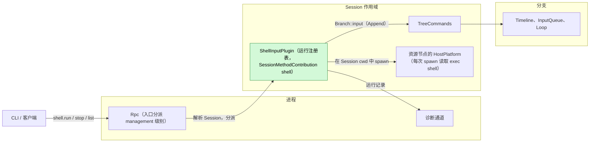
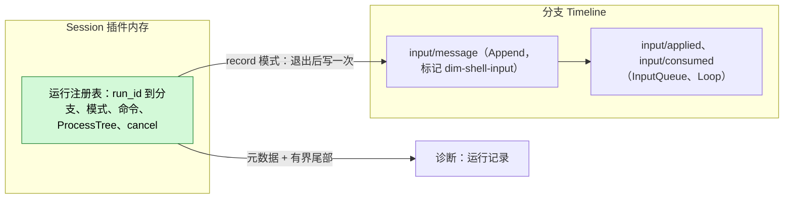
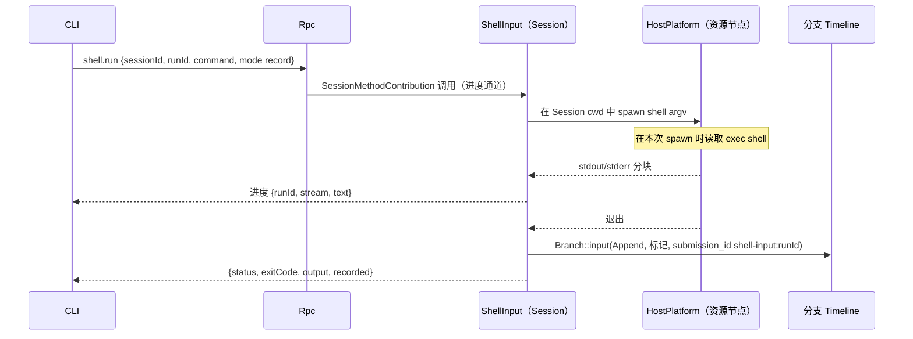
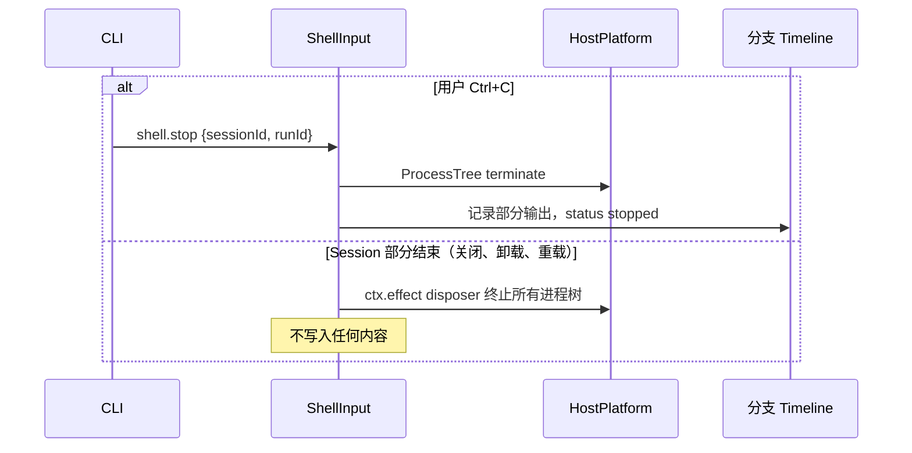
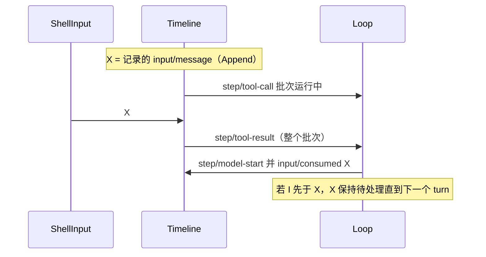

# ShellInput

状态：草案。总体设计：[overview B.3](../overview.md)。阶段：P1。语言：Rust。作用域：Session（[ADR 002](../../adr/002-plugin-scope.md)）。

在 Session 的资源节点上、于其工作区内执行用户输入的 `!command` 和 `!!command`。`!command` 的结果（命令与有界输出）作为 Append 输入写入，因此随下一次模型请求进入上下文；`!!command` 的输出只发送给发起调用的客户端和诊断。ShellInput 是一个没有事件的 Session 插件。它以 `SessionMethodContribution` 在 `management` 级别贡献 `shell.run`、`shell.stop` 和 `shell.list`（[session-boundary](../contracts/session-boundary.md)）。每个 Session 至多运行一个命令；命令在 `shell.stop` 时或 Session 部分结束时（Session 关闭或卸载、重载、daemon 退出）结束。

## 1. 结构



| 部分 | 作用域 | 依赖 | 提供 |
| --- | --- | --- | --- |
| `ShellInputPlugin` | Session | `S:SessionConfig`（`cwd`）、`S:TreeCommands`、Session 资源节点的 HostPlatform（与 WorkspaceTools 的用法相同）、诊断通道 | `S:SessionMethodContribution[shell]`（级别 `management`） |

依赖的契约：`SessionMethodContribution` 及调用的进度通道（[session-boundary](../contracts/session-boundary.md)）；带边界校验的 `Branch::input`（[interrupt](../../../architecture/rust-agent/interrupt.md)）；`HostPlatform::spawn(ProcessSpec)`、`ProcessTree::{stdout, stderr, wait, terminate}`；节点的 exec shell 作为业务配置在每次 spawn 时读取（[ADR 002](../../adr/002-plugin-scope.md) "Existing plugins"）；隔离（overview 附录 C 补充）；`exec` 工具的 shell argv 构造（[exec.rs](../../../../crates/dim-agent-capabilities/src/workspace_tools/exec.rs)，作为 HostPlatform 辅助函数暴露，A2）。

本文定义的契约：`shell.*` 方法、来源标记 `dim-shell-input`（kind `command`）以及 `submission_id` 前缀 `shell-input:`。

## 2. 数据与状态



运行注册表是插件这一代通过 `ctx.effect` 拥有的内存，从不重建：Session 部分结束时，所有运行都被终止。唯一持久的结果是现有的 `input/message`，随 Session 恢复。

事件：无。运行由用户而非分支 turn 发起，因此分支中断不会结算它。`!command` 唯一与后续相关的结果是该输入；`!!command` 不影响任何后续内容。运行记录写入诊断。

## 3. 流程

### 3.1 记录 `!command`



写入只发生一次，在进程树释放之后。InputQueue 应用该 Append；Loop 在运行中 turn 的下一次模型请求时消费它，空闲时则在下一个 turn 的第一次请求时消费。不会开启 turn。

### 3.2 停止与 Session 结束



turn 的 `stop/interrupt` 不会触及运行：`Ctrl+C` 先发送 `shell.stop`，第二次才落到 turn 停止。

### 3.3 `!!command`

与 3.1 相同但不写入：输出只流式发送并返回给调用方。

## 4. 时序与冲突

### 4.1 结果与 turn



位置由输入的所有方按序号决定；ShellInput 没有复查，因为它的写入不依赖任何 Timeline 事实。

| 场景 | 结果 |
| --- | --- |
| 同一 Session 中已有运行时再次 `!` | `shell_busy` |
| 运行期间分支关闭 | 写入失败 `BranchMissing`；回复 `recorded: null`，返回输出 |
| X 在消费前被 `input/withdrawn` | 从不被消费；不重写 |
| 运行期间 Session 关闭、空闲卸载或重载 | 进程树终止；不写入；调用方得到 `operation_interrupted`（A10） |
| Exec shell 配置变更 | 运行中的命令保持原 shell；下一次 spawn 读取新值；不重载任何东西 |

完整表格：附录 B。

## 5. 上下文映射

| 模式 | 模型看到什么 | 形式与位置 |
| --- | --- | --- |
| `!command` | `<dim-shell-input kind="command" status="completed" exit="0" truncated="false">` + `$ command` + 有界输出 | 一个无 key 的 raw 块（user 角色消息），位于输入的消费位置 |
| `!!command` | 无 | — |

没有工具声明、提示词来源或 key：每次运行都是一次性观察。压缩之后，结果只通过摘要保留。子分支仅在其于切点之前被消费时继承它。模型从不看到 `runId`、`submission_id`、流的区分、耗时、诊断或终端转义序列。

## 6. 接口（摘要）

| 接口 | 类型 | 用途 |
| --- | --- | --- |
| `shell.run` | `SessionMethodContribution`，级别 `management`，带进度 | 运行命令（`record` 或 `private`），流式输出，返回结果 |
| `shell.stop` | 同上，级别 `management` | 按 `runId` 停止运行；幂等 |
| `shell.list` | 同上，级别 `management` | Session 中正在进行的运行 |
| 标记 `dim-shell-input` kind `command` | 输入约定 | 模型可见的记录结果 |
| CLI `!` / `!!` | 客户端 | 把前缀映射为 `shell.run` 模式 |

## 7. 安全

`!` 和 `!!` 以服务用户身份在资源节点上执行任意命令，不经 Approval（overview §5.3）。权限来自分派 `management` 级别的入口；导出它即授予宿主管理权。远程配对设备可以调用 Session 方法，但 `shell.*` 属于 `management` 级别，RemoteGateway 不分派它。节点的隔离生效（宿主本地，从不来自 Timeline）。对于 `!`，命令文本与输出被写入 Timeline 并重放给模型；用户必须避免打印机密。环境是服务的环境，从不从客户端转发。诊断只携带元数据和有界尾部（A13）。

## 附录 A. 接口细节

### A.1 方法

| 方法 | 参数 | 结果 |
| --- | --- | --- |
| `shell.run` | `{sessionId, branchId?: "main", runId, command, mode: "record" \| "private"}` | 退出时：`{runId, status: "completed" \| "failed" \| "stopped", exitCode?, signal?, output, truncated, durationMs, recorded?: {sequence, submissionId} \| null}`。进度：`{runId, stream: "stdout" \| "stderr", text}`，仅发往发起调用的连接，按速率合并（A9） |
| `shell.stop` | `{sessionId, runId}` | `{stopped: bool}`；已结束时为 `false` |
| `shell.list` | `{sessionId}` | `[{runId, branchId, mode, command, startedAt}]` |

`runId` 由客户端生成，因此 `stop` 可以在 `run` 回复之前发送。

### A.2 执行

| 项 | 规则 |
| --- | --- |
| 宿主 | Session 资源节点的 HostPlatform，即 Session 工作区工具所用的那个 |
| Shell | 节点的 exec shell，每次 spawn 时读取（变更时不重载），argv 按 `exec` 的方式构造（A2） |
| 工作目录 | Session cwd；每次运行一个新进程（A3） |
| 环境 | 节点的服务环境，从不使用客户端的；另加 `DIM_SESSION_ID`（A5） |
| stdin | Null；交互程序看到 EOF |
| 隔离 | 由 HostPlatform 施加节点的隔离；Permission 预设从不放宽它 |
| 超时 | 无；由 `shell.stop` 或 Session 部分结束来终止 |
| 输出 | stdout 和 stderr 按到达顺序交错；按 `exec` 的方式解码（无效字节表示为 `<0xNN>`） |
| 上限 | 回复和模型可见输出：50 KiB 以内的最后 2000 行，即 `exec` 的 `truncate_preview` 规则（A7） |

### A.3 记录的输入

```rust
branch.input(InputMessage {
    submission_id: Some(format!("shell-input:{run_id}")),
    blocks: vec![marker("dim-shell-input", "command",
        [("status", status), ("exit", code_or_signal), ("truncated", bool)],
        format!("$ {command}\n{bounded_output_without_terminal_escapes}"))],
    user: None, mode: InputMode::Append,
})
```

正文中的 ANSI/OSC 序列被移除（A8）；回复为终端保留它们。

### A.4 机制

| 步骤 | 机制 |
| --- | --- |
| 开始 | 校验；拒绝 `shell_busy`/`duplicate_run`；`spawn`；在这一代的 tracker 中注册运行 |
| 运行 | 一个任务把两个管道读入有界尾部缓冲区，并把分块转发到进度通道；对退出和 `cancel` 做 `select!` |
| 停止 | `cancel` → `ProcessTree::terminate` → 状态 `stopped`，带部分输出 |
| 写入（`record`） | 资源释放之后：通过 `S:TreeCommands` 解析分支，`Branch::input` → 边界 `validate` → `Timeline::append`。已提交的序号作为 `recorded.sequence` 返回。从不重试；命令从不重新运行 |
| 消费 | InputQueue `input/applied {mode: append}`，Loop `input/consumed` |
| 复查 | 无 |
| Session 部分结束 | 卸载 disposer 取消所有运行、终止进程树并等待其结束，不写入输入。Daemon 退出：进程树随进程一起结束（`ProcessTree` drop 会杀死进程树）。这包括结构性操作之后的重载，是可接受的代价（[ADR 002](../../adr/002-plugin-scope.md) D3） |

## 附录 B. 完整冲突表

`X` = 记录的 `input/message`（Append），`I` = turn `stop/interrupt`。

| 场景 | 序号顺序 | 结果 | 决定方 |
| --- | --- | --- | --- |
| 结果先于运行中 turn 的下一次请求 | X < `step/model-start` | 随该请求被消费 | Loop |
| 工具批次运行期间的结果 | X < `step/tool-result` | 在批次结果之后的下一次请求时被消费 | Loop |
| 空闲时的结果 | X，无 turn | 待处理；在下一个 Queue/Steer 开启 turn 时被消费；从不自行开启 turn | InputQueue、Loop |
| X 之前的 turn 中断 | I < X | 运行不受影响；X 待处理直到下一个 turn | Loop |
| X 已应用，然后在消费前中断 | X < I | 待处理；由下一个 turn 消费 | Loop |
| X 已消费，然后中断 | 已消费 < I | 保持在其消费位置 | Loop |
| X 的 `input/withdrawn` | X < withdrawn | 从不被消费；不重写 | InputQueue |
| 运行期间分支级中断或分支关闭 | 关闭 < X | 运行继续；写入失败 `BranchMissing`；`recorded: null` | Runtime facade；ShellInput |
| 运行期间 Session 关闭或空闲卸载 | — | 进程树终止，不写入（A10） | ShellInput |
| 并发的 Steer/Queue 与 X | Timeline 顺序 | 各自按其模式应用 | InputQueue |
| 同一 Session 中的第二次运行 | — | `shell_busy` | ShellInput |
| X 与消费之间压缩 | X < 压缩 < 已消费 | 放在摘要之后的消费位置 | ContextPreparation |
| 消费之后压缩 | 已消费 < 压缩 | 只通过摘要保留 | ContextPreparation |
| 子分支切在 X 与消费之间 | X < 切点 < 已消费 | 子分支不采用 X | InputQueue（子分支） |
| 消费之后子分支切出 | 已消费 < 切点 | 在前缀中被继承 | 历史投影 |
| `!!` 运行 | — | 无 Timeline 影响 | — |
| 运行中途 ShellInput 或 Session 重载 | — | 进程树终止；不写入；调用方得到 `operation_interrupted`（D3） | ShellInput |
| 运行中途进程重启 | — | 进程树随 daemon 结束；不写入 | — |
| 已提交，然后回复丢失 | X 已提交 | 同一代内重试 → `duplicate_run`；重启后客户端用 `session.input_lookup` 查找 `shell-input:<runId>`（A11） | 客户端 |
| 开始时 Session 已卸载 | — | Rpc 在分派前恢复它 | Rpc、AgentIndex |
| 开始时资源节点离线 | — | `node_unavailable`；不启动任何内容 | ShellInput |
| 运行中途资源节点丢失 | — | 状态 `failed`；对于 `record`，以 `status="failed"` 写入部分输出（A6） | ShellInput |
| 重复或迟到的 `stop` | — | `{stopped: false}` | ShellInput |
| 客户端 detach 或断开 | — | 运行继续，结果被记录或丢弃；进度被丢弃（A12） | ShellInput |
| 远程配对设备 | — | `unknown_method`：RemoteGateway 不分派 `management` 级别 | Rpc |
| 运行中途 exec shell 变更 | — | 运行保持原 shell；下一次 spawn 读取新值 | HostPlatform |

## 附录 C. 错误与恢复

| 错误（`appError`） | 条件 |
| --- | --- |
| `shell_unavailable` | 节点上 `HostPlatform.shell` 不可用（转发原因） |
| `shell_busy` | 该 Session 已有另一个运行在进行 |
| `duplicate_run` | `runId` 在这一代中已被使用 |
| `invalid_params` | 命令为空、命令超过 64 KiB、`runId` 不符合 `[A-Za-z0-9-]{1,64}` |
| `session_closed` / `branch_missing` | 开始时 Session 或分支已不存在 |
| `node_unavailable` | 资源节点不可达 |
| `unknown_method` | Session 未启用 ShellInput，或该级别不由入口分派 |
| `service_reloading` | 开始时贡献正在重载 |
| `operation_interrupted` | 调用运行期间 Session 部分结束 |

| 情况 | 结果 |
| --- | --- |
| Spawn 失败 | `status: "failed"` 并附原因；不记录 |
| 非零退出 | `status: "completed"`，设置 `exitCode`；记录 |
| 写入被拒（`SessionClosed`、`BranchMissing`、`Rejected`） | 返回输出，`recorded: null` 并附错误 |
| 卸载、重载、重启 | 运行被终止，从不重新执行 |

## 附录 D. 验收

1. 空闲时 `!echo hi`：带标记的 Append 输入；不开启 turn；下一次提示的第一次请求在提示之前包含它。
2. 带工具批次的 turn 期间 `!`：在同一 turn 中于批次结果之后被消费。
3. `!!`：返回输出，Timeline 无变化。
4. turn 停止不停止运行；`shell.stop` 终止进程树（进程不再存在）并记录 `stopped`。
5. 同一 Session 中第二次 `shell.run` → `shell_busy`。
6. 10 MiB 输出得到 50 KiB 以内的最后 2000 行以及 `truncated="true"`。
7. 分支关闭：`recorded: null`。Session 关闭：进程树终止，不写入。
8. 运行中途 Session 重载和 daemon 重启：进程树终止，不写入，不重新执行。
9. 离线节点：仅该 Session 得到 `node_unavailable`。
10. 已撤回的 X 从不被消费；远程入口：`unknown_method`。
11. 修改 exec shell：下一次运行使用新 shell，无需重载任何东西。

## 附录 E. 假设

| # | 假设 | 依据 | 若被否决的影响 |
| --- | --- | --- | --- |
| A1 | 方法 `shell.run/stop/list`，带 `mode` | Overview §5.3（run、stop）；`list` 和 `mode` 为判断 | 方法集合改变 |
| A2 | Shell 与 argv 同 `exec` | 判断 | ShellInput 自行构造 argv |
| A3 | 每次运行都是新进程 | 判断 | 每 Session 一个 shell 需要生命周期和状态 |
| A4 | 每个 Session 一个运行中的命令 | 维护者决定 | 并发运行，输入按完成顺序 |
| A5 | 环境中加入 `DIM_SESSION_ID` | 判断 | 命令无法识别 Session |
| A6 | 停止或失败的 `!` 运行记录部分输出 | 判断 | 只记录已完成的运行 |
| A7 | `exec` 预览上限（2000 行，50 KiB） | 现有 `exec` 常量 | 单独的限制 |
| A8 | 从模型可见文本中去除终端转义序列 | 判断 | 转义序列到达模型 |
| A9 | 进度通过调用的进度通道发送，按速率合并 | [session-boundary](../contracts/session-boundary.md)；合并为判断 | 只在完成时输出 |
| A10 | 运行是 Session 工作：随 Session 部分结束（关闭、空闲卸载、重载） | ADR 002 D1（Session 作用域）、D3 | 运行需要一个进程级所有方 |
| A11 | 客户端通过 `session.input_lookup` 按 `runId` 去重 | Session 公开接口 | 可能出现重复输入 |
| A12 | 客户端断开不停止运行 | Lifecycle（"连接关闭保留 Session 工作"） | 断开即停止运行 |
| A13 | 诊断只携带元数据和有界尾部 | 判断 | 诊断中包含完整输出 |

## 附录 F. 待对齐问题

| # | 问题 | 说明 |
| --- | --- | --- |
| F1 | Overview §5.3 结束条件 | Overview 列出 stop 和 daemon 退出；本设计还在 Session 部分结束时结束运行 |
| F2 | 运行期间的空闲卸载 | AgentIndex 是否把运行中的命令视为活动；否则空闲卸载会终止它（A10） |
| F3 | 远程节点的进程树终止 | 导入的 HostPlatform 是否在链路断开时杀死进程树（#5） |
