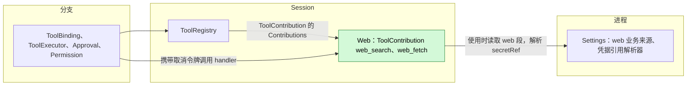
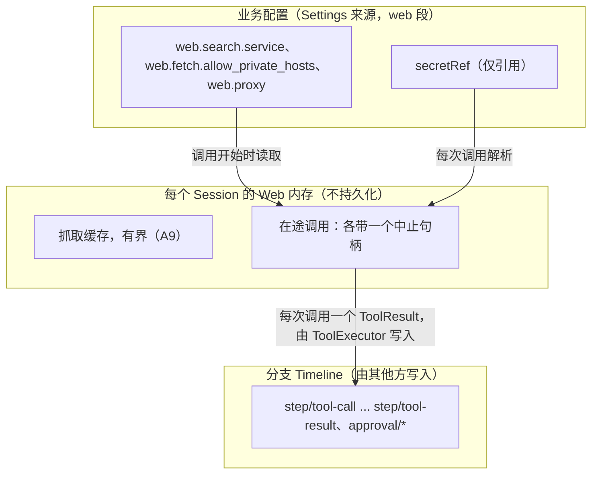
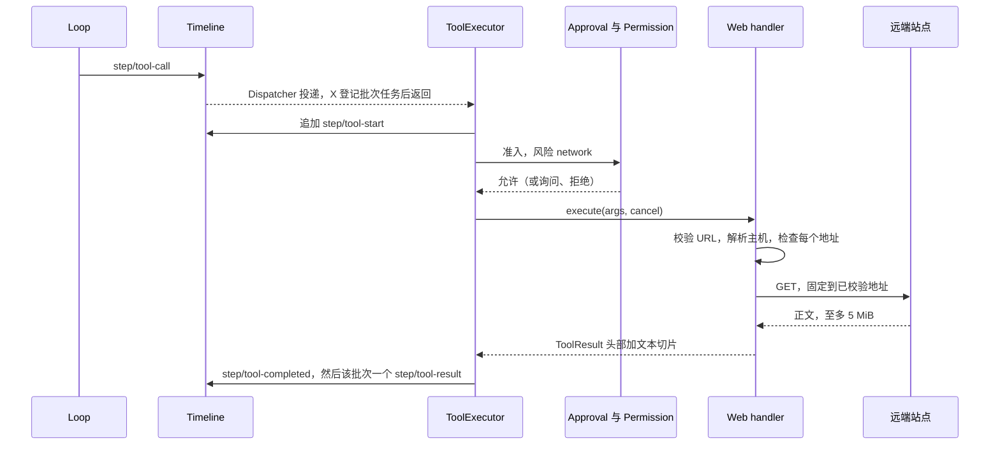
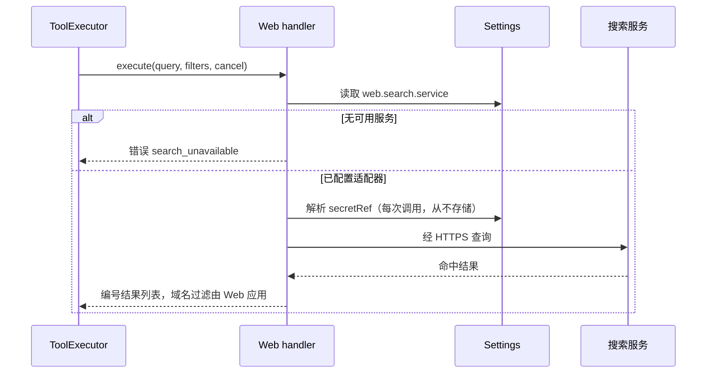
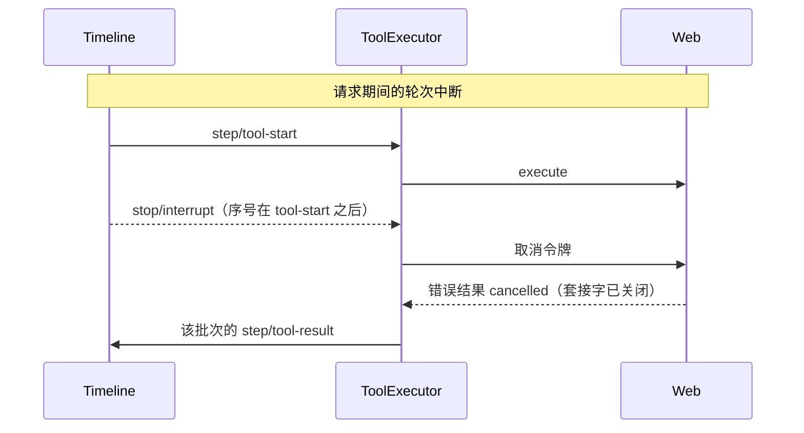

# Web

状态：草案。总体设计：[overview](../overview.md)（Web）。阶段：P2。语言：TypeScript 优先。作用域：[ADR 002](../../adr/002-plugin-scope.md)（Session）。

Web 是一个 Session 插件，以两个 Session 级 `ToolContribution` 向模型提供 `web_search` 与 `web_fetch`（[工具贡献](../../../architecture/rust-agent/tool-contributions.md)）。搜索交给已配置的内置搜索适配器；抓取下载一个公开页面并返回有界文本。Web 不持有跨 Session 共享的状态，不写任何 Timeline 事件（每次调用与结果本身已是工具调用事实），并在使用时从 Settings 业务来源读取其 `web.*` 业务配置，因此编辑配置不会重载任何东西（[ADR 002 D4](../../adr/002-plugin-scope.md)）。

## 1. 结构



| 部件 | 作用域 | 依赖 | 提供 |
| --- | --- | --- | --- |
| `Web` | Session（仅启用时安装） | Settings 业务来源（`web` 段）与凭据引用解析器；诊断通道 | `ToolContribution` `web_search` 与 `web_fetch`（名称经 `AgentBuilder::session_tool` 注册） |

**依赖的契约：** Session `ToolContribution`（既有）；Settings 业务来源与凭据引用解析器；由 Permission 读取的 `ToolDefinition.risk = "network"`（既有，[permission.rs](../../../../crates/dim-agent-capabilities/src/permission.rs)）。**本文定义的契约：** 工具名称、参数与结果格式；`web.*` 业务配置。

**重载。** Web 只依赖外层作用域（Settings）。启用、禁用或升级 Web，或 Settings 重载，会重载 Web，并经 `Contributions<ToolContribution>` 重载 ToolRegistry 及其依赖方；在途调用由 ToolExecutor 以 reloaded 结算。这是罕见结构性操作的可接受代价（[ADR 002 D3](../../adr/002-plugin-scope.md)）。配置编辑从不重载。

**节点。** 请求从承载该 Session 的 App Server 进程发出，而非从 Session 的资源节点发出（A2）。

## 2. 数据与状态



Web 不拥有 Timeline 状态，也没有 `StateCell`。缓存在 `apply` 时为空；不从 Timeline 重建任何内容。

## 3. 流程

### 3.1 一次 `web_fetch` 调用



handler 在 ToolExecutor 的任务上运行，只依据其参数与调用开始时读取的配置做决定。更长的页面通过带 `start_char` 的后续调用读取；跨主机重定向以提示形式返回，使新主机获得独立的准入（A10）。

### 3.2 一次 `web_search` 调用



Web 启用时 `web_search` 始终声明；在配置可用服务之前，它以 `search_unavailable` 失败（A3）。更换服务在下一次调用时生效。

## 4. 时序与冲突



| 场景 | 结果 | 负责方 |
| --- | --- | --- |
| 调用期间编辑配置 | 调用继续使用开始时读取的值；下一次调用使用新值 | Web |
| 两次调用之间移除服务 | 下一次 `web_search` 返回 `search_unavailable` | Web |
| 调用中途 Web 或 Settings 重载 | ToolRegistry 及其依赖方重载；调用以 reloaded 结算（D3） | ToolExecutor |
| 调用中途进程重启 | ToolExecutor 将已提交调用结算为未能在恢复中存活；Web 从不重复请求 | ToolExecutor |
| 结果之后发生压缩 | 抓取文本只通过摘要保留 | ContextPreparation |

完整表格见附录 B。

## 5. 上下文映射

| 模型所见 | 形式 | 位置 |
| --- | --- | --- |
| `web_search`、`web_fetch` 的名称、描述、输入 schema | 工具声明 | 列入 `SessionConfig.tools` 时，位于已采纳的 `context/configured.tools` |
| 搜索结果、抓取文本、错误、重定向提示 | `ToolResult.content`（仅文本） | 该调用所在批次的工具结果位置 |

- 压缩：声明作为配置保留；结果只通过摘要保留。
- 子分支继承其祖先前缀中的结果。
- 非交互 Session 看到相同的工具（`requires.interactive = false`）。
- 永不可见：`structured_content`、服务名称、配置、凭据引用、私有主机例外、诊断。
- 抓取的页面文本是不受信任的第三方内容，放入工具结果时不加指令性框定（A14）。

## 6. 接口（摘要）

| 接口 | 类型 | 用途 |
| --- | --- | --- |
| `web_search` | `ToolContribution`，风险 `network` | 查询已配置服务；编号结果列表 |
| `web_fetch` | `ToolContribution`，风险 `network` | 抓取一个公开 `http(s)` URL；带分页的有界文本切片 |
| `web.*` 配置 | Settings 来源中的业务配置，使用时读取 | 搜索服务、私有主机例外、代理 |

无方法，也无 CLI 子命令：配置经 Settings 的类型化操作与 `/settings` 进行。详见附录 A。

## 7. 安全

- 准入：两个工具都声明 `network`；每次调用都经过 Approval 与 Permission（read-only 拒绝，workspace-write 询问，FullAccess 允许）。
- SSRF：Web 自行解析名称，将每个地址与屏蔽范围比对，并只连接已检查的地址；跨主机重定向需要新的调用与新的准入（A.4、A10）。
- 无环境权限：仅 `GET`；无 cookie、已存站点凭据或客户端证书；除模型写出的 URL 外不带入 Session 的任何内容（A8）。
- 凭据：引用在每次调用时解析；从不出现在定义、结果、`structured_content`、诊断或错误中。
- 经 URL 外泄是 `network` 类别固有的风险，由准入控制。
- 配置 `web.proxy` 时，由代理自行解析名称；私有地址保护此时取决于代理（会向用户说明）。

## 附录 A. 接口细节

### A.1 工具

两个工具：`risk: "network"`，`requires: { interactive: false, roles: None }`。参数由 handler 校验；违反时返回错误结果，不访问网络。

### A.2 `web_search`

| 参数 | 类型 | 规则 |
| --- | --- | --- |
| `query` | string | 必填；去除首尾空白后 1 到 500 个字符（A4） |
| `max_results` | integer | 可选；1 到 10；默认 5（A4） |
| `allowed_domains` | string[] | 可选；至多 10 个主机名；结果限定于这些主机及其子域 |
| `blocked_domains` | string[] | 可选；至多 10 个；与 `allowed_domains` 互斥 |

服务支持时将域名过滤传给服务，并且在任何情况下都由 Web 对返回列表再应用一次。`ToolResult.content`：

```
Search results for "<query>" (<n> results)

[1] <title>
<url>
<snippet>

[2] ...
```

标题与摘要为纯文本，各占一行，摘要至多 500 个字符。零结果返回 `No results for "<query>".`（不是错误）。不显示服务名称。`structured_content` 为客户端携带 `{ results: [{ title, url, snippet, published_at? }] }`。总时限 20 s（A5）。

### A.3 `web_fetch`

| 参数 | 类型 | 规则 |
| --- | --- | --- |
| `url` | string | 必填；绝对 `http` 或 `https`；至多 2048 个字符；不含 userinfo；去除片段（A6） |
| `start_char` | integer | 可选；默认 0；转换后文本中的偏移 |
| `max_chars` | integer | 可选；1000 到 50000；默认 20000（A7） |

`ToolResult.content`：

```
URL: <final url>
Title: <title, if any>
Content-Type: <media type>
Characters: <start>-<end> of <total>
[Truncated: call web_fetch again with start_char=<end> to continue.]
[Download limit reached: the page exceeds <limit> and later content is missing.]

<converted text slice>
```

方括号行仅在适用时出现。`structured_content`：`{ url, final_url, status, content_type, title?, start, end, total, truncated, download_limited }`。

| 项目 | 规则 |
| --- | --- |
| 方法与请求头 | 仅 `GET`；`User-Agent: dim-web/<version>`；`Accept` 优先 HTML 与文本；无 cookie、凭据或 referrer（A8） |
| 限制 | 连接 10 s；整次调用 30 s；解码后正文至多 5 MiB，超出即关闭连接并设置 `download_limited`（A5） |
| 状态码 | 2xx 进行转换；3xx 按重定向规则；4xx/5xx 返回错误 `http_status`，带状态码与原因短语，不含正文 |
| 重定向 | 至多 5 跳，每跳重新校验。重定向到不同主机（小写化并去除前导 `www.` 后比较）时不跟随：返回非错误提示 `Redirected to <url>; call web_fetch with that URL to follow it.`（A10） |
| `text/html`、`application/xhtml+xml` | 字符集先取响应头，再取 `<meta>`，否则按 UTF-8 并替换非法字符；移除 `script`、`style`、`noscript`、`template`、`svg`、`iframe`、导航与表单控件；优先主体内容；转为带绝对链接的 Markdown；规范化空白 |
| `text/plain`、`text/markdown`、`text/csv`、`application/json`、`application/xml`、`text/xml`、`*+json`、`*+xml` | 按原样输出解码文本（合法 JSON 美化输出） |
| 其他类型 | 错误 `unsupported_content_type`，注明类型（A11） |
| 转换为空 | 非错误结果，含头部与 `(no text content)` |
| 切片 | 按 Unicode 标量值 `[start_char, start_char + max_chars)`；`start_char >= total` 返回带头部的空切片 |
| 缓存 | 转换后文本以最终 URL 为键，每 Session 一份，15 分钟，至多 50 MiB，使分页无需重新抓取（A9） |

### A.4 地址策略

| 规则 | 内容 |
| --- | --- |
| 解析 | Web 解析主机名，校验每个解析出的地址，并只连接已校验地址（固定），因此检查与连接之间不可能发生 DNS 重绑定 |
| 默认屏蔽 | 回环（`127.0.0.0/8`、`::1`）、未指定地址、RFC 1918、链路本地（`169.254.0.0/16`、`fe80::/10`，含云元数据）、CGNAT `100.64.0.0/10`、唯一本地 `fc00::/7`、组播、广播、保留范围，以及上述地址的 IPv4 映射与 IPv4 兼容 IPv6 形式；主机名 `localhost` 与 `*.localhost` |
| 字面 IP | 仅当按同样规则判定为公开时允许 |
| 端口 | 公开地址上的任意端口（A12） |
| 例外 | `web.fetch.allow_private_hosts`：精确主机名或 CIDR；默认为空；仅由用户经 Settings 写入 |
| 代理 | 配置 `web.proxy` 时，Web 仍校验自身的解析结果，并经代理发送 |

### A.5 业务配置（`web` 段，Settings 来源）

| 键 | 类型 | 默认值 |
| --- | --- | --- |
| `web.search.service` | `{ kind: "<built-in adapter id>", endpoint?: string, secretRef?: string }` 或缺省 | 缺省（`web_search` 返回 `search_unavailable`） |
| `web.fetch.allow_private_hosts` | string[] | `[]` |
| `web.proxy` | string（URL） | 缺省 |

每次调用时读取；变更是带通知的数据更新，从不重载。只有 Web 的启用属于结构性配置。内置适配器 id 是实现选择，列于插件 README（A13）。凭据只以 `secretRef` 形式出现。

### A.6 Timeline 与 Capability 机制

| 步骤 | 路径 |
| --- | --- |
| 提供 | Web 的 `apply` 提供 `ToolContribution` `web_search` 与 `web_fetch`；ToolRegistry 注册列入 `SessionConfig.tools` 的工具；ToolBinding 采纳它们。Web 不写入任何内容 |
| 调用 | ToolExecutor 在 Dispatcher 上消费 `step/tool-call`，登记批次任务后返回；每次调用依次为 `step/tool-start`、准入、在执行器任务上运行 handler、`step/tool-completed`，然后每批次一个 `step/tool-result` |
| Dispatcher | Web 没有订阅 |
| 状态与复核 | 无 `StateCell`；不消费事实；决定基于调用开始时读取的参数与配置 |
| 终态事实 | 由 ToolExecutor 写入；Web 每次调用恰好返回一个 `ToolResult` |
| 重载 | Disposer 中止在途请求；ToolExecutor 以 reloaded 结算（[工具贡献 §4](../../../architecture/rust-agent/tool-contributions.md)） |
| 进程重启 | 无结果的已提交调用由 ToolExecutor 的重建结算；Web 从不重复请求 |

## 附录 B. 完整冲突表

| 场景 | 序号顺序 | 结果 | 负责方 |
| --- | --- | --- | --- |
| 派发前的轮次 `stop/interrupt` | interrupt < `step/tool-call` 消费 | 不执行 | ToolExecutor |
| 审批期间的轮次 `stop/interrupt` | `approval/request` < interrupt | `approval/cancelled`；不发送请求 | Approval |
| 请求期间的轮次 `stop/interrupt` | `step/tool-start` < interrupt | 令牌取消；套接字中止；错误 `cancelled`；中止前已完整转换的响应按原样返回 | ToolExecutor、Web |
| 分支级中断或分支关闭 | 分支中断 | 同轮次中断 | ToolExecutor |
| 批次中另有长时调用 | Web 已返回，另一调用仍在运行 | 结果保留至该批次的 `step/tool-result` | ToolExecutor |
| 并发 Steer/Queue/Append | 任意 | 对调用无影响；Steer 在批次结果之后消费 | Loop |
| 待处理输入的 `input/withdrawn` | 任意 | 无影响；Web 不消费输入 | InputQueue |
| 结果之后发生压缩 | `step/tool-result` < 压缩 | 文本只通过摘要保留 | ContextPreparation |
| 子分支切出 | 在 `step/tool-result` 之后切出 | 子分支继承结果 | — |
| 调用运行时编辑配置 | — | 调用继续使用开始时读取的值 | Web |
| 无可用服务时调用 `web_search` | — | 错误 `search_unavailable` | Web |
| 调用中途 Web 或 Settings 重载 | 尚无结果 | 调用以 reloaded 结算；依赖方重载（D3） | ToolExecutor |
| 调用中途进程重启 | 已提交，无结果 | 结算为未能在恢复中存活；不重复 | ToolExecutor |
| Session 卸载与恢复 | `branch/resume` | Web 再次应用；缓存为空 | Lifecycle |
| Session 资源节点离线 | — | 无影响；Web 不使用节点服务 | — |
| 取消后迟到的 handler 调用 | 令牌已取消 | 返回 `cancelled`，不访问网络 | Web |
| 两个分支抓取同一 URL | — | 各自独立请求；缓存由先完成者填充 | Web |
| 客户端分离 | — | 无影响 | — |

## 附录 C. 错误与恢复

每个错误都是错误 `ToolResult`（`is_error: true`），内容为 `web_fetch failed: <code>: <message>` 或 `web_search failed: ...`。任何错误都不影响其他调用或 Session。

| 代码 | 含义 |
| --- | --- |
| `invalid_input` | 参数违反附录 A |
| `blocked_address` | 主机或某一重定向跳解析到被屏蔽地址；消息只指出规则 |
| `dns_failed`、`connect_failed`、`tls_failed` | 网络错误 |
| `timeout` | 达到连接或整次调用时限 |
| `http_status` | 最终状态非 2xx |
| `too_many_redirects` | 同主机跳转超过 5 次 |
| `unsupported_content_type` | 类型不在 A.3 中 |
| `search_unavailable` | 未配置服务、适配器不可用或凭据无法解析 |
| `search_failed` | 服务错误或数据无效；消息经缩短并去除机密 |
| `cancelled` | 令牌已取消 |

恢复：Web 不持有持久工作；重载与重启只丢失缓存。

## 附录 D. 验收

通过公共接口进行流程测试：测试 Session 中的工具调用、仅能经测试用 `allow_private_hosts` 条目访问的本地 HTTP 服务器、伪造的搜索适配器。

1. 无服务时 `web_search` 返回 `search_unavailable`；配置一个服务后下一次调用成功且无重载；移除服务后下一次调用失败。
2. `web_search` 格式、域名过滤、零结果、服务错误。
3. `web_fetch` HTML 头部与 Markdown；`start_char` 分页直至末尾；`max_chars`；下载上限提示。
4. 纯文本、JSON、不支持的类型、404、空页面。
5. 同主机重定向至多 5 次；第六次失败；跨主机重定向返回提示。
6. 回环、私有、链路本地、IPv4 映射 IPv6、`localhost` 以及解析到私有地址的主机名均被屏蔽；DNS 重绑定测试不发生连接。
7. Permission：read-only 拒绝，workspace-write 询问，FullAccess 允许。
8. 派发前、审批期间及慢响应期间的中断（套接字关闭，一个结果）。
9. 重启结算不重复任何请求。
10. 非交互 Session 声明两个工具。
11. 诊断与结果从不包含已解析的凭据。

## 附录 E. 假设

| # | 假设 | 依据 | 若被否决的影响 |
| --- | --- | --- | --- |
| A1 | 搜索服务（包括基于账户的服务）是内置适配器；无后端注册表 | ADR 002 D2 | 由 Web 拥有的搜索后端契约 |
| A2 | 请求从承载该 Session 的 App Server 进程发出 | 判断 | 经资源节点的服务访问网络 |
| A3 | `web_search` 始终声明，无可用服务时失败 | ADR 002 D4（配置从不重载） | 声明将随配置变化 |
| A4 | 查询长度 500；`max_results` 1 到 10，默认 5 | 判断 | 限制改变 |
| A5 | 连接 10 s，抓取 30 s，搜索 20 s；下载 5 MiB | 判断 | 限制改变 |
| A6 | 仅 `http`/`https`，至多 2048 个字符，不含 userinfo | 判断 | 输入面更宽 |
| A7 | `max_chars` 1000 到 50000，默认 20000，`start_char` 分页 | 判断 | 结果的界定方式不同 |
| A8 | 仅 `GET`，固定 user agent，无 cookie 或凭据 | 判断 | 带认证的抓取需要单独设计 |
| A9 | 缓存每 Session 一份，15 分钟，至多 50 MiB，以最终 URL 为键 | 判断 | 每个切片都重新抓取；切片之间可能不一致 |
| A10 | 跨主机重定向只报告，不跟随 | 判断 | 重定向会到达从未准入的主机 |
| A11 | 不转换 PDF 与图片 | 判断 | 增加提取或图片内容块 |
| A12 | 公开地址上的任意端口 | 判断 | 限制为 80/443 |
| A13 | 内置适配器列表是实现选择 | overview 未指定服务 | 由 overview 固定某个服务 |
| A14 | 抓取内容周围不加框定文本 | 判断 | 需要定义模型可见的框定 |

## 附录 F. 待对齐问题

| 问题 | 说明 |
| --- | --- |
| 跨语言迁移 | TypeScript 实现需要 Session `ToolContribution` 绑定与 Settings 业务来源 |
