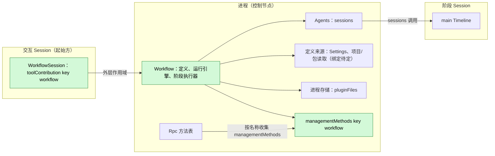
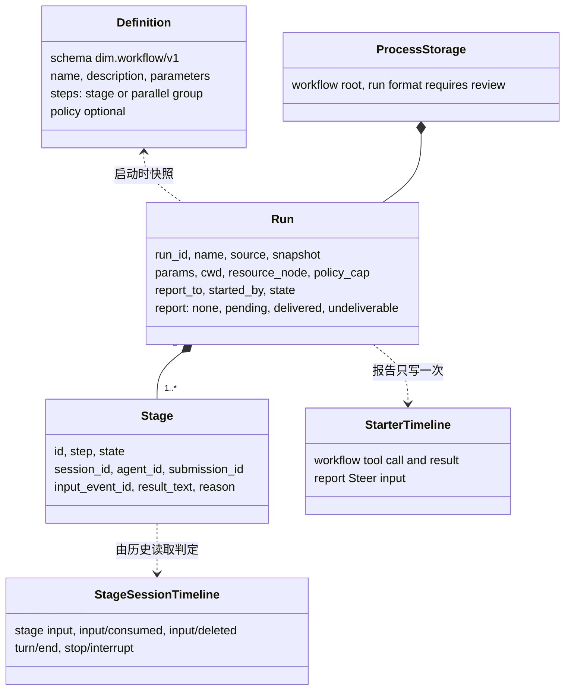
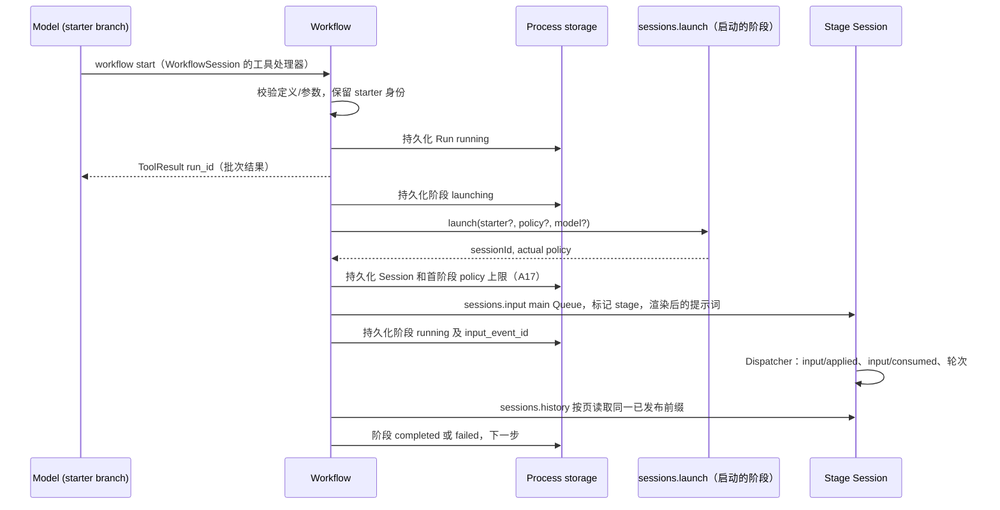
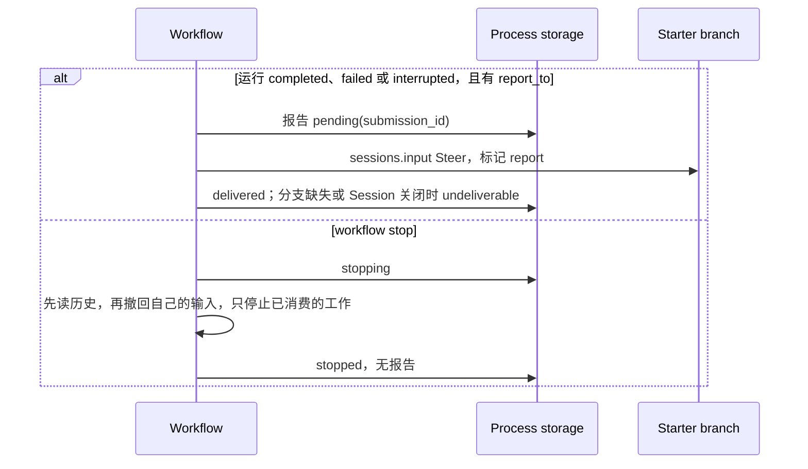
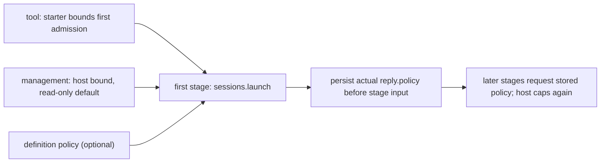
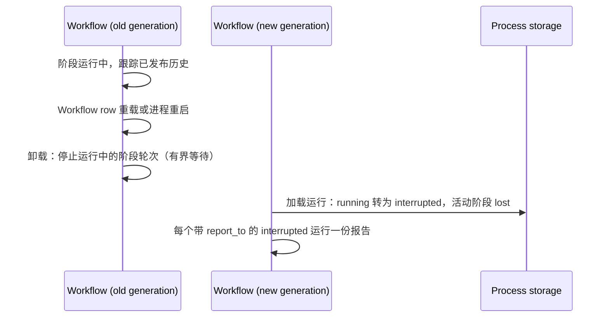

# Workflow

状态：草案。总体设计：[overview §4](../overview.md#4-插件目录)；作用域：[ADR 002](../../adr/002-plugin-scope.md)（进程 + Session）。阶段：P2。语言：优先 TypeScript（[overview 附录 C](../overview.md#附录-c-实现语言)）。

**交付边界。** Workflow 供设计评审，尚未实现。C4 工具、S2 sessions、Settings owner 读写/事件、pluginFiles 带版本文本存储已提供。进程/包绑定及 §1.1、附录 F 的业务条件须在 Ready 前解决，不提新的 core 或 rutis 能力。

> **离线资源节点。** 关于资源节点离线的各行描述的是 P3 多节点行为。#5 已撤回（rutis 是外部依赖，链接断开时会撤掉导入的服务），这些行在 P3 按总览 §6.3 重新设计：节点服务在每次调用时按 `resourceNode` 查找。P1/P2 中每个 Session 都使用控制节点。

Workflow 拥有工作流定义和运行。一次运行推进一个固定的步骤列表；每个阶段在通过 Agents 启动的一个新非交互 Session 中运行。进程部分拥有运行，并通过进程服务 `sessions`（[session-access](../contracts/session-access.md)）访问启动的 Session，方式与 Collaboration 相同。用户保存的定义存于 Workflow 的 Settings 来源 `workflow`，项目定义仍是项目文件，由 Workflow 经 FileStorage 读取，运行记录存于 `pluginFiles`。Session 部分以 `toolContribution` 在每个 Session 中声明 `workflow` 工具，只有交互 Session 可以使用它；运维方使用 `workflow.*` 管理方法，即一个 `managementMethods` 条目。所有契约都是语言中立的命名服务（[ADR 002 D5](../../adr/002-plugin-scope.md)）；Rust 形式见[附录 G](#附录-g-rust-绑定)。运行结束时，其结果以 Steer 输入向起始分支报告一次。Workflow 不写自己的 Timeline 事件。

## 1. 结构



运行跨 Session，属于进程；工具属于 Session（[ADR 002](../../adr/002-plugin-scope.md) D1/D2）。进程声明既有 sessions、settings、pluginFiles。Agents 稳定目录提供 sessions，每次查找当前 index，index 重载使调用返回 reloading，不重载 Workflow 或 Session（[S2 D1](../../../design/appserver/sessions-service.md#3-decisions)、[#35](https://github.com/arcships/dim/issues/35)）。Agents 已解析阶段/profile/默认模型，无须 Workflow 再依赖 Provider。按调用访问 workflowRuns 仍需可用绑定（§1.1）；未声明 ctx.use 不是通用原生可选查找。C3 隔离核心与可选 row。定义是使用时读取的业务数据，不引发结构重载。

| 部分 | 作用域 | 依赖 | 提供 |
| --- | --- | --- | --- |
| Workflow | 进程（控制节点） | 既有 sessions/settings/pluginFiles；来源读取绑定见 §1.1 | 运行引擎，拟定 workflowRuns 与管理命名空间 workflow |
| WorkflowSession | 启用时安装的 Session 部分 | C4 工具、创建配置；按调用访问进程须经 §1.1 确认 | toolContribution:workflow；interactive === false 时拒绝 |

**既有合同：** [C4 工具](../../../design/session-typescript.md)、[S2 sessions](../appserver/sessions-service.md)、[Settings](../appserver/settings-service.md)、[方法准入](../contracts/session-boundary.md)、[pluginFiles](../../../../crates/dim-app-server/README.md#trusted-plugin-storage)。**本插件拟定合同：** dim.workflow/v1、toolContribution:workflow、workflowRuns.call、管理命名空间 workflow、Settings 来源 workflow、阶段/报告标记文本与运行记录。项目和包定义的读取绑定仍须决定，不假定 PluginContents 服务已经实现。

### 1.1 现有绑定与实施条件

| 入口 | 当前实现与约束 |
| --- | --- |
| 工具 / 进程包 | C4 支持普通 Session 工具 row，同步声明、异步执行；C3 在分支初始化取样 Active 工具。ServerConfig.session_typescript 不是通用进程包配置，拒绝其他服务族。Ready 前以现有机制选择进程装配、#35 workflowRuns 访问，不增加接线 row 或可选查找 API。 |
| 管理 | Rust ManagementMethods 支持按调用准入及 report/drain；C4 不投影 TS managementMethods，row 声明不等于 workflow.* 已可调用，绑定选择须明确。 |
| 定义 / Settings | owner 读写/CAS/事件已交付（#175/#177）。唯一来源 owner 声明用户文档和 userOnly 项目启用记录，Session 部分不重复声明。来源文件/scope/schema 与语义校验边界须确认。FileStorage 是 Rust 类型服务，此处没有已实现 PluginContents 或任意项目文件命名桥接，不用直接文件系统访问替代。 |
| 存储 | pluginFiles.open() 返回带 withLock/quiesce/close 的自持 scope，read/replace 为 v1 文本。先确认运行业务格式再持久化，不扩二进制存储。 |
| Sessions | 使用既有 {ok:true,value} / {ok:false,error:{code,message,retryable}}；launch 返回 {sessionId,policy}，input 返回 {inputId,sequence}；lookup 查已提交输入，不去重写入。 |
| 权限 | S2 在真正准入阶段时收窄权限，§3.3 拟复用返回的 policy 约束后续阶段（A17），不增加权限查询服务，不把创建配置当作实时 Permission。 |
| 生命周期 | S2 每次调用的租约结束不等于关闭 Session。反复创建阶段 Session 发布前仍须 [#126](https://github.com/arcships/dim/issues/126)；确认保留期所有权后使用既有 sessions.delete。 |

A17 将上限捕获从工具启动时调整为首阶段准入时；期间 Permission 变更会影响首 launch 上限，采用 A17 前须确认该时点调整。

### 1.2 影响面

不改运行时、门面、loader、事件格式或 rutis。新业务归 Workflow 包，Settings、ToolRegistry、运维方消费来源/工具/管理命名空间，workflowRuns 连接本功能两个真实作用域。不增加注册表、就绪服务、上下文路径或 App Server 业务模块。

## 2. 数据与状态



定义在每次调用时从其来源读取（A1）；运行存于进程存储，并在每次状态转换时、在其所守护的副作用之前持久化。阶段进度由每个阶段 Session 中的已有事实推导；只复制有界的结果文本。不从 Timeline 重建任何内容；Workflow 不拥有 `StateCell`，Session 部分不持有状态。

## 3. 流程

### 3.1 从工具启动并运行一个阶段



处理器持久化运行后立即返回；阶段推进在进程部分的任务跟踪器上运行。只有读完阶段 Session 的固定已发布前缀后才判定完成（§3.2）。

### 3.2 报告与停止



所有者显式停止不唤醒起始方（[event-driven flows §3](../../../architecture/rust-agent/event-driven-flows.md)）。报告一次（E15）取决于 Workflow 的写入所有权、结算和恢复。sessions.lookup 等待已提交内容发布，再按 submissionId 读取，不是原子写入/去重操作。重试 unknown 报告前，前次尝试必须结算，旧写入者不得仍能提交。附录 F 须用包内现有机制明确并验证此顺序，不能仅凭 lookup 声称已保证一份报告。

每个阶段有一个自持历史跟踪任务，使用已保存的输入回执。提交后读取一次，此后每秒读取，不保留原生 idle 等待。首次 history {after} 回复固定已发布截止点 H，后续分页保持 through: H。读完整个前缀再决定，并把最后序号作为下次游标。匹配本阶段 inputId，保留已发布终态，不把其他轮次结束当成本阶段完成。待处理审批不阻止历史读取。

停止时先读完整个已发布前缀并保留已有终态。本输入已应用、随后中断，且该前缀没有匹配的消费时，按 A.6 将阶段结算为 stopped，不再调用 stop。否则只撤回本阶段尚未消费的输入；deleted 使其停止；notHeld 只表示这次撤回没有删除输入，输入可能已删除或已消费。重读历史并应用同样的规则：匹配删除或消费前已中断则结算，其他未消费输入继续等待。仅在观察到消费且没有后续结束事实时调用 sessions.stop。本地 stopped 终态不会收回已应用输入。每个已准入变更调用由任务持有至结算，丢弃 JS Promise 不等于原生取消。

sessions.stop 作用于轮次，以分支寻址，不接受预期轮次 id，也不取消分支中的脱离工作。观察到的轮次可能在调用生效前结束，另一轮次可能开始。此限制和轮询间隔留待 Ready 前确认（附录 F），不增加原子指定轮次、锁、协议或 core 需求。报告写入者结算仍是单独的 E15 决定，不由阶段跟踪解决。

### 3.3 阶段的 policy



运行不放宽权限（E2）。**拟定准入流程（A17）：** 首阶段经既有 sessions.launch 传入工具调用的 {sessionId,branchId} starter 和定义可选 policy；管理启动不带 starter，S2 使用宿主上限和现有只读默认。Agents 解析实时上限并返回有效 policy，在任何阶段输入前持久化为 Run.policy_cap；此字段仅在首个启动回复尚未确认时缺失。后续阶段显式传入已存 policy、不带 starter，由 Agents 再按当前宿主默认上限收窄；起始方关闭不会放宽权限或妨碍已拥有工作继续。首次 policy 确认前禁止回退。

首步骤为并行组时，先取得并持久化定义中第一个阶段的 launch 回复，再准入同组其他阶段，仍遵守既有并发限制。定义的 policy 在定义边界转换一次为现有 PermissionPolicy 形状，由 S2 正常收窄，不另写权限比较实现。此方案把上限捕获时点放在首阶段准入，A17 须经评审确认后才能实施，不增加权限查询方法、辅助 Session 或 core 能力。

## 4. 时序与冲突



Workflow 自身重载或重启使运行 interrupted，不重新启动（E15）。Agents index 重载不同：稳定 sessions 保留，Workflow 和阶段 Session 不重载，经既有 S2 调用复核不确定回复；不因回复丢失而重新提交已提交输入。

| 场景 | 序号顺序 | 结果 | 负责方 |
| --- | --- | --- | --- |
| 工具结果之后起始方轮次中断 | result < interrupt | 运行继续 | Workflow |
| 运行很快结束时工具批次尚未结算 | report < `step/tool-result` | Steer 在批次结果之后消费；模型先看到 `run_id` | Loop |
| `workflow.stop` 与阶段自身的 `turn/end` 竞争 | `turn/end` < `stop/interrupt` | 阶段 `completed` 并带结果；运行 `stopped` | 阶段 Session 顺序 |
| 阶段输入在被持有时被撤回（用户或 stop） | input < `input/withdraw` < `input/deleted` | 阶段 `stopped`；从未应用或消费 | InputQueue、Workflow |
| Workflow 重载或重启 | — | 运行 interrupted、活动阶段 lost，不重新启动；按确认的写入结算流程保持 E15 | Workflow |
| Agents index 重载 | — | Workflow/阶段 Session 继续；调用可返回 reloading，不确定写入用 lookup/历史 | Agents、Workflow |
| 阶段运行中起始方分支关闭 | close < report | 阶段继续；报告 `undeliverable` | Workflow |

完整表格：附录 B。

## 5. 上下文映射

| 模型看到的内容 | 形式 | 位置 |
| --- | --- | --- |
| `workflow` 声明 | 已采用配置中的工具声明（每个 Session；只在交互 Session 中可用） | 前缀包含该配置的请求 |
| 启动、状态、停止 | `ToolResult.content`（文本，含 `run_id`） | 其批次的工具结果位置 |
| 报告 | 一个 raw 块 `<dim-workflow kind="report" run="..." status="...">`；正文：各阶段状态、最后一步结果的有界预览（A16）、获取完整结果的方式（`status`） | Steer 输入的消费位置；无 key |
| 阶段任务（阶段 Session） | 标记 `<dim-workflow kind="stage" run="..." stage="...">`，随后是作为用户内容的渲染后提示词 | 启动的阶段 Session 的第一个输入 |

报告和阶段输入无 key，压缩后只经摘要保留，子分支只继承切点前已消费内容。非交互阶段仍声明 ask_user/workflow，但处理函数拒绝，防止嵌套。模型后续动作所需 run/Session id、状态、结果预览进入 ToolResult.content 或已采用报告输入；structuredContent 仅供持久化/UI，不自动把存储、日志或诊断注入上下文。

## 6. 接口（摘要）

| 接口 | 类型 | 用途 |
| --- | --- | --- |
| `workflow`（`list`、`start`、`status`、`stop`） | `toolContribution`（Session，key `workflow`），风险类别同 Collaboration 的 `agent` 工具 | 模型运行工作流 |
| `workflow.list/save/start/status/stop` | `managementMethods`（进程，key `workflow`） | 运维方管理定义和运行 |
| CLI 入口 | 方法绑定后的独立客户端工作 | 本文不声称已实现命令 |
| `sessions` | 依赖 | 阶段 Session：launch、input、history、lookup、stop、withdraw、delete |
| `dim.workflow/v1` | 此处定义 | 定义格式（附录 A） |

## 7. 安全

Workflow 无宿主本地批准（[overview §6.4](../overview.md#64-约定)）。工具启动属于 agent 动作，受 Approval/Permission 管理；管理启动及已启用定义由配置/操作者负责。项目定义默认禁用（[ADR 003 D3](../../adr/003-approval-scope.md#d3-启用是普通配置项目条目默认关闭)），文件不能自启用。用户来源按工作区/名称保存 userOnly 启用记录；已实现的受保护客户端 settings.update 可改，owner/工具不可改。打开仓库不自动运行；启用后文件编辑用于后续运行而不再次审批（D4）。发布前确认来源/schema 和真实项目读取绑定。阶段权限遵循拟定 A17，不把创建配置当实时权限。参数/结果经已采用输入进上下文，定义不带凭据。

## 8. 规则检查

规则：[principles §1 与 §4](../../../architecture/rust-agent/principles.md)，[ADR 002](../../adr/002-plugin-scope.md) D1–D5。

| 规则 | 本文如何符合 |
| --- | --- |
| §4.1 改别的模块拥有的状态时写指令事件 | 阶段 Session 只通过 `sessions` 改动（输入、`input/withdraw`、`stop/interrupt`）；结果由所有者写入。 |
| §4.2 交接后不能撤回 | 撤回只删除仍被持有的输入；notHeld 后读历史，本输入消费且无后续终态才可 stop（§3.2）。 |
| §4.3 只用 before 回调在写入前干预 | 不适用：Workflow 不加入口检查，也不注册 before 回调；定义校验是它自己的边界校验。 |
| §4.4 核心机制不带业务含义 | 运行时不为 Workflow 增加任何内容；Workflow 只使用通用的 `sessions` 操作。 |
| §4.5 决定前读完整个批次 | 读完首页固定的已发布前缀 H 再决定，后续分页保持同一截止点。S2 分页结束于批次边界（§3.2、A.6）。 |
| §4.6 模型上下文只含交接后被读取的事件 | 阶段任务和报告只作为已消费的输入到达模型；被撤回的输入被删除，模型看不到。 |
| §4.7 公开事件和服务 | 既有 sessions/Settings/pluginFiles；Agents 解析模型/权限。不用私有 Permission/AgentIndex 租约，不假定文件/目录服务已实现。 |
| §4.8 向机制所有者提需求 | 无（§9）；用既有机制在 Ready 前解决绑定与业务流程，P3 节点另行设计。 |
| §4.9 只有后续决定要用的事实才进 Timeline | Workflow 不写 Timeline 事件；运行留在进程存储，只有模型要消费的阶段任务和报告作为输入进入 Timeline。 |
| §1 Capability 与 App Server 边界 | 进程插件拥有定义和运行，Session Capability 提供工具；通过 pluginFiles 存储，不设 App Server 业务模块。 |
| ADR 002 D1 作用域跟随状态所有者 | 运行跨越 Session（进程部分）；工具属于 Session（Session 部分）。 |
| ADR 002 D2 不设接线模块 | 现有 Rpc/ToolRegistry 消费业务方法/工具，不增接线插件、Provider 端口或注册表，不声称 TS 管理绑定已实现。 |
| ADR 002 D3 依赖跟随作用域 | 稳定 sessions 隔离 index 重载，C3 隔离核心和可选 row，按调用访问进程的绑定须明确。 |
| ADR 002 D4 结构性配置与业务配置分离 | 定义和运行上限是使用时读取的业务数据；没有结构性变化。 |
| ADR 002 D5 合同语言中立 | `workflowRuns`、工具、方法和定义格式都是命名服务或数据；Rust 形式见附录 G。 |

## 9. 向机制所有者提出的需求

无。使用已交付 C3/C4、S2、Settings、pluginFiles。附录 F 记录未决绑定/业务顺序，不转化为 core/rutis 需求。报告一次不意味着增加幂等扩展、generation token 或注册表，P3 资源节点不属本次实施范围。

## 附录 A. 接口细节

### A.1 定义格式 `dim.workflow/v1`

YAML（A2）。用户定义是 Settings 来源 workflow 的条目（A3），项目定义保留在 `<workspace>/.dimcode/workflows/<name>.yaml` 的项目文件权威下（E11），包包含相同文档。Ready 前决定项目/包来源绑定（§1.1），不声称已有命名文件服务或 PluginContents，不把定义和来源权威静默改成 loader options 或第二份 manifest。

```yaml
schema: dim.workflow/v1
name: review-and-fix                 # [a-z0-9-]{1,64}; unique per source
description: Analyze, fix in parallel, summarize
policy: workspace_write              # optional; narrowing only
parameters:
  - { name: target, description: Path to review, required: true }
  - { name: style, default: concise }
steps:
  - stage: { id: analyze, prompt: "Analyze {{params.target}}." }
  - parallel:
      - { id: fix-a, agent: <agent id>, prompt: "Fix part A.\n{{stages.analyze.result}}" }
      - { id: fix-b, prompt: "Fix part B.\n{{stages.analyze.result}}" }
  - stage: { id: summarize, model: { providerId: p, modelId: m }, prompt: "Summarize: {{stages.fix-a.result}} {{stages.fix-b.result}}" }
```

| 字段 | 规则 |
| --- | --- |
| `steps` | 按顺序 1–32 步；一步是一个 `stage` 或一个含 2–8 个阶段的 `parallel` 组（A4） |
| `stage.id` | `[a-z0-9-]{1,32}`，在定义内唯一 |
| `stage.agent` | 可选的 Agent id（原生或外部 profile）；省略时启动请求不带 `agent`，Agents 使用默认 profile |
| stage.model | 可选现有 ModelId {providerId,modelId}；省略则由 Agents 解析 profile/默认选择（A5） |
| `stage.prompt` | 渲染后 ≤ 32 KiB 的模板（A6）；占位符 `{{params.<name>}}`、`{{stages.<id>.result}}` |
| `policy` | `read_only` \| `workspace_write` \| `full_access`；受上限约束（3.3） |
| 引用 | `stages.<id>` 必须指向更早一步的阶段；只做纯替换（A7） |
| 参数 | 字符串；缺少必填项或名称未知 → `invalid_parameters`；其余由默认值填充 |

Settings 在边界按声明 schema 校验/填默认，Workflow 直接使用文档，不再重复格式检查。项目/包文档解析与 start 参数校验属于真实输入边界。把参数、模板和引用解析成运行快照是 Workflow 自己的业务转换；跨阶段语义规则须在 Ready 前明确所有者，不把它归给通用 JSON Schema。运行使用得到的显式快照。

### A.2 工具 `workflow`

toolContribution:workflow 不按交互性改变声明（#30），config.interactive === false 时拒绝（A8），省略表示 true。C4 交付创建配置，不是当前 Permission；同步 declaration 不做 I/O。execute(ToolCall,cancelled) 使用既有第二个按引用取消 Promise。已接受运行归进程 owner，清理及持久化前/后取消行为按该所有权处理，不从 JS Promise 推断原生调用已取消。ToolExecutor 拥有工具终态事实。

`workflowRuns`，进程作用域，无 key，在此定义：`call(RunRequest): async -> RunReply`，其中 `RunRequest = {action, name?, source?, params?, run_id?, caller: {sessionId, branchId, callId, cwd}}` 使用下列动作，`RunReply = {content: string, structured: JSON}`，或下列错误码中的 `{code}`。

| 动作 | 参数 | `ToolResult.content` |
| --- | --- | --- |
| `list` | — | 对调用方 cwd 可见的已启用定义：名称、来源、描述、参数 |
| `start` | `name`、`source?`（先 `project`，再 `user`，再 `plugin`）、`params` | `{"run_id", "status": "running", "stages": [...]}`，并附一句说明结果会作为报告输入到达 |
| `status` | `run_id` | 状态、各阶段状态、Session id、有界的结果预览、最近的日志条目 |
| `stop` | `run_id` | 传播后的最终状态 |

start 保存 report_to = {session_id,branch_id} 和调用方 cwd；首阶段准入按 §3.3/A17 捕获实际 policy，不假定已有独立实时权限查询。P3 前无 resource_node。错误为 definition_not_found（含未启用项目定义）、invalid_definition、invalid_parameters、run_not_found、limit_exceeded（A11）。

### A.3 管理方法

`managementMethods` key `workflow`：`describe(): async -> MethodDecl[]` 列出下列方法（`mutating` 如表所示）；`call(MethodCall): async -> MethodReply` 以 JSON 参数和结果分派它们。

| 方法 | 参数 | 结果 | `mutating` |
| --- | --- | --- | --- |
| `workflow.list` | `cwd` | 定义及来源、启用状态、问题 | 否 |
| `workflow.save` | `source: user\|project`、`cwd?`、`document` | `{name}`；`user`：Workflow 以类型化写入把条目写进 `workflow` 文档（按其 revision 做 CAS）；`project`：经 FileStorage 写入项目文件（文件权威）；保存不会启用项目定义 | 是 |
| `workflow.start` | name、source?、cwd、resource_node?（P3）、params、report_to? | run_id；首 launch 记录返回 policy（A17），管理启动使用现有宿主上限/只读默认 | 是 |
| `workflow.status` | `run_id?` | 一次运行或最近的运行 | 否 |
| `workflow.stop` | `run_id` | 运行的最终状态 | 是 |

选定绑定后使用既有准入：list/status 为 report，save/start/stop 为 drain，已接受变更在卸载前结算。Pending/重载 owner 返回 service_reloading，Failed/Unresolved 返回 service_unavailable，禁用/不存在返回 unknown_method，不声称 TS 管理投影已实现。

### A.4 运行记录

```text
Run { run_id, name, source: user|project|plugin, definition (snapshot),
      params, cwd, resource_node? (absent until P3), policy_cap? (pending first launch reply, A17), report_to?: {session_id, branch_id},
      started_by: tool{session_id, branch_id, call_id} | management,
      state: running | stopping | completed | failed | stopped | interrupted,
      stages: [Stage], log: [LogEntry] (bounded, A9),
      report: none | pending{submission_id} | delivered | undeliverable{reason} }
Stage { id, step, state: waiting | launching | running | completed | failed | stopped | skipped | lost,
        session_id?, agent_id?, submission_id?, input_event_id?, result_text?, reason? }
```

### A.5 依赖的契约

| 契约 | 所有者 | 用途 |
| --- | --- | --- |
| sessions.launch {agent?,cwd,model?:{providerId,modelId},policy?,starter?:{sessionId,branchId}} → {sessionId,policy} | 既有 [S2](../appserver/sessions-service.md) | Agents 解析模型/权限，每个阶段非交互，Workflow 写首条输入 |
| 对自己的输入执行 `sessions.withdraw {sessionId, branchId, inputId}`；按 `submissionId` 执行 `sessions.lookup` | session-access（InputQueue） | 停止时撤回自己未消费的阶段输入；回复 `deleted` 或 `notHeld` |

### A.6 Timeline 与 Capability 机制

| 步骤 | 路径 |
| --- | --- |
| 启动 | 校验定义/参数，保留 starter 身份，持久化 Run running、首准入 pending 后返回 run_id；阶段推进归进程任务 owner，不直接写 Timeline；A17 须确认。 |
| 阶段启动 | 复核运行状态，持久化 launching，S2 launch 省略未设置 agent/model；首回复在输入前保存 sessionId 和 policy 上限，后续启动显式传入已存 policy；保存 `submissionId = workflow:<uuid>`。 |
| 阶段输入 | `sessions.input {sessionId,branchId:"main",mode:"queue",submissionId,rawBlocks:[{text:"<dim-workflow …>…</dim-workflow>"}],content:[{type:"text",text:prompt}]}` → `{inputId,sequence}`；Workflow 输入边界构建/转义标记，S2 接受 RawBlock {text,key?} 而非结构化 marker，先存 receipt 再继续。 |
| 消费 | 阶段 Session 的 InputQueue 和 Loop 在各自的 Dispatcher 上（`input/applied`、`input/consumed`），然后是轮次 |
| 完成 | 自持历史跟踪（§3.2），每次固定一个已发布截止点。本输入消费前：匹配的 input/deleted，或本输入 input/applied 后接 stop/interrupt → stopped，否则继续等待；消费后第一个 turn/end 决定 completed/failed/stopped，取该轮次最后的回复文本。 |
| 推进 | 持久化阶段结果；某一步的所有阶段都到达终态时，启动下一步或结束运行；失败的阶段会停止运行中的同组阶段并使运行失败（A4） |
| 报告 | 在 `completed`、`failed` 或 `interrupted` 且有 `report_to` 时：持久化 `pending{submission_id}`，在起始分支上以标记 `report` 执行 `sessions.input`（模式 `steer`）；持久化 `delivered`，或在分支缺失或 Session 已关闭时持久化 `undeliverable` |
| 停止 | 持久化 stopping；等待中的阶段 skipped；按 §3.2 撤回本阶段输入，notHeld 后重读历史。保留已有终态；已应用、随后中断且本输入未消费 → stopped，不再 stop，输入仍已应用；其他未消费输入继续等待。消费后无结束事实才可调用按分支寻址、无预期轮次 id 的轮次范围 sessions.stop；运行 stopped，无报告。 |
| 重载、重启 | Agents index 重载不重载 Workflow。自身卸载时停止新工作、停止自持阶段（A13）、结算已准入写入者再清理。恢复时 running/stopping 运行为 interrupted、活动阶段 lost，不重新启动。仅在旧写入者不能再提交后 lookup pending 报告：accepted → delivered，unknown → 已确认的包内恢复流程。保持 E15，附录 F 须用既有机制明确/验证结算。 |

## 附录 B. 完整冲突表

| 场景 | 序号顺序 | 结果 | 负责方 |
| --- | --- | --- | --- |
| 调用分派前起始方中断 | interrupt < `step/tool-call` | 未执行；无运行 | ToolExecutor |
| 处理器运行时起始方中断 | `step/tool-start` < interrupt | 已持久化的运行继续；持久化前取消 → 无运行 | Workflow |
| 工具结果之后起始方中断 | result < interrupt | 运行继续 | Workflow |
| 起始方分支级中断或分支关闭 | close < report | 运行继续；报告 `undeliverable` | Workflow |
| 运行结束时工具批次尚未结算 | report < `step/tool-result` | Steer 在批次结果之后消费 | Loop |
| 报告分支上并发 Steer/Queue | Timeline 顺序 | 按模式应用；报告是普通的 Steer | InputQueue |
| 起始方空闲时报告到达 | — | Steer 启动一个轮次 | InputQueue、Loop |
| 用户在报告输入被持有时撤回它 | report < `input/withdraw` < `input/deleted` | 报告计为 `delivered`；不重写 | InputQueue |
| 报告写入与消费之间发生压缩 | input < compaction < consumed | 放在摘要之后 | ContextPreparation |
| 报告写入与消费之间切出子分支 | input < cut < consumed | 子分支看不到它 | InputQueue（子分支） |
| 消费前用户停止阶段 Session | 自己的 `input/applied` < `stop/interrupt`，尚未消费自己的输入 | 阶段 `stopped`；已应用输入保留在该 Session 中 | Workflow |
| 阶段输入在被持有时被撤回 | input < `input/withdraw` < `input/deleted` | 阶段 `stopped` | InputQueue、Workflow |
| `workflow.stop` 与阶段的 `turn/end` 竞争 | `turn/end` < `stop/interrupt` | 阶段 `completed`；运行 `stopped` | 阶段 Session 顺序 |
| `workflow.stop` 与应用竞争 | `input/applied` < `input/withdraw` | `notHeld`；按 §3.2 重读历史，保留已发布结果再决定 stop | InputQueue、Workflow |
| `workflow.stop` 发生在其他删除之后 | `input/deleted` < `input/withdraw` | `notHeld`；匹配删除后结算，不等待不可能发生的消费 | InputQueue、Workflow |
| 两次 `workflow.stop` 或结束后 stop | — | 幂等 | Workflow |
| 重复 `start` | — | 两次运行（A15） | Workflow |
| Agents index 重载 | — | Workflow/阶段 Session 继续，S2 复核不确定回复，不中断全部运行 | Agents、Workflow |
| Workflow 在工具调用期间重载 | — | 提供者结算已接受工作，C3 保持核心继续；进程绑定仍须 §1.1 确认 | Workflow、ToolExecutor |
| 阶段资源节点离线（P3） | — | 不属 P1/P2，按独立 P3 节点设计，不向 rutis 提需求 | Agents、阶段 Session |
| 轮次中阶段 Session 的 Capability 重载 | 轮次以 `Failed` 结束 | 阶段 `failed` | 阶段 Loop |
| 报告时起始方 Session 已卸载 | — | `sessions.input` 先恢复它，再写入 | Agents |
| 运行中进程重启 | — | `interrupted`/`lost`；已提交但未消费的阶段输入留在各自 Session 中 | Workflow |
| 报告写入不确定 | — | 结算旧写入者后 lookup 再重试；E15 依赖 owner 串行化，不只靠 lookup | Workflow |
| 启动后项目定义被编辑 | — | 运行保留其快照；之后的阶段使用该快照；已启用定义的之后运行直接使用修改后的文件，不再询问（ADR 003 D4） | Workflow |
| 客户端断开 | — | 无影响 | — |

## 附录 C. 错误与恢复

| 情况 | 结果 |
| --- | --- |
| 定义文件无效 | 连同问题一起列出；`start` → `invalid_definition` |
| 定义 policy 超过准入权限 | 现有 S2 收窄并记录返回 policy（拟定 A17），不增加查询或回退到更大权限 |
| `launch` 失败 | 阶段 `failed`；运行 `failed` |
| 阶段轮次 `Failed`/`Cancelled` | 阶段 `failed`/`stopped`；运行 `failed`（A4） |
| 等待期间 Session 关闭或分支缺失 | 阶段 `failed: session_closed` |
| 存储写入失败 | 运行任务在被守护的副作用之前停止；下次加载时结算为 `interrupted` |

错误为 A.2 工具错误，管理 wire 错误使用既有 data.appError。

## 附录 D. 验收

Ready 条件确认后，经真实工具/管理桥接和 Session 历史读取验证：

1. 顺序和并行步骤；结果替换；保存时拒绝前向引用。
2. 工具启动返回 `run_id`；报告 Steer 结束一次 `wait`，并在批次结果之后到达。
3. 停止：等待中的阶段 skipped，持有输入删除（input/deleted），已应用、消费前中断的阶段无需再次 stop 或新输入即结算 stopped，已消费且运行中的工作按分支寻址停止轮次；运行 stopped，无报告。本地 stopped 终态不会收回已应用输入；重复停止幂等。
4. 与阶段 turn/end 竞争的停止保留已有完成结果。覆盖其他撤回已删除输入后返回 notHeld、消费前已中断，以及消费后审批让 idle 持续等待；都不等待不可能的消费或 idle 回复。保留 §3.2 与后续轮次的竞态，不声称有条件停止指定轮次的保证。
5. 起始方轮次中断不停止运行；起始方分支关闭 → `undeliverable`。
6. `.dimcode/workflows/` 中的项目定义：打开工作区后列为关闭，`start` 返回 `definition_not_found`；用户启用后（写入 `workflow` 来源中仅限用户的启用记录）无需任何批准即可启动；启动后编辑它不改变运行中的快照，下一次运行直接使用修改，不再询问。
7. Workflow 重载/重启：interrupted/lost，不重启，按已确认写入结算流程仅一份报告；Agents index 重载时运行/阶段保留，只复核受影响调用。
8. 权限：首个工具阶段在 WorkspaceWrite 下准入时，全部阶段最多 WorkspaceWrite；管理默认 ReadOnly，ReadOnly 拒绝工具。另按确认的 A17 时点验证启动与首准入之间的 Permission 变更。
9. 每个阶段（包括并行阶段）都在自己启动的非交互 Session 中运行；未声明 `agent` 的阶段使用 Agents 的默认 profile。
10. 非交互阶段 Session 声明了 `workflow` 工具，调用它返回错误结果。
11. A17：首 launch 返回后，在输入/同组启动前保存实际 policy；后续权限不超过它，起始方关闭或宿主策略变化亦然；首准入前启动方缺失则失败关闭。
12. 保留期仅经 sessions.delete 删除过期运行拥有的阶段 Session；#126 在发布前约束已加载空闲 Session。来源读取、owner CAS、项目默认禁用使用实际绑定，不绕过文件服务。

## 附录 E. 假设

| # | 假设 | 依据 | 若被否决的影响 |
| --- | --- | --- | --- |
| A1 | 定义每次调用时读取，不缓存 | 判断（文件权威） | 带变更检测的缓存 |
| A2 | YAML，带 `schema: dim.workflow/v1` | 判断 | 其他语法 |
| A3 | 用户保存的定义是 Settings 来源 `workflow` 中的一个文档，把名称映射到定义；项目定义按工作区和名称的启用状态也存于该文档 | 用户决定（第二轮 R7）；[ADR 003](../../adr/003-approval-scope.md) D3 | 存为 dim home 下的文件 |
| A4 | 阶段或并行组（≤ 32 步，每组 ≤ 8）；快速失败 | 功能清单（“stages”）；限制为判断 | 每阶段的失败策略 |
| A5 | 模型优先级：阶段 > profile > Provider 的默认选择 | [Overview §4](../overview.md#4-插件目录)；优先级为判断 | 其他优先级 |
| A6 | 渲染后提示词 ≤ 32 KiB；存储结果 ≤ 64 KiB | 判断 | 其他上限 |
| A7 | 纯替换模板 | 判断 | 表达式需要沙箱 |
| A8 | 工具只在交互 Session 中可用；在其他 Session 中处理函数拒绝 | 防止嵌套 | 需要深度限制 |
| A9 | 日志 ≤ 500 条；保留最近 100 次运行 | 判断 | 其他保留策略 |
| A11 | 4 个运行中的运行，每个运行 4 个并发阶段；是 `workflow` 文档中的字段，每次启动时读取 | 判断 | 其他限制 |
| A13 | 卸载最多等待 10 s 以停止阶段 | 判断 | 其他上限 |
| A15 | `start` 不去重 | 判断 | 幂等键 |
| A16 | 报告预览 ≤ 4 KiB | 判断；`dim-agent-report` 先例 | 其他上限 |
| A17 | 首阶段准入时捕获实际 policy，后续阶段在当前宿主上限下显式请求已存 policy | 拟复用 S2 launch 回复，须评审 | 实施前另选使用现有权限机制的业务流程 |

已决定：工具风险和阶段 policy 上限（E2）、`.dimcode/`（E11）、重启后报告一次（E15）、每个阶段都在启动的 Session 中运行（用户决定）、用户保存的定义存于 Settings 业务来源、运行记录存于 `pluginFiles`（用户决定）、没有宿主本地批准（用户决定）、撤回自己的输入、作用域（[ADR 002](../../adr/002-plugin-scope.md)）。

## 附录 F. 待对齐问题

| 问题 | 描述 |
| --- | --- |
| 由 Collaboration 成员运行阶段（可能的后续功能） | 未设计。阶段可以在起始方的某个 Collaboration 成员中运行，以便跨阶段复用该成员的上下文。这需要 Collaboration 接受从分支外发出的成员请求。目前每个阶段都在启动的 Session 中运行。 |
| 包绑定 | 用现有机制选择进程装配、#35 按调用访问 workflowRuns、管理绑定；C4 Session row 不表示这些 API 已提供。 |
| 定义来源 | 确认文件/scope/schema、userOnly 项目启用记录、项目/包读取、语义校验边界；不把 Settings schema 校验当任意跨阶段规则的实现，不据此推导文件旁路、新目录或通用文件服务需求。 |
| 权限 A17 | 确认首准入捕获，而非启动前实时权限查询；初始 policy 缺失是未确认 launch 结果，不是默认权限。 |
| 报告一次 / 清理 | 用包自持写入结算/串行化保持 E15，明确并验证卸载、恢复、原生在途调用；lookup 是读取，不是去重。不新增 core 幂等协议或无证据保证。 |
| 停止顺序 | 确认 §3.2 的历史轮询，以及按分支寻址且无预期轮次 id 的轮次范围 stop。另一输入可能在读取和 stop 之间启动后续轮次，不声称能有条件停止指定轮次；已准入变更调用由任务持有至结算。 |
| 存储 / 保留期 | 确认运行业务格式和阶段 Session 所有权，使用 pluginFiles 文本与 sessions.delete；反复创建阶段发布前须 #126。 |

已知恢复限制：阶段 launch 可在调用方消失后完成，Session id 尚未保存。该阶段标为 lost、不重新启动，但无法按运行保留期跟踪/删除未识别的 Session。留给后续统一恢复设计，不因此增加注册表、幂等扩展或基础设施门槛。

A13 约束阶段 stop 的等待时间，不允许释放仍能提交的已接受报告写入者；报告一次的流程须在实施前用包内现有清理/所有权处理此区别。

## 附录 G. Rust 绑定

既有绑定不等于全部拟定 TS 入口已提供；Ready 前保留 §1.1 与附录 F 的条件。

| 中立 | Rust |
| --- | --- |
| `toolContribution` key `workflow` | 在 `WorkflowSession` 的 `provides` 中注册的 Session 级 `ToolContribution` |
| `managementMethods` key `workflow` | 由 Rpc 按调用查找，不是 Rpc 的依赖（[方法附录 F](../contracts/session-boundary.md#附录-f-rust-绑定)） |
| sessions | 公开命名 host 服务；原生请求模块、AgentIndex::acquire 为私有实现，不是外部 crate API |
| workflowRuns | 拟定业务进程服务，绑定仍须在 Ready 时决定 |
| 进程存储 | 既有 pluginFiles.open scope，立即登记 effect 清理，持久化前确认业务格式 |
| 运行任务 | 在 `ctx.effect` 持有的 `TaskTracker` 上 spawn |
