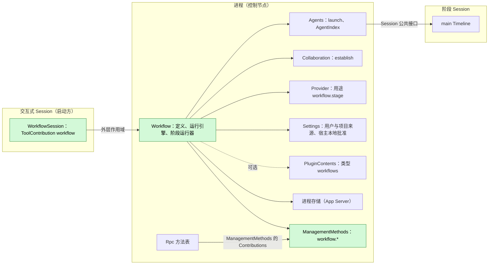
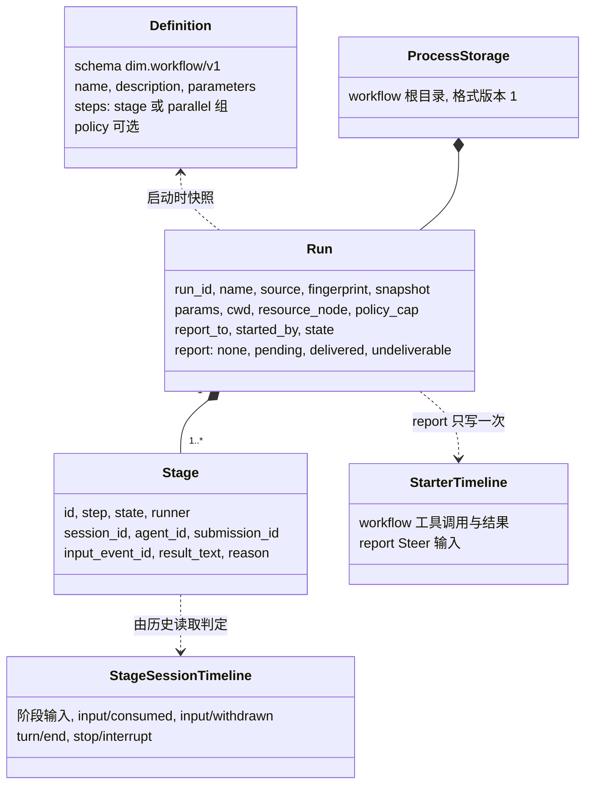
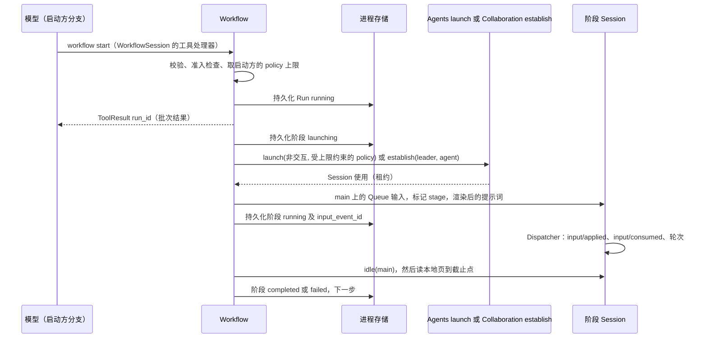
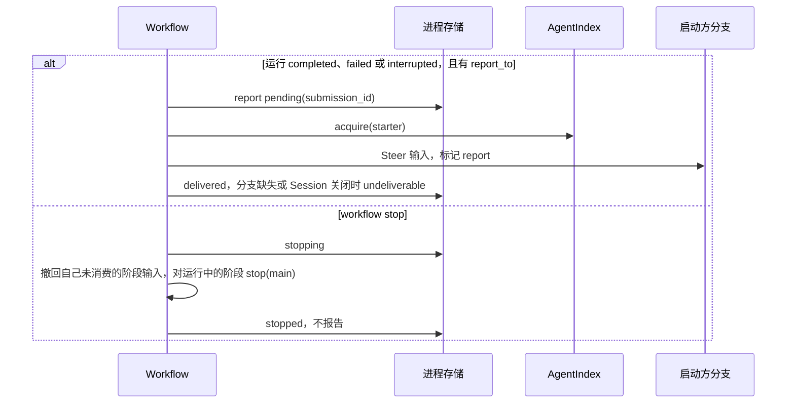
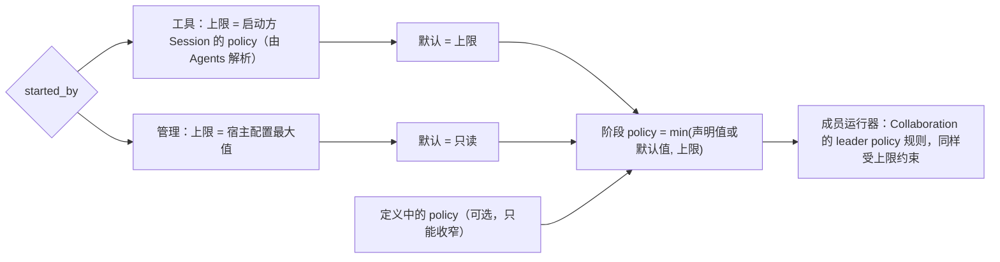
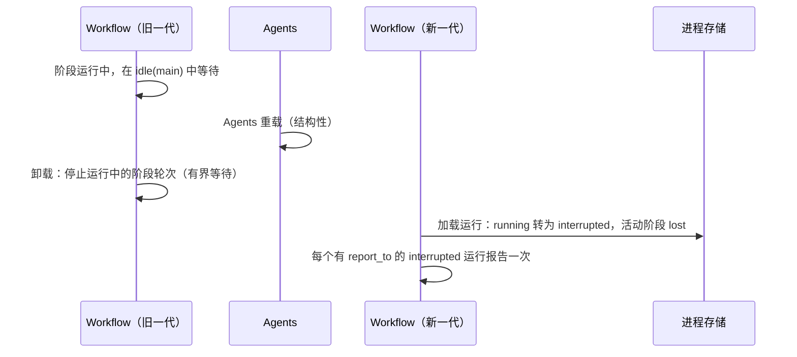

# Workflow

状态：草案。总体设计：[overview §B.9](../overview.md)；作用域：[ADR 002](../../adr/002-plugin-scope.md)（进程 + Session）。阶段：P2。语言：优先 TypeScript（[overview §F.3](../overview.md)）。

Workflow 拥有工作流定义和运行。一次运行推进一个固定的步骤列表；每个阶段在自己的 Session 中运行，要么是通过 Agents launch 的新非交互 Session，要么是用 Collaboration 的 `establish` 创建的启动方 Session 的 Collaboration 成员。进程部分拥有运行，并通过 Agents（`AgentIndex`）和 Session 公共接口（[session-access](../contracts/session-access.md)）访问 Session，与 Collaboration 的做法相同。Session 部分向交互式 Session 提供 `workflow` 工具；运维方使用管理级 `workflow.*` 方法。运行结束时，其结果以 Steer 输入向启动方分支报告一次。Workflow 不写自己的 Timeline 事件。

## 1. 结构



一次运行跨越多个 Session，因此运行属于进程（[ADR 002](../../adr/002-plugin-scope.md) D1）；工具由 Session 级 `ToolContribution` 提供（D2）。Session 部分依赖进程部分；进程部分依赖同一作用域的 Agents、Collaboration、Provider 和 Settings。依赖遵循作用域（D3）：Agents 或 Collaboration 重载会重载 Workflow，后者把其运行结算为 `interrupted`（A.6）；Workflow 重载会重载其 Session 部分，使它们的在途轮次失败。这些是少见的结构性事件，属于已接受并有文档记录的代价。定义编辑和批准属于业务配置（D4）：在使用时读取，从不重载。

| 部分 | 作用域 | 依赖 | 提供 |
| --- | --- | --- | --- |
| `Workflow` | 进程（控制节点） | Agents（带 `policy` 的 `launch`、`AgentIndex`）、Collaboration（`establish`）、Provider 模型选择、Settings 用户/项目来源与宿主本地批准服务、`PluginContents`（可选，类型 `workflows`）、App Server 进程存储 | 运行引擎；由 Rpc 收集的 `ManagementMethods` 条目 `workflow.*` |
| `WorkflowSession` | Session，Workflow 启用时安装 | `Workflow`、`S:SessionConfig` | Session 级 `ToolContribution` `workflow`，仅在 `interactive` 时贡献 |

**依赖的契约**：[session-access](../contracts/session-access.md)（带受启动方上限约束的 `policy` 的 Agents `launch`、`SessionConfig` 字段、带来源 raw 块的输入、历史读取、撤回）、Collaboration `establish(leader, agent)`（Collaboration 补充）、Provider 用途策略、Session 级 `ToolContribution`（[工具贡献](../../../architecture/rust-agent/tool-contributions.md)）、Rpc 方法表中的管理级方法（[session-boundary](../contracts/session-boundary.md)）、App Server 进程存储（R8）、Settings 来源与宿主本地批准服务（R11）。**本文定义的契约**：定义格式 `dim.workflow/v1`、`workflow` 工具、`workflow.*` 方法、来源名 `workflow`（标记类型 `stage` 和 `report`）、用途 key `workflow.stage`、内容类型 key `workflows`、运行记录。

## 2. 数据与状态



定义在每次调用时从其来源读取（A1），批准在每次检查时读取；运行存在于进程存储中，每次状态转换都在其守护的效果之前持久化。阶段进度由各阶段 Session 中的已有事实推导；只复制有界的结果文本。不从 Timeline 重建任何内容；Workflow 不拥有 `StateCell`，Session 部分不持有状态。

## 3. 流程

### 3.1 由工具启动并运行一个阶段



处理器持久化运行后立即返回；阶段推进在进程部分的任务跟踪器上运行。完成只依据阶段 Session 中截至 `idle` 截止点的事实判定。

### 3.2 报告与停止



所有者显式停止从不唤醒启动方（[事件驱动流程 §3](../../../architecture/rust-agent/event-driven-flows.md)）。任何重试前先按 `submission_id` 查找，保证至多一次报告。

### 3.3 阶段的 policy



运行从不扩大权限（E2）：`workflow` 工具与 Collaboration 的 `agent` 工具使用相同的风险类别准入，阶段 Session 从不超过启动方的 policy。

## 4. 时序与冲突



Workflow 自身重载、依赖（Agents、Collaboration）重载或重启都会把运行结算为 `interrupted`；不重新 launch 任何内容（E15）。重载是少见的结构性事件（D3），因此接受这一代价而不是去阻止它。

| 场景 | 序号顺序 | 结果 | 负责方 |
| --- | --- | --- | --- |
| 工具结果之后启动方轮次中断 | result < interrupt | 运行继续 | Workflow |
| 运行很快结束时工具批次尚未结算 | report < `step/tool-result` | Steer 在批次结果之后被消费；模型先看到 `run_id` | Loop |
| `workflow.stop` 与阶段自身的 `turn/end` 竞争 | `turn/end` < `stop/interrupt` | 阶段 `completed` 并带结果；运行 `stopped` | 阶段 Session 顺序 |
| 阶段输入在消费前被撤回（用户或 stop） | input < `input/withdrawn` | 阶段 `stopped`；从未被消费 | InputQueue、Workflow |
| Workflow、Agents 或 Collaboration 重载，或重启 | — | 运行 `interrupted`，活动阶段 `lost`，不重新 launch；各报告一次（E15） | Workflow |
| 成员阶段运行中 leader 分支关闭 | close < report | 成员阶段继续；报告 `undeliverable` | Workflow |

完整表格：附录 B。

## 5. 上下文映射

| 模型看到的内容 | 形式 | 位置 |
| --- | --- | --- |
| `workflow` 声明 | 已采用配置中的工具声明（仅交互式 Session） | 前缀中包含该配置的请求 |
| 启动、状态、停止 | `ToolResult.content`（文本，含 `run_id`） | 其批次的工具结果位置 |
| 报告 | 一个 raw 块 `<dim-workflow kind="report" run="..." status="...">`；正文：各阶段状态、最后一步结果的有界预览（A16）、获取完整结果的方式（`status`） | Steer 输入的消费位置；不带 key |
| 阶段任务（阶段 Session） | 标记 `<dim-workflow kind="stage" run="..." stage="...">`，随后是作为用户内容的渲染后提示词 | launch 的 Session 的首个输入，或成员 Session 的新输入 |

报告和阶段输入不带 key：压缩后只经由摘要保留；子分支只在其于切点前被消费时继承。阶段 Session 是非交互的（没有 `ask_user`，没有 `workflow` 工具），因此运行从不嵌套。模型从不看到未列出的定义、运行记录、日志、批准、指纹或诊断信息。

## 6. 接口（摘要）

| 接口 | 类型 | 用途 |
| --- | --- | --- |
| `workflow`（`list`、`start`、`status`、`stop`） | Session 级 `ToolContribution`，风险类别同 Collaboration 的 `agent` 工具 | 模型运行工作流 |
| `workflow.list/save/start/status/stop/approve/revoke` | 管理级方法（`ManagementMethods`） | 运维方管理定义和运行 |
| `/workflow`、`/workflow:save` | CLI | 调用管理方法 |
| Agents `launch`、Collaboration `establish` | 依赖 | 创建阶段 Session |
| `dim.workflow/v1` | 本文定义 | 定义格式（附录 A） |

## 7. 安全

项目和插件定义是可执行内容：`start` 和每次阶段 launch 都需要 Settings 宿主本地批准服务中的授权，记录为 `{owner: workflow, node, workspace, source, id: name, fingerprint}`，fingerprint = 对规范化定义文档计算的 SHA-256（R11）。授权只来自在服务 `management` 级别的入口上调用的 `workflow.approve`；工具、Timeline 事实、重放和 fork 从不授予授权。用户定义无需批准。阶段 policy 遵循 3.3，定义只能收窄它。成员阶段中发起的审批由 Collaboration 转发给 leader（E6），而不是由 Workflow 转发。阶段 Session 只使用自身资源节点的服务。参数和结果会成为阶段 Session 和报告所在 Session 的 Timeline 内容；定义不得携带凭据。

## 附录 A. 接口细节

### A.1 定义格式 `dim.workflow/v1`

YAML（A2）。文件：用户来源 `<dim home>/workflows/<name>.yaml`，项目来源 `<workspace>/.dimcode/workflows/<name>.yaml`（E11、A3）；包以 `PluginContents` 类型 `workflows` 发布相同的文档。

```yaml
schema: dim.workflow/v1
name: review-and-fix                 # [a-z0-9-]{1,64}; unique per source
description: Analyze, fix in parallel, summarize
policy: workspace_write              # optional; narrowing only
parameters:
  - { name: target, description: Path to review, required: true }
  - { name: style, default: concise }
steps:
  - stage: { id: analyze, prompt: "Analyze {{params.target}}." }
  - parallel:
      - { id: fix-a, agent: <agent id>, prompt: "Fix part A.\n{{stages.analyze.result}}" }
      - { id: fix-b, runner: member, prompt: "Fix part B.\n{{stages.analyze.result}}" }
  - stage: { id: summarize, model: { provider: p, model: m }, prompt: "Summarize: {{stages.fix-a.result}} {{stages.fix-b.result}}" }
```

| 字段 | 规则 |
| --- | --- |
| `steps` | 按顺序 1–32 步；一步是一个 `stage` 或由 2–8 个阶段组成的 `parallel` 组（A4） |
| `stage.id` | `[a-z0-9-]{1,32}`，在定义内唯一 |
| `stage.agent` | 可选 Agent id（原生或外部 profile）；默认：Agents 默认 Agent |
| `stage.runner` | `session`（默认）或 `member`；`member` 需要 `report_to` 和 Collaboration `establish` |
| `stage.model` | 可选；否则取 profile 的模型；再否则取 Provider 为用途 `workflow.stage` 选择的模型（A5） |
| `stage.prompt` | 模板，渲染后 ≤ 32 KiB（A6）；占位符 `{{params.<name>}}`、`{{stages.<id>.result}}` |
| `policy` | `read_only` \| `workspace_write` \| `full_access`；受上限约束（3.3） |
| 引用 | `stages.<id>` 必须指向更早步骤中的阶段；只做纯文本替换（A7） |
| 参数 | 字符串；缺少必填项或名称未知 → `invalid_parameters`；其余由默认值填充 |

校验发生在外部边界（文件读取、`workflow.save`、`start` 参数）；运行使用校验后的快照。

### A.2 工具 `workflow`

仅在 `SessionConfig` 为 `interactive: true` 的 Session 中由 `WorkflowSession` 贡献（A8）；处理器调用进程部分。风险：Collaboration 的 `agent` 工具所声明的类别（目前没有，因此未分类：ReadOnly 拒绝，WorkspaceWrite 询问，FullAccess 允许；E2）。

| 动作 | 参数 | `ToolResult.content` |
| --- | --- | --- |
| `list` | — | 调用方 cwd 可见的定义：名称、来源、描述、参数、批准状态 |
| `start` | `name`、`source?`（先 `project`，再 `user`，再 `plugin`）、`params` | `{"run_id", "status": "running", "stages": [...]}` 以及一句说明：结果将以报告输入到达 |
| `status` | `run_id` | 状态、各阶段状态、Session id、有界结果预览、最近日志条目 |
| `stop` | `run_id` | 传播完成后的最终状态 |

`start` 设置 `report_to = {session_id, branch_id}`，`cwd`/`resource_node` 取自调用方 Session 的 `SessionConfig`，`policy_cap` 取自启动方（由 Agents 解析）。错误：`definition_not_found`、`invalid_definition`、`invalid_parameters`、`approval_required`、`run_not_found`、`limit_exceeded`（A11）。

### A.3 管理方法

| 方法 | 参数 | 结果 | `mutating` |
| --- | --- | --- | --- |
| `workflow.list` | `cwd` | 定义及其来源、指纹、批准状态、问题 | 否 |
| `workflow.save` | `source: user\|project`、`cwd?`、`document` | `{name, fingerprint}`，经由 Settings 的来源写入（文件权威） | 是 |
| `workflow.start` | `name`、`source?`、`cwd`、`resource_node?`、`params`、`report_to?` | `{run_id}`；`policy_cap` = 宿主配置最大值，默认只读 | 是 |
| `workflow.status` | `run_id?` | 一个运行或最近的运行 | 否 |
| `workflow.stop` | `run_id` | 运行的最终状态 | 是 |
| `workflow.approve`、`workflow.revoke` | `name`、`source`、`cwd` | 绑定到节点 + 工作区 + 指纹的批准状态 | 是 |

已准入的调用在调用方断开后仍会完成。Workflow 重载期间，Rpc 回答 `service_reloading`；未启用时回答 `unknown_method`。

### A.4 运行记录

```text
Run { run_id, name, source: user|project|plugin, fingerprint, definition (snapshot),
      params, cwd, resource_node, policy_cap, report_to: Option<{session_id, branch_id}>,
      started_by: tool{session_id, branch_id, call_id} | management,
      state: running | stopping | completed | failed | stopped | interrupted,
      stages: [Stage], log: [LogEntry] (bounded, A9),
      report: none | pending{submission_id} | delivered | undeliverable{reason} }
Stage { id, step, runner, state: waiting | launching | running | completed | failed | stopped | skipped | lost,
        session_id?, agent_id?, submission_id?, input_event_id?, result_text?, reason? }
```

### A.5 依赖的契约

| 契约 | 所有者 | 用途 |
| --- | --- | --- |
| 带 `interactive: false`、`resource_node`、`policy` 的 `launch`；`created_by: Launch { source: "workflow" }` | Agents 补充（[session-access](../contracts/session-access.md)） | launch 的阶段；Workflow 自己写入首个输入 |
| `establish(leader_session_id, agent_id)` | Collaboration 补充 | 成员阶段；Collaboration 维持 Team 规则（单一 leader、`Busy`），应用 leader 的 cwd 和 policy，并把成员审批转发给 leader |
| 撤回自己的输入 | session-access（InputQueue） | stop 时撤回自己未消费的阶段输入 |

### A.6 Timeline 与 Capability 机制

| 步骤 | 路径 |
| --- | --- |
| 启动 | 处理器或管理调用进行校验、准入检查、解析 policy 上限，持久化 `Run{running}`，在进程部分的 `TaskTracker`（`ctx.effect`）上派生运行任务并返回。不写 Timeline |
| 阶段 launch | 在存储中复查（运行为 `running`；批准对快照指纹仍有效，A12）。持久化 `launching`；`launch` 或 `establish`；持久化 `session_id` 和 `submission_id = workflow:<uuid>` |
| 阶段输入 | 在 `main` 上 `Session::input`：标记 `{kind: "stage", attrs: [run, stage], body: definition name}`，渲染后的提示词，模式 Queue → `Timeline::append`；持久化 `running` 及 `input_event_id` |
| 消费 | 阶段 Session 的 InputQueue 和 Loop 在其 Dispatcher 上（`input/applied`、`input/consumed`），然后是轮次 |
| 完成 | `Session::idle("main")` 返回截止点 `C`；读取到 `C` 的本地页。在 `input/consumed{input_event_id}` 之前：出现 `input/withdrawn` 或随后的 `stop/interrupt` → `stopped`，否则再次等待。消费之后：`(consumed, C]` 中其后的首个 `turn/end` 决定 `completed`/`failed`/`stopped`；该轮次最后一条响应文本即为结果（Collaboration 的结果规则） |
| 推进 | 持久化阶段结果；一步中所有阶段都到达终态时，开始下一步或结束运行；失败的阶段会停止运行中的同组阶段并使运行失败（A4） |
| 报告 | 在 `completed`、`failed` 或 `interrupted` 且有 `report_to` 时：持久化 `pending{submission_id}`，`AgentIndex::acquire`，写带 `report` 标记的 Steer 输入；持久化 `delivered` 或 `undeliverable` |
| 停止 | 持久化 `stopping`；等待中的阶段记 `skipped`；撤回未消费的阶段输入；运行中的阶段 `Session::stop("main", "workflow stopped")`；由完成规则读取结果；运行 `stopped`，不报告 |
| 重载、重启 | Session 部分随 Workflow 重载；在途的 `workflow` 调用随其轮次失败。卸载时旧一代停止运行中的阶段轮次（有界等待，A13）。新一代加载运行：`running`/`stopping` → `interrupted`；`launching`/`running` 阶段 → `lost`；不重新 launch 任何内容。`pending` 报告先查找（已接受 → `delivered`，未知 → 此时写入）；有 `report_to` 且 `report: none` 的 interrupted 运行报告一次（E15） |

## 附录 B. 完整冲突表

| 场景 | 序号顺序 | 结果 | 负责方 |
| --- | --- | --- | --- |
| 调用派发前启动方中断 | interrupt < `step/tool-call` | 不执行；无运行 | ToolExecutor |
| 处理器运行时启动方中断 | `step/tool-start` < interrupt | 已持久化的运行继续；持久化前取消 → 无运行 | Workflow |
| 工具结果之后启动方中断 | result < interrupt | 运行继续 | Workflow |
| 启动方分支级中断或分支关闭 | close < report | 运行继续；报告 `undeliverable` | Workflow |
| 运行结束时工具批次尚未结算 | report < `step/tool-result` | Steer 在批次结果之后被消费 | Loop |
| 报告分支上并发 Steer/Queue | Timeline 顺序 | 按模式应用；报告是普通 Steer | InputQueue |
| 报告到达时启动方空闲 | — | Steer 启动一个轮次 | InputQueue、Loop |
| 用户撤回报告输入 | report < `input/withdrawn` | 报告计为 `delivered`；不重写 | InputQueue |
| 报告写入与消费之间发生压缩 | input < compaction < consumed | 放在摘要之后 | ContextPreparation |
| 报告写入与消费之间切出子分支 | input < cut < consumed | 子分支看不到它 | InputQueue（子分支） |
| 用户在消费前停止阶段 Session | input < interrupt | 阶段 `stopped`；除非被撤回，输入在该 Session 中保持待处理 | Workflow |
| 阶段输入被撤回 | input < `input/withdrawn` | 阶段 `stopped` | InputQueue、Workflow |
| `workflow.stop` 与阶段的 `turn/end` 竞争 | `turn/end` < `stop/interrupt` | 阶段 `completed`；运行 `stopped` | 阶段 Session 顺序 |
| `workflow.stop` 与消费竞争 | consumed < withdraw 请求 | 撤回被拒；走 `stop` 路径 | InputQueue、Workflow |
| 重复 `workflow.stop` 或结束后 stop | — | 幂等 | Workflow |
| 重复 `start` | — | 两个运行（A15） | Workflow |
| 成员阶段，leader 对同一成员发起 `request` | 阶段输入已排队、未开始 | 两个输入都在成员 Session 中排队；只有轮次运行后才出现 `Busy`；阶段结果是其自身输入被消费后的首个 `turn/end` | Collaboration、Workflow |
| 成员阶段期间 leader 分支关闭 | close < stage end | 成员阶段继续；报告 `undeliverable` | Workflow |
| 成员阶段期间 leader Session 关闭 | — | 成员被 Collaboration 关闭 → 阶段 `failed: session_closed`；运行 `failed` | Collaboration、Workflow |
| Agents 或 Collaboration 重载 | — | Workflow 重载；运行 `interrupted`，各报告一次 | Workflow |
| `workflow` 调用期间 Workflow 重载 | — | 调用方 Session 部分重载；该轮次失败（D3，已接受） | Loop |
| 阶段资源节点离线 | capabilities Pending | `launch` 到期失败 → `failed: node_unavailable`；运行中的阶段在 `idle` 中等待 | Agents、rutis 生命周期 |
| 轮次中阶段 Session Capability 重载 | 轮次以 `Failed` 结束 | 阶段 `failed` | 阶段 Loop |
| 报告时启动方 Session 已卸载 | — | `acquire` 恢复后写入 | AgentIndex |
| 运行中进程重启 | — | `interrupted`/`lost`；已提交但未消费的阶段输入留在各自 Session 中 | Workflow |
| 报告写入不确定（重载、发布未知） | — | 重试前查找；从不产生两次报告 | Workflow |
| 启动后项目定义被编辑 | — | 运行保留其快照；下次阶段 launch 复查快照指纹 → `failed: approval_revoked` | Workflow |
| 客户端断开 | — | 无影响 | — |

## 附录 C. 错误与恢复

| 情况 | 结果 |
| --- | --- |
| 定义文件无效 | 连同问题一起列出；`start` → `invalid_definition` |
| 批准缺失或过期 | 启动时 `approval_required`；后续 launch 时 `failed: approval_revoked` |
| 声明的 policy 高于上限 | 启动时 `invalid_definition` |
| `launch`/`establish` 失败 | 阶段 `failed`；运行 `failed` |
| 阶段轮次 `Failed`/`Cancelled` | 阶段 `failed`/`stopped`；运行 `failed`（A4） |
| 等待时 Session 关闭或分支缺失 | 阶段 `failed: session_closed` |
| 存储写入失败 | 运行任务在被守护的效果之前停止；下次加载时结算为 `interrupted` |

错误码即 A.2 的工具错误码；管理方法以 `app_error` 返回它们。

## 附录 D. 验收

通过工具、管理方法和 Session 历史读取：

1. 顺序和并行步骤；结果替换；保存时拒绝前向引用。
2. 工具启动返回 `run_id`；报告 Steer 结束一次 `wait`，并在批次结果之后到达。
3. 停止：等待中的阶段 `skipped`，未消费输入被撤回，运行中的阶段被中断，运行 `stopped`，不报告；重复停止幂等。
4. 停止与阶段 `turn/end` 竞争时保留已完成的结果。
5. 启动方轮次中断不停止运行；启动方分支关闭 → `undeliverable`。
6. `.dimcode/workflows/` 中的项目定义：未批准 → `approval_required`；批准；编辑 → 下一阶段 `approval_revoked`。
7. 重启、Workflow 重载和 Agents 重载：`interrupted`/`lost`，不重新 launch，恰好一次报告。
8. Policy：WorkspaceWrite 下由工具启动 → 阶段至多 WorkspaceWrite；管理启动 → 默认 ReadOnly；ReadOnly 下拒绝 `workflow`。
9. `member` 运行器：成员出现在 leader 的 Team 中；leader 请求与已排队阶段输入的竞争按附录 B 处理。
10. 非交互阶段 Session 没有 `workflow` 工具。

## 附录 E. 假设

| # | 假设 | 依据 | 若被否决的影响 |
| --- | --- | --- | --- |
| A1 | 定义每次调用时读取，不缓存 | 判断（文件权威） | 带变更检测的缓存 |
| A2 | YAML，带 `schema: dim.workflow/v1` | 判断 | 其他语法 |
| A3 | 用户目录 `<dim home>/workflows/` | 判断；overview §B.9 用户来源 | 路径由 Settings 决定 |
| A4 | 阶段或并行组（≤ 32 步，每组 ≤ 8）；快速失败 | 功能清单（"stages"）；上限为判断 | 按阶段的失败策略 |
| A5 | 模型优先级：stage > profile > 用途 `workflow.stage` | Overview §B.9；优先级为判断 | 其他优先级 |
| A6 | 渲染后提示词 ≤ 32 KiB；存储的结果 ≤ 64 KiB | 判断 | 其他上限 |
| A7 | 纯文本替换模板 | 判断 | 表达式需要沙箱 |
| A8 | 工具只给交互式 Session | 防止嵌套 | 需要深度限制 |
| A9 | 日志 ≤ 500 条；保留最近 100 次运行 | 判断 | 其他保留策略 |
| A11 | 4 个运行中的运行，每个运行 4 个并发阶段 | 判断 | 其他上限 |
| A12 | 每次阶段 launch 前复查批准 | MCP 先例 | 只在启动时检查 |
| A13 | 卸载时最多等待 10 秒让阶段停止 | 判断 | 其他上限 |
| A15 | `start` 不去重 | 判断 | 幂等 key |
| A16 | 报告预览 ≤ 4 KiB | 判断；`dim-agent-report` 先例 | 其他上限 |

已决定：工具风险与阶段 policy 上限（E2）、`.dimcode/`（E11）、重启后报告一次（E15）、成员审批由 Collaboration 转发（E6）、`establish`（decisions §2）、进程存储（R8）、撤回（R7）、宿主本地批准服务（R11）、作用域（[ADR 002](../../adr/002-plugin-scope.md)）。

## 附录 F. 待对齐问题

| 问题 | 说明 |
| --- | --- |
| Overview 方法列表 | Overview §B.9 列出 `workflow.list/save/start/status/stop`；本设计增加 `workflow.approve/revoke`（D11） |
| Launch 契约 | Agents 补充必须定义带 `policy` 的 `launch` 以及启动方 policy 的解析 |
